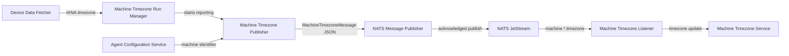
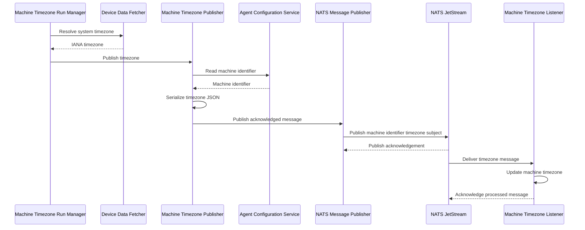
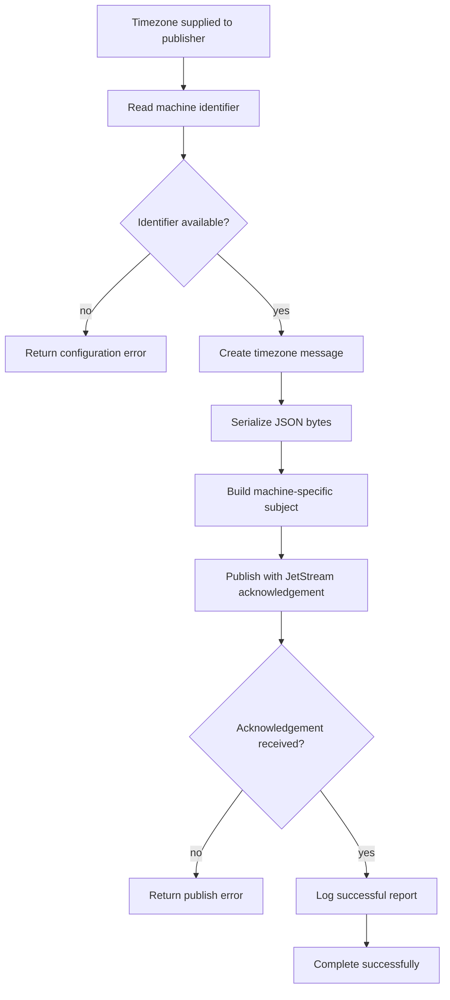

# Machine Timezone Publisher

Machine Timezone Publisher is the OpenFrame client-agent component that reports a machine's current IANA timezone to the platform. It is implemented by the `openframe_agent_lib` dependency from the OpenFrame OSS Library and runs as part of this repository's OpenFrame client. Its narrow responsibility is to turn an already-resolved timezone into a JSON event, address that event to the registered machine, and wait for JetStream to acknowledge publication.

The implementation is in the OpenFrame OSS Library: [machine timezone publisher source](https://github.com/flamingo-stack/openframe-oss-lib/blob/16e7c1cbd9664e7d10ec5ebca7d53c9bd314decf/clients/openframe-client/src/services/machine_timezone_publisher.rs).

## Responsibilities

- Obtain the stable machine identifier from the agent configuration.
- Construct a `MachineTimezoneMessage` containing a single `timezone` string.
- Serialize that message as JSON.
- Publish to the machine-specific NATS subject `machine.{machineId}.timezone`.
- Require a JetStream publish acknowledgement before treating the operation as successful.
- Emit an informational log that includes the reported timezone and destination subject.

The component does not detect the operating system timezone, schedule the reporting loop, persist a last-reported value, or update the platform data store. Those concerns belong to its collaborators.

## Architecture and Boundaries



### Local collaborators

| Component | Role in the flow |
|---|---|
| `MachineTimezoneRunManager` | Owns the publisher, device-data fetcher, and NATS connection manager. Its `start` method launches its work on Tokio; the publisher itself is not a scheduler. |
| `DeviceDataFetcher` | Resolves the system timezone through `iana_time_zone`. It returns no value when resolution fails and logs that failure. |
| `AgentConfigurationService` | Reads the registered machine identifier from agent configuration. A configuration read failure stops the publish attempt before an event is built. |
| `NatsMessagePublisher` | Acquires the current NATS client, creates a JetStream context, publishes bytes, and awaits the server acknowledgement. |
| `MachineTimezoneMessage` | Wire payload with one `timezone` field. |

### Platform-side consumer

The Java `MachineTimezoneListener`, supplied by the OpenFrame client service core library, subscribes to `machine.*.timezone` in the `MACHINE_TIMEZONE` stream. It extracts the machine identifier from the subject, deserializes the JSON body, and delegates valid nonblank timezones to `MachineTimezoneService`. It acknowledges successful updates and also acknowledges blank values without applying them. Parsing, subject-extraction, or service errors remain unacknowledged so JetStream can redeliver the message.

## Publication Data Flow



## Publication Process



## Message Contract

The subject scopes the event to the registered machine, while the payload carries only the observed timezone. The publisher uses the identifier exactly as returned by agent configuration.

| Item | Value or behavior |
|---|---|
| Subject | `machine.{machineId}.timezone` |
| Payload type | `MachineTimezoneMessage` |
| Payload field | `timezone` as a string |
| Encoding | JSON produced with `serde_json` |
| Delivery guarantee at publish boundary | The call waits for JetStream acknowledgement. A returned success therefore means JetStream acknowledged the publish, not that the platform listener has completed its database update. |

Conceptual payload:

```json
{
  "timezone": "America/New_York"
}
```

## Failure Semantics and Operations

Machine Timezone Publisher propagates failures to its caller rather than retrying locally:

1. Agent configuration cannot provide a machine identifier.
2. JSON serialization fails.
3. The NATS connection manager cannot provide a client.
4. JetStream rejects the publish or does not return an acknowledgement.

Timezone discovery is a separate earlier step. When `DeviceDataFetcher` cannot resolve the host timezone, it logs a warning and yields no timezone; no publisher invocation should be attempted for that observation. Conversely, a successful publisher call is only an acknowledgement of broker acceptance. The downstream listener controls processing acknowledgement and redelivery behavior.

For troubleshooting, correlate the client informational log containing the timezone and subject with JetStream stream activity and listener logs. Verify that agent configuration contains the expected machine identifier, that the NATS connection is available, and that the `MACHINE_TIMEZONE` consumer accepts the matching subject.

## Maintenance Notes

- Preserve the subject format: the consumer relies on `machine.*.timezone` and extracts the machine identifier from that position.
- Preserve the JSON field name `timezone` unless producer and consumer are changed together.
- Do not replace acknowledged publishing with fire-and-forget publication; callers currently receive broker-level failure feedback.
- Keep timezone collection independent of publishing. The publisher accepts a string and intentionally contains no platform-specific timezone detection logic.
- Treat a timezone value as machine inventory metadata. Validation of blank payloads and persistence behavior are enforced on the consuming service.
