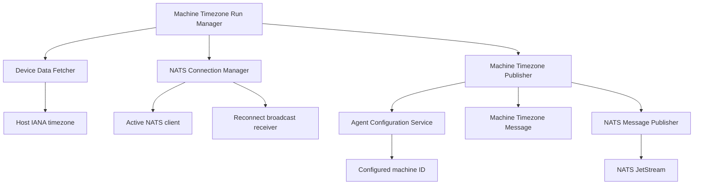
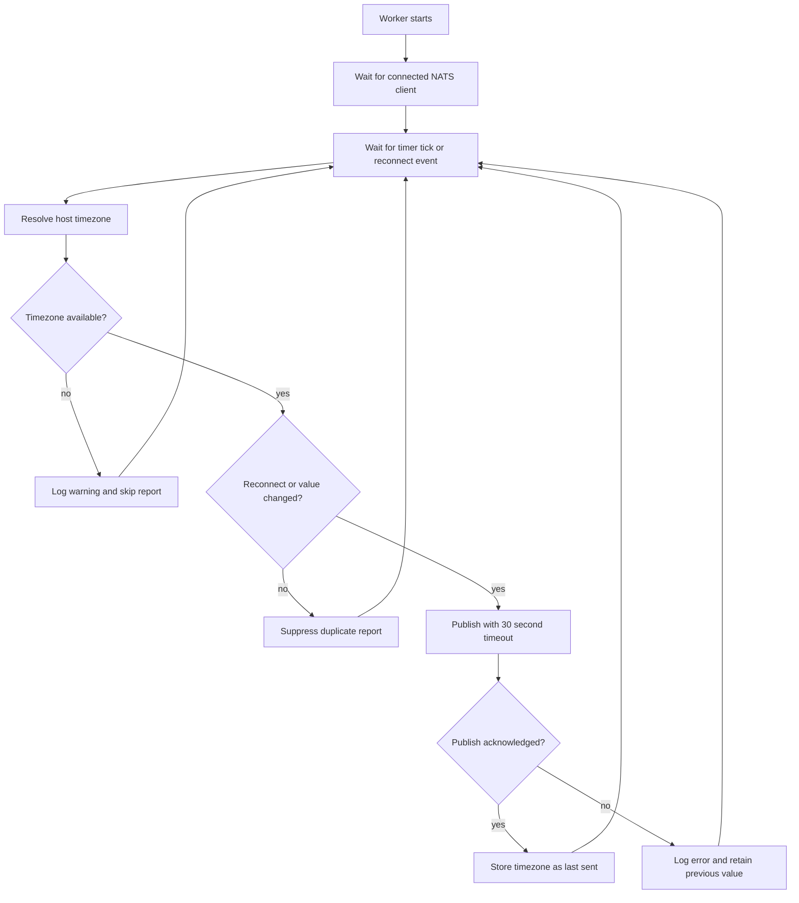
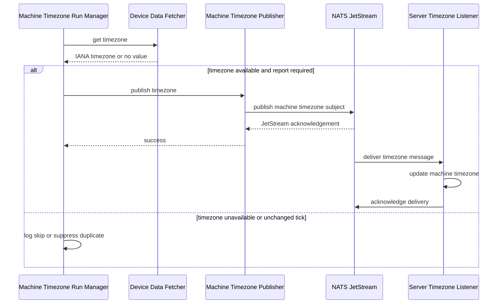

# Machine Timezone Run Manager

Machine Timezone Run Manager is an asynchronous OpenFrame client worker that keeps the platform informed of a managed machine's current IANA timezone. It waits for the client's NATS connection, reads the operating system timezone, and publishes a timezone report when the value changes, at the periodic reporting interval, or whenever the client reconnects.

The implementation is supplied by the `openframe_agent_lib` Cargo dependency from OpenFrame OSS Library and runs inside this repository's OpenFrame client deployment. Its core implementation is available in the [OpenFrame OSS Library source](https://github.com/flamingo-stack/openframe-oss-lib/blob/16e7c1cbd9664e7d10ec5ebca7d53c9bd314decf/clients/openframe-client/src/services/machine_timezone_run_manager.rs).

## Purpose and Scope

Accurate timezone data lets the server associate a device with its reported local timezone. The manager is deliberately narrow in scope:

- It orchestrates when timezone reports are attempted.
- It obtains the timezone through `DeviceDataFetcher`.
- It delegates message construction, machine identity lookup, serialization, and JetStream acknowledgement to `MachineTimezonePublisher`.
- It does not persist a timezone cache, alter the host timezone, or process inbound commands.

The in-memory `last_sent` value suppresses unchanged values on ordinary timer ticks. A client restart resets that value, so the new process reports again after it becomes connected.

## Runtime Placement

The OpenFrame client constructs and owns the manager as part of its application composition. During client startup, registration and authentication complete, the NATS connection is established, and the NATS watchdog starts before the client invokes `MachineTimezoneRunManager.start()`. Calling `start()` logs startup and spawns the manager's asynchronous loop; it does not block the remaining client startup sequence.

```mermaid
flowchart LR
    ClientStart["OpenFrame client startup"] --> NatsConnect["Connect to NATS"]
    NatsConnect --> Watchdog["Start NATS connection watchdog"]
    Watchdog --> TimezoneStart["Start Machine Timezone Run Manager"]
    TimezoneStart --> Worker["Background timezone worker"]
    Worker --> Publisher["Machine Timezone Publisher"]
    Publisher --> JetStream["NATS JetStream"]
    JetStream --> Listener["Server timezone listener"]
    Listener --> MachineService["Machine timezone service"]
```

On the server side, the Java `MachineTimezoneListener` consumes `machine.*.timezone` from the `MACHINE_TIMEZONE` stream. It extracts the machine identifier from the subject, deserializes the timezone message, ignores blank timezone values after acknowledging them, and otherwise updates the machine timezone before acknowledging the JetStream delivery. Exceptions are left unacknowledged so JetStream can redeliver them.

## Components and Responsibilities

| Component | Responsibility |
| --- | --- |
| `MachineTimezoneRunManager` | Coordinates connection readiness, periodic polling, reconnect notifications, duplicate suppression, publish timeout handling, and task termination when its reconnect channel closes. |
| `DeviceDataFetcher` | Resolves the operating system's IANA timezone using the client-side timezone provider. A resolution failure returns no value, causing the current reporting opportunity to be skipped. |
| `MachineTimezonePublisher` | Retrieves the configured machine ID, builds `MachineTimezoneMessage`, serializes it as JSON, and publishes with a JetStream acknowledgement requirement. |
| `NatsConnectionManager` | Exposes the active client and a broadcast subscription that signals successful reconnects after the initial connection. |
| `NatsMessagePublisher` | Performs JetStream publication and waits for the broker acknowledgement. |
| `MachineTimezoneMessage` | Wire payload containing the `timezone` string. |
| Server `MachineTimezoneListener` | Validates and applies reports on the server-side consumer. |

## Dependency Architecture

The manager has three constructor dependencies. All are value-owned and clonable, allowing `start()` to move a clone into the Tokio task while the owning client remains available for other runtime services.

### Construction

`MachineTimezoneRunManager.new(...)` receives a ready-to-use publisher, data fetcher, and connection manager. It performs no I/O and does not validate connection state. This separates dependency assembly from background execution.

### Startup and Connection Readiness

`start()` spawns `run()` onto Tokio. The worker first subscribes to reconnect notifications, then polls the connection manager every 500 milliseconds until it can obtain a client whose connection state is `Connected`. No timezone lookup or publish is attempted before this condition holds.

The NATS connection manager emits its reconnect broadcast only on a later `Connected` event, not the initial connection. Therefore, normal initial reporting comes from the interval-driven path after the readiness wait, while reconnect reporting is explicitly event-driven.

## Reporting Flow

After connection readiness, the manager creates a 300-second Tokio interval and initializes `last_sent` as empty. Tokio intervals yield an initial tick immediately, so a connected client normally attempts an initial report without waiting five minutes.

### Trigger Rules

| Trigger | Behavior |
| --- | --- |
| Initial interval tick | Attempts the first report after NATS is connected. |
| Five-minute interval tick | Reads the timezone and publishes only if it differs from the last successfully sent value. |
| Reconnect event | Reads and publishes even when the timezone matches `last_sent`, refreshing server state after reconnection. |
| Lagged reconnect receiver | Treats the receiver lag as a reconnect trigger, favoring a refresh instead of dropping the report opportunity. |
| Closed reconnect receiver | Logs an error and stops the worker permanently. |

### Publish Contract

`MachineTimezonePublisher.publish_timezone(...)` obtains the registered machine ID from agent configuration, serializes a payload shaped as `MachineTimezoneMessage`, and sends it to the subject `machine.{machineId}.timezone`. The underlying publisher creates a JetStream context and waits for the broker acknowledgement. The run manager applies an additional 30-second timeout around that operation.

A successful acknowledgement is the only outcome that updates `last_sent`. Publisher errors and timeouts are logged, but do not advance the cache. The next timer tick or reconnect therefore has another opportunity to send the current timezone.

## Failure Handling and Operational Semantics

The worker is resilient to transient reporting failures but intentionally has bounded behavior:

- **Unavailable connection at startup:** it remains in the 500-millisecond readiness loop until a connected client becomes available.
- **Timezone lookup failure:** it warns and skips the current trigger. No fallback value is generated.
- **Broker or serialization failure:** it logs the error and retains the last successful value, allowing a later trigger to retry.
- **Publish stall:** it logs a timeout after 30 seconds, indicating that NATS may be disconnected; the task continues.
- **Reconnect burst:** broadcast receiver lag is treated as a reason to publish rather than as a terminal error.
- **Reconnect channel closure:** it is considered terminal for this worker. The worker logs an error and returns.

Because the cache is memory-only, no local durable state needs migration or cleanup. This also means the module offers at-least-opportunity reporting rather than a durable outbox: failed reports are retried only through future interval or reconnect triggers.

## Maintenance Guidance

When changing this module, preserve the following behavioral boundaries:

1. Keep connection readiness ahead of the first report so the publisher is not used before NATS is usable.
2. Preserve reconnect-triggered publication even when the timezone is unchanged; this refreshes data after transport recovery.
3. Update `last_sent` only after the publisher completes successfully within the timeout.
4. Treat an unresolved timezone as non-fatal and avoid publishing an invented default.
5. Maintain the bounded publish timeout so a stalled transport does not permanently block the reporting loop.
6. Keep the subject and payload compatible with the server listener: the machine ID belongs in the subject and the JSON payload supplies a nonblank timezone string.

## Observability

The manager emits structured tracing at key lifecycle points:

| Level | Event |
| --- | --- |
| Info | The manager starts. |
| Warn | The local timezone cannot be resolved. |
| Error | Publishing fails, a report times out, or the reconnect channel closes. |

To diagnose stale timezone data, first confirm that the client authenticated and connected to NATS, then inspect client logs for timezone resolution, publish, or timeout failures. Next, verify the server-side timezone consumer is receiving messages on the machine timezone stream. The publisher logs the resolved timezone and destination subject only after a successful broker-acknowledged publish.
