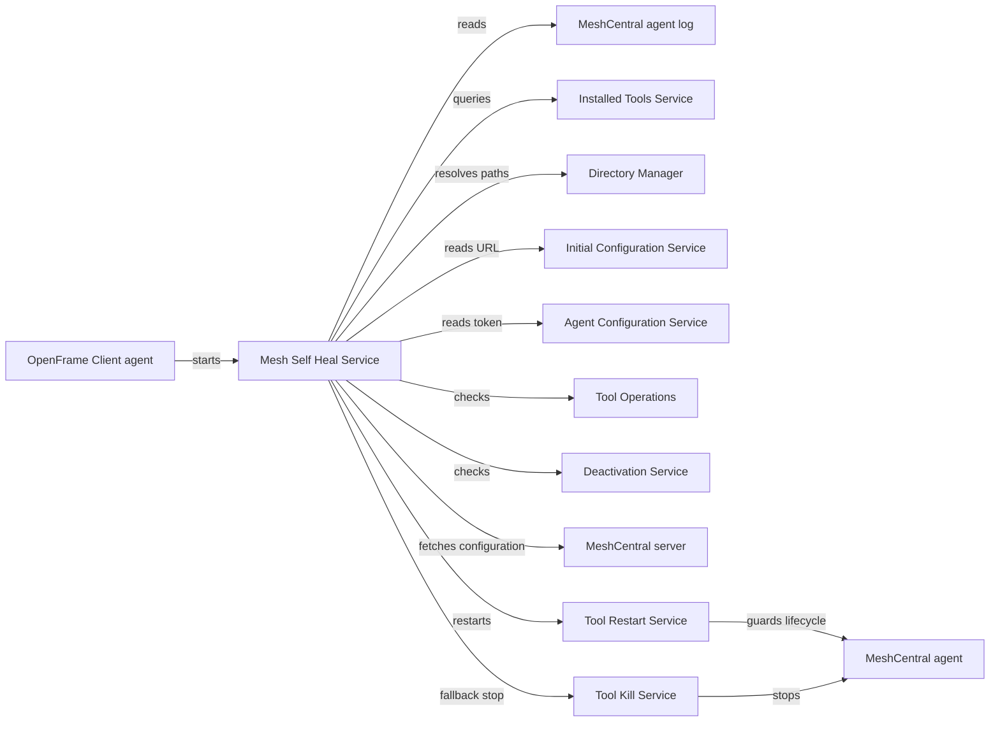
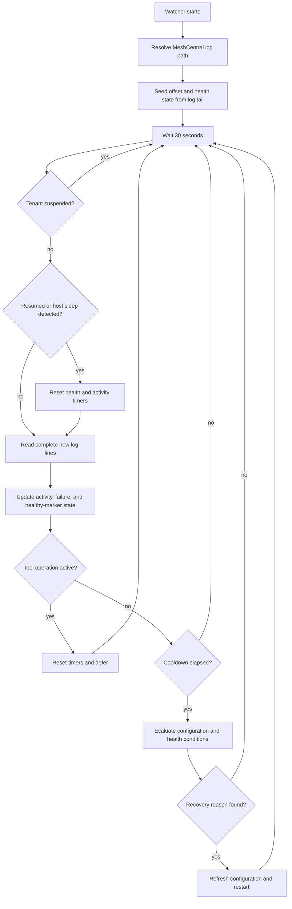
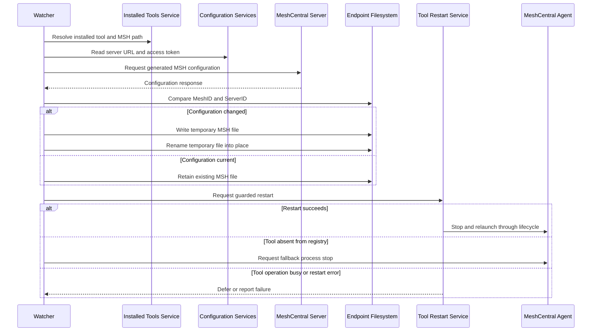
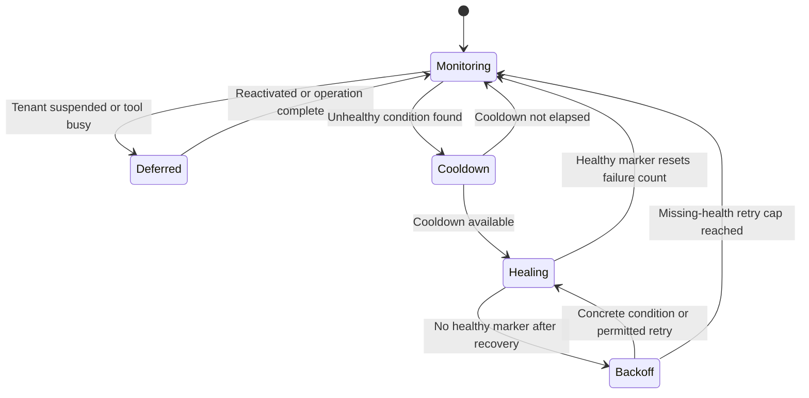

# Mesh Self Heal Service

Mesh Self Heal Service is an asynchronous endpoint watchdog for the MeshCentral remote-access agent. It observes the agent log and its `.msh` configuration, identifies conditions that show the agent cannot maintain an authenticated server session, refreshes configuration when necessary, and requests a controlled restart.

The module is supplied by the OpenFrame OSS Library `openframe_agent_lib` artifact, version `v0.0.5`. This repository assembles the OpenFrame Client that runs it on managed endpoints; it is not an inbound tenant-side HTTP service.

**Implementation source:** [Mesh Self Heal Service source in OpenFrame OSS Library](https://github.com/flamingo-stack/openframe-oss-lib/blob/16e7c1cbd9664e7d10ec5ebca7d53c9bd314decf/clients/openframe-client/src/services/mesh_self_heal_service.rs)

## Responsibilities

- Start and supervise a background watcher.
- Poll the MeshCentral agent log every 30 seconds, processing only complete new lines.
- Use compatible positive session markers and the stable `Connection FAILED` failure marker to assess connection health.
- Detect an installed agent whose `.msh` file is absent, unreadable, or lacks `ServerID`.
- Fetch current configuration using the configured server and the agent access token.
- Replace the `.msh` file only when its `MeshID` or `ServerID` changes.
- Restart through the shared guarded tool lifecycle, falling back to a process stop only when no installed-tool registry entry exists.
- Defer recovery during deactivation, tool operations, and cooldown periods.
- Bound retries based only on missing positive health, preventing a changed log format or server outage from creating a restart loop.

## Architecture

`MeshSelfHealService` is built from OpenFrame Client services. It owns no independent health database and exposes no route. Its dependencies provide endpoint paths, configuration, installed-tool state, lifecycle coordination, and tenant-deactivation boundaries.

| Component | Role |
|---|---|
| `MeshSelfHealService` | Holds the shared services, deactivation state, and HTTP client needed to monitor and recover the MeshCentral agent. |
| `new` | Receives endpoint path, tool registry, lifecycle, configuration, deactivation, and HTTP dependencies. Construction has no side effects. |
| `run` | Spawns the watcher and returns immediately. It catches watcher panics, logs unexpected exits, and respawns the watcher after 60 seconds. |
| `DirectoryManager` | Locates the application-support directory, executable location, agent log, and `.msh` paths. |
| `InstalledToolsService` | Determines whether `meshcentral-agent` is installed and supplies its recorded installation metadata. |
| `InitialConfigurationService` | Supplies the configured server host for configuration refresh. |
| `AgentConfigurationService` | Supplies the access token used as the bearer credential. |
| `ToolOps` | Identifies active operations so recovery cannot interfere with update or installation work. |
| `DeactivationService` | Suspends recovery while the tenant is deactivated. |
| `ToolRestartService` | Performs the normal guarded restart and reports restart, busy, or not-installed outcomes. |
| `ToolKillService` | Stops the process only as a fallback for the not-installed outcome. |

## Health Signals and State

The watcher requires positive proof of a server session rather than assuming that the absence of an error is healthy. It recognizes these markers:

- `Server fully authenticated`
- `Received CoreOk from server`
- `Server verified meshcore`

The first supports a fork-specific authentication message, while the latter two cover older and newer MeshCentral agent wording around core acknowledgment. Failure detection uses the stable `Connection FAILED` prefix. At startup, the service scans the final 64 KiB of the log to determine the last health marker, then begins incremental reads at end of file so stale history cannot repeatedly trigger recovery.

| Condition | Threshold or rule | Result |
|---|---|---|
| Unresolved connection failure | 10 minutes after failure evidence with no healthy marker | Refresh and restart. |
| Silent log | 90 minutes with no new content | Refresh and restart. |
| No positive session evidence | Three hours since the last healthy marker, or since watching began when none exists | Refresh and restart, subject to the absent-health retry cap. |
| Invalid current configuration | Installed agent has no `.msh`, cannot read it, or it lacks `ServerID` | Refresh and restart. |
| Tool operation active | `ToolOps` reports activity for `meshcentral-agent` | Reset timing state and defer recovery. |
| Tenant deactivated | `DeactivationService` is suspended | Pause recovery. |
| Host suspension | A polling sleep exceeds five normal poll intervals | Reset timers and begin a new grace period. |

The silence timer is seeded from log modification time with bounded credit. This allows a client restart to recognize an already-silent agent without trusting unlimited wall-clock age or firing immediately after boot.

## Watcher Process

Only newline-terminated content advances the byte offset. If the log truncates or rotates so its length is behind that offset, the offset returns to zero. A transient log-read error is debug logged and is not, by itself, a restart trigger.

## Recovery Data Flow

Every unhealthy branch enters the same recovery path. The service arms cooldown before beginning work, so a busy outcome, refresh error, or no-change result cannot spin the loop.

### Configuration Refresh

The service first searches the MeshCentral support directory for an existing `.msh` file. If none exists, it derives the imported configuration location from the recorded executable path by changing its extension to `.msh`. It resolves the destination before making a network request, so an uninstalled tool fails fast.

The refresh request uses the configured server host, sends the agent access token as a bearer credential, and has a 30-second HTTP timeout. A response must include at least `MeshID` or `ServerID`. The service compares those fields with current content and leaves the file unchanged when neither value differs.

When a rewrite is needed, it creates the parent directory if necessary, writes the response to a sibling temporary file, and renames that file into place. The rename prevents a concurrently launched agent from reading a partially written configuration. A refresh error does not suppress restart, because restarting can still recover a wedged process.

### Restart Semantics

The preferred path is the guarded restart service:

- **Restarted:** recovery is logged as successful.
- **Busy:** restart is intentionally skipped because another operation owns the tool.
- **Not installed:** the service asks the tool-kill service to stop the process so the operating-system supervisor can relaunch it.
- **Error:** recovery logs the failure and allows later attempts according to cooldown policy.

## Recovery Controls

- **Deactivation awareness:** suspended tenants do not accumulate unhealthy time. Reactivation resets activity, session, and failure timers.
- **Update awareness:** an active tool operation resets state, preventing stale pre-update logs from causing a post-update restart.
- **Cooldown and backoff:** the base wait is one hour. Consecutive attempts without a healthy marker double the wait, capped after three exponential shifts. A healthy marker clears the action timestamp and resets the failure count.
- **Absent-health cap:** after five recoveries without a healthy marker, missing healthy markers alone no longer cause recovery. Concrete reasons such as invalid configuration, persistent failures, and log silence remain independent triggers.
- **Watcher supervision:** a normal watcher exit or panic is reported and followed by a new watcher after 60 seconds.

## Operations and Maintenance

When recovery repeats, inspect endpoint evidence together:

1. The MeshCentral log for recognized healthy markers and `Connection FAILED` lines.
2. The `.msh` file for nonempty `ServerID` and expected `MeshID` values.
3. Tool lifecycle activity that can make `ToolOps` report the agent busy.
4. Tenant deactivation state, which intentionally suppresses recovery.
5. Restart outcome logs, distinguishing an intentional `Busy` skip from the fallback taken after `NotInstalled`.

A healthy reconnect clears pending failure state, clears the recorded recovery action, and resets the failed-heal count. An active agent that never emits a healthy marker can trigger limited recovery; after the cap, it requires operator investigation or reinstall rather than endless restarts.

When modifying this module, preserve positive-session marker semantics, line buffering, atomic file replacement, timeout behavior, guarded restart coordination, and the distinction between concrete failure signals and missing positive evidence. Extend tests when changing marker parsing, partial-line handling, configuration comparison, cooldown, suspension, or restart outcomes.

## Integration Boundaries

Mesh Self Heal Service belongs to the Rust OpenFrame Client implementation supplied by OpenFrame OSS Library. This repository assembles the broader platform and client deployment. The service communicates with MeshCentral only to refresh configuration and manages the local agent through shared lifecycle abstractions; it does not expose an inbound route or persist an independent health database.

Refer to the OpenFrame Client and platform documentation for client wiring, installation, updates, and broader remote-access workflows.

## Source and Ownership

The authoritative implementation is [Mesh Self Heal Service source in OpenFrame OSS Library](https://github.com/flamingo-stack/openframe-oss-lib/blob/16e7c1cbd9664e7d10ec5ebca7d53c9bd314decf/clients/openframe-client/src/services/mesh_self_heal_service.rs). The tenant repository that assembles the platform is [OpenFrame OSS Tenant](https://github.com/flamingo-stack/openframe-oss-tenant).