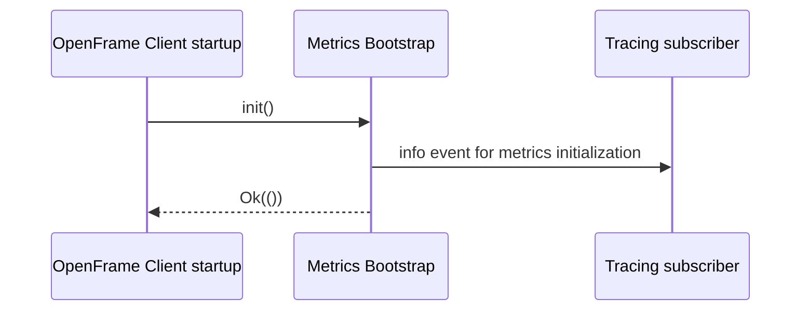
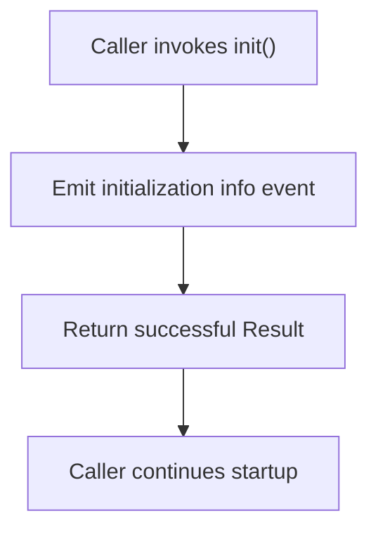

# Metrics Bootstrap

Metrics Bootstrap is the OpenFrame Client startup hook responsible for announcing that metrics collection is being initialized. It is implemented in the `openframe_agent_lib` dependency from OpenFrame OSS Library and is run by this repository's OpenFrame Client. The current implementation records one informational tracing event and completes successfully; it does not create a metrics exporter, start a collection loop, register instruments, or publish measurements.

## Scope and Source

| Item | Detail |
| --- | --- |
| Runtime owner | OpenFrame Client agent |
| Implementation artifact | `openframe_agent_lib` version `v0.0.5` |
| Implementation language | Rust |
| Public operation | `init() -> Result<()>` |
| Source | [metrics.rs in OpenFrame OSS Library](https://github.com/flamingo-stack/openframe-oss-lib/blob/7a766f00e4f58b5d89db007b878ac8d6e0c344f4/clients/openframe-client/src/metrics.rs) |

The module is intentionally small. Its role is to provide a stable initialization boundary: callers can invoke one fallible function during agent startup, while the implementation currently emits the `Initializing metrics collection` informational event and returns `Ok(())`.

## Architecture

Metrics Bootstrap depends only on `anyhow` for its `Result` return type and `tracing` for the `info!` event. It owns no durable state, configuration, network connection, scheduler, metric registry, or background task.

## Component Contract

### `init`

`init` is a synchronous, zero-argument initialization function.

| Behavior | Current implementation |
| --- | --- |
| Input | No parameters |
| Observability side effect | Emits an informational tracing event indicating metrics initialization |
| Success result | Returns `Ok(())` |
| Error production | None in the current function body |
| Persistent state | None |
| Network or agent-server communication | None |

Although the signature can report an error, no fallible work is presently performed. Callers should still propagate or handle the result rather than assuming the function will always remain infallible: the fallible boundary permits future initialization to validate configuration or initialize telemetry resources without changing the caller-facing API.

## Initialization Flow

The tracing event is the only emitted output of the current flow. Whether it becomes visible depends on logging initialization and the active tracing subscriber configured by the surrounding client process.

## Relationship to Client Observability

Metrics Bootstrap is separate from the client logging metrics implementation. The OpenFrame Client module tree also contains logging metrics types and recording operations, including counters, gauges, histograms, a metrics store, and a tracing layer. Those components are not invoked by `init` in its current implementation.

This separation matters when diagnosing observability behavior:

- A successful Metrics Bootstrap call confirms only that the bootstrap hook ran and its tracing statement was issued.
- It does not prove that metrics are being recorded, retained, exported, or shipped.
- Missing bootstrap output may indicate tracing configuration or startup ordering rather than a metrics-collection failure.
- Adding collectors or exporters belongs behind this initialization boundary, with explicit lifecycle and failure behavior.

## Data and Control Flow

No measurements cross a process boundary in this module. In particular, it does not send data to NATS, an HTTP endpoint, a log shipper, or a metrics backend.

## Operational Expectations

### Startup ordering

For the initialization message to be captured as intended, initialize the tracing subscriber before calling Metrics Bootstrap. The function itself does not configure logging and cannot ensure event delivery.

### Idempotence

The implementation has no mutable state and performs no registration. Repeated calls therefore repeat the informational event and return successfully. This is an observation about the current code, not a guarantee that future metric backend initialization will be safely repeatable.

### Failure handling

Current behavior has no failure branch. Preserve result handling at the call site so future versions can surface setup errors through the existing `Result<()>` contract.

## Maintenance Guidance

When extending Metrics Bootstrap, keep its boundary focused on startup-time telemetry setup:

1. Define what is initialized, such as a registry, exporter, collector, or periodic task.
2. Specify configuration ownership and validation, including safe treatment of endpoints and credentials.
3. Make lifecycle behavior explicit: one-time initialization, repeat invocation, shutdown, and background-task ownership.
4. Return contextual errors instead of silently disabling telemetry when setup is required for the selected mode.
5. Keep the initialization event, or replace it with equivalent structured observability, so startup diagnostics remain available.
6. Add tests for success, invalid configuration, disabled telemetry, and duplicate initialization once the function performs fallible work.

The current implementation has no module-local configuration surface and no testable output beyond the tracing event and successful result. Changes that add data transmission should document the destination, payload content, retry behavior, and privacy implications before deployment.
