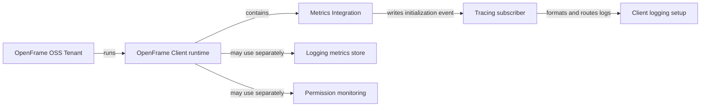
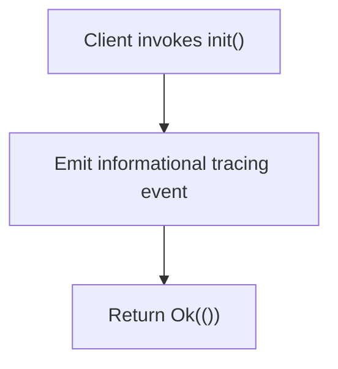
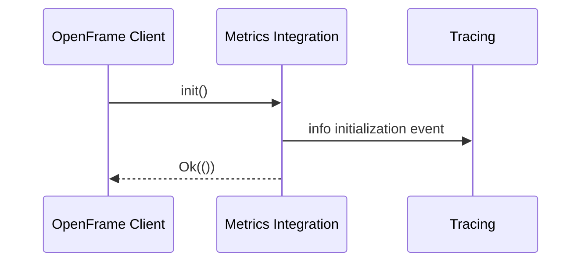
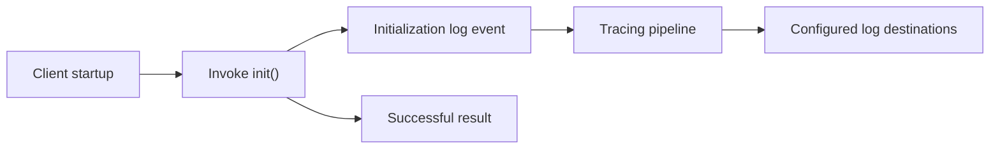

# Metrics Integration

Metrics Integration is the OpenFrame Client startup hook for metrics collection. It is implemented in the externally supplied `openframe_agent_lib` crate, which this repository consumes from OpenFrame OSS Library version `v0.0.5`. The implementation currently records an informational tracing event and returns successfully; it does not itself collect measurements, configure an exporter, expose an endpoint, or transmit data.

The source implementation is [`metrics.rs` in OpenFrame OSS Library](https://github.com/flamingo-stack/openframe-oss-lib/blob/16e7c1cbd9664e7d10ec5ebca7d53c9bd314decf/clients/openframe-client/src/metrics.rs).

## Scope and Responsibilities

The module provides one public function, `init()`.

| Responsibility | Behavior |
| --- | --- |
| Startup integration point | Gives the client application a single place to initialize metrics-related behavior. |
| Initialization visibility | Emits `Initializing metrics collection` through the `tracing` `info` level. |
| Error-compatible interface | Returns `anyhow::Result<()>`, allowing a future implementation to report initialization failures without changing the function's result shape. |
| Current collection behavior | No metric instruments, collectors, sinks, schedulers, endpoints, or configuration are created by the current implementation. |

Metrics Integration is deliberately small. It establishes the lifecycle boundary where metrics setup belongs while keeping the current client startup path non-failing.

## Position in the Client Architecture

The OpenFrame Client is provided by OpenFrame OSS Library and is run as part of this repository's tenant deployment. Metrics Integration belongs to that client-side runtime rather than to the Java services deployed by the tenant. The broader client contains separate logging metrics and permission-monitoring components, but this module's source does not call or configure them directly.

The arrows to logging metrics and permission monitoring describe neighboring client capabilities from the module tree, not calls made by `init()`. This distinction is important when investigating missing metrics: successful initialization of Metrics Integration only proves that its startup hook ran.

## Component Design

`init()` imports only `anyhow::Result` and `tracing::info`. Its control flow is linear:

No branch, retry, shared state, background task, or external I/O exists in the current function. Consequently, the function has no runtime dependency on a metrics backend and no initialization ordering requirement visible in its source beyond the availability of the tracing facade for the event to be observed.

## Initialization Sequence

The expected lifecycle is a caller invoking the hook during client startup. The module reports the attempt through tracing, then immediately completes.

Because `init()` returns `Ok(())` after the logging call, client startup continues from this module's perspective. The code shown provides no metric-registration result, no collector handle, and no shutdown operation for a caller to retain.

## Data Flow

The current data flow is limited to an application lifecycle message. It is not a telemetry-export path.

At present, the module does not produce counters, gauges, histograms, resource attributes, or a metrics payload. Any destination for the informational event is determined by the client's logging configuration rather than by Metrics Integration.

## Operational Implications

- A visible initialization event confirms that the hook was called and that the active tracing configuration accepted the `info` event. It does not confirm that metrics are being collected or exported.
- An absent event can result from the hook not being invoked, filtering of the `info` log level, or a logging destination that is unavailable. The module contains no fallback output mechanism.
- The current implementation has no settings to tune. The client configuration includes a `MetricsConfig` type in the wider application module, but this source does not read it.
- No network endpoint, credentials, persistence, queueing, or retry policy is configured here. Those concerns would need to be implemented by a future expansion or provided by another client component.

## Maintenance Guidance

When extending Metrics Integration, retain `init() -> Result<()>` as the startup contract unless all callers are updated together. A production implementation should make its ownership boundaries explicit:

1. Construct and register instruments or collectors during `init()`.
2. Read only configuration that the module actually owns.
3. Define where metric data is exported and how export failure affects startup.
4. Avoid claiming readiness merely because setup began; preserve the initialization event while adding events or errors that distinguish registration and exporter readiness.
5. Keep metric labels bounded and avoid placing device-specific, user-specific, token, or other high-cardinality values in labels.

A future implementation should also document its relationship with the existing logging metrics store and permission-monitoring metrics, so that telemetry is not recorded twice or emitted through competing pipelines.

## Verification

The current implementation can be verified at the source level by confirming two observable semantics:

- Calling `init()` produces an informational tracing event with the initialization message.
- The call resolves to `Ok(())` when the tracing call itself does not cause a process-level failure.

There is no module-local collector, exporter, or endpoint to query. Validate any actual metrics pipeline through the component that later adds collection or export behavior, together with the runtime logging configuration.