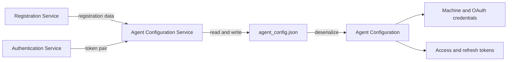
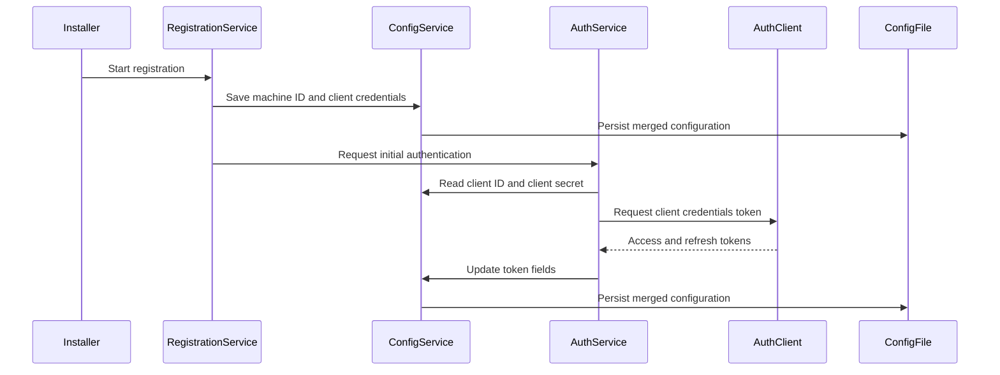

# Model Agent Config

Model Agent Config defines the persisted credential record used by the OpenFrame endpoint client. It is a Rust data model supplied by the `openframe_agent_lib` artifact from OpenFrame OSS Library and assembled at runtime by this repository's client deployment. The record binds a locally installed agent to its machine identity, OAuth client credentials, and current token pair.

**Implementation:** [agent_configuration.rs](https://github.com/flamingo-stack/openframe-oss-lib/blob/16e7c1cbd9664e7d10ec5ebca7d53c9bd314decf/clients/openframe-client/src/models/agent_configuration.rs)

## Responsibilities

`AgentConfiguration` is deliberately a small transport and persistence model. It provides:

- A stable, serializable representation of agent registration and authentication state.
- Fields for the platform-issued machine identity and OAuth client credentials.
- Fields for the short-lived access token and renewable refresh token.
- Cloneable, comparable values for service orchestration and tests.
- A default empty instance, allowing the configuration service to initialize a record before registration data and tokens are available.

It does **not** perform encryption, validate token expiry, make network requests, or manage file permissions. Those responsibilities reside in the surrounding client services and platform directory layer.

## Data Contract

The model derives `Serialize` and `Deserialize` without field-renaming attributes. Its serialized JSON therefore uses the Rust field names shown below.

| Field | Type | Role | Written by | Read by |
|---|---|---|---|---|
| `machine_id` | `String` | Identifier assigned to the endpoint machine during registration. | Registration flow | Configuration consumers needing the machine identity. |
| `client_id` | `String` | OAuth client identifier for the installed agent. | Registration flow | Initial and fallback client-credential authentication. |
| `client_secret` | `String` | OAuth client secret paired with `client_id`. | Registration flow | Initial and fallback client-credential authentication. |
| `access_token` | `String` | Current bearer access token. | Initial authentication and successful token refresh. | Components that need the active access token. |
| `refresh_token` | `String` | Token used to obtain a replacement access token. | Initial authentication and successful token refresh. | Reauthentication flow. |

All five fields are plain `String` values. The derived `Default` implementation initializes them to empty strings; an empty value is therefore an unconfigured or incomplete state rather than a validated credential value.

## Ownership and Persistence Boundary

The model is owned by the OpenFrame client library, while OpenFrame OSS Tenant consumes that library through the `openframe_agent_lib` Cargo dependency. The client-side `AgentConfigurationService` establishes the persistence boundary:

- It places the record in `agent_config.json` under the client `DirectoryManager` secured directory.
- It ensures the directory structure exists before use.
- It serializes concurrent read-modify-write operations with an asynchronous mutex so registration writes and token writes cannot overwrite one another's fields.
- Registration updates only `machine_id`, `client_id`, and `client_secret`.
- Authentication updates only `access_token` and `refresh_token`.

## Registration and Authentication Flow

The configuration becomes complete in stages. Registration receives durable identity and client credentials, then authentication obtains the renewable token state. The registration operation preserves existing token fields, while token updates preserve registration fields.

During later reauthentication, the authentication service first attempts the refresh-token grant. If that request fails, it falls back to the stored client ID and client secret. On a successful response, it persists both replacement tokens and makes the new access token available to the shared token service.

## Component Interactions

| Participant | Interaction with Model Agent Config |
|---|---|
| `AgentRegistrationService` | Saves the platform response's machine ID, client ID, and client secret after registration. It also persists a separate subset of machine information for reinstall handling. |
| `AgentConfigurationService` | Reads and writes the JSON record, exposes token and credential getters, and protects partial updates with a write lock. |
| `AgentAuthService` | Reads registered credentials for initial authentication, refreshes or reacquires tokens, and writes the resulting token pair. |
| `AuthClient` | Sends form-encoded requests to the client OAuth token endpoint using either client credentials or a refresh token. It returns an `AgentTokenResponse`; it does not directly persist Model Agent Config. |
| `SharedTokenService` | Receives newly authenticated token material from the authentication workflow for in-memory use. |

## Security and Operational Considerations

Model Agent Config contains authentication material and must be treated as secret-bearing state.

- Do not log, display, or include any field values in diagnostics, support bundles, or tests.
- Preserve the atomicity expectations of the configuration service. New writers must merge the latest record under its write lock rather than writing a partial independent representation.
- Keep registration credentials and token updates separate. Replacing the entire record from a stale in-memory copy can erase a newly refreshed token or newly registered identity.
- Handle empty default fields as not-yet-configured values. The model itself does not enforce registration completeness.
- Changes to field names, serde behavior, or required fields are persisted-data compatibility changes. Provide a migration path for existing `agent_config.json` files before changing the contract.

## Maintenance Guidance

When extending Model Agent Config, first determine whether the value is durable registration identity, renewable authentication state, or transient runtime state. Only durable data belongs in this model. Update the configuration service's read, save, and merge paths together, and ensure each producer preserves fields owned by other workflows.

The model's scope is intentionally narrow: it is the shared record at the junction of endpoint registration and agent authentication, not a general client settings object. Configuration unrelated to identity or credentials should remain in its owning configuration or service module.