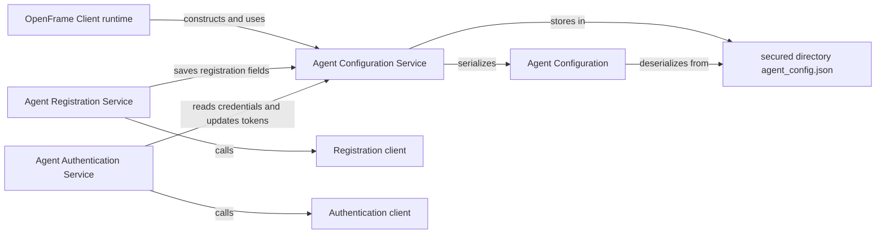
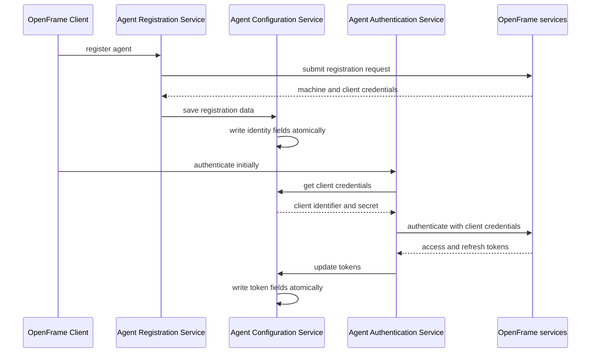
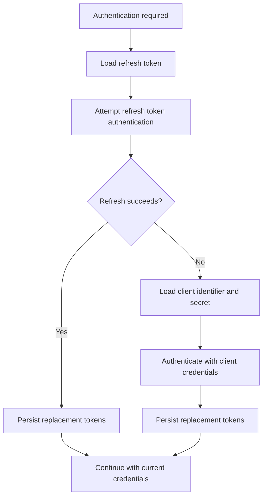

# Model Agent Config

Model Agent Config is the persisted credential model used by the OpenFrame endpoint client. It is a small Rust data contract from the `openframe_agent_lib` library, consumed at runtime by this repository’s OpenFrame Client service. It brings together the device identity, OAuth client credentials, and the current token pair required to register and authenticate an installed agent.

The implementation is defined in the OpenFrame OSS Library: [agent_configuration.rs](https://github.com/flamingo-stack/openframe-oss-lib/blob/7a766f00e4f58b5d89db007b878ac8d6e0c344f4/clients/openframe-client/src/models/agent_configuration.rs).

## Purpose and Scope

`AgentConfiguration` is a serializable, deserializable, cloneable Rust structure with a default value. Its five string fields form one persisted credential record:

| Field | Meaning | Written by | Read by |
|---|---|---|---|
| `machine_id` | Identifier for the enrolled device. | Agent registration | Registration credential lookup and machine identity lookup |
| `client_id` | OAuth client identifier assigned to the agent. | Agent registration | Initial and fallback client-credential authentication |
| `client_secret` | OAuth client secret assigned during registration. | Agent registration | Registration lookup and client-credential authentication |
| `access_token` | Current access token. | Initial authentication and token refresh | Authenticated client operations that need the stored token |
| `refresh_token` | Current refresh token. | Initial authentication and token refresh | Reauthentication, before the client-credential fallback |

The structure itself contains no validation, encryption, I/O, token-expiry calculation, or refresh policy. Those concerns are deliberately provided by the surrounding client services. Treat it as the stable payload at the boundary between credential lifecycle logic and secure local persistence.

## System Position

The tenant repository publishes the `openframe_client` Cargo package, while the model implementation is supplied by the OpenFrame OSS Library artifact. The OpenFrame Client assembles the model with configuration, registration, authentication, and secure-directory services.

### Ownership Boundaries

- **Model Agent Config** defines only the fields and Serde-compatible representation.
- **Agent Configuration Service** owns the `agent_config.json` location under the managed secured directory, reads the record, and serializes writes with an asynchronous mutex so independent read-modify-write operations do not overwrite each other.
- **Agent Registration Service** receives the machine and OAuth client identity from registration, then persists `machine_id`, `client_id`, and `client_secret`.
- **Agent Authentication Service** exchanges stored client credentials for tokens, tries refresh-token authentication during reauthentication, and persists replacement tokens.
- **The OpenFrame Client runtime** owns service construction and starts the broader agent workflow.

## Credential Lifecycle

A fresh enrollment creates the identity portion first, then establishes the token portion. Later authentication attempts preserve the same configuration record while replacing only the token fields.

### Reauthentication Flow

The fallback path means the configuration must retain both the refresh token and client credentials. A failed refresh does not by itself prevent recovery if the registered client credentials remain usable.

## Persistence Semantics

The configuration service initializes its file path as `agent_config.json` beneath the `DirectoryManager` secured directory and ensures the required directories exist during construction. Its write lock covers both registration-data updates and token updates. Each operation reads the current record, changes only its owned fields, and saves the resulting complete record.

This behavior is important because registration and token updates are logically separate operations:

1. Registration updates `machine_id`, `client_id`, and `client_secret`.
2. Authentication updates `access_token` and `refresh_token`.
3. Serialized read-modify-write prevents either update from discarding the other group of fields when concurrent tasks save configuration.

The default-derived model permits an empty in-memory value, but a default record is not evidence that an agent has been enrolled or authenticated. Callers should use the lifecycle services and their error handling rather than interpreting empty strings as valid credentials.

## Data Classification and Security Considerations

Every field in Model Agent Config is identity or credential material. In particular, `client_secret`, `access_token`, and `refresh_token` must be handled as secrets.

- Do not emit the complete structure, tokens, or client secret in logs, diagnostics, telemetry, command output, or support artifacts.
- Keep persistence within the configured secured directory and preserve the directory and file permission model supplied by the platform layer.
- Use the configuration service rather than writing the JSON file directly. Direct writes can bypass locking and lose fields written by another lifecycle step.
- Registration data and refresh data have different renewal behavior, but they share one file. Changes to serialization shape must therefore be backward-compatible with previously persisted records or be accompanied by an explicit migration strategy.
- Clearing or rotating credentials should be implemented as a coordinated lifecycle operation; this model has no intrinsic revocation behavior.

## Maintenance Guidance

When changing Model Agent Config, assess the whole producer-consumer path:

1. **Wire compatibility:** The type derives `Serialize` and `Deserialize`; a field rename, removal, or type change changes the on-disk JSON contract.
2. **Partial writes:** Preserve the separation between registration fields and token fields, and retain serialized updates in the configuration service.
3. **Authentication recovery:** Verify both refresh-token and client-credential paths still have the data they require.
4. **Secret hygiene:** Check debug logging and error reporting around callers, because the model’s derived `Debug` implementation can expose fields if logged indiscriminately.
5. **Fresh and existing installations:** Test first enrollment, restart with persisted credentials, successful token refresh, refresh failure with client-credential fallback, and malformed or unavailable persisted configuration.

## Related Runtime Components

The following components are part of the same OpenFrame Client module tree and define the behavior around this model. They are named here rather than linked because their documentation files were not generated with this module.

- **Agent Configuration Service** persists and retrieves the model fields.
- **Agent Registration Service** populates the identity and client credential fields after registration.
- **Agent Authentication Service** obtains and rotates access and refresh tokens.
- **Agent Registration Request**, **Agent Registration Response**, and **Agent Token Response** define the adjacent wire-level registration and authentication payloads.
- **Initial Configuration Service** supplies initial enrollment inputs, such as the registration key, to the registration process.
