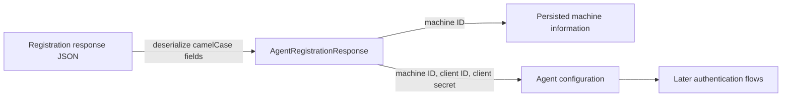
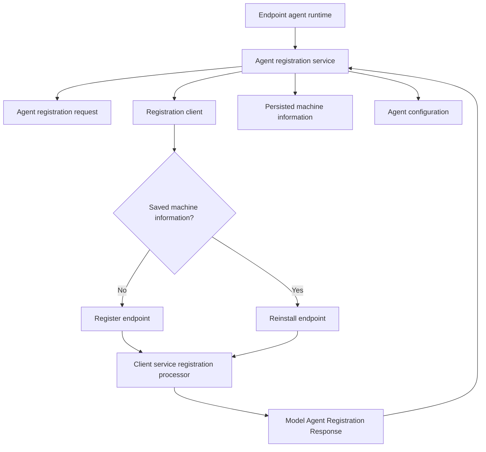
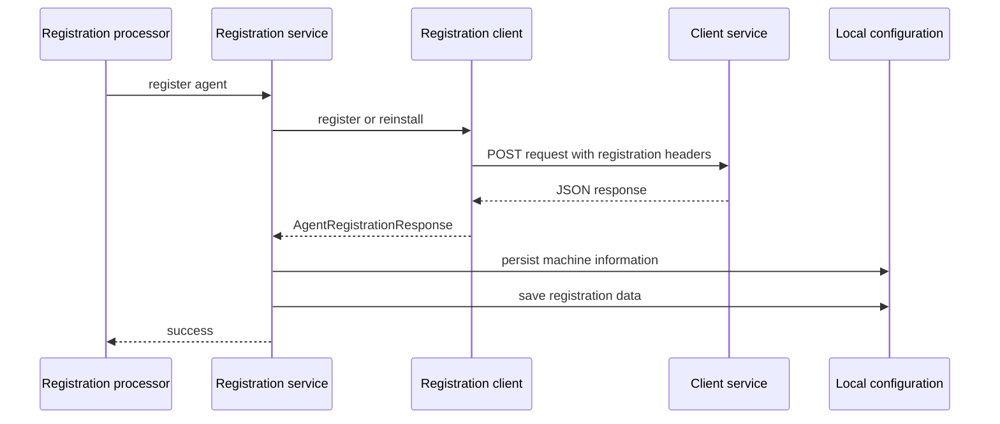
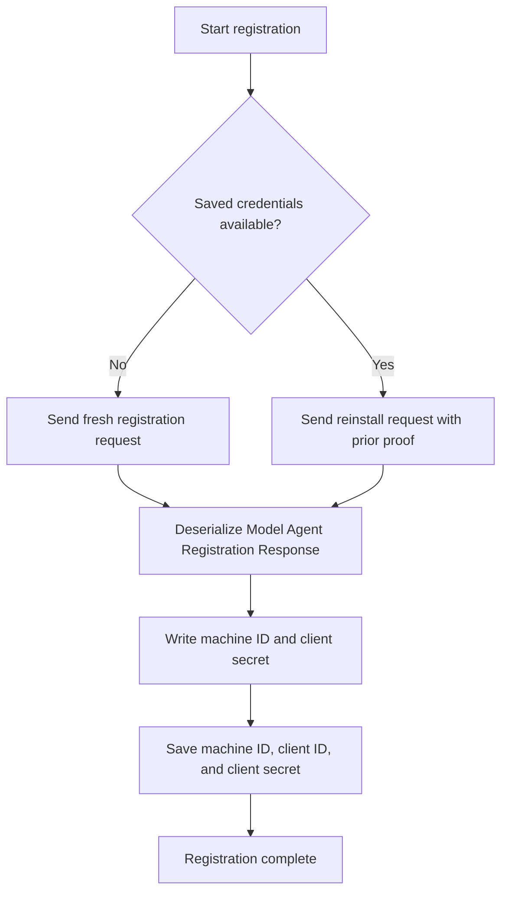
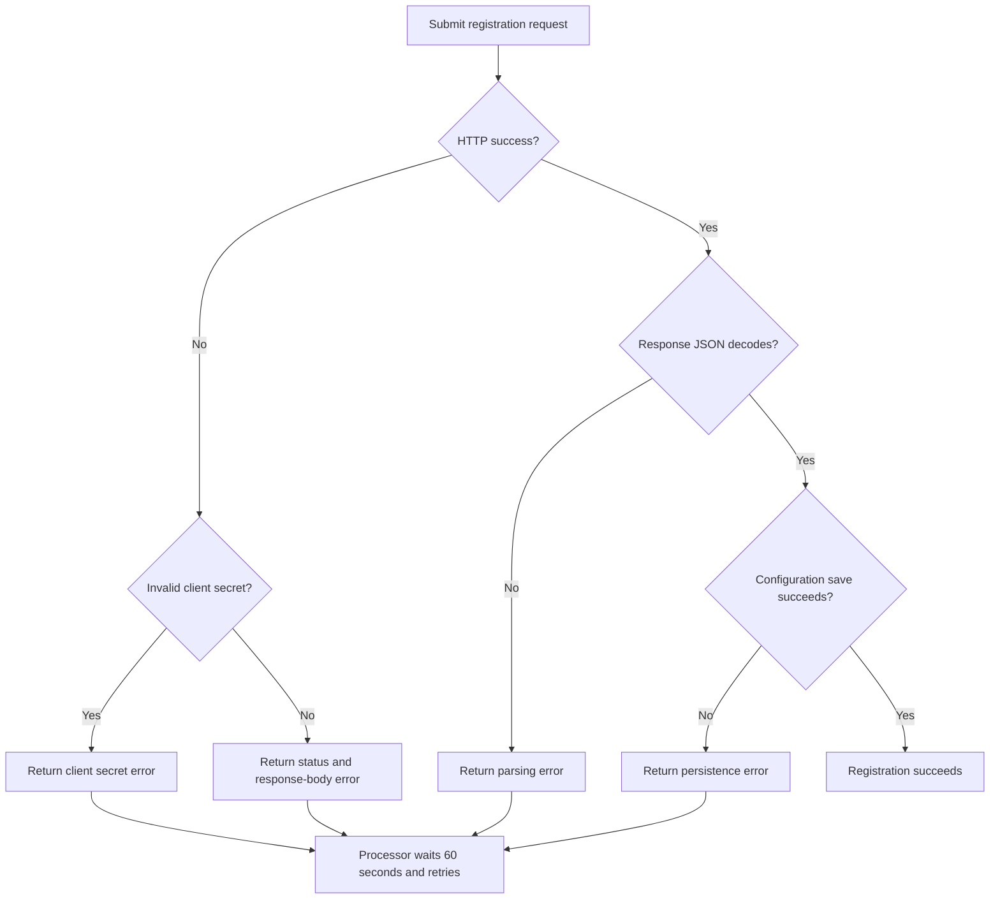

# Model Agent Registration Response

Model Agent Registration Response is the Rust data-transfer model returned after an OpenFrame endpoint agent registers or reinstalls with the client service. It carries the server-assigned machine identity and the OAuth-style client credentials that let the agent persist its registration state and participate in later authenticated operations.

The model is implemented by the `openframe_agent_lib` artifact supplied by [OpenFrame OSS Library](https://github.com/flamingo-stack/openframe-oss-lib/blob/7a766f00e4f58b5d89db007b878ac8d6e0c344f4/clients/openframe-client/src/models/agent_registration_response.rs). OpenFrame OSS Tenant consumes version `v0.0.5` of that Cargo artifact when running the endpoint client.

## Responsibility and Contract

`AgentRegistrationResponse` is a deserialization-only Rust struct. Serde applies `camelCase` naming to the complete type, mapping the JSON response properties to the Rust fields shown below.

| Rust field | JSON property | Meaning | Handling after receipt |
| --- | --- | --- | --- |
| `machine_id` | `machineId` | Stable server-side identity for the registered machine. | Persisted both as machine information and in the agent configuration. |
| `client_id` | `clientId` | Client identifier used by subsequent authentication flows. | Saved in the agent configuration. |
| `client_secret` | `clientSecret` | Secret paired with the client identifier and used for client authentication and reinstall proof. | Saved in agent configuration and persisted with machine information. Treat as sensitive. |

All three fields are required `String` values. There are no defaults, optional fields, validation helpers, or behavior on the model itself: malformed JSON or missing required properties causes response deserialization to fail in the registration client.

## Position in the Registration Architecture

The response is the boundary between the server-side registration endpoint and the endpoint agent runtime:

1. The agent gathers hostname, agent version, operating-system type, optional organization and user identifiers, and optional tags into an agent registration request.
2. The registration client selects a fresh-registration endpoint or a reinstall endpoint based on whether persisted machine information exists.
3. It sends the request with the initial key and, for reinstall, the previously persisted machine identity and client secret in headers.
4. On a successful HTTP response, the registration client deserializes the body into Model Agent Registration Response.
5. The agent registration service persists returned identity and credentials, then returns the same response to its caller.

The server implementation contains extension points for agent-registration processing. Its default processor performs no mutation beyond debug logging, so the response contract remains the authoritative hand-off to the endpoint client.

## Component Interaction

The response model has no methods and does not initiate network calls. Its consumers determine all operational behavior.

| Component | Relationship to Model Agent Registration Response | Key behavior |
| --- | --- | --- |
| Registration client | Produces the model. | Posts the agent registration request, rejects non-success HTTP statuses, and deserializes a successful body. A recognized invalid client-secret response becomes a dedicated registration error. |
| Agent registration service | Consumes and persists the model. | Chooses fresh registration or reinstall, writes machine ID and client secret to persisted machine information, then saves all three fields to configuration. |
| Registration processor | Coordinates registration retries. | Skips work if a machine ID is already configured; otherwise retries a failed registration attempt every 60 seconds until it succeeds. |
| Agent configuration service | Stores the returned registration state. | Serializes read-modify-write operations with a lock so concurrent configuration writes do not discard fields. |
| Authentication client and services | Indirect consumers through saved configuration. | Use the persisted client credentials in later authentication and token-refresh paths. |

## Fresh Registration and Reinstall Flow

The response has the same shape for both paths, but the request target and headers differ.

| Scenario | Endpoint selected by the registration client | Required identity material before the request | Response use |
| --- | --- | --- | --- |
| Fresh registration | `/clients/api/agents/register` | Initial key | Establishes the first local machine identity and client credentials. |
| Reinstall | `/clients/api/agents/reinstall` | Initial key, saved machine ID, and saved client secret | Replaces or confirms credentials while retaining the machine association supplied by the service. |

## Persistence and Security Considerations

- The registration service only writes configuration after it has received and decoded a successful response. A failure in deserialization or persistence prevents the registration attempt from completing successfully.
- The machine-information write is logged if it fails, while configuration persistence is propagated as an error. Maintainers should investigate either failure because future reinstall and authentication behavior depends on these values.
- `client_secret` is credential material. Do not add logging, telemetry, diagnostics, or user-facing representations that reveal it. The same applies to any serialized configuration or persisted machine-information file containing it.
- Registration requires a nonempty initial key. The service explicitly reports that an initial key cleared after a device obtains a log key cannot be reused for a later registration; a fresh installation command is required.
- The registration processor treats an existing configured machine ID as already registered and does not request a new response. Clear or alter persisted registration state only through a controlled lifecycle operation.

## Failure Behavior

## Maintenance Guidance

The response schema is a compatibility boundary shared by a Java client service and the Rust endpoint agent. Changes to field names, requiredness, or types must be coordinated across the server response producer and this Rust consumer. In particular:

- Preserve the struct-level camel-case mapping when the server continues to emit `machineId`, `clientId`, and `clientSecret`.
- Additive fields may be ignored by the current model, but newly required Rust fields make older server responses invalid.
- Renaming a field requires a deliberate Serde mapping and a coordinated server rollout.
- Test both fresh-registration and reinstall paths, including invalid credential responses, malformed response payloads, and configuration persistence failures.

For the broader client model hierarchy, see the OpenFrame client documentation. The neighboring registration request, token response, configuration, registration client, and agent-registration service modules define the request construction, transport, persistence, and follow-on authentication concerns that this response model supports.
