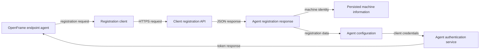
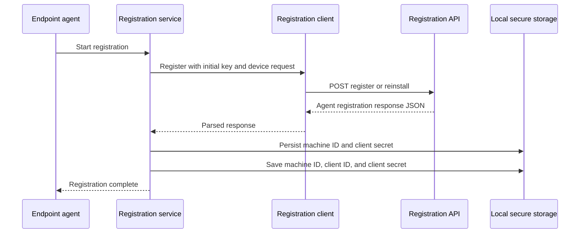
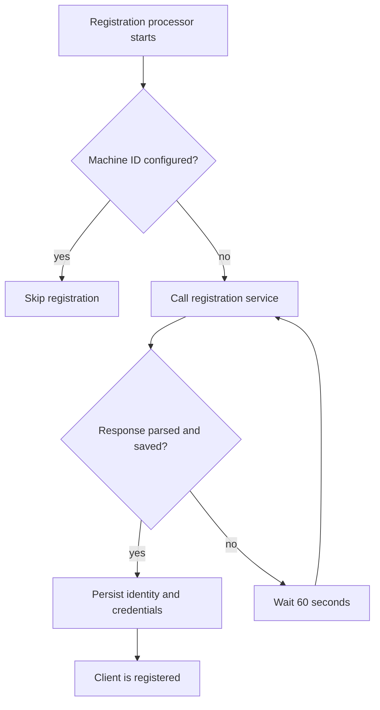

# Model Agent Registration Response

Model Agent Registration Response is the small, security-sensitive response contract returned after an OpenFrame endpoint agent registers or reinstalls. It belongs to the Rust `openframe_client` implementation supplied by the OpenFrame OSS Library and running in this repository's client service. The model carries the durable device identity and OAuth client credentials that let the agent transition from bootstrap enrollment to authenticated operation.

The implementation is defined in [the OpenFrame OSS Library source](https://github.com/flamingo-stack/openframe-oss-lib/blob/16e7c1cbd9664e7d10ec5ebca7d53c9bd314decf/clients/openframe-client/src/models/agent_registration_response.rs). This repository consumes `openframe_agent_lib` version `v0.0.5`; the response model is deserialized from the registration API payload rather than constructed as an independent domain object.

## Responsibility and Contract

`AgentRegistrationResponse` is a Rust struct derived with `Debug` and `Deserialize`. Its `serde` configuration applies `camelCase` JSON names to its snake case Rust fields.

| Rust field | JSON field | Meaning | Lifecycle use |
|---|---|---|---|
| `machine_id` | `machineId` | Server-assigned identity for the managed machine. | Marks the client as registered and identifies the machine on reinstall. |
| `client_id` | `clientId` | OAuth client identifier assigned to the agent. | Used with the client secret when the agent obtains tokens. |
| `client_secret` | `clientSecret` | Credential paired with the client identifier. | Persisted locally and also supplied for an authenticated reinstall request. |

All three fields are required strings at deserialization time. A successful HTTP response whose JSON omits a field or provides an incompatible value fails response parsing; the registration client returns that failure instead of silently accepting a partial registration.

```rust
#[derive(Debug, Deserialize)]
#[serde(rename_all = "camelCase")]
pub struct AgentRegistrationResponse {
    pub machine_id: String,
    pub client_id: String,
    pub client_secret: String,
}
```

## Position in the Registration Architecture

The response is the boundary between the remote registration API and local client state. A request contains host, agent version, operating system, and optional organization, user, and tag data. The response supplies the identity and credentials used by subsequent authentication and messaging workflows.



### Producing the Response

The registration client chooses its endpoint from the presence of persisted machine information:

- A first registration sends the registration request to the agent registration endpoint with the bootstrap initial key in `X-Initial-Key`.
- A reinstall sends the request to the reinstall endpoint with the same initial key plus `X-Client-Secret` and `X-Machine-Id` from persisted machine information.
- For either successful response, the client deserializes the JSON body directly into `AgentRegistrationResponse`.

The request and response are intentionally distinct models: the request reports endpoint facts and enrollment context, while the response establishes the server-issued identity and secrets.



## Processing and Persistence

The registration service obtains an `AgentRegistrationResponse` and performs two persistence operations:

1. It writes persisted machine information containing the response `machine_id` and `client_secret`; when known, it also retains the resolved user identity. This state enables the reinstall path on a future invocation.
2. It calls the agent configuration service to save all response fields: `machine_id`, `client_id`, and `client_secret`.

The registration processor protects this workflow from repeated enrollment. It first reads the configured machine ID; a nonempty value means registration has already completed. Otherwise, it retries registration every 60 seconds until it succeeds. This makes the response the state-change payload that ends bootstrap retry behavior.



## Authentication Handoff

The response does not contain access or refresh tokens. Instead, it gives the credentials that the authentication flow later exchanges for the separate agent token response, which contains an access token, refresh token, token type, and optional expiry. Keeping enrollment credentials separate from token material clarifies the transition between registration and ongoing authentication.

The agent configuration model stores both sets of information:

- Registration state: machine ID, client ID, and client secret.
- Token state: access token and refresh token.

Maintainers changing the response contract should preserve this handoff: registration persistence must complete before authentication attempts rely on the stored client credentials.

## Security and Maintenance Considerations

`client_secret` is credential material. Treat instances, serialized payloads, and diagnostics as sensitive:

- Do not add logging that prints the complete response, even though the struct derives `Debug`.
- Do not expose the response through user-facing diagnostics or telemetry.
- Preserve HTTPS transport and the initial-key header requirement in the registration client.
- Keep JSON property names stable unless both the registration API and all deployed agents are migrated together.
- Preserve the write ordering and error handling around configuration persistence. A response that cannot be saved must not be treated as a completed registration.

When extending the contract, add a Rust field and verify the corresponding camel case JSON field. If the new field is required, older servers will cause deserialization failures; if compatibility is required, represent the field as optional and define its fallback behavior explicitly.

## Failure Boundaries

The model itself validates structural compatibility through deserialization, while surrounding services handle operational failures:

| Boundary | Behavior |
|---|---|
| Non-success registration status | The registration client returns an error; a recognized invalid client-secret response becomes a dedicated client-secret error. |
| Invalid or incomplete JSON response | Deserialization into Model Agent Registration Response fails and registration returns an error. |
| Failed machine-information write | The registration service logs the persistence failure and continues to save the complete registration data through the configuration service. |
| Failed configuration save | Registration fails, so the processor retries rather than declaring the agent registered. |
| Existing configured machine ID | The processor does not invoke registration again. |

## Verification Checklist

Changes to Model Agent Registration Response should be validated across the enrollment boundary:

1. Confirm a fresh-registration response with `machineId`, `clientId`, and `clientSecret` deserializes successfully.
2. Confirm a reinstall response uses the same schema and can update persisted credentials.
3. Confirm missing required fields and malformed field types fail registration rather than yielding partial local state.
4. Confirm saved configuration includes all three response values and the authentication workflow can obtain tokens afterward.
5. Inspect test output and logs to ensure the client secret is never emitted.
