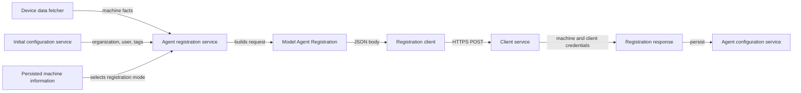
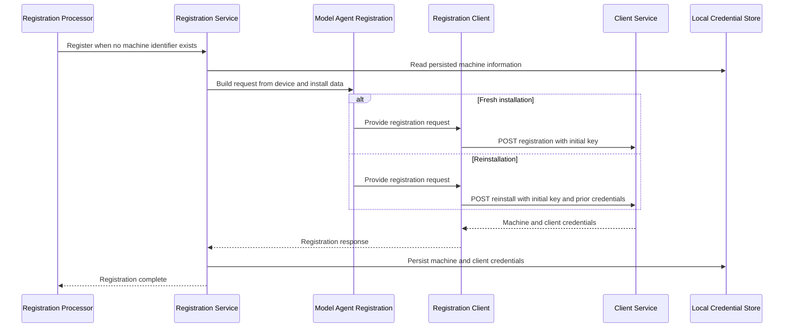

# Model Agent Registration

Model Agent Registration defines the outbound registration payload used by the OpenFrame endpoint client when a device first joins a tenant or re-registers after a prior installation. It is a small, serialization-only contract from the OpenFrame OSS Library's Rust client implementation, consumed at runtime by this repository's client deployment.

The payload carries machine identity and inventory context without owning registration policy, transport retries, credential storage, or server-side provisioning. Those responsibilities remain in the client services and the server components that receive the request.

## Purpose and Scope

`AgentRegistrationRequest` is a Rust structure serialized as JSON with camel-case property names. It provides the registration client with:

- Required machine facts: hostname, operating-system type, and agent version.
- Optional tenant context: organization identifier and user identifier.
- Optional device classification: a collection of keyed device tags, each with one or more values.

The model deliberately omits optional organization, user, and tag properties when their values are empty. This keeps an unscoped or tagless enrollment distinct from sending empty strings or an empty collection.

**Source:** [OpenFrame OSS Library implementation](https://github.com/flamingo-stack/openframe-oss-lib/blob/7a766f00e4f58b5d89db007b878ac8d6e0c344f4/clients/openframe-client/src/models/agent_registration_request.rs)

## Contract

| JSON property | Rust field | Required | Description | Serialization behavior |
|---|---|---:|---|---|
| `hostname` | `hostname` | Yes | Device hostname collected by the endpoint client. | Always included. |
| `agentVersion` | `agent_version` | Yes | Version reported by the installed endpoint agent. | Always included. |
| `organizationId` | `organization_id` | No | Tenant organization context supplied during installation. | Omitted when the string is empty. |
| `userId` | `user_id` | No | Optional user context for the installation or reinstallation. | Omitted when the string is empty. |
| `osType` | `os_type` | Yes | Operating-system type detected by the endpoint client. | Always included. |
| `tags` | `tags` | No | Device tags represented as key and values records. | Omitted when the collection is empty. |

Each tag is a `DeviceTag` value containing a `key` and a `values` collection. Command-line tag input is normalized by the device-tag parser: it accepts key-value pairs, trims whitespace, discards entries with an empty key or value, and groups repeated keys into one tag with multiple values.

### Example Payloads

A fully contextual enrollment serializes to the following JSON shape:

```json
{
  "hostname": "workstation-17",
  "agentVersion": "0.1.0",
  "organizationId": "organization-42",
  "userId": "user-9",
  "osType": "windows",
  "tags": [
    {
      "key": "site",
      "values": ["london"]
    },
    {
      "key": "role",
      "values": ["engineering", "managed"]
    }
  ]
}
```

If organization context, user context, and tags are unavailable, only required properties are encoded:

```json
{
  "hostname": "workstation-17",
  "agentVersion": "0.1.0",
  "osType": "windows"
}
```

## Architecture and Relationships

The model is assembled in the endpoint client rather than directly by service startup code. The registration service gathers device facts and initial installation configuration, then supplies the finished request to the registration client. The registration client sends it to either the fresh-registration endpoint or the reinstallation endpoint, depending on whether persisted machine credentials exist.



### Boundaries

| Concern | Owning component | Model role |
|---|---|---|
| Fact collection | Device data fetcher | Supplies hostname, agent version, and operating-system type. |
| Installation inputs | Initial configuration service | Supplies organization, user, and tag values. |
| Request transport | Registration client | Converts the model into an HTTP JSON request and attaches registration headers. |
| Registration lifecycle | Agent registration service and registration processor | Selects fresh or reinstall behavior, retries failures, and persists the successful response. |
| Credential persistence | Agent configuration service and machine information persistence | Stores the machine identifier, client identifier, and client secret returned by the server. |

## Registration Data Flow

The same payload model is used in both registration paths. The path selection changes the destination and headers, not the body contract.



At startup, the registration processor first checks the stored machine identifier in agent configuration. If one is already present, it does not create a request. Otherwise it attempts registration repeatedly, waiting 60 seconds after an error. The registration service requires a nonempty initial key; that key is cleared after the device holds a log key, so a later registration requires a new installation command.

## HTTP Interaction

The registration client serializes the model as an application JSON request and selects an endpoint based on persisted machine information:

| Situation | Destination path | Authentication and identity headers |
|---|---|---|
| Fresh installation | `/clients/api/agents/register` | Initial key header. |
| Reinstallation | `/clients/api/agents/reinstall` | Initial key header, client-secret header, and machine-identifier header. |

A successful response provides a machine identifier, client identifier, and client secret. On failure, the transport reports the status and response body. A recognized invalid-client-secret response is surfaced as a dedicated registration error.

## Serialization and Compatibility Rules

1. Keep the JSON property names camel case. The model-level serialization setting controls this mapping from Rust field names.
2. Do not replace omitted optional properties with empty values. Empty organization and user strings, and an empty tag collection, are intentionally skipped during serialization.
3. Preserve required device facts. `hostname`, `agentVersion`, and `osType` are always sent, even though this model does not validate their content itself.
4. Treat tags as structured metadata. A tag key may map to multiple values; consumers must not assume one value per key.
5. Avoid adding credential material to this request. The initial key and, for reinstallations, prior credentials are transmitted as headers by the registration client rather than as JSON fields.

## Maintenance Guidance

Changes to this model are wire-contract changes because the endpoint client serializes it directly for the client service. When modifying it:

- Update the registration client and server-side registration processor together if an added field requires new behavior.
- Preserve omission semantics unless the server contract explicitly requires empty values.
- Add serialization tests for property casing and optional-field omission.
- Test both fresh installation and reinstallation, since both use the same model with different headers and destinations.
- Review tag parsing behavior when changing tag representation, especially repeated keys and malformed command-line values.

The repository consumes this client implementation from the OpenFrame OSS Library as the `openframe_agent_lib` Cargo dependency, pinned at version `v0.0.5` in the generated ecosystem inventory.