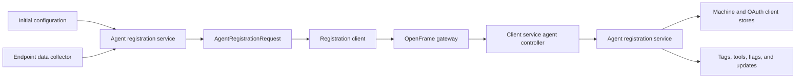
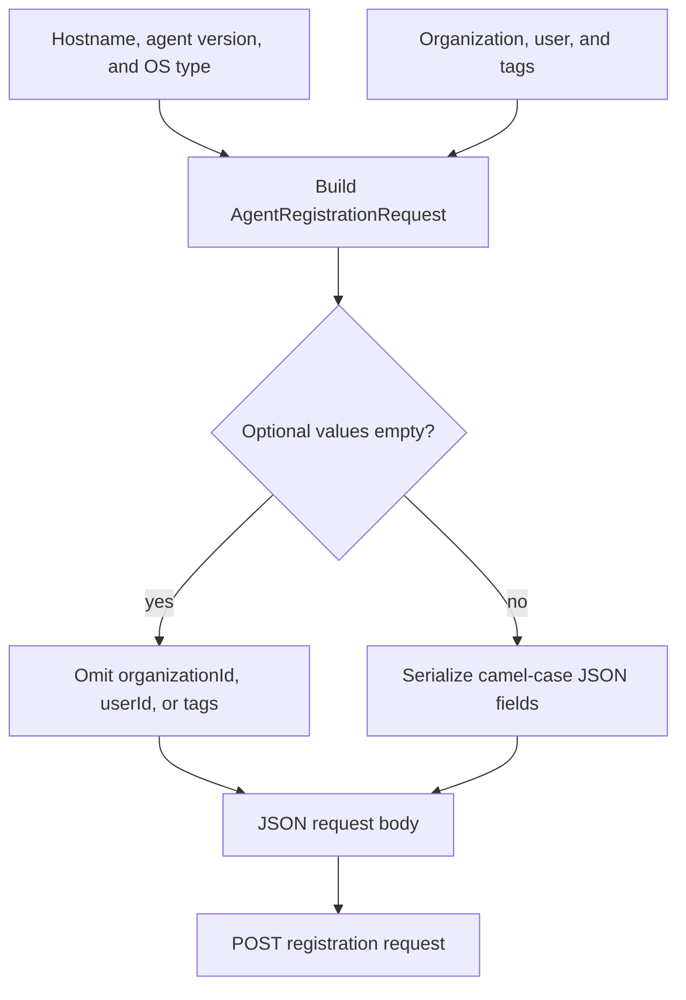
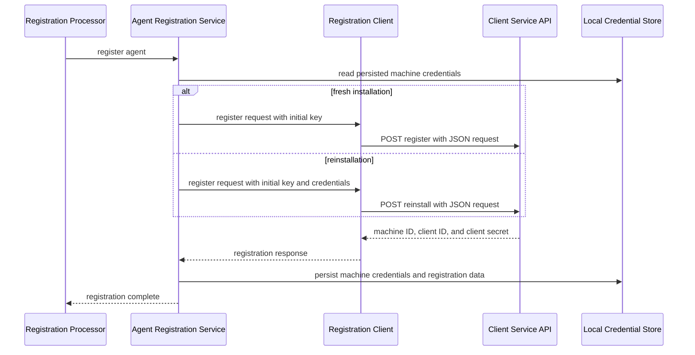
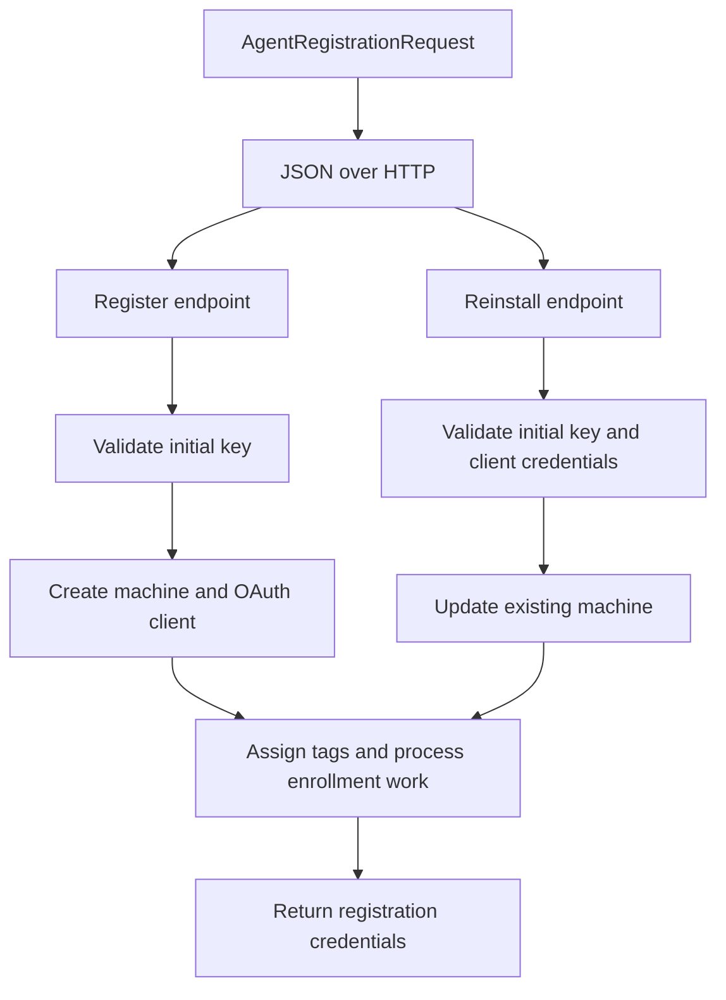

# Model Agent Registration

Model Agent Registration defines the Rust `AgentRegistrationRequest` payload used by the OpenFrame Client to enroll a managed endpoint or re-enroll a previously known endpoint. It is implemented by the `openframe_agent_lib` dependency from [OpenFrame OSS Library](https://github.com/flamingo-stack/openframe-oss-lib/blob/16e7c1cbd9664e7d10ec5ebca7d53c9bd314decf/clients/openframe-client/src/models/agent_registration_request.rs), consumed at version `v0.0.5` by this repository.

The model carries the minimum endpoint identity and inventory facts required by the registration API: hostname, agent version, operating-system type, optional organization and installer identity, and optional tags. It is a request-only transport type: it serializes to JSON but does not define deserialization, validation, persistence, authentication, or retry behavior.

## Responsibility and Contract

`AgentRegistrationRequest` is a public Rust structure with camel-case JSON field names. The structure has six fields:

| Rust field | JSON field | Required in Rust payload | Serialization behavior | Purpose |
|---|---|---:|---|---|
| `hostname` | `hostname` | Yes | Always included | Endpoint host name. |
| `agent_version` | `agentVersion` | Yes | Always included | Version of the installed OpenFrame Client. |
| `organization_id` | `organizationId` | Yes as a Rust field | Omitted when empty | Organization context, when supplied by initial configuration. |
| `user_id` | `userId` | Yes as a Rust field | Omitted when empty | Optional installer identity. |
| `os_type` | `osType` | Yes | Always included | Operating-system type reported by the endpoint. |
| `tags` | `tags` | Yes as a Rust field | Omitted when empty | Tags to create or assign at registration time. |

The Rust representation deliberately uses concrete `String` and `Vec` types. Optional wire values are represented by empty values and excluded with `skip_serializing_if`, rather than by Rust `Option` types. `DeviceTag` supplies each tag's `key` and a collection of `values`.

> The receiving Java API validates `hostname`, `organizationId`, `agentVersion`, and `osType` as nonblank for its current contract. Since this client model omits an empty `organizationId`, a successful request requires installation configuration to provide a nonempty organization identifier.

## Architecture

The model belongs to the Rust OpenFrame Client library, while the tenant deployment hosts the Java client service that accepts registration requests. The client library is brought into this repository as the `openframe_agent_lib` Cargo dependency; the registration model source itself remains in OpenFrame OSS Library.

### Participating Components

| Component | Role in the registration path |
|---|---|
| `AgentRegistrationService` in the Rust client | Builds a fresh-install or reinstall request, persists returned credentials, and saves registration data locally. |
| `AgentRegistrationRequest` | Serializes client identity, endpoint facts, and tags into the HTTP request body. |
| `RegistrationClient` | Selects the registration endpoint, sets request headers, posts JSON, and decodes the registration response. |
| `RegistrationProcessor` | Skips registration if a machine identifier already exists; otherwise, retries failed attempts every 60 seconds. |
| Java `AgentController` | Exposes registration and reinstall endpoints beneath `/api/agents`. |
| Java `AgentRegistrationService` | Validates the initial key and, for reinstall, client credentials; creates or updates the machine and client records. |
| Java post-processing services | Record the OpenFrame Client version, assign requested tags, and process tool installation, feature flags, and client-update work. |

## Request Construction and Serialization

The `serde` `rename_all = "camelCase"` annotation translates Rust field names to the API names. Empty `organization_id`, `user_id`, and `tags` values are not emitted; required identity and platform fields are always emitted.

The model does not derive `Deserialize`, so it cannot be used for incoming JSON. The separate `AgentRegistrationResponse` model holds the successful response values: `machine_id`, `client_id`, and `client_secret`.

## Registration and Reinstallation Flow

The client reads the initial key from its configuration. It then checks for persisted machine credentials:

- **Fresh registration:** No persisted credentials exist. The client posts the request to `/clients/api/agents/register` with the `X-Initial-Key` header.
- **Reinstallation:** Persisted credentials exist. The client posts the same request body to `/clients/api/agents/reinstall` and includes `X-Initial-Key`, `X-Machine-Id`, and `X-Client-Secret` headers.
- **Success:** The client stores the returned machine identifier, client identifier, and client secret. It also writes persisted machine information for future reinstall handling.
- **Failure:** The registration processor logs the failure and retries the registration attempt after 60 seconds, unless registration has already been completed according to its locally stored machine identifier.

## Server-Side Effects

For a fresh request, the Java service validates the initial registration key, generates a machine identifier and client secret, creates an OAuth client with the agent role and client-credentials grant, then creates a machine in `PENDING` status. It resolves the organization identifier before saving the machine.

The service then performs post-registration work. It saves the OpenFrame Client as an installed agent, assigns the submitted tags, and invokes tool-installation, feature-flag, client-update, and extension processing. If post-processing fails after machine creation, the service marks the new machine as deleted and disconnects installed-agent records to prevent a permanently pending endpoint.

For a reinstall, the service validates both the initial key and the existing machine credentials. It updates request-owned machine fields, returns the existing OAuth client identity and secret, disconnects existing tool and agent connections, and repeats post-processing. Optional values not supplied by the request are preserved where the server's update logic supports preservation, including installer identity and certain hardware facts.

## Data Flow and Boundaries

### Security-Relevant Handling

- The registration payload contains endpoint metadata, not registration secrets. Secrets are supplied in HTTP headers and returned only in the response model.
- The registration client treats a server response identified as an invalid client-secret condition distinctly, allowing higher-level logic to recognize stale or invalid reinstall credentials.
- The response client secret is persisted locally for later authentication and reinstall operations. Maintainers should avoid logging request headers, response credentials, or serialized credential storage.
- The server stores a password-encoded client secret when creating the OAuth client; the raw secret is returned to the endpoint only as part of registration or valid reinstall handling.

## Maintenance Guidance

When extending Model Agent Registration, maintain compatibility across the Rust client and Java registration API:

1. Preserve camel-case wire names or coordinate a server-side contract change.
2. Decide whether a new field is required, optional-and-omittable, or optional-but-explicitly-nullable. This model currently uses omission for empty optional fields.
3. Update fresh registration and reinstall behavior together, because both submit this same payload.
4. Confirm Java validation, machine field mapping, and field-level update behavior before making a client field required.
5. Treat the server response credentials as sensitive data and keep them out of diagnostics, telemetry, and documentation examples.
6. Add tests for serialization of populated and empty optional fields, along with service-level registration and reinstall coverage.

## Source and Scope

The canonical implementation is [`agent_registration_request.rs`](https://github.com/flamingo-stack/openframe-oss-lib/blob/16e7c1cbd9664e7d10ec5ebca7d53c9bd314decf/clients/openframe-client/src/models/agent_registration_request.rs) in OpenFrame OSS Library. This repository assembles that library into the OpenFrame Client runtime and deploys the receiving OpenFrame Client service as part of the tenant platform.
