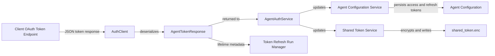
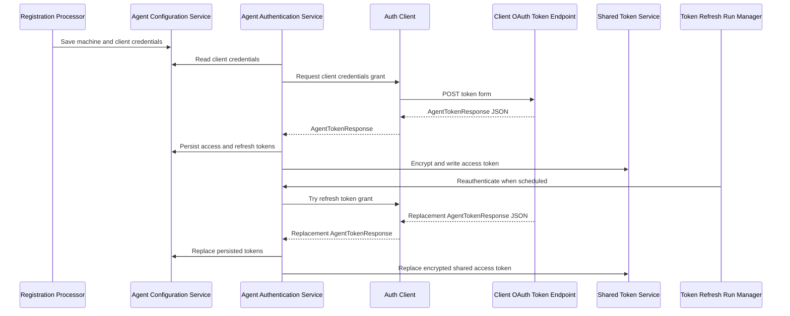
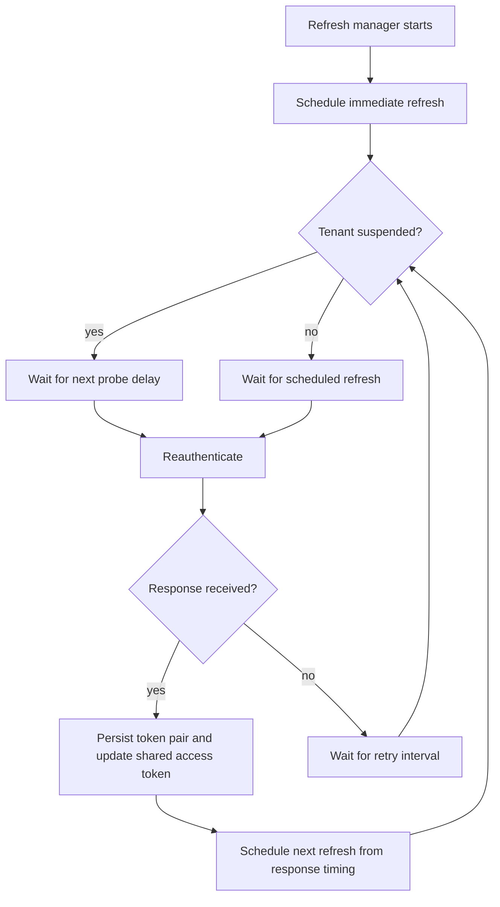

# Model Agent Token Response

Model Agent Token Response is the Rust wire model that represents a successful token grant returned to the OpenFrame endpoint agent. It belongs to the `openframe_client` crate supplied by the OpenFrame OSS Library (`openframe_agent_lib` version `v0.0.5`), which this repository assembles into its client runtime. The model is intentionally small: it carries the credentials needed for authenticated agent operation and optional lifetime metadata used to schedule proactive renewal.

The implementation is defined in the OpenFrame OSS Library: [agent_token_response.rs](https://github.com/flamingo-stack/openframe-oss-lib/blob/16e7c1cbd9664e7d10ec5ebca7d53c9bd314decf/clients/openframe-client/src/models/agent_token_response.rs).

## Responsibilities

- Deserialize a successful token response from the agent authentication endpoint.
- Preserve both the short-lived access credential and the renewable credential returned by the server.
- Preserve the declared token scheme and, when supplied, the access-token lifetime.
- Provide a cloneable value that authentication and refresh services can persist and use for refresh scheduling.

The type does not issue tokens, validate JWT signatures, persist credentials, or make authorization decisions. Those responsibilities remain in the authentication client and the surrounding agent services.

## Contract

`AgentTokenResponse` derives `Serialize`, `Deserialize`, `Debug`, and `Clone`. Its camel-case Serde policy maps Rust field names to the JSON contract below.

| Rust field | JSON field | Type | Meaning |
| --- | --- | --- | --- |
| `access_token` | `accessToken` | `String` | Current credential used by the agent for authenticated activity. Treat it as secret material. |
| `refresh_token` | `refreshToken` | `String` | Credential used to request a replacement token pair. Treat it as secret material. |
| `token_type` | `tokenType` | `String` | Server-declared token scheme. The model retains the value without interpreting or validating it. |
| `expires_in` | `expiresIn` | `Option<i64>` | Optional lifetime supplied by the server. Absence is accepted by the model. |

The model requires the three string fields during deserialization. `expiresIn` is the only optional property. It is an `i64`, so callers must handle it as signed data and should not assume the model itself validates its sign or unit.

```json
{
  "accessToken": "redacted-access-token",
  "refreshToken": "redacted-refresh-token",
  "tokenType": "Bearer",
  "expiresIn": 3600
}
```

Do not place real credentials in logs, documentation, error messages, or tests. In particular, the derived `Debug` implementation includes all fields, so logging the complete response could disclose both token values.

## Architecture and Dependencies

The response model is a boundary type between an HTTP token endpoint and local agent credential management. `AuthClient` posts form-encoded requests to the client OAuth token path, deserializes a successful JSON body into `AgentTokenResponse`, and returns it to `AgentAuthService`.



### Producing Components

`AuthClient` obtains this model by posting to `clients/oauth/token` beneath its configured base URL. It has two grant paths:

- **Client credentials grant:** `authenticate_with_secret` submits `grant_type=client_credentials` with the persisted client identifier and client secret. This is used for initial authentication and as the fallback when refresh authentication cannot succeed.
- **Refresh-token grant:** `authenticate_with_refresh_token` submits `grant_type=refresh_token` and the persisted refresh token. This is the preferred reauthentication route.

Both calls set `application/x-www-form-urlencoded`, notify `DeactivationService` of the HTTP status, reject non-success responses, and only deserialize `AgentTokenResponse` after success.

### Consuming Components

- **Agent Authentication Service** owns the authentication workflow. Initial authentication reads registered client credentials, requests a token response, and saves the resulting credentials. Reauthentication tries refresh-token authentication first and falls back to client credentials.
- **Agent Configuration Service** stores the current `access_token` and `refresh_token` in `AgentConfiguration`. Its token update operation serializes writes with a lock before saving configuration.
- **Shared Token Service** receives the access credential for shared use by local tools. It encrypts the value and atomically writes it to `shared_token.enc` in the agent secured directory.
- **Token Refresh Run Manager** starts a background loop that reauthenticates proactively. It uses the returned response and request timing to calculate its next schedule; the optional `expires_in` field informs that calculation when supplied.
- **Deactivation Service** observes token endpoint statuses through `AuthClient`. A suspended tenant changes refresh-loop behavior into delayed probes, while a successful request allows recovery.

## Authentication and Refresh Flow

The same response contract serves bootstrap authentication and routine credential renewal. Registration precedes these flows: it produces a machine identifier, client identifier, and client secret, which are persisted in `AgentConfiguration`. Initial authentication is skipped when configuration already contains a non-empty access token.



### Renewal Decision Process

The refresh manager runs immediately at startup rather than trusting the stored token lifetime against the device clock. On successful reauthentication it calculates a future refresh schedule. If a refresh fails or times out, it retries after its configured short interval. If the agent is suspended because the tenant is gone, it waits for the deactivation service's next probe delay and uses reauthentication as the recovery probe.



## Persistence and Security Boundaries

The response contains two distinct credentials with different local destinations:

1. The access and refresh values update `AgentConfiguration`, allowing the agent to authenticate again after restart.
2. The access value is additionally encrypted by `SharedTokenService` and atomically written to the secured shared-token file so dependent local tools can use the current credential.

`token_type` and `expires_in` remain part of the in-memory response contract. The response struct itself performs no encryption, redaction, expiry calculation, or persistence. Keeping those concerns outside the DTO makes the HTTP wire schema explicit, while services own secret storage and lifecycle behavior.

## Failure Handling

| Stage | Behavior |
| --- | --- |
| HTTP transport failure | The authentication client returns an error with request context. No response model is created. |
| Non-success token response | The authentication client reports an authentication or refresh failure. It does not attempt JSON decoding as `AgentTokenResponse`. |
| Invalid success JSON | JSON conversion to `AgentTokenResponse` fails, and the authentication client returns a parse-context error. |
| Refresh failure | Reauthentication falls back from the refresh-token grant to client credentials. The refresh manager retries unsuccessful reauthentication attempts at its configured interval. |
| Tenant suspension | The deactivation-aware refresh loop delays work and treats later reauthentication as a recovery probe. |
| Persisting new credentials | The configuration service serializes token updates; the shared-token writer encrypts the access value before atomic file replacement. |

## Maintenance Guidance

- Maintain the `camelCase` JSON names unless the server contract changes in lockstep. Changing a Rust field name without preserving its serialized JSON name breaks token response decoding.
- Adding a required field is a wire-breaking change for servers that do not return it. Prefer `Option` for backward-compatible fields when the endpoint may omit them.
- Do not add validation assumptions to this DTO without considering all grant responses. Validation and expiry policy belong in the authentication and scheduling layers.
- Treat `access_token`, `refresh_token`, and any clone of the response as sensitive. Avoid debug logging and ensure test fixtures use clearly fake values.
- Changes to `expires_in` semantics must be reviewed with the refresh scheduler, since refresh timing depends on the response and send timestamps rather than on the model alone.

## Scope in the OpenFrame Client

Model Agent Token Response is one of the OpenFrame endpoint client's protocol models. It connects the agent-side Rust implementation from the OpenFrame OSS Library to the tenant deployment in this repository: the library performs token exchange and local lifecycle management, while the deployed OpenFrame client service provides the runtime context and routing configuration for agent authentication.
