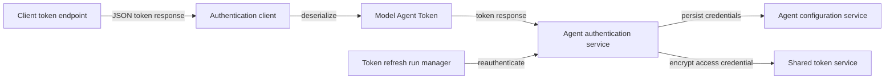
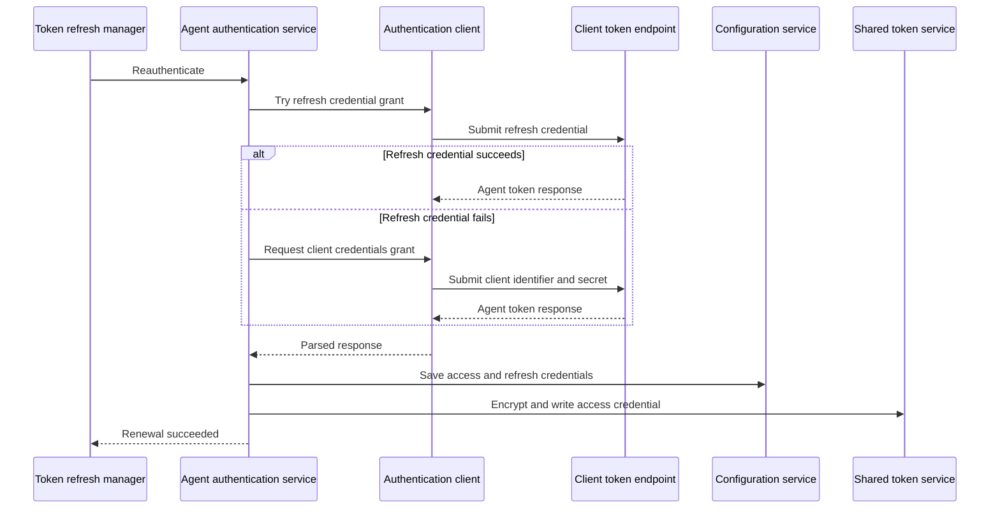
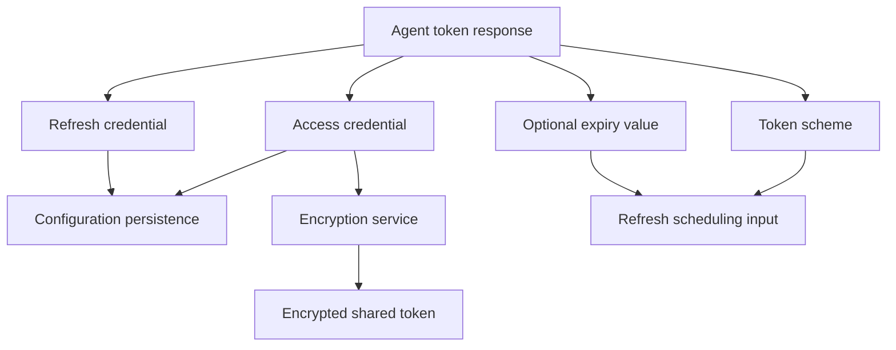

# Model Agent Token

Model Agent Token defines the Rust response model returned when an installed OpenFrame client obtains or renews its agent credentials. The module consists of `AgentTokenResponse`, a serializable and deserializable value that carries the access credential, refresh credential, token scheme, and an optional expiry value.

The model is implemented by the `openframe_agent_lib` Cargo dependency supplied by the OpenFrame OSS Library. Its source is available in the [Agent Token Response source file](https://github.com/flamingo-stack/openframe-oss-lib/blob/7a766f00e4f58b5d89db007b878ac8d6e0c344f4/clients/openframe-client/src/models/agent_token_response.rs). In this repository, it runs as part of the installed OpenFrame client rather than as a server-side API model.

## Responsibility and Boundary

The Model Agent Token module is a transport contract. It does not issue credentials, contact the server, validate token signatures, calculate expiry, or persist secrets itself. Those responsibilities belong to the surrounding client services:

- The authentication client sends credential grants to the client token endpoint and deserializes successful responses into `AgentTokenResponse`.
- The agent authentication service chooses an initial or renewal authentication path and saves the returned credentials.
- The configuration service persists the access and refresh credentials.
- The shared token service encrypts and writes the current access credential for local tool consumers.
- The token refresh run manager periodically reauthenticates and retries failures.



## Data Contract

`AgentTokenResponse` derives Rust debug, clone, serialization, and deserialization support. Its Serde configuration applies camel case to its wire names, so a JSON response uses the following keys:

| JSON key | Rust field concept | Type | Required | Purpose |
|---|---|---|---|---|
| `accessToken` | Access credential | String | Yes | Credential used by the client and propagated to local consumers. |
| `refreshToken` | Refresh credential | String | Yes | Credential submitted when the client requests a replacement access credential. |
| `tokenType` | Token scheme | String | Yes | Server-provided token classification. The model stores it without interpretation. |
| `expiresIn` | Expiry value | Optional signed 64-bit integer | No | Server-provided lifetime or expiry-related value. The model preserves absence and does not assign units or enforce a range. |

A representative wire shape is:

```json
{
  "accessToken": "access-credential",
  "refreshToken": "refresh-credential",
  "tokenType": "Bearer",
  "expiresIn": 3600
}
```

The example values are illustrative only. Never include a real access credential, refresh credential, or client secret in source code, diagnostics, or documentation.

## Authentication and Renewal Flow

The OpenFrame client uses two grant paths against the client token endpoint:

1. Initial authentication submits the registered client identifier and client secret with the client credentials grant.
2. Reauthentication attempts the stored refresh credential first.
3. If refresh authentication fails, reauthentication falls back to the client credentials grant.
4. A successful response becomes an `AgentTokenResponse`; the client saves the access and refresh credentials and updates its encrypted shared access credential.
5. The refresh manager schedules another renewal. It retries after failures and uses a bounded request timeout. During tenant suspension, it waits for the deactivation service probe delay before attempting reauthentication again.



## Component Interaction Details

### Authentication Client

The authentication client posts form-encoded requests to the client token endpoint. It requests either the refresh token grant or client credentials grant, checks that the HTTP status is successful, and only then deserializes the response body as `AgentTokenResponse`.

Before handling success or failure, the client reports the received gateway status to the deactivation service. A non-success status stops the operation with an error rather than producing a partial token model.

### Agent Authentication Service

Initial authentication obtains the registered client credentials from configuration, invokes client credentials authentication, and saves the returned access and refresh credentials. Reauthentication prefers the refresh path and falls back to client credentials if necessary. The returned model is also passed back to the caller so lifecycle code can schedule the next refresh.

### Persistence and Local Distribution

The configuration service updates the access and refresh credentials together while holding its write lock. The shared token service separately encrypts the access credential and writes it atomically to its secured location for local tools. The refresh credential is not distributed through that shared access credential path.



The response model itself does not enforce any relationship between token scheme or expiry fields and the credentials. Scheduling behavior is implemented by the refresh manager, which receives the complete response after successful authentication.

## Failure Behavior

The model is created only after a successful HTTP response body can be parsed. Important failure boundaries are:

| Situation | Handling location | Outcome |
|---|---|---|
| Token endpoint returns a non-success status | Authentication client | Returns an authentication error; no response model is produced. |
| Response body cannot be decoded into the model | Authentication client | Returns a parsing error. |
| Refresh credential request fails | Agent authentication service | Attempts client credentials authentication. |
| Reauthentication repeatedly fails | Token refresh run manager | Logs the failure and retries at its configured retry interval. |
| Tenant suspension is active | Deactivation and refresh services | Delays retry and uses the configured probe path. |
| Credential persistence or encrypted shared token update fails | Authentication and persistence services | Propagates an error instead of silently accepting an incomplete credential update. |

## Security Considerations

- Treat both credential strings as secrets. They are ordinary `String` fields, so callers must avoid copying them into logs, error messages, metrics, or telemetry.
- `AgentTokenResponse` derives `Debug`. Maintainters should therefore avoid debug-formatting a populated response in production logs because the derived representation can expose credentials.
- The type provides no cryptographic verification, token claim parsing, expiration enforcement, or redaction. Those controls must be implemented at the service boundary.
- Persistence and distribution are intentionally separated: configuration retains the access and refresh credentials, while the shared token service encrypts the access credential for local consumption.

## Maintenance Guidance

Changes to Model Agent Token are API contract changes between the client token endpoint and the installed Rust client.

1. Preserve camel-case JSON compatibility unless the server and all deployed clients are coordinated.
2. Add new response fields as optional when backward compatibility with older servers is required.
3. Do not rename, remove, or change the type of existing credential fields without a rollout plan for persisted configuration and renewal behavior.
4. Keep authentication client deserialization, configuration persistence, encrypted access token distribution, and refresh scheduling aligned with any contract revision.
5. Test both grant paths, missing optional expiry, malformed JSON, non-success endpoint responses, credential persistence errors, and renewal retry behavior.

## System Placement

Model Agent Token is part of the OpenFrame client core supplied by OpenFrame OSS Library version `7.0.11` and consumed by this repository through the `openframe_agent_lib` Cargo artifact. It supports the installed agent's authenticated connection to the tenant platform. Server-side credential issuance and registration are implemented by the client service stack; the model remains deliberately small so the Rust client can decode and distribute credentials without embedding server policy.
