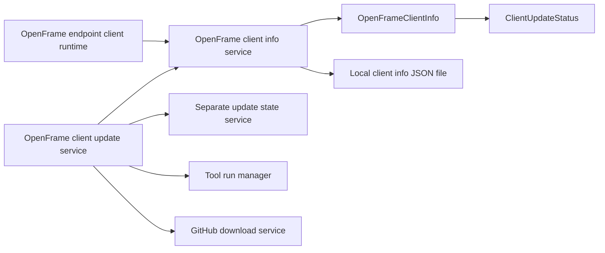
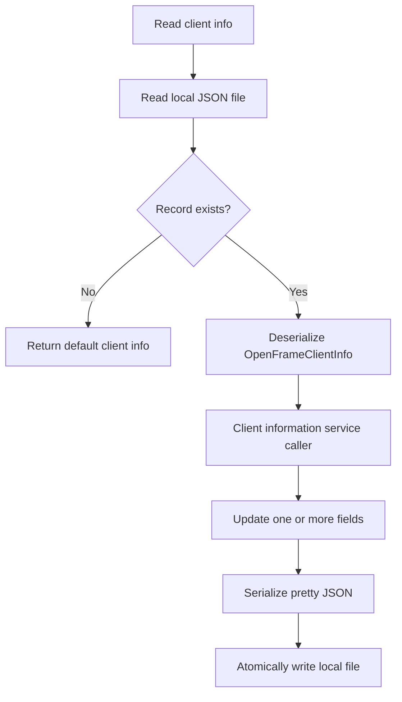
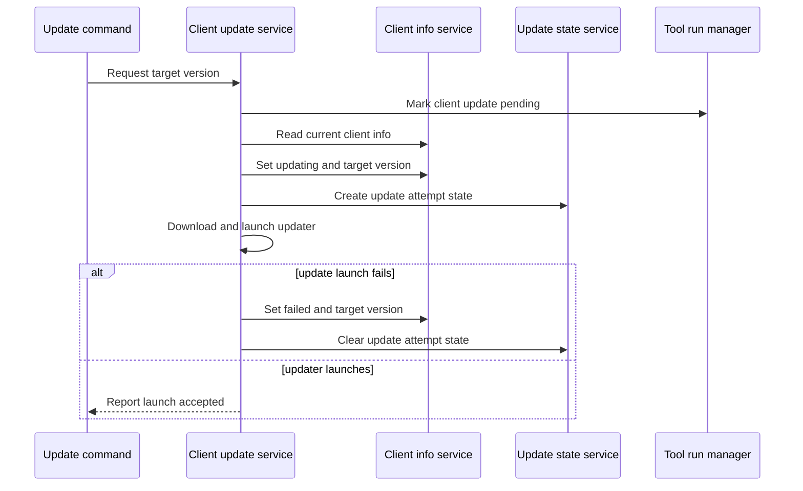

# Model Client Info

Model Client Info defines the persisted, local status record for an OpenFrame endpoint client. It is implemented by the `openframe_agent_lib` library from [OpenFrame OSS Library](https://github.com/flamingo-stack/openframe-oss-lib/blob/7a766f00e4f58b5d89db007b878ac8d6e0c344f4/clients/openframe-client/src/models/openframe_client_info.rs), which this repository assembles into the endpoint-client runtime.

The model has a deliberately narrow responsibility: retain the version currently running, an optionally requested target version, update lifecycle status, the managed executable location, and timestamps for update bookkeeping. It is local client state, rather than an update command or the durable update execution state.

## Responsibilities

- Represent client update state in a serializable Rust value.
- Preserve the version reported by the running client binary.
- Retain an optional target version while an update is being tracked.
- Record the managed binary path used by client update and installation logic.
- Expose timestamps for the latest update check and latest version update.
- Provide defaults so a newly created or absent record begins in a safe `Current` state.

## Data Model

`OpenFrameClientInfo` derives `Serialize`, `Deserialize`, `Debug`, `Clone`, and `Default`. Its fields are public, allowing the client information service to load, alter, and save the complete record.

| Field | Rust type | Meaning | Default behavior |
|---|---|---|---|
| `current_version` | `String` | Version believed to be running on the endpoint. | Empty string until discovered or reconciled. |
| `target_version` | `Option<String>` | Requested version associated with the tracked update. | `None` when no target is stored. |
| `status` | `ClientUpdateStatus` | Local update lifecycle marker. | `Current`. |
| `binary_path` | `String` | Path of the endpoint-client executable managed by the updater. | Empty string until set. |
| `last_update_check` | `Option<String>` | RFC 3339 timestamp of the most recent status update attempt. | `None` until status tracking occurs. |
| `last_updated` | `Option<String>` | RFC 3339 timestamp of the most recent version reconciliation or version write. | `None` until a version changes. |

### Update Status Values

`ClientUpdateStatus` is serialized with `serde(rename_all = "lowercase")`. Consequently, its on-disk JSON values are lowercase even though the Rust variants use PascalCase.

| Rust variant | Serialized value | Meaning |
|---|---|---|
| `Current` | `current` | No update is recorded as active. This is the default. |
| `Updating` | `updating` | An accepted update is being prepared or launched. |
| `Updated` | `updated` | An update completion state may be recorded by the surrounding update workflow. |
| `Failed` | `failed` | The attempted update did not complete successfully. |

The model itself does not enforce legal transitions. The surrounding services own transition timing and error handling.

## Architecture and Ownership

The Model Client Info types are part of the Rust endpoint client supplied by OpenFrame OSS Library. In this repository, the endpoint client is packaged and deployed as part of the OpenFrame tenant platform. `OpenFrameClientInfoService` owns persistence and controlled mutation; `OpenFrameClientUpdateService` coordinates update reservations, downloads, update state, running tools, and lifecycle status changes.



### Separation From Other Update Records

Model Client Info is a concise operational snapshot. It is not interchangeable with the update request or the update-state record:

| Record | Primary purpose | Distinguishing data |
|---|---|---|
| Model Client Info | Persist local version and status summary. | Current version, target version, status, binary path, timestamps. |
| Client update message | Describe a requested update. | Requested version and platform-specific download configurations. |
| Update state | Track an individual update attempt across process replacement. | Target version, phase, boot attempt count, start time, and updater-stamped error. |

This division prevents request payloads and crash-recovery metadata from being conflated with the endpoint's persisted status summary.

## Persistence Semantics

`OpenFrameClientInfoService` retrieves this model from its configured local file path. When that file is absent, `get` returns `OpenFrameClientInfo::default()` rather than treating the absence as an error. Saving serializes pretty JSON and writes through the shared atomic-write utility, so the service does not directly expose partially written JSON as the intended persistence result.



### Service Operations

The information service provides the following behavior around the model:

- `get` loads the record, returning default data if no record exists.
- `save` serializes and atomically persists the complete record.
- `set_binary_path` changes only `binary_path` before saving.
- `set_update_status` changes `status` and `target_version`, then stamps `last_update_check` with the current UTC RFC 3339 time.
- `update_version` changes `current_version`, stamps `last_updated`, and saves.
- `reconcile_version` compares the stored version with the executing binary's version. When they differ, it records the running version and refreshes `last_updated`.

`reconcile_version` only changes the version and update timestamp. It does not infer a target version or update status, which keeps runtime truth reconciliation independent from update lifecycle decisions.

## Update Interaction Flow

The update service uses Model Client Info for bookkeeping, not as the update lock or the source of executable state. Before applying a request, it reserves a process-wide update guard, skips a request matching the currently running version, and defers while protected operations are busy. During application, it validates and canonicalizes the requested version, checks the last-known-good version to prevent disallowed downgrades, and reads the stored current version for diagnostic logging.

Once an update is ready to proceed, the service attempts to record `Updating` and the canonical target version. A bookkeeping write failure is logged but does not prevent the actual update from continuing. If the update operation fails, it attempts to record `Failed` with the same target version and clears separate update-state data so stale state cannot affect later boot recovery.



## State Interpretation Guidelines

Consumers should interpret this record as observational local state:

- `current_version` is corrected by the running executable during reconciliation, making it the preferred local observation of the active binary version.
- `target_version` identifies the version associated with the latest tracked update state. Its presence alone does not prove that an update has completed.
- `status` supplies the lifecycle context required to interpret `target_version`.
- `last_update_check` is updated when the service records a status, rather than only after a successful binary replacement.
- `last_updated` is updated when a version is saved or reconciled, rather than on every status transition.
- `binary_path` is mutable independently of version fields because deployment location can change without changing the active binary version.

Because the persisted model may be missing on a new installation, callers must tolerate empty strings and absent optional timestamps. The default enum state is `Current`, but that state does not populate `current_version` or `binary_path` by itself.

## JSON Shape

The exact optional-field emission behavior follows the default Serde configuration in this type: optional fields are represented as JSON values or `null` because the model has no `skip_serializing_if` attributes.

```json
{
  "current_version": "1.2.3",
  "target_version": "1.2.4",
  "status": "updating",
  "binary_path": "/path/to/openframe-client",
  "last_update_check": "2026-01-15T12:34:56Z",
  "last_updated": "2026-01-01T09:00:00Z"
}
```

The values above are illustrative only. In particular, binary paths are operating-system and installation-location dependent.

## Maintenance Considerations

- Treat serialized status names as a persisted compatibility contract. Renaming an enum variant or modifying the lowercase serialization convention changes stored data compatibility.
- New fields should have sensible defaults or optional types so existing local records remain readable.
- Keep lifecycle policy in update services rather than adding transition validation to this data-only model unless all existing callers are updated together.
- Preserve the distinction between local client info and crash-recovery update state. Clearing failed update state should not erase the diagnostic summary retained in Model Client Info.
- Use the information service for writes so file access continues to use its centralized JSON parsing, quarantine behavior, and atomic persistence path.

## Source

The model is provided by OpenFrame OSS Library at [clients/openframe-client/src/models/openframe_client_info.rs](https://github.com/flamingo-stack/openframe-oss-lib/blob/7a766f00e4f58b5d89db007b878ac8d6e0c344f4/clients/openframe-client/src/models/openframe_client_info.rs). The tenant repository consumes `openframe_agent_lib` version `v0.0.5` as part of its endpoint-client runtime.