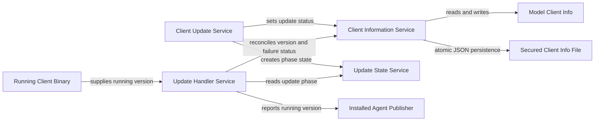
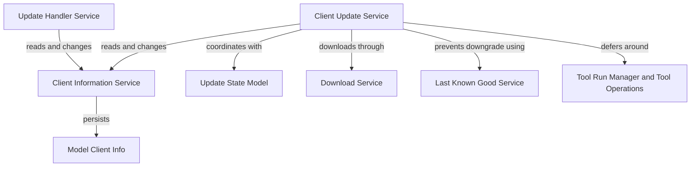
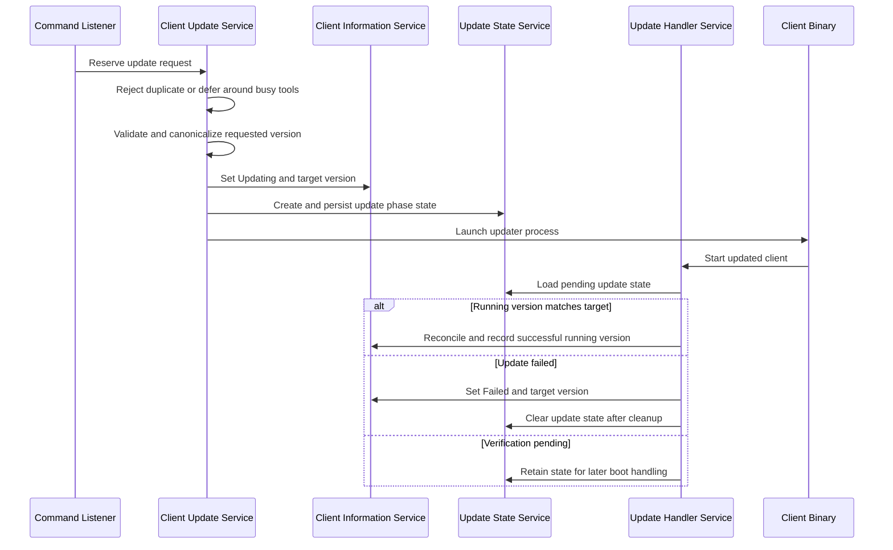
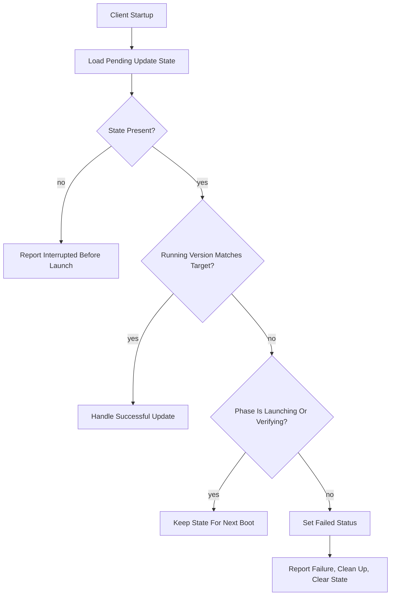

# Model Client Info

Model Client Info is the persisted local identity and update-summary model for the OpenFrame endpoint client. It is implemented by the `openframe_agent_lib` Cargo artifact supplied by OpenFrame OSS Library and is used at runtime by this repository's OpenFrame client service. The model records the version that is running, a requested update target, update status, the executable path, and timestamps that describe update activity.

The source implementation is maintained in [OpenFrame OSS Library](https://github.com/flamingo-stack/openframe-oss-lib/blob/16e7c1cbd9664e7d10ec5ebca7d53c9bd314decf/clients/openframe-client/src/models/openframe_client_info.rs).

## Responsibilities

- Provide a serializable on-disk snapshot of client version and binary location.
- Represent the user-visible lifecycle of a client update with a small, stable status enum.
- Preserve the requested target version while an update is running or has failed.
- Supply bookkeeping data to the client information and update-handling services without making update decisions itself.

Model Client Info does not download an update, replace an executable, publish a message, or manage update phases. Those responsibilities remain in surrounding client services.

## Model

The module exposes two Rust types.

| Type | Purpose |
| --- | --- |
| `ClientUpdateStatus` | Lifecycle classification for the client update summary. It serializes to lowercase strings and defaults to `Current`. |
| `OpenFrameClientInfo` | Serializable record containing version, target, status, binary path, and update timestamps. It derives `Default`, so absent persisted data yields empty strings, absent optional fields, and a `Current` status. |

### Update Status

| Status | Meaning |
| --- | --- |
| `Current` | Default state indicating no active or recorded exceptional update state. |
| `Updating` | An update has been accepted and update work is underway. |
| `Updated` | A completed-update classification available to consumers of the model. |
| `Failed` | The most recent update attempt failed or was determined to be unsuccessful during startup handling. |

Because the enum uses lowercase serialization, persisted values are `current`, `updating`, `updated`, and `failed`.

### Persisted Fields

| Field | Type | Meaning |
| --- | --- | --- |
| `current_version` | `String` | Version attributed to the currently running client binary. |
| `target_version` | `Option<String>` | Version requested for an update, when one is being tracked. |
| `status` | `ClientUpdateStatus` | Summary update state. |
| `binary_path` | `String` | Path of the client executable recorded by the client information service. |
| `last_update_check` | `Option<String>` | RFC 3339 UTC timestamp written when the update status is changed. |
| `last_updated` | `Option<String>` | RFC 3339 UTC timestamp written when the recorded running version changes. |

## Architecture and Boundaries

Model Client Info belongs to the Rust endpoint client. `OpenFrameClientInfoService` owns its persistence lifecycle, storing the serialized record as `openframe_client_info.json` beneath the directory manager's secured directory. It creates that directory before use, reads the record through the quarantine-aware JSON helper, and writes updates atomically.

### Dependency Relationships

The model has no behavior beyond derived serialization, cloning, equality for the status enum, and defaults. Its operational dependencies are therefore consumers rather than imports:

The separate update-state model is the authoritative process-level state for target version, phase, boot attempts, start time, and updater-reported error. Model Client Info is the durable, concise status view; it must not be interpreted as a replacement for phase-level recovery state.

## Persistence Semantics

`OpenFrameClientInfoService` establishes the following behavior:

1. **Creation:** initialization resolves the secured-directory path, ensures client directories exist, and targets `openframe_client_info.json`.
2. **Read:** `get` uses a JSON reader that can quarantine invalid content. A missing file is not an error; it returns `OpenFrameClientInfo::default()`.
3. **Write:** `save` serializes pretty JSON and uses an atomic write, avoiding a partially written record during replacement.
4. **Version reconciliation:** `reconcile_version` compares `current_version` with the actual running version. If they differ, it overwrites the recorded version and stamps `last_updated`.
5. **Status change:** `set_update_status` updates both `status` and `target_version`, then stamps `last_update_check`.
6. **Path change:** `set_binary_path` replaces only the saved `binary_path` before persisting.

A missing record is deliberately recoverable. A corrupt record is handled by the JSON helper's quarantine path rather than being silently treated as valid prior state.

## Update Interaction Flow

An update request carries a requested version and one or more download configurations. The client update service reserves a single in-progress update, checks for conflicting tool activity, validates and canonicalizes the version, and skips work if that version is already running. For an eligible request it records `Updating` with the target version before beginning update execution. Bookkeeping failure is logged but does not block the update attempt.

## Startup Recovery and Failure Handling

On startup, the update handler examines persisted phase state alongside the version compiled into the running binary.

For an unresolved updater-launch or verification state, the handler records boot attempts. If the target version still does not match the running version after the configured maximum number of attempts, the crash-loop guard treats the update as failed, performs failure cleanup, clears update state, and initiates rollback handling. This protects the client from retaining an indefinitely unresolved update record.

## Version Reporting

The update handler publishes the running OpenFrame client version through the installed-agent publisher after startup. It obtains the machine identifier from agent configuration and retries publication up to five times with one-second waits. This remote version report is distinct from Model Client Info persistence:

- the persisted record supports local continuity and update bookkeeping;
- the publisher announces the running version to the platform;
- reconciliation corrects local `current_version` when the executable's running version disagrees with stored data.

## Maintenance Guidance

- Keep `ClientUpdateStatus` values backward compatible: the lowercase serialized names are persisted data.
- Add a status only when consumers can distinguish it from phase-level `UpdateState`; otherwise prefer keeping the additional detail in the update-state model.
- Do not treat `target_version` as proof that an update was applied. Confirm the running version and the update-state outcome.
- Preserve atomic persistence and the missing-file default behavior when changing the client information service.
- Treat `binary_path` as local metadata. The actual executable replacement and platform-specific updater behavior are outside this model.

## Source Scope

This documentation covers the two types defined in the Model Client Info module and their verified use by the client information, client update, and update handler services in OpenFrame OSS Library. Platform-specific binary replacement, downloader selection, tool shutdown, and rollback mechanics are intentionally outside the model's scope.