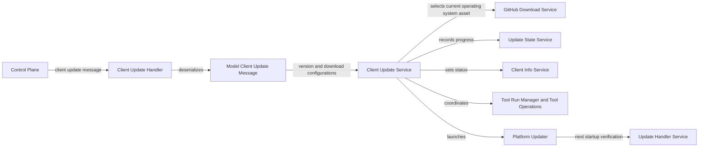
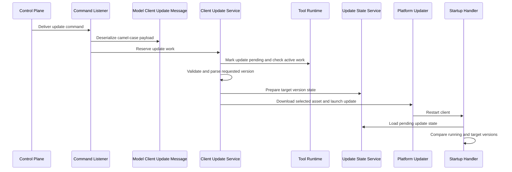
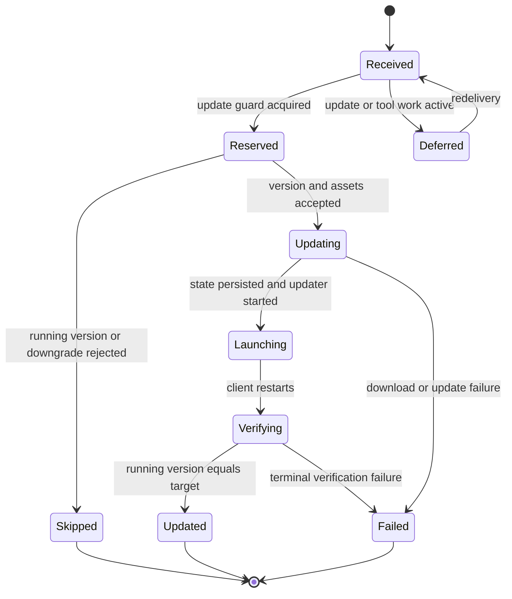

# Model Client Update Message

Model Client Update Message is the wire model that requests an installed OpenFrame client to move to a specific client release. It belongs to the Rust `openframe_agent_lib` library from the OpenFrame OSS Library and is assembled into this repository's OpenFrame Client service. The model deliberately carries only the desired version and the OS-specific download choices; validation, update coordination, persistence, binary replacement, and post-restart verification remain responsibilities of the receiving client.

**Source:** [openframe_client_update_message.rs](https://github.com/flamingo-stack/openframe-oss-lib/blob/16e7c1cbd9664e7d10ec5ebca7d53c9bd314decf/clients/openframe-client/src/models/openframe_client_update_message.rs)

## Contract

`OpenFrameClientUpdateMessage` is a serializable and deserializable Rust structure with camel-case wire names:

| Field | Rust type | Wire name | Meaning |
|---|---|---|---|
| `version` | `String` | `version` | Requested client version. The update service trims, validates, parses, and canonicalizes it before beginning an update. |
| `download_configurations` | `Vec<DownloadConfiguration>` | `downloadConfigurations` | Candidate binaries or bundles. A configuration identifies the target operating system, source link, source filename, installed target filename, installation type, and optional bundle or service metadata. |

The model derives `Debug`, `Clone`, `Serialize`, and `Deserialize`. It is therefore suitable for transport decoding, diagnostic logging under the caller's logging policy, and safe ownership transfer into asynchronous update work.

## Message Shape and Compatibility

The camel-case serde policy means that Rust's `download_configurations` is represented as `downloadConfigurations` on the wire. The embedded download configuration model accepts `agentFileName` and `assetFileName` as deserialization aliases for its target filename, preserving compatibility with senders that use either historical name.

A conceptual payload has this shape. Values are illustrative only and are not a prescribed release URL or version.

```json
{
  "version": "1.2.3",
  "downloadConfigurations": [
    {
      "os": "windows",
      "fileName": "openframe-client.exe",
      "targetFileName": "openframe-client.exe",
      "link": "https://release-host.example/client/1.2.3/openframe-client.exe"
    }
  ]
}
```

The message itself does not select a download. The update path evaluates each `DownloadConfiguration` against the running operating system. The model recognizes `windows`, `macos`, and `linux` case-insensitively; unsupported build targets do not match. A target filename with more than one path component signals folder extraction rather than a single-file placement.

## Architecture and Responsibilities



The message is a boundary model. It has no behavior beyond serde mapping and does not embed policy. The surrounding OpenFrame Client components provide the operational guarantees:

- **Command handling** receives the update command and delegates it to the client update service.
- **Client update service** reserves exclusive update work, rejects malformed versions, avoids reapplying the running version, and uses the last-known-good anchor to reject downgrades when downgrades are disabled.
- **Download configuration** provides the platform-specific artifact metadata used during asset selection and download.
- **Tool coordination** marks a client update as pending and prevents a binary update from overlapping tool or package upgrade activity.
- **State and client information services** persist target version and lifecycle state, reporting `Updating`, `Updated`, or `Failed` status separately from the binary operation.
- **Startup update handling** examines persisted state after process restart. If the running version equals the target version, it treats the update as successful; otherwise it retains verification-related state for a later boot or handles failure according to the recorded phase.

## Update Data Flow



A duplicate delivery cannot overlap a live update: the client update service holds an in-progress guard from reservation until the updater completes its work for the process. If another update-related operation is active, reservation fails so the message can be redelivered rather than racing the existing operation. A request for the version already running is skipped and clears the pending update indication.

## Lifecycle and Failure Semantics



Important operational details:

1. Version parsing occurs in the update service, not in the message type. A syntactically valid JSON message can still be rejected for an invalid version.
2. If an update execution error occurs after status tracking begins, the client records `Failed`, clears stale update state, and leaves message retry to the transport flow.
3. Update state includes the target version, phase, boot-attempt count, start time, and an optional updater-stamped failure reason. This gives restart-time handling enough context to distinguish an in-progress verification from a failed update.
4. Download configurations must include an artifact that matches the target device OS. The client update implementation owns the final selection and installation behavior.

## Dependencies

| Dependency | Relationship to the model |
|---|---|
| `DownloadConfiguration` | Nested asset metadata. It identifies OS applicability and how the selected release artifact is placed or extracted. |
| Client Update Handler | Transport-side consumer that routes a decoded update request to update orchestration. |
| OpenFrame Client Update Service | Primary consumer. It reserves the operation, validates the version, coordinates workloads, downloads the asset, and launches replacement. |
| Client Info Model and Service | Holds current version and update status for reporting. |
| Update State Model and Service | Persists restart-resilient state for the target version and update phase. |
| Last Known Good Service | Supplies the downgrade-protection anchor. |
| Tool Run Manager and Tool Operations | Avoid concurrent client replacement and managed tool or package activity. |
| Update Handler Service | Performs startup-time success or failure handling after the updater relaunches the client. |

## Maintenance Guidance

Treat this structure as a versioned transport contract:

- Preserve camel-case names and existing download configuration aliases when evolving the payload.
- Add fields as optional or defaulted where backward compatibility is required, because older client binaries deserialize the message.
- Do not infer platform behavior from the message alone. Platform selection, extraction, privilege handling, staging, replacement, and restart are implemented by the update and platform services.
- Keep `version` canonical and semver-compatible with the update service. The service, rather than this DTO, is the enforcement point for version validity and downgrade policy.
- Changes to the embedded download configuration affect all supported operating systems and should be tested against single-file and folder-extraction releases.

## System Placement

The OpenFrame OSS Tenant repository publishes and deploys the OpenFrame Client alongside platform services. At runtime, the client connects to the tenant's NATS service and is configured with the tenant's Kafka and NATS endpoints. This model is part of the client-side command contract used to request a local agent upgrade; it is not an HTTP endpoint and does not itself publish a NATS subject.

The model is implemented by the OpenFrame OSS Library artifact `openframe_agent_lib` version `v0.0.5`, which this repository consumes. The server-side control-plane services and the local Rust client must remain compatible on the serialized update payload and on its release artifact conventions.
