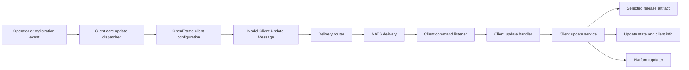
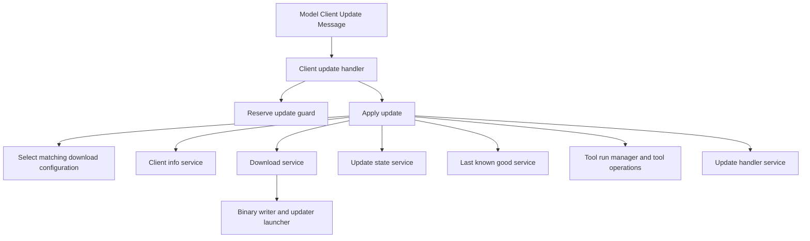
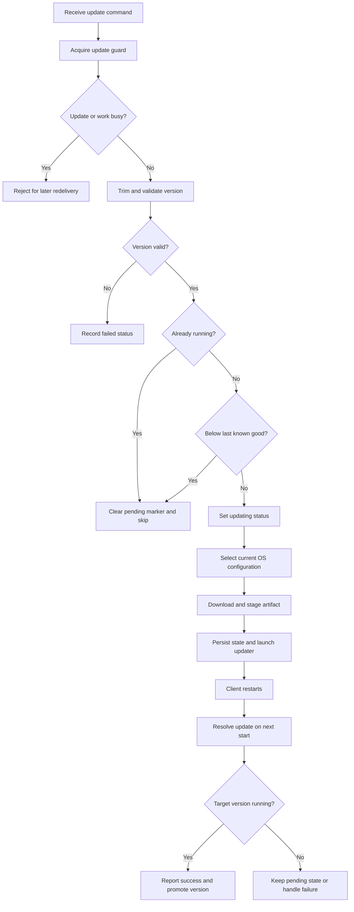
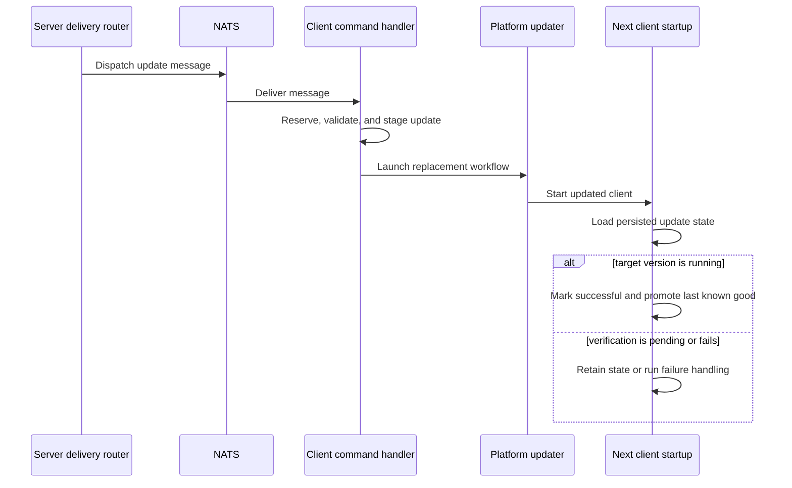

# Model Client Update Message

Model Client Update Message is the wire contract that asks an installed OpenFrame client to update itself. It carries the requested client version and a set of operating-system-specific download choices. The contract is implemented by the Rust `OpenFrameClientUpdateMessage` type in the `openframe_agent_lib` crate supplied by OpenFrame OSS Library version `v0.0.5`; the tenant repository runs the client that consumes it.

The authoritative source is [openframe_client_update_message.rs](https://github.com/flamingo-stack/openframe-oss-lib/blob/7a766f00e4f58b5d89db007b878ac8d6e0c344f4/clients/openframe-client/src/models/openframe_client_update_message.rs).

## Purpose and Contract

The message separates update intent from platform delivery details:

- `version` is the requested OpenFrame client version.
- `downloadConfigurations` is an ordered list of `DownloadConfiguration` records, from which the client selects the record matching its current operating system.

The Rust type derives serialization and deserialization with camel-case property names. Consumers must therefore send `downloadConfigurations`, not the Rust field spelling `download_configurations`.

```json
{
  "version": "1.2.3",
  "downloadConfigurations": [
    {
      "os": "windows",
      "fileName": "openframe-client.zip",
      "targetFileName": "openframe-client.exe",
      "link": "https://example.invalid/releases/openframe-client.zip",
      "installationType": "standard"
    }
  ]
}
```

The example illustrates the shape only. `link` must be an actual artifact location supplied by the platform configuration; this module does not generate or validate a release URL.

## Payload Fields

| Field | Type | Meaning | Processing rule |
|---|---|---|---|
| `version` | string | Requested release version. | The update service trims it, validates and parses it as a semantic version, then stores its canonical representation in update tracking. |
| `downloadConfigurations` | array | Platform-specific artifact definitions. | The client selects the first configuration whose `os` matches the running operating system case-insensitively. |
| `downloadConfigurations[].os` | string | Target operating system. | Supported client build targets are `windows`, `macos`, and `linux`. No matching entry causes the update to fail. |
| `downloadConfigurations[].fileName` | string | Artifact filename. | Identifies the downloadable release artifact. |
| `downloadConfigurations[].targetFileName` | string | Installed executable path or filename. | Legacy wire aliases `agentFileName` and `assetFileName` are accepted during deserialization. A path with multiple components indicates folder extraction. |
| `downloadConfigurations[].link` | string | Artifact download location. | Passed to the client download service. |
| `downloadConfigurations[].installationType` | enum | Installation form. | Defaults to `standard`; available forms are `standard`, `guiApp`, and `service`. |
| `downloadConfigurations[].bundleId` | optional string | Application bundle identifier. | Present only when required by the installation form. |
| `downloadConfigurations[].serviceName` | optional string | System-service identifier. | Present only when required by the installation form. |

## Position in the Update Architecture

The update message is one part of a cross-service workflow. Java services in the OpenFrame OSS Library obtain the current client configuration, create a per-machine or all-machines delivery seed, and submit it to the delivery router. The installed Rust client receives the command, reserves the update, and applies the message through its update service.



### Server-Side Dispatch

Two server paths issue the same kind of update delivery:

1. During agent registration, `AgentRegistrationClientUpdateService` loads the current OpenFrame client configuration, creates a machine-specific delivery seed, and dispatches it. Errors are logged without failing registration.
2. The API force-update service loads the latest configuration and dispatches either one seed per requested machine or one all-machines seed. The API controller exposes the `force/client/update` and `force/client/update/all` operations through the API service.

Dispatch means that the delivery router accepted the seed. It does not prove the endpoint has downloaded, installed, or successfully booted the requested version.

### Client Dependencies

The client-side handler and service use the message as a boundary model rather than embedding update logic in the listener.



The principal runtime dependencies are:

- **Client update handler:** deserializes the command into this model and delegates reservation and execution.
- **Client update service:** owns validation, concurrency control, platform selection, update orchestration, and status changes.
- **Download configuration:** describes the selected artifact and whether it is a direct binary replacement or an archive extracted into a directory.
- **Client information service:** records `Updating` before execution and `Failed` if execution returns an error. Its status vocabulary also includes `Current` and `Updated`.
- **Update state service:** persists a target version, phase, boot-attempt count, start time, and optional failure detail so a later process start can resolve an incomplete update.
- **Last known good service:** supplies a version anchor that guards against downgrade and can promote a verified version.
- **Tool run manager and tool operations:** prevent a client replacement from overlapping tool or package work and mark the client update as pending while it waits.

## Client Processing Flow

The message is applied only after the command layer has accepted it. A reservation protects against concurrent deliveries; it is intentionally held until the updater has completed with the current process, preventing a redelivery from overlapping a live update.



### Validation, Idempotency, and Downgrade Protection

Before an update starts, the service validates and parses the requested version. An invalid value produces an error rather than a download attempt. If the request matches the binary's currently running version, the service treats the operation as skipped and clears the client-update pending marker.

The service also checks the persisted last-known-good version when downgrades are disabled. A requested version lower than that anchor is skipped. If the anchor cannot be read or parsed, the client logs the condition and continues without that downgrade check rather than making the anchor store an availability prerequisite.

### Platform Selection and Staging

`find_config_for_current_os` locates the first configuration whose operating-system value matches the compiled client target. Absence of a matching record is an update failure.

The selected configuration determines staging behavior:

- A `targetFileName` containing one path component is treated as a direct executable update. The download service obtains the artifact and writes the executable to the default agent path.
- A nested `targetFileName` is treated as a folder extraction. The download service extracts the artifact into the tool folder, applies executable permissions to the target path, and reports the relative target path for later use.

The model does not carry checksums, signatures, retry settings, or credentials. Those concerns belong to the surrounding delivery, download, and platform-update services.

## Delivery and Restart Semantics

The command framework distinguishes completed, failed, restart-required, and restarting outcomes. Client update processing can terminate the current agent process, so completion is reconciled after startup rather than assuming that delivery hand-off equals a completed installation.



On startup, pending state is compared with the compiled running version. If it equals the target version, the update handler follows its success path. If the process is not yet verified and the recorded phase is `UpdaterLaunched` or `Verifying`, it keeps the state for a later startup. Other incomplete phases are handled as failures. This makes restart recovery explicit and limits false success reporting.

## Operational Considerations

- Supply at least one exact OS match for each platform expected to receive the release. The comparison ignores case but does not infer equivalent names.
- Use valid semantic versions. The client canonicalizes parsed versions for status and persisted state.
- Avoid planning a downgrade unless the deployment configuration intentionally permits it; the last-known-good anchor can reject it.
- Treat a dispatch response as a routing result, not a device-success result. Confirm outcomes through client status, delivery results, and client logs.
- Expect deferred redelivery while an update, tool operation, or package upgrade is active. This is deliberate coordination, not a request loss.
- Do not expose private artifact credentials in the message. The contract has no dedicated secret field.

## Source and Ownership

The model is library code, not a type defined directly in this tenant repository. It is compiled into the endpoint client through the `openframe_agent_lib` dependency. The tenant repository publishes and deploys the surrounding OpenFrame client service and its image, while OpenFrame OSS Library owns the Rust message definition and client update implementation.
