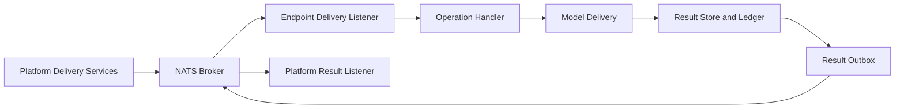
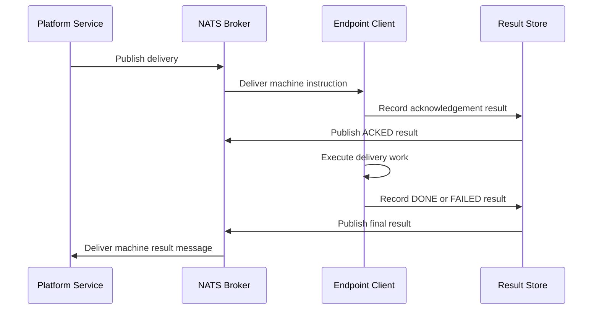
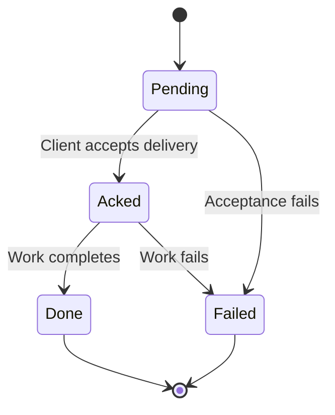
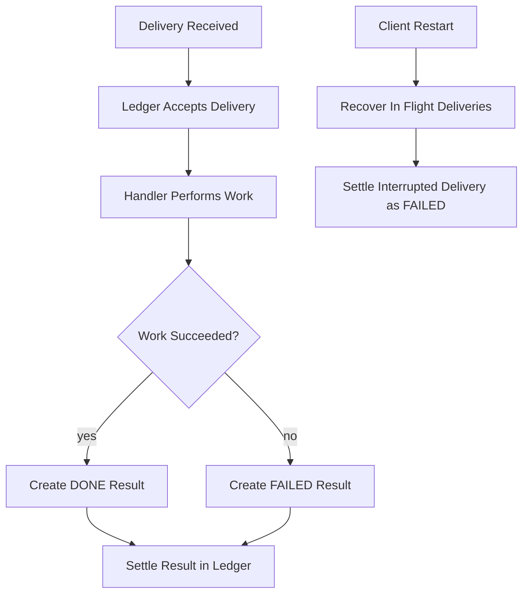

# Model Delivery

Model Delivery defines the endpoint client result protocol for delivered work. It supplies delivery correlation data, lifecycle outcomes, an optional error, and a machine-scoped result subject.

The implementation is supplied by the `openframe_client` Rust crate from the OpenFrame OSS Library. This repository consumes that library as `openframe_agent_lib` version `v0.0.5`. See [`delivery.rs`](https://github.com/flamingo-stack/openframe-oss-lib/blob/16e7c1cbd9664e7d10ec5ebca7d53c9bd314decf/clients/openframe-client/src/models/delivery.rs).

## Purpose

Model Delivery is a transport contract rather than an instruction handler. Endpoint listeners and operation handlers use it to report that work was accepted, completed, or failed. The `CLIENT_UPDATE` constant identifies the client-update delivery category.

- **Acknowledged** means the client accepted a delivery.
- **Done** means delivery work completed successfully.
- **Failed** means delivery work could not complete and may include an error reason.

## Architecture



The endpoint client includes command listeners, result-store services, and a result outbox around this model. The OpenFrame client service contains complementary dispatch and result-listener components. Model Delivery stays focused on the common wire data exchanged between these components.

## Core Contract

### Delivery Reference

`DeliveryRef` identifies the delivery represented by every result. Its fields serialize in camel case.

| Field | Serialized name | Meaning |
| --- | --- | --- |
| `delivery_type` | `type` | Delivery category, such as `CLIENT_UPDATE`. |
| `target_id` | `targetId` | Identifier of the delivery target. |
| `dispatch_id` | `dispatchId` | Identifier of the originating dispatch. |
| `sequence` | `sequence` | Optional ordering or deduplication sequence; omitted when absent. |

The explicit `type` rename is a protocol requirement: consumers read and write `type`, not `deliveryType`.

### Result Values

`DeliveryResult` uses screaming-snake-case serialization and accepts exactly these values:

| Wire value | Meaning |
| --- | --- |
| `ACKED` | The client accepted the delivery. |
| `DONE` | The work completed successfully. |
| `FAILED` | The work failed. |

`DeliveryResultMessage` pairs the reference with a result and an optional `error`. The `error` field is omitted when no error exists. Its `acked`, `done`, and `failed` constructors create the conventional messages; `new` permits direct construction when necessary.

## Result Publication

`delivery_result_subject(machine_id)` creates the following subject. The fixed result kind is `delivery.result`.

```text
machine.<machine-id>.delivery.result
```



The machine identifier scopes a result to the endpoint that emitted it. The complete `DeliveryRef` correlates lifecycle messages with a specific platform dispatch.

## Lifecycle and Recovery

An acknowledgment is not completion: it precedes the eventual `DONE` or `FAILED` result. The operation handler determines transitions; Model Delivery represents their outputs.



The endpoint result-store ledger accepts a delivery with a subject and ledger state before settlement. Settlement records a `DeliveryResultMessage` and prunes excess entries. Recovery identifies deliveries left in flight by a restart and settles them as failed with an interruption reason.



This path avoids silently losing an in-flight delivery when a client restarts and supports later result publication through the result outbox.

## Integration Boundaries

| Boundary | Role |
| --- | --- |
| Endpoint command and update listeners | Interpret incoming work and construct lifecycle results. |
| Result store ledger | Records acceptance and settlement for recovery. |
| Result outbox manager | Publishes durable queued results. |
| NATS message publisher | Sends serialized results to the machine-scoped subject. |
| Platform delivery listeners | Correlate results to server-side delivery records. |

## Serialization Examples

A completed client-update result:

```json
{
  "delivery": {
    "type": "CLIENT_UPDATE",
    "targetId": "client-update-42",
    "dispatchId": "dispatch-983",
    "sequence": 7
  },
  "result": "DONE"
}
```

A failure retains the same reference and adds an error:

```json
{
  "delivery": {
    "type": "CLIENT_UPDATE",
    "targetId": "client-update-42",
    "dispatchId": "dispatch-983"
  },
  "result": "FAILED",
  "error": "download could not be completed"
}
```

## Maintenance Guidance

- Treat serialized field names, result values, and the subject suffix as compatibility boundaries.
- Preserve the `type` rename on `DeliveryRef`.
- Add outcomes only with coordinated changes to client handlers, durable storage, and platform consumers.
- Use `failed` to preserve a consistent failure reason.
- Reuse the original `DeliveryRef` for every report about an existing delivery.
- Keep error text useful for operators and free of credentials, tokens, or other sensitive material.
