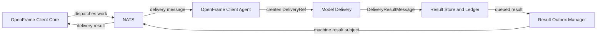
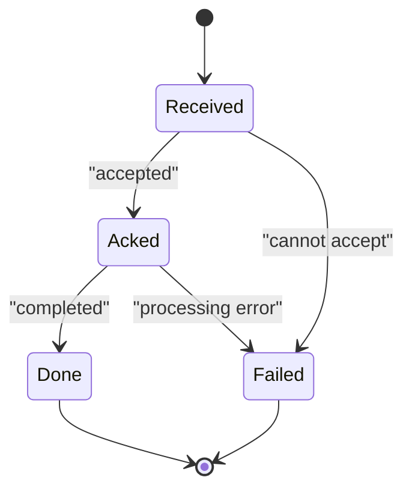
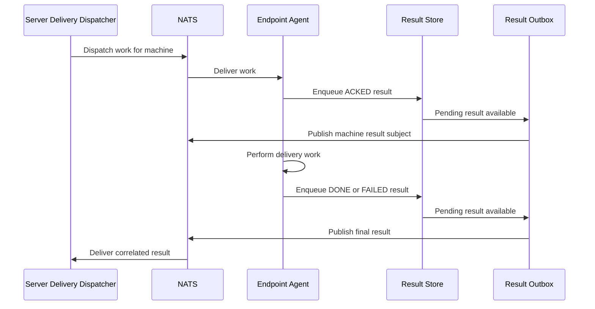

# Model Delivery

Model Delivery defines the small, transportable result contract used by the OpenFrame endpoint agent to report the lifecycle of a server-dispatched delivery. It is implemented in the Rust `openframe_agent_lib` library, consumed at runtime by this repository's OpenFrame Client service, and is the boundary between local agent work and the platform's delivery tracking.

The module does **not** execute a command, install a tool, or apply an update. Instead, it identifies the dispatched work and expresses whether the agent has accepted it, completed it, or failed it. This makes the same reporting envelope usable for deliveries such as client updates, tool operations, feature-flag changes, and package updates.

**Source:** [`clients/openframe-client/src/models/delivery.rs`](https://github.com/flamingo-stack/openframe-oss-lib/blob/7a766f00e4f58b5d89db007b878ac8d6e0c344f4/clients/openframe-client/src/models/delivery.rs) in OpenFrame OSS Library.

## Responsibilities

- Preserve the identity of a dispatch with its delivery type, target, dispatch identifier, and optional ordering sequence.
- Model the three terminal or progress outcomes: acknowledgement, completion, and failure.
- Attach a human-readable failure reason only when an operation fails.
- Produce the NATS subject used to publish results for an individual machine.
- Provide constructors that prevent callers from mismatching a normal acknowledgement or completion with an error payload.

## Contract Types

| Component | Role | Wire behavior |
|---|---|---|
| `DeliveryRef` | Identifies one delivery instance. | Serializes field names in camel case; `delivery_type` is emitted as `type`. The optional `sequence` is omitted when absent. |
| `DeliveryResult` | Outcome enum. | Serializes as screaming snake case: `ACKED`, `DONE`, or `FAILED`. |
| `DeliveryResultMessage` | Envelope returned by the agent. | Contains the delivery reference, outcome, and optional error text. |
| `delivery_result_subject` | Addressing function. | Builds the per-machine result subject `machine.{machineId}.delivery.result`. |

`CLIENT_UPDATE` is a declared delivery-type constant. Other delivery types can use the same data model because `DeliveryRef.delivery_type` is a string rather than a closed Rust enum.

## Architecture and Dependencies

The module is deliberately model-only: it depends on Serde for serialization and deserialization, but it has no network, persistence, or platform dependency. The surrounding client runtime supplies those capabilities:

- Command and execution listeners receive and act on deliveries.
- The result store records outbound results and tracks their delivery state.
- The result outbox manager publishes retained results through the agent's NATS publisher.
- The server-side client core receives results and reconciles the matching platform delivery record.



The model comes from the `openframe_agent_lib` Cargo artifact supplied by OpenFrame OSS Library. The tenant repository consumes that library at version `v0.0.5`; the source revision above is the implementation documented here.

## Delivery Identity

A `DeliveryRef` binds a result to the server-side dispatch that originated the work:

| Field | Meaning | Presence |
|---|---|---|
| `type` | Delivery category, such as `CLIENT_UPDATE`. | Required |
| `targetId` | Identifier for the target operation or resource. | Required |
| `dispatchId` | Identifier for this individual dispatch attempt. | Required |
| `sequence` | Optional sequence supplied for ordered processing or deduplication. | Optional |

The identity is nested inside every result instead of being inferred from the NATS subject. The subject selects the machine channel, while the reference lets the platform correlate the response to a particular delivery on that machine.

## Result Lifecycle

The three result values form a concise lifecycle contract:

1. **`ACKED`** means the agent accepted the delivery for processing. Create it with `DeliveryResultMessage::acked`.
2. **`DONE`** means processing completed successfully. Create it with `DeliveryResultMessage::done`.
3. **`FAILED`** means processing could not complete. Create it with `DeliveryResultMessage::failed`, which records the supplied reason in `error`.

The general `new` constructor remains available for callers that must build an explicit combination. The specialized constructors encode the normal invariant: acknowledgement and completion carry no error, while failure carries an error string.



The model itself does not enforce sequencing between messages. Callers decide whether to emit an acknowledgement, and persistence and outbox services provide recovery and retransmission behavior around the resulting messages.

## Result Publication Flow

The agent builds a message after it handles a delivery, stores it durably when the result store is available, then publishes it through the outbox. This separation means result publication can be retried after a temporary transport failure rather than coupling the local operation's outcome to immediate NATS availability.



For deliveries requiring a process restart, the client result ledger also recognizes an `AwaitingRestart` state before it settles a `DeliveryResultMessage`. That state belongs to the surrounding result-store implementation, not to `DeliveryResult`; the public model remains limited to `ACKED`, `DONE`, and `FAILED`.

## NATS Addressing

`delivery_result_subject(machine_id)` returns a machine-scoped subject:

```text
machine.{machineId}.delivery.result
```

The fixed `delivery.result` suffix is the protocol kind, represented by `DELIVERY_RESULT_KIND`. Machine scoping isolates results by endpoint while the nested `DeliveryRef` identifies the exact delivery. Callers should use this function rather than duplicating subject formatting so that all publishers follow the same protocol.

## Serialization Example

A successful completion with an ordering sequence is represented as JSON equivalent to the following:

```json
{
  "delivery": {
    "type": "CLIENT_UPDATE",
    "targetId": "client-release-42",
    "dispatchId": "dispatch-8f31",
    "sequence": 12
  },
  "result": "DONE"
}
```

A failure retains the same identity and includes an `error` field:

```json
{
  "delivery": {
    "type": "CLIENT_UPDATE",
    "targetId": "client-release-42",
    "dispatchId": "dispatch-8f31"
  },
  "result": "FAILED",
  "error": "download verification failed"
}
```

Because `sequence` and `error` are optional and use `skip_serializing_if`, they are absent rather than serialized as `null` when not applicable. Consumers should therefore treat their absence as meaningful.

## Integration Boundaries

| Boundary | Relationship to Model Delivery |
|---|---|
| Endpoint command handlers | Create result messages as they accept, complete, or reject incoming deliveries. |
| Result store and ledger | Persist pending results, recover delivery state, and settle results once publishing succeeds. |
| Result outbox manager | Pulls queued messages and delegates actual publication to a result publisher. |
| NATS message publisher | Transmits the serialized message on the derived machine result subject. |
| Server delivery listeners | Consume result messages and update platform-side delivery state. |

When changing this model, maintain wire compatibility across the Rust endpoint client and the Java server components. In particular, changing field names, enum spelling, subject construction, or omission rules changes a messaging contract shared by independently deployed services.

## Maintenance Guidance

- Preserve `type` as the serialized name for `DeliveryRef.delivery_type`; it is an intentional protocol mapping.
- Keep outcome values stable and uppercase on the wire unless all result consumers are migrated together.
- Add a new delivery category as a string value only after its producer and server-side processing are defined.
- Include a useful, non-sensitive reason when creating `FAILED` results; do not embed credentials, tokens, or raw command secrets in `error`.
- Use the helper constructors for ordinary outcomes, reserving `new` for cases that need full control of the optional error value.
- Treat `dispatchId` as the primary correlation key for a particular attempt, and preserve the optional sequence where the dispatcher provides it.
