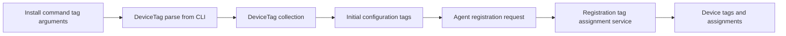
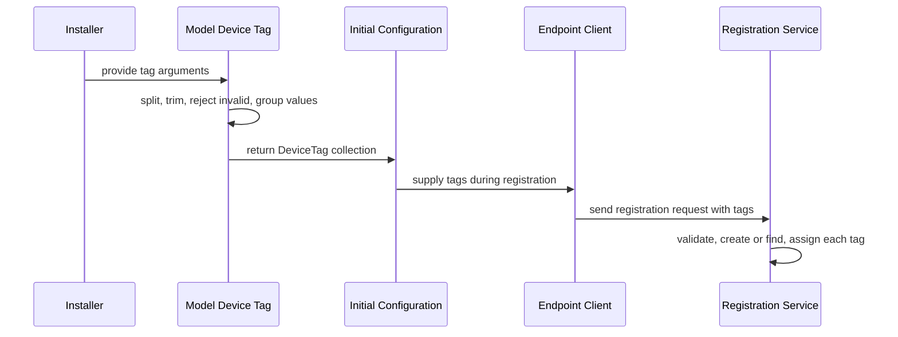
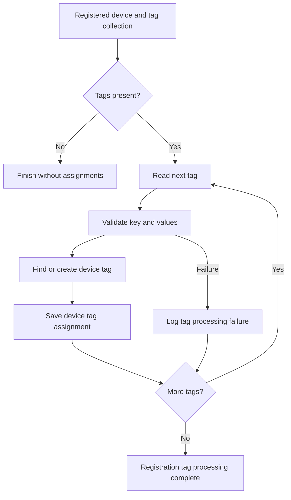

# Model Device Tag

Model Device Tag is the install-time tag representation used by the OpenFrame endpoint client. It turns repeated command-line tag arguments into a serializable collection of tag keys with one or more values, so device classification can travel with the initial client configuration and be applied during device registration.

The implementation belongs to the `openframe_agent_lib` Cargo dependency from [OpenFrame OSS Library](https://github.com/flamingo-stack/openframe-oss-lib/blob/7a766f00e4f58b5d89db007b878ac8d6e0c344f4/clients/openframe-client/src/models/device_tag.rs). This repository runs that client library as part of its client deployment; Model Device Tag itself is not implemented in this repository.

## Responsibilities

- Represent one device tag as a `key` plus a list of `values`.
- Accept repeated CLI-style `key=value` inputs.
- Trim whitespace around keys and values.
- Ignore malformed entries and entries with an empty key or value.
- Group valid values under their shared key for registration configuration.

The model derives serialization and deserialization support, cloning, debug formatting, and equality comparison. It deliberately preserves repeated values: parsing aggregates every valid occurrence for a key and does not deduplicate the value list.

## Data Contract

| Field | Rust type | Meaning |
|---|---|---|
| `key` | `String` | The tag name after trimming surrounding whitespace. |
| `values` | `Vec<String>` | All accepted values supplied for that key. |

`DeviceTag::parse_from_cli` receives `Vec<String>` and returns `Vec<DeviceTag>`. Its result order is not a contract: grouping uses a hash map, whose iteration order is unspecified.

## Parsing Rules

Each candidate must contain an equals sign. The parser splits only at the first equals sign, trims the two resulting portions, and accepts the result only when both portions are nonempty.

| Raw argument | Result |
|---|---|
| `role=workstation` | Adds `workstation` under `role`. |
| `role=workstation` followed by `role=developer` | Produces one `role` tag with both values. |
| ` region = eu ` | Adds `eu` under `region`. |
| `role=` | Ignored because the value is empty. |
| `=workstation` | Ignored because the key is empty. |
| `role` | Ignored because no equals sign is present. |
| `note=a=b` | Adds `a=b` under `note`, because only the first equals sign splits the input. |

## Architecture and Dependencies

Model Device Tag is a small boundary model inside the endpoint-client library. It depends only on Rust standard collections and Serde. Its output becomes part of the client initial configuration, whose `tags` field defaults to an empty list when absent. The registration path then sends tags to the server-side registration processor.

### Component Interaction

## Registration Flow

The server-side registration component, supplied by the OpenFrame client-core library, processes tags independently after a device is registered:

1. If no tags are present, it returns without assigning anything.
2. For every received tag, it validates the key and values.
3. It finds a device-scoped tag with the same key or creates one.
4. For an existing tag, it appends newly supplied values to the tag's option list after deduplication.
5. It stores a device-tag assignment containing the values submitted for that registration.
6. If an individual tag fails processing, the failure is logged and processing continues with later tags.

## Operational Considerations

- Treat CLI input as untrusted configuration. Parsing removes only structurally invalid or blank entries; it does not enforce server-side tag policy.
- Do not rely on the emitted order of tags. Consumers should locate tags by key rather than by vector position.
- Repeated identical inputs remain repeated in the client model. Server-side handling may deduplicate a tag definition's available values, but the assigned value list reflects the registration input.
- Invalid input is silently skipped by the parser. Installation diagnostics should therefore inspect the original arguments when expected tags are absent.
- Keep key and value validation compatible with the server registration service. Client parsing is intentionally permissive beyond requiring nonempty trimmed strings.

## Source and System Placement

The client library is supplied to OpenFrame OSS Tenant as `openframe_agent_lib` version `v0.0.5` from OpenFrame OSS Library. At run time, endpoint-client initial configuration carries the parsed tags into registration, while the Java client-core registration service creates or associates the server-side device tags. The tenant deployment also provides the client service and its backing platform services, but Model Device Tag performs no network or persistence operations itself.

- [Model Device Tag source in OpenFrame OSS Library](https://github.com/flamingo-stack/openframe-oss-lib/blob/7a766f00e4f58b5d89db007b878ac8d6e0c344f4/clients/openframe-client/src/models/device_tag.rs)
