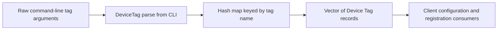
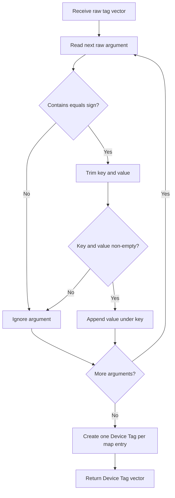
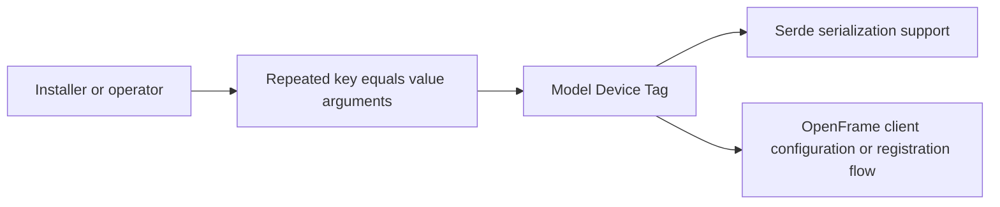

# Model Device Tag

Model Device Tag is the OpenFrame client model that converts repeatable command-line tag arguments into a serializable device-tag collection. It belongs to the Rust client implementation supplied by the **OpenFrame OSS Library** as the `openframe_agent_lib` Cargo dependency. The tenant repository runs that client; the model source itself is maintained in the library repository.

The module has two public elements:

- `DeviceTag` represents one tag key and all values supplied for that key.
- `DeviceTag::parse_from_cli` accepts raw command-line arguments, validates their basic shape, normalizes whitespace, and groups values by key.

The implementation is available in the [OpenFrame OSS Library source](https://github.com/flamingo-stack/openframe-oss-lib/blob/16e7c1cbd9664e7d10ec5ebca7d53c9bd314decf/clients/openframe-client/src/models/device_tag.rs).

## Purpose and Scope

A command line commonly expresses device metadata as repeated `key=value` arguments. Model Device Tag converts that flat representation into a structure suitable for the OpenFrame client configuration and registration flow. For example, inputs such as `site=London`, `role=server`, and `role=database` become two tag records: one for `site` and one for `role` with two values.

The module deliberately has a narrow responsibility:

- It parses only the first equals sign as the separator.
- It trims the key and value around that separator.
- It ignores malformed inputs and empty keys or values.
- It collects multiple values under a shared key.
- It does not enforce an allowed-key list, deduplicate values, persist tags, or communicate with a service.

## Data Model

`DeviceTag` derives `Debug`, `Clone`, `Serialize`, `Deserialize`, and `PartialEq`. These traits make the result inspectable, copyable, comparable in tests, and compatible with Serde-based transport or configuration serialization.

| Field | Type | Meaning |
| --- | --- | --- |
| `key` | `String` | The normalized tag name, taken from the text before the first equals sign. |
| `values` | `Vec<String>` | Every normalized non-empty value supplied for that key. Duplicate values are preserved. |

Conceptually, the parser converts a list of raw strings into an intermediate map and then into a vector of `DeviceTag` values.



## Parsing Contract

The parser receives `Vec<String>`. Each member is handled independently and has no effect on whether the next member is processed.

### Accepted Input

A string is accepted when it contains an equals sign and, after trimming surrounding whitespace, both portions are non-empty. Only the first equals sign separates the key from the value, so later equals signs remain part of the value.

| Raw argument | Result |
| --- | --- |
| `site=London` | Key `site`, value `London`. |
| ` role = database ` | Key `role`, value `database`. |
| `role=server` followed by `role=database` | One `role` record containing `server` and `database`. |
| `token=a=b` | Key `token`, value `a=b`. |

### Ignored Input

The parser silently drops invalid items rather than returning an error.

| Raw argument | Why it is ignored |
| --- | --- |
| `region` | No equals sign exists. |
| `=London` | The normalized key is empty. |
| `site=` | The normalized value is empty. |
| `  =   ` | Both normalized portions are empty. |

This behavior is useful for tolerant command-line processing, but callers that require strict user feedback must validate their input before invoking the parser or compare the accepted result with the supplied arguments.

## Processing Flow



The grouping stage uses a Rust `HashMap<String, Vec<String>>`. The value append operation retains the input encounter order for values belonging to the same key. Conversely, the returned vector is created by iterating the hash map, so consumers must not rely on the order of different tag keys.

## Component Interaction

Model Device Tag is a pure in-memory model. It has no network, filesystem, or database dependency. Its only direct external libraries are Serde for the serialization and deserialization derives and Rust's standard `HashMap` for aggregation.



Within the broader client, the model is adjacent to initial configuration handling, whose public interface includes retrieval of configured tags, and agent registration request models. The module tree identifies those components, but this source file alone does not establish a direct call path between them. Keep that distinction when changing the parsing contract.

## Implementation Notes

### Grouping Semantics

`parse_from_cli` first creates an empty hash map. For each valid pair, it obtains the vector for that key or creates one, then appends the value. It finally maps each key and associated vector into a `DeviceTag`.

```text
Input:
  environment=production
  role=web
  role=api

Logical grouped state:
  environment -> [production]
  role -> [web, api]

Output records:
  Device Tag { key: environment, values: [production] }
  Device Tag { key: role, values: [web, api] }
```

The record order in the final output is intentionally unspecified because the map is unordered. Code that needs deterministic output should sort the returned records by `key` after parsing, without altering the model's current behavior.

### Value Preservation

The parser does not split values further and does not deduplicate them. Thus, `label=a=b` preserves `a=b`, while two occurrences of `role=web` produce two `web` entries for `role`. This preserves input fidelity but leaves semantic validation and uniqueness rules to a higher-level caller.

### Error Handling

There is no `Result` return type. Invalid strings are ignored and valid strings continue to be processed. This makes the function suitable where optional or partially generated argument lists are expected. It is not an error-reporting interface.

## Maintenance Guidance

When modifying Model Device Tag, preserve the behavior that callers may already depend on:

1. Treat only the first equals sign as the delimiter.
2. Continue trimming before testing for empty key and value content.
3. Do not accidentally convert ignored malformed arguments into accepted empty tags.
4. Preserve multi-value grouping for repeated keys.
5. Do not introduce an ordering guarantee unless the data structure and contract are explicitly changed.
6. Add or update tests in the co-located `device_tag_tests.rs` module for every parsing-rule change.

Changes to accepted syntax, duplicate handling, ordering, or invalid-input handling can alter the tags associated with a device at enrollment time. Such changes should therefore be evaluated together with the client configuration and agent-registration paths that consume tag data.

## Dependency Summary

| Dependency | Role |
| --- | --- |
| OpenFrame OSS Library | Provides the Rust source for Model Device Tag. |
| `openframe_agent_lib` | Cargo artifact that supplies the client functionality to this repository. |
| Serde | Supplies serialization and deserialization support for `DeviceTag`. |
| Rust standard library | Supplies the hash map used to group values by tag key. |

Model Device Tag is an internal data-shaping boundary: it turns user-supplied CLI strings into structured metadata while leaving policy, transport, persistence, and downstream tag assignment to the broader OpenFrame platform.
