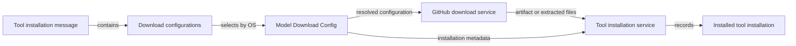
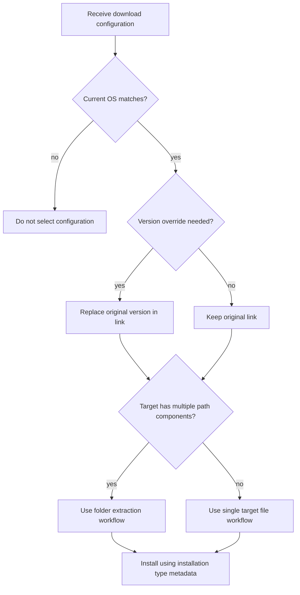
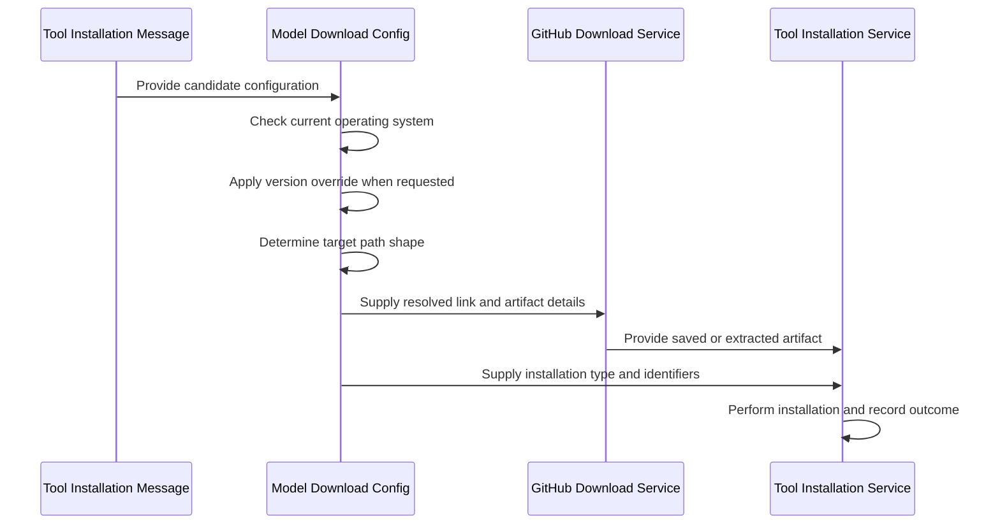

# Model Download Config

Model Download Config is the Rust data model that describes a downloadable tool artifact for the OpenFrame client agent. It is supplied as part of the `openframe_agent_lib` crate from OpenFrame OSS Library and consumed at runtime by this repository's OpenFrame client deployment. The model identifies the target operating system, source artifact, local destination, and installation behavior so one tool-installation message can carry platform-specific download choices.

The implementation is defined in the OpenFrame OSS Library source: [download_configuration.rs](https://github.com/flamingo-stack/openframe-oss-lib/blob/16e7c1cbd9664e7d10ec5ebca7d53c9bd314decf/clients/openframe-client/src/models/download_configuration.rs).

## Responsibilities

The module provides three focused responsibilities:

- **Artifact description** — `DownloadConfiguration` carries the operating-system selector, remote link, downloaded artifact name, and destination name.
- **Installation classification** — `InstallationType` distinguishes a standard executable, GUI application bundle, and managed service, with optional bundle or service identity metadata.
- **Safe selection and adaptation** — helper methods determine whether the configuration applies to the compiled agent platform, whether archive extraction must preserve a directory tree, and whether a versioned link can be overridden.

It does not download, extract, install, or validate artifact contents itself. Those operations belong to the client download and tool-installation services that consume this model.

## Architecture and System Position

A tool-installation message holds zero or more download configurations. The client selects a configuration for its operating system, may adapt its link for a version override, and supplies the resolved artifact and installation metadata to the download and installation workflow.



The surrounding client model separates concerns:

| Component | Relationship to Model Download Config |
|---|---|
| `ToolInstallationMessage` | Owns `download_configurations` as a list, alongside commands, assets, and tool identity. |
| `GithubDownloadService` | Exposes download-and-save and download-and-extract operations; Model Download Config provides the input metadata used to choose the artifact and destination shape. |
| `ToolInstallationService` | Coordinates installation after an artifact has been acquired. |
| `Installation` | Represents persisted or reported installation state using variants corresponding to standard, GUI application, and service installations. |

## Data Model

### `DownloadConfiguration`

`DownloadConfiguration` is serializable and deserializable with camel-case field names. Its fields are:

| Field | Required | Purpose |
|---|---:|---|
| `os` | Yes | Operating system selector. Matching is case-insensitive against `windows`, `macos`, or `linux`. |
| `fileName` | Yes | Name of the source download artifact. |
| `targetFileName` | Yes | Target file name or target relative path after download or extraction. During deserialization, legacy `agentFileName` and `assetFileName` keys are also accepted. |
| `link` | Yes | Remote artifact link. This may be rewritten by a version override. |
| `installationType` | No | Installation behavior. When absent, defaults to `STANDARD`. |
| `bundleId` | No | GUI application bundle identifier. It is omitted during serialization when absent. |
| `serviceName` | No | Service identity for service-style installation. It is omitted during serialization when absent. |

An illustrative payload is shown below. It documents the wire naming and is not a required configuration template.

```json
{
  "os": "macos",
  "fileName": "tool.zip",
  "targetFileName": "Tool.app/Contents/MacOS/tool",
  "link": "https://artifacts.example.invalid/tool/1.2.3/tool.zip",
  "installationType": "GUI_APP",
  "bundleId": "com.example.tool"
}
```

### `InstallationType`

`InstallationType` is an enum serialized in screaming snake case:

| Wire value | Meaning | Associated optional metadata |
|---|---|---|
| `STANDARD` | Conventional executable or ordinary installation. This is the default. | None required. |
| `GUI_APP` | GUI application installation. | `bundleId` may identify the application bundle. |
| `SERVICE` | Managed system service installation. | `serviceName` may identify the service. |

The installation-state model mirrors these concepts with standard, GUI application, and service variants, allowing downstream code to retain the executable path, bundle identifier, or service name appropriate to the selected behavior.

## Configuration Resolution Flow

The model’s helpers are deliberately deterministic and side-effect free except for warning logging during an unsuccessful version replacement.



### Operating System Matching

`matches_current_os()` derives the current platform at compile time:

- Windows maps to `windows`.
- macOS maps to `macos`.
- Linux maps to `linux`.
- Any other compile target returns `false`.

It compares `os` without ASCII case sensitivity. This makes values such as `WINDOWS` and `windows` equivalent, but does not establish aliases between operating-system names.

### Folder Extraction Detection

`is_folder_extraction()` parses `target_file_name` as a path and counts its components. More than one component means the target denotes a nested path and therefore requires the extraction workflow to preserve the archive’s directory structure. A single-component target is treated as a single-file destination.

This behavior is based on path structure rather than filename extension. Consequently, a ZIP-like filename alone does not trigger folder extraction; the target path determines that decision.

### Version Overrides

`with_version_override(original, override_version)` clones the configuration and conditionally rewrites its `link`:

1. If `original` is empty, or already equals `override_version`, the clone retains its original link.
2. Otherwise, every occurrence of `original` in the link is replaced with `override_version`.
3. If the original version string is not found, the link remains unchanged and the client emits a warning through `tracing`.

The method does not alter `file_name`, `target_file_name`, operating system, or installation metadata. It also does not validate that the resulting link is reachable; network retrieval remains the downloader’s responsibility.

## Component Interaction



## Serialization and Compatibility Notes

- Rust field names are snake case, while the serialized `DownloadConfiguration` contract uses camel case.
- `InstallationType` values use screaming snake case, not camel case.
- `targetFileName` is the canonical serialized field. `agentFileName` and `assetFileName` are deserialize-only compatibility aliases, allowing older message producers to be read without emitting legacy names on serialization.
- Optional `bundleId` and `serviceName` are defaulted to absent and omitted from serialized output when absent.
- The default installation type is `STANDARD`, preserving behavior for payloads that predate explicit installation classification.

## Maintenance Guidance

When extending this model, preserve wire compatibility deliberately:

- Add new fields with `serde` defaults when older payloads must remain readable.
- Avoid renaming existing serialized keys without an explicit alias and migration plan.
- Keep installation-type variants synchronized with installation and updater code paths so a configuration can be installed and later recognized consistently.
- Treat changes to operating-system labels as protocol changes because `matches_current_os()` only recognizes the three explicit names.
- Test both a single-file target and a nested target path whenever modifying extraction behavior.
- Test a successful version replacement, a no-op replacement, and a missing-original replacement to retain warning behavior and immutable source configuration semantics.

## Source and Runtime Ownership

The source code belongs to the OpenFrame OSS Library, which this repository consumes as the `openframe_agent_lib` Cargo dependency at version `v0.0.5`. OpenFrame OSS Tenant runs the client assembly that includes this library; therefore, application deployment and service configuration live here, while the Model Download Config implementation and its direct unit-level evolution live in the library source linked above.
