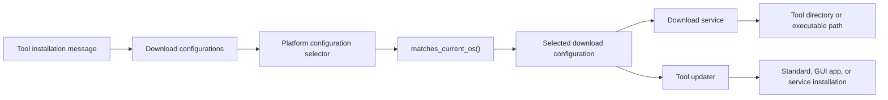
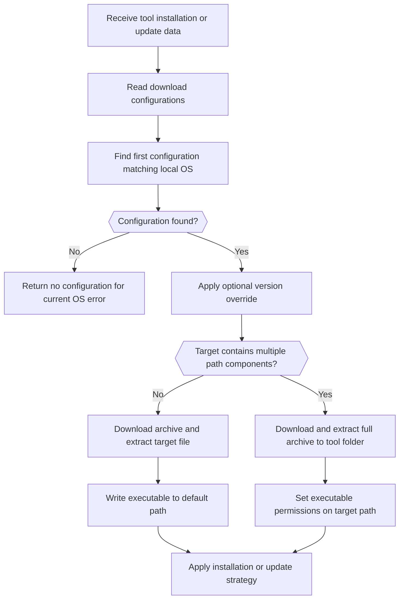
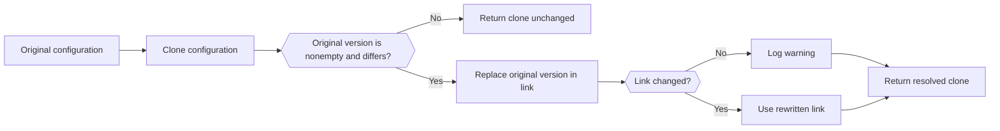
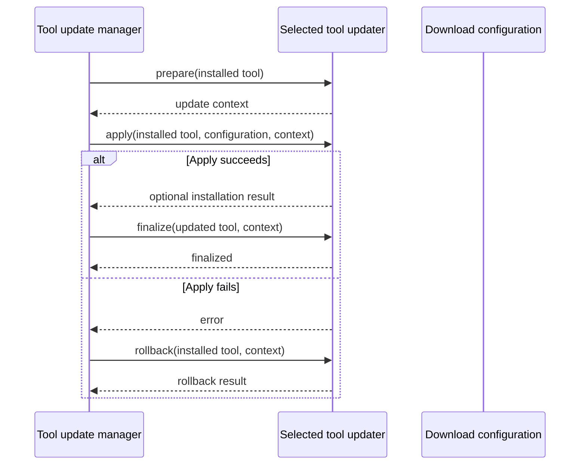

# Model Download Configuration

Model Download Configuration defines the per-operating-system artifact descriptor consumed by the OpenFrame client agent when it installs or updates an integrated tool. It is implemented by the `openframe_agent_lib` Cargo dependency from [OpenFrame OSS Library](https://github.com/flamingo-stack/openframe-oss-lib/blob/7a766f00e4f58b5d89db007b878ac8d6e0c344f4/clients/openframe-client/src/models/download_configuration.rs), pinned by this repository at version `v0.0.5`.

The model is deliberately declarative: it identifies an artifact, the executable or bundle member expected after download, its operating system, and the intended installation shape. The client resolves the configuration locally, while download, extraction, file placement, and lifecycle actions are performed by surrounding client services.

## Responsibilities

`DownloadConfiguration` provides four decisions required before an artifact can be installed:

1. **Platform selection** through a case-insensitive comparison of `os` with the compiled client platform.
2. **Artifact identification** through the downloaded archive or file name, target path, and source link.
3. **Extraction scope** by determining whether `targetFileName` identifies one file or a nested path that requires a whole-archive extraction.
4. **Release substitution** by cloning the configuration and replacing an original version segment in its link when a version override is selected.

The module does not download content, validate checksums, create directories, or invoke installers. Those responsibilities remain in the OpenFrame client services that consume this model.

## Data Model

The payload uses camel-case property names. `targetFileName` additionally accepts the legacy aliases `agentFileName` and `assetFileName` during deserialization, allowing older producers to remain compatible with the agent.

| Property | Rust type | Serialization behavior | Purpose |
|---|---|---|---|
| `os` | `String` | Required | Target operating system identifier. |
| `fileName` | `String` | Required | Name of the downloaded artifact, used to select extraction handling. |
| `targetFileName` | `String` | Required; accepts legacy aliases | File or relative path expected inside the artifact. |
| `link` | `String` | Required | Artifact source URL. |
| `installationType` | `InstallationType` | Optional; defaults to `STANDARD` | Installation lifecycle expected for the tool. |
| `bundleId` | `Option<String>` | Optional; omitted when absent | Bundle identifier for installations that need one. |
| `serviceName` | `Option<String>` | Optional; omitted when absent | Service identity for service-managed installations. |

`InstallationType` is serialized as screaming-snake-case and has three values:

| Value | Meaning |
|---|---|
| `STANDARD` | The default file-oriented installation. |
| `GUI_APP` | A graphical application installation. |
| `SERVICE` | An installation managed as a system service. |

The type defaults to `STANDARD` if omitted. `bundleId` and `serviceName` do not themselves change extraction or platform matching; consumers use them when applying the chosen installation strategy.

## Configuration Example

The following is an illustrative wire-format shape. URLs, product names, and versions are deployment-specific and are not prescribed by this module.

```json
{
  "os": "macos",
  "fileName": "example-tool-1.2.3.dmg",
  "targetFileName": "Example Tool.app/Contents/MacOS/Example Tool",
  "link": "https://artifacts.example.invalid/example-tool-1.2.3.dmg",
  "installationType": "GUI_APP",
  "bundleId": "invalid.example.tool"
}
```

A `targetFileName` with more than one path component signals folder extraction. For example, `Example Tool.app/Contents/MacOS/Example Tool` is treated differently from a single filename such as `example-tool`.

## Architecture and Consumers

The model travels within the client-side tool-installation message. The message can contain several configurations so one tool definition supports Windows, macOS, and Linux. The download service selects the first configuration whose operating-system value matches the local target, then uses the selected artifact metadata. The updater layer uses `installationType` through the installed-tool installation record to select an appropriate updater implementation.



### Runtime Boundaries

| Component | Relationship to Model Download Configuration |
|---|---|
| Tool installation message | Carries `downloadConfigurations` alongside tool identifiers, version, commands, and optional assets. |
| Download service | Selects the local configuration, retrieves the link with retry behavior, extracts or writes it, and applies executable permissions where applicable. |
| Directory manager and binary writer | Supply the destination paths and persist a downloaded executable. |
| Tool updater | Applies update lifecycle behavior and can roll back after a failed update. The concrete updater is selected from the existing installation type. |
| Installed-tool records | Persist the resulting installation representation, including the installation kind needed by subsequent updates. |

## Artifact Resolution Flow

The OpenFrame client uses this configuration as follows:



### Platform Matching

`matches_current_os()` maps the client build target to exactly one of `windows`, `macos`, or `linux`. It then compares that value with `os` using ASCII case-insensitive equality. Unsupported build targets never match. Consequently, server-side configuration must use one of those platform names and include a distinct entry for every supported platform.

The selection function returns the first matching entry. Avoid duplicate configurations for the same operating system unless their ordering is an intentional priority rule.

### Extraction Semantics

`is_folder_extraction()` counts path components in `targetFileName`:

- A single component selects the single-file path. The download service supports ZIP, TAR.GZ, and TGZ archives in this branch, extracts the named member, rejects unsupported formats, and writes the resulting bytes as an executable.
- More than one component selects the full-archive path. The download service extracts TAR.GZ or TGZ archives, and also supports DMG extraction in this path. It then applies executable permissions to the target path under the tool directory.

In both paths, the download service rejects artifacts below its minimum binary-size threshold. After full extraction it warns, rather than immediately failing, if the configured target is not present. Configuration authors should therefore ensure that `fileName`, `targetFileName`, and the archive layout agree exactly.

## Version Overrides

`with_version_override(original, overrideVersion)` returns a cloned configuration. When `original` is nonempty and differs from `overrideVersion`, it replaces every matching occurrence of `original` in `link`. If no matching substring exists, it logs a warning and returns the otherwise unchanged clone.

This method only rewrites the link. It does not update `fileName`, `targetFileName`, `bundleId`, or `serviceName`. A release naming convention must therefore keep the download URL and expected archive contents compatible with an override, or the producer must provide configuration that remains valid after the substitution.



## Installation Lifecycle Integration

The configuration identifies an intended installation type, but update dispatch is based on the installed tool's current installation representation. The updater factory maps standard installations to the standard updater, GUI application installations to the GUI updater on macOS and to the standard updater on non-macOS builds, and service installations to the service updater.

Each update follows a three-phase lifecycle:



A configuration change should be tested against new installation and update paths, especially when moving between standard, GUI application, or service packaging.

## Authoring and Maintenance Guidance

- Provide one configuration for each supported client operating system, using `windows`, `macos`, or `linux`.
- Keep `fileName` aligned with the real archive extension because extraction routing uses that field rather than inspecting the remote response.
- Use a simple `targetFileName` for a single extracted executable. Use a relative multi-component target for bundles or archive layouts that must be retained.
- Prefer paths relative to the tool directory. The module checks component count but does not itself enforce a complete path-safety policy.
- Choose `installationType` to reflect the intended lifecycle, and set `bundleId` or `serviceName` only where the relevant installer requires it.
- Validate version overrides against the actual link and artifact layout. A replacement can succeed syntactically while still pointing to a package whose expected target path differs.
- Treat the source link as deployment data. This model does not authenticate the source or perform integrity verification beyond the downloader's size checks.

## Source of Truth

The model and all three helper methods are defined in [download_configuration.rs](https://github.com/flamingo-stack/openframe-oss-lib/blob/7a766f00e4f58b5d89db007b878ac8d6e0c344f4/clients/openframe-client/src/models/download_configuration.rs) in OpenFrame OSS Library. This tenant repository assembles that library into its OpenFrame client runtime; the runtime integration described here is provided by the same library's download, installation, and updater services.
