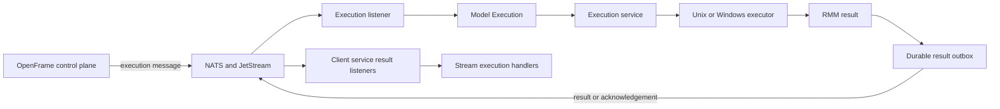
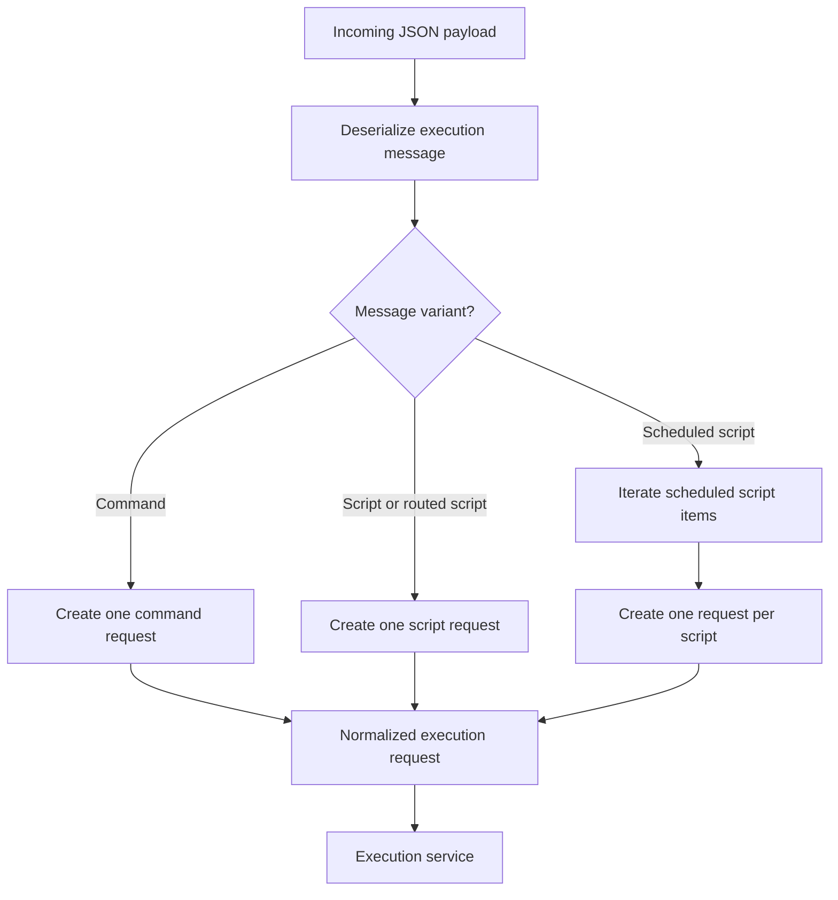
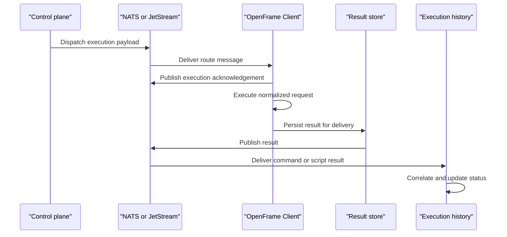

# Model Execution

Model Execution is the OpenFrame Client agent's execution-message contract. It defines how command, ad hoc script, bootstrap, software, and scheduled-script work is represented after the agent receives it, and how completed work is reported. The contract is implemented by the Rust client code supplied by the `openframe_agent_lib` dependency from [OpenFrame OSS Library](https://github.com/flamingo-stack/openframe-oss-lib/blob/16e7c1cbd9664e7d10ec5ebca7d53c9bd314decf/clients/openframe-client/src/models/execution.rs).

This module intentionally contains data types and conversion rules rather than process-launching logic. It is the boundary between NATS-delivered JSON and the execution service that invokes an operating-system-specific executor.

## Responsibilities

Model Execution provides the following guarantees:

- **Typed inbound payloads.** Command, script, and scheduled-script payloads deserialize from camel-case JSON into typed Rust structures.
- **Normalized execution requests.** Each message becomes one or more `ExecutionRequest` values with code, shell, arguments, environment variables, privilege, timeout, and correlation identifiers.
- **Route-specific identity and policy.** The `ExecutionMessage` trait names the message kind, identifies whether a scheduled request is durable, and permits route-specific privilege behavior.
- **Correlated outcomes.** `RmmResult` retains the execution, machine, script, and schedule identifiers needed to associate a device result with server-side execution history.
- **Delivery acknowledgement selection.** `requires stream ack` identifies subjects that must be published through JetStream acknowledgement rather than a fire-and-forget publish.

## System Position

The OpenFrame Client application subscribes to execution subjects through generic execution listeners. After a payload is parsed through the Model Execution contract, the execution service runs each normalized request and the result path publishes a serialized outcome. The tenant's Java client service consumes acknowledgements and result messages; downstream stream handlers update command or script execution history.

The Rust agent originates in OpenFrame OSS Library, while this repository assembles the services and infrastructure that receive the results. The tenant configuration identifies NATS as a datasource for the client-facing services, and execution results ultimately drive command and script history processing.

## Message Model

### Execution Message Trait

`ExecutionMessage` is the common interface used by the generic listener. Every implementation supplies a message kind and implements three operations:

1. Parse a UTF-8 JSON payload.
2. Return the common execution identifier.
3. Convert the message into one or more `ExecutionRequest` values.

The trait also exposes optional schedule correlation, a result-kind override, a durable-delivery indicator, and a privilege-policy constant. This keeps listener and execution code generic while allowing message variants to define their own wire routing.

| Message variant | Message kind | Requests produced | Special behavior |
|---|---|---:|---|
| `CommandMessage` | `command-execution` | One | Contains inline code and no script or schedule identifier. |
| `ScriptMessage` | `script-execution` | One | Carries an optional script identifier and schedule identifier. |
| Bootstrap script route | `script-bootstrap-execution` | One | Uses the standard script payload shape under a different route. |
| Software script route | `software-execution` | One | Declares interactive elevated privilege policy. |
| `ScriptScheduleExecutionMessage` | `script-schedule-execution` | One per embedded script | Is durable and reports under the script execution result kind. |

`RoutedScriptMessage` is a generic wrapper around `ScriptMessage`. It uses a zero-sized route marker to reuse the script schema while changing the NATS kind and, where needed, policy. Bootstrap and software execution therefore share fields and conversion logic with ordinary scripts instead of duplicating JSON models.

### Script Specification

`ScriptSpec` is flattened into script messages and scheduled-script items. It contains:

| Field | Meaning | Default when omitted |
|---|---|---|
| Code | Script source passed to the operating-system executor. | Required. |
| Shell | Interpreter selector. | Required. |
| Privilege level | Requested user or administrator context. | Administrator. |
| Arguments | Ordered interpreter or script arguments. | Empty list. |
| Timeout seconds | Per-request execution limit. | 900 seconds. |
| Environment variables | Name and value pairs injected for the process. | Empty list. |

Supported shells are PowerShell, Command Prompt, Bash, Python, Nushell, and the generic shell. `ScriptShell::as param` maps the serialized shell enum to the interpreter argument expected by the executor: PowerShell becomes `powershell`, Command Prompt becomes `cmd`, Bash becomes `bash`, generic shell becomes `sh`, Python becomes `python`, and Nushell becomes `nushell`.

An environment variable also carries a `secret` marker. Model Execution preserves that marker when deserializing the payload, but request construction produces the executor input as `name=value` strings. Callers must therefore ensure that surrounding logging and transport paths do not expose secret values.

### Request Conversion

`ScriptSpec::to request` applies defaults and preserves correlation:

- It uses the parent execution identifier for every generated request.
- It retains the script identifier and optional schedule identifier when available.
- It converts each environment variable to an executor-compatible string.
- It applies the default timeout if one is absent.
- It initially assigns the default privilege policy, while the receiving route declares whether it should be interpreted as requested or interactively elevated.

A scheduled message contains a shared execution identifier and a list of script items. Each item has its own script identifier and specification; this prevents a multi-script schedule from losing per-script correlation even though it is dispatched as one schedule execution.

## Privilege and Platform Execution

`PrivilegeLevel` represents the requested execution context: user or administrator. `PrivilegePolicy` expresses how a route treats that request:

- **As requested** is the default behavior.
- **Interactive elevated** is declared by the software route, allowing its execution path to request elevation in an interactive user context.

The execution service resolves the final privilege and invokes the correct platform executor. On Unix, the executor resolves the target run-as context, writes normalized code to a temporary script file, applies arguments and environment variables, configures process execution, and enforces the timeout. On Windows, it accepts PowerShell and Command Prompt, prepares a temporary script file, then runs normally or through the logged-on user's interactive session according to the resolved privilege.

If the process cannot start, the execution service treats exit code `85` as an execution-start error and places the executor diagnostic into the optional result error field. Unsupported host platforms return the same exit code with an explicit unsupported-platform error. A zero timeout is normalized to 900 seconds by the execution service before execution begins.

## Result and Acknowledgement Contracts

`RmmResult` is the agent-to-platform result envelope. It reports standard output, standard error, exit code, elapsed milliseconds, timeout status, and an optional error. Script and schedule identifiers are omitted from JSON when absent; this lets the same result structure represent command and script work.

`ExecutionAck` reports that a machine has acknowledged an execution. It includes the execution identifier, machine identifier, optional schedule identifier, and the collection of script identifiers involved. Its kind is `execution.acknowledge`.

The result outbox persists outbound result payloads before delivery when the local result store is available. Its run manager wakes periodically or when notified, rejects entries that exceed the publisher payload limit, and removes an entry only after a successful publish. It selects JetStream publish acknowledgement for execution acknowledgements, delivery results, and package-update status subjects. Other subjects use normal publish semantics. This separation supports retries without treating every result channel as a stream-acknowledged channel.

On the platform side, the client service's acknowledgement listener consumes `machine.*.execution.acknowledge` from the `EXECUTION_ACKNOWLEDGE` stream. Script results are consumed from `machine.*.script-execution.result`. Stream processing then correlates script history using the machine identifier, execution identifier, and script identifier. The script identifier is essential for scheduled runs because multiple scripts can share the same execution identifier and machine.

## Execution Outcome Processing

The downstream stream handlers use fields originating in `RmmResult` to update execution rows:

- The command handler correlates a row by machine identifier and execution identifier.
- The script handler correlates a row by machine identifier, execution identifier, and script identifier.
- Both handlers classify the outcome using exit code, timeout state, error, and agent failure reason.
- Terminal rows are protected from duplicate or late results that would overwrite an already final state.
- Standard output and standard error are bounded before persistence, and each truncation is recorded.
- A completed scheduled script can trigger schedule aggregation; scheduled device-online dispatches can be marked processed after the result is applied.

## Maintenance Notes

When extending Model Execution, preserve the following compatibility boundaries:

1. **Keep wire names stable.** Payload fields use camel case and shell values use uppercase deserialization. Changing either breaks messages already emitted by the control plane.
2. **Preserve correlation fields.** Any new execution form must keep enough identifiers for result listeners to locate the appropriate command or script history row.
3. **Declare delivery semantics explicitly.** Set message kind, result kind, durability, and acknowledgement behavior deliberately rather than inheriting them by accident.
4. **Review privilege behavior with the platform executors.** A new privilege level or policy requires compatible handling on both Unix and Windows.
5. **Bound and protect output.** Execution output may be large or sensitive. Continue using the durable outbox and downstream truncation path rather than bypassing result handling.

The authoritative implementation is [execution.rs in OpenFrame OSS Library](https://github.com/flamingo-stack/openframe-oss-lib/blob/16e7c1cbd9664e7d10ec5ebca7d53c9bd314decf/clients/openframe-client/src/models/execution.rs).