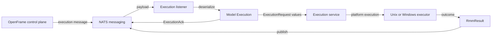
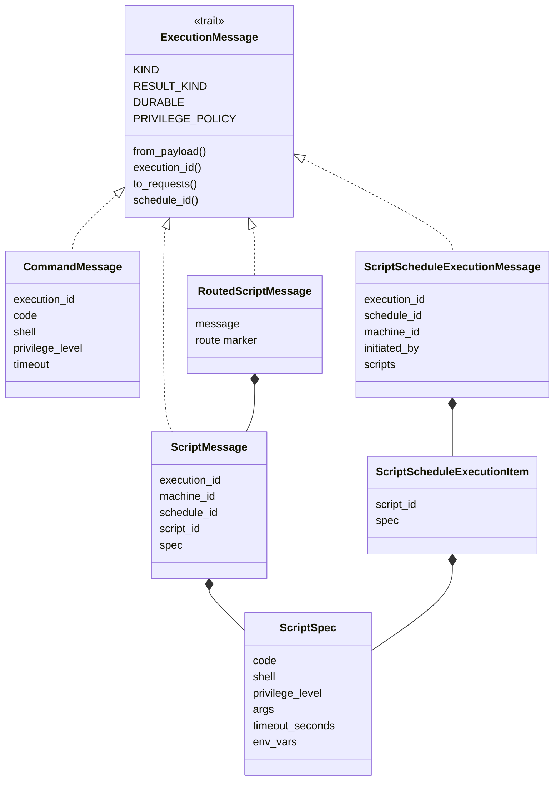
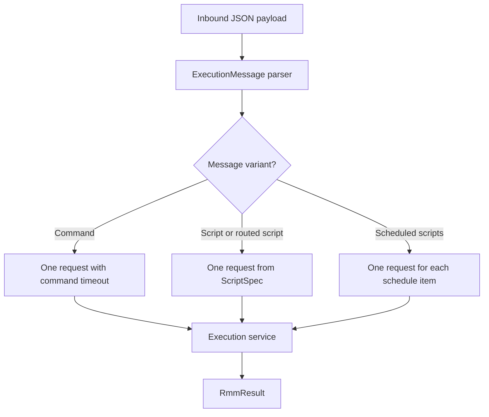
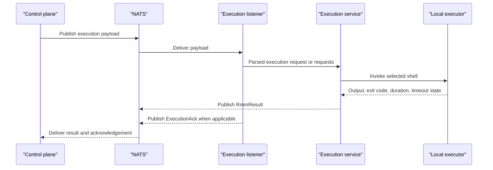

# Model Execution

Model Execution defines the Rust wire models that describe remote command and script work received by the OpenFrame client agent. It belongs to the `openframe_client` Cargo artifact supplied by OpenFrame OSS Library version `v0.0.5`, which this repository runs as part of its client deployment. The module is deliberately declarative: it parses execution payloads, normalizes them into executable requests, and serializes execution acknowledgements and results. Process creation, operating-system-specific execution, message subscription, and result transport are performed by neighboring agent components.

The implementation is in the OpenFrame OSS Library: [execution.rs](https://github.com/flamingo-stack/openframe-oss-lib/blob/7a766f00e4f58b5d89db007b878ac8d6e0c344f4/clients/openframe-client/src/models/execution.rs).

## Responsibilities

- Deserialize commands, one-off scripts, routed scripts, and scheduled script batches.
- Represent shell selection, requested privilege, command arguments, time limits, and environment variables.
- Convert every message variant into one or more normalized `ExecutionRequest` values.
- Preserve execution, machine, script, and schedule identifiers needed to correlate server-side dispatch with agent-side outcomes.
- Declare routing metadata, including message kind, result kind, durability, and privilege policy.
- Serialize the result and acknowledgement payloads returned through the agent messaging path.

It does **not** execute code, validate whether a device may run a payload, redact secret environment variable values, or publish messages. Those responsibilities remain with the agent execution, listener, logging, and messaging services.

## Architecture and System Position

The surrounding OpenFrame client agent consumes model values as follows:

| Boundary | Model Execution contribution | Consuming concern |
|---|---|---|
| Inbound dispatch | `ExecutionMessage::from_payload` identifies and decodes the JSON body for a message kind. | The execution listener receives and routes messaging traffic. |
| Normalization | `to_requests` turns one message into a list of `ExecutionRequest` values. | The execution service coordinates execution and tracks running scripts. |
| Operating-system launch | Each request supplies shell, privilege, arguments, timeout, environment values, and correlation IDs. | Platform executors invoke the appropriate local interpreter or command mechanism. |
| Completion reporting | `RmmResult` supplies output, timing, exit state, and optional error and script metadata. | The result store and outbox publish durable outcomes. |
| Delivery confirmation | `ExecutionAck` identifies accepted work. | Stream-aware transport can distinguish acknowledgement messages from ordinary publications. |

## Core Types

### Script Description

`ScriptSpec` is the reusable executable definition embedded in a one-off `ScriptMessage` and each `ScriptScheduleExecutionItem`. Its deserialized camel-case fields are:

| Field | Purpose | Default when omitted |
|---|---|---|
| `code` | Script source text to execute. | Required |
| `shell` | Interpreter or command shell. | Required |
| `privilegeLevel` | Requested `User` or `Admin` execution level. | `Admin` during request conversion |
| `args` | Ordered command arguments. | Empty list during request conversion |
| `timeoutSeconds` | Maximum runtime in seconds. | 900 seconds during request conversion |
| `envVars` | Environment variables as `ScriptEnvVar` records. | Empty list during request conversion |

`ScriptEnvVar` contains `name`, `value`, and a `secret` flag. Conversion formats each item as `name=value` for `ExecutionRequest.env_vars`. The flag is metadata on the inbound model; this source file does not implement masking or encryption. Callers and logging paths must therefore avoid exposing values that are marked secret.

`ScriptShell` accepts uppercase wire names and maps them to the process parameter shown below:

| Wire name | `as_param()` value |
|---|---|
| `POWERSHELL` | `powershell` |
| `CMD` | `cmd` |
| `BASH` | `bash` |
| `PYTHON` | `python` |
| `NUSHELL` | `nushell` |
| `SHELL` | `sh` |

### Inbound Message Families

`ExecutionMessage` is the common contract for all inbound work. Every implementation supplies a `KIND`, parser, stable execution identifier, and one or more requests. The optional trait members communicate additional delivery semantics:

- `RESULT_KIND` defaults to `KIND` and identifies the outbound result category.
- `DURABLE` defaults to `false`; scheduled script messages set it to `true`.
- `PRIVILEGE_POLICY` defaults to `AsRequested`.
- `schedule_id()` defaults to absent and is implemented for script and scheduled-script messages.

| Message | Kind | Requests produced | Special behavior |
|---|---|---:|---|
| `CommandMessage` | `command-execution` | One | Has command-specific `timeout`, whose JSON default is 900 seconds. No arguments, environment variables, script ID, or schedule ID are supplied. |
| `ScriptMessage` | `script-execution` | One | Flattens a `ScriptSpec` alongside execution, machine, script, and optional schedule identity. |
| `ScriptScheduleExecutionMessage` | `script-schedule-execution` | One per item in `scripts` | Uses `script-execution` as `RESULT_KIND` and marks the message durable. Each generated request uses the batch execution ID and batch schedule ID. |
| Bootstrap routed script | `script-bootstrap-execution` | One | A typed route wrapping `ScriptMessage`. |
| Software routed script | `software-execution` | One | Declares `InteractiveElevated` as its route-level privilege policy. |

`RoutedScriptMessage` uses a phantom route marker rather than adding route fields to the JSON document. `BootstrapRoute` and `SoftwareRoute` consequently share the exact `ScriptMessage` payload shape while retaining distinct type-level message kinds and policies.

## Request Conversion

`ExecutionRequest` is the execution-ready internal representation. It borrows code, IDs, and arguments from the parsed message while owning the formatted environment-variable list.

The conversion rules are intentionally consistent across script paths:

1. The request keeps the enclosing `execution_id`.
2. `ScriptSpec` provides code and shell.
3. An omitted script privilege becomes `Admin`; an explicit value remains `User` or `Admin`.
4. Missing arguments and environment variables become empty collections.
5. An omitted script timeout becomes 900 seconds.
6. Script and schedule IDs are included when available, allowing downstream outcome correlation.

`PrivilegePolicy` is separate from requested `PrivilegeLevel`. `PrivilegeLevel` tells the executor whether the request asks for a user or administrator context. `PrivilegePolicy` describes route-level handling: `AsRequested` is the default, while `InteractiveElevated` is declared for the software route. Consumers that apply execution policy should read the associated `ExecutionMessage` policy rather than inferring it from JSON fields.

## Result and Acknowledgement Flow

`RmmResult` serializes these outcome fields: execution and machine IDs, standard output, standard error, integer exit code, execution duration in milliseconds, and a timeout flag. `error`, `script_id`, and `schedule_id` are omitted from the serialized payload when unavailable. Unlike the camel-case input structs and acknowledgement, this type does not declare a rename policy in this file; its serialized field names therefore follow Rust's default field naming.

`ExecutionAck` uses camel-case serialization and contains the execution ID, machine ID, optional schedule ID, and the set of script IDs accepted by the agent. `EXECUTION_ACK_KIND` is `execution.acknowledge`.

The `requires_stream_ack` helper returns `true` when a subject ends with any of the following message kinds:

- `execution.acknowledge`
- the delivery-result kind defined by the sibling delivery model
- the package-update-status kind defined by the sibling package-update-status model

The suffix comparison permits these kinds to be used beneath a subject prefix while retaining the same acknowledgement decision.

## Wire-Contract Considerations

- Input structs use serde field mapping. Most execution messages use camel-case JSON; `ScriptShell` and `PrivilegeLevel` use uppercase enum names.
- `ScriptMessage` and schedule items flatten `ScriptSpec`, so specification properties appear at the same JSON level as the message-specific properties rather than in a nested `spec` object.
- A scheduled payload accepts an omitted `scripts` field as an empty list. It consequently converts to no execution requests rather than failing solely because the collection is absent.
- The `machine_id` and `initiated_by` fields are carried by models where present, but request conversion only places execution, script, and schedule correlation identifiers on `ExecutionRequest`.
- All parsing uses `serde_json` and returns an `anyhow::Result`; malformed payloads fail parsing before any local execution request is produced.

## Maintenance Guidance

When evolving this module:

1. Treat message kinds and serde names as interoperability contracts with the server and the client listener.
2. Preserve the distinction between execution ID, script ID, and schedule ID. Scheduled work can generate multiple requests under one execution ID.
3. Update all `ExecutionMessage` metadata when adding a new route, particularly `KIND`, result kind, durability, and privilege policy.
4. Keep timeout behavior explicit. The default is 900 seconds both for `CommandMessage` deserialization and omitted script timeout conversion.
5. Review the execution service, operating-system executors, and outbound result handling together with model changes, because this module only defines the data boundary.
6. Consider secret environment-variable handling across the complete pipeline. The model preserves secret values in request strings and cannot itself prevent later output or logs from disclosing them.
