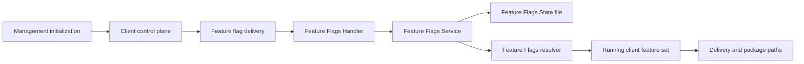
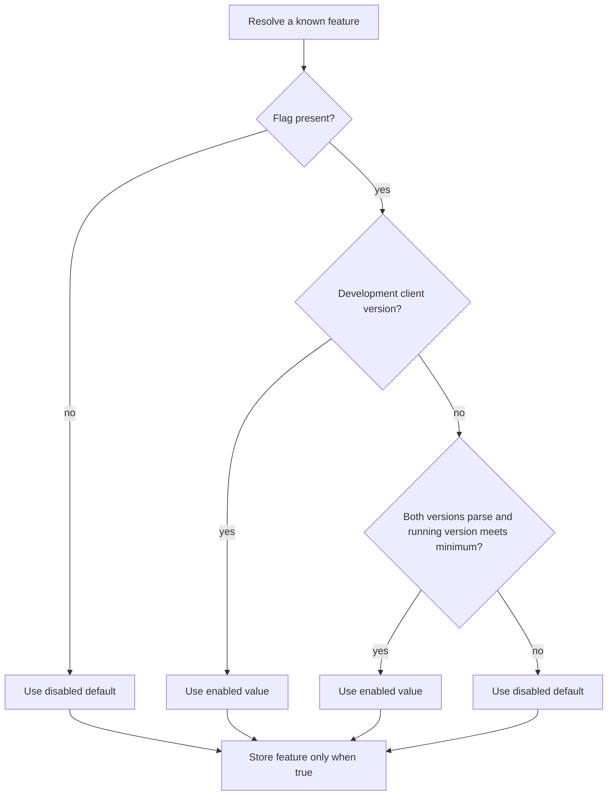
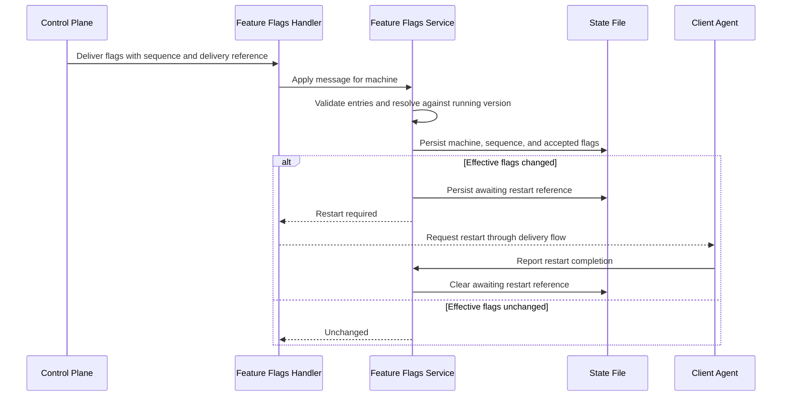
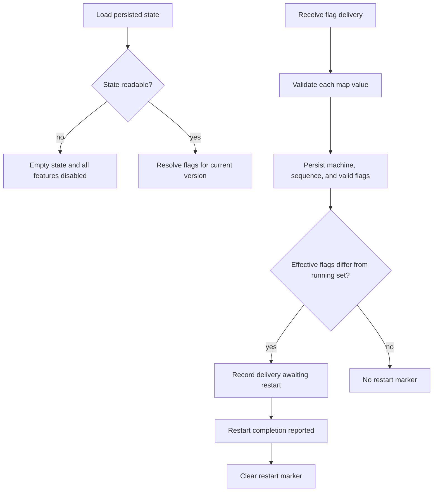

# Model Feature Flags

Model Feature Flags defines the wire format and local evaluation rules used by the OpenFrame client agent to selectively enable delivery and package-management capabilities. It is implemented by the `openframe_agent_lib` dependency from the OpenFrame OSS Library and runs in this repository's OpenFrame client deployment.

The module is deliberately fail-closed: every defined feature defaults to disabled, absent or malformed configuration does not enable it, and a version-ineligible flag resolves to the feature default. The implementation is in the [OpenFrame OSS Library feature flags source](https://github.com/flamingo-stack/openframe-oss-lib/blob/16e7c1cbd9664e7d10ec5ebca7d53c9bd314decf/clients/openframe-client/src/models/feature_flags.rs).

## Responsibilities

- Name the finite set of agent-controlled features.
- Represent a server-delivered flag as an `enabled` value plus a minimum client version.
- Resolve the effective, in-memory feature set for the currently running agent version.
- Preserve the received state, delivery sequence, machine identity, and restart acknowledgement state through the companion feature-flag service.
- Keep new or malformed configuration from silently turning on privileged agent functionality.

## Supported Features

`Feature::ALL` is the authoritative list of features evaluated by this module. Every entry currently has a default of `false`.

| Feature enum value | Wire name | Default | Effect when enabled |
|---|---|---:|---|
| `DeliveryToolInstallation` | `delivery-tool-installation` | Disabled | Allows the agent's tool-installation delivery path to be considered enabled. |
| `DeliveryClientUninstall` | `delivery-client-uninstall` | Disabled | Allows client-uninstall delivery to be considered enabled. |
| `DeliveryClientUpdate` | `delivery-client-update` | Disabled | Allows client-update delivery to be considered enabled. |
| `PackageAutoUpdate` | `package-auto-update` | Disabled | Allows the package automatic-update path to be considered enabled. |

Only these names affect `FeatureFlags::is_enabled`. The payload map is string-keyed, so an unrecognized but syntactically valid flag can be retained in persisted state; it has no effect until the client adds a matching `Feature` variant.

## Architecture and System Placement

The Rust model is not a standalone service. It is used by the client command-handling and persistence layers supplied by the OpenFrame OSS Library. In the tenant deployment, the client service runs the library; management and client-core services supply the broader control-plane integration that initializes and delivers configuration.



### Component Roles

| Component | Role |
|---|---|
| `Feature` | Closed enum identifying the capabilities that can be switched on. `name` produces the protocol key and `default_enabled` supplies fail-closed defaults. |
| `FeatureFlag` | Per-key payload with `enabled` and `min_version`; its internal evaluation determines whether the payload applies to the running client. |
| `FeatureFlagsMessage` | Incoming, deserialized message wrapper. Its map values are generic JSON so each item can be validated independently. |
| `FeatureFlags` | Resolved runtime set backed by a hash set of enabled enum values. Callers use `is_enabled` rather than reading raw payloads. |
| `FeatureFlagsState` | Persisted snapshot containing the registration's machine identifier, delivery sequence, accepted flag map, and optional delivery awaiting restart completion. |
| `FeatureFlagsService` | Loads and persists state, validates incoming entries, detects when a restart is required, and exposes sequence and restart status to command-delivery infrastructure. |
| `FeatureFlagsHandler` | Command handler that connects delivered feature-flag commands to the service. |

## Flag Payload Contract

The message contains a map under `flags`. Each usable entry must deserialize to a `FeatureFlag` and have a parseable semantic-version `minVersion` value. Rust's camel-case serialization maps the `min_version` field to `minVersion` on the wire.

```json
{
  "flags": {
    "delivery-client-update": {
      "enabled": true,
      "minVersion": "1.2.0"
    },
    "package-auto-update": {
      "enabled": false,
      "minVersion": "1.2.0"
    }
  }
}
```

An entry lacking a boolean `enabled`, lacking `minVersion`, or carrying an unparsable minimum version is ignored during application and logged as invalid. The remaining valid entries are persisted. A missing known feature, an invalid entry, or an insufficient or unparsable running version yields that feature's default, which is disabled.

## Resolution Rules

For every member of `Feature::ALL`, `FeatureFlags::resolve` looks up the feature's wire name and evaluates the associated entry. The result is independent for each known feature.



The special development version is `DEV_CLIENT_VERSION` from the client configuration module. When the running version exactly matches it, the minimum-version gate is bypassed and the flag's `enabled` value is used directly. For ordinary releases, the module parses both versions and requires the running version's precedence to be greater than or equal to the minimum version.

### Effective State Versus Stored State

The stored flag map records the accepted configuration. The runtime `FeatureFlags` set represents the configuration effective at process start. `FeatureFlagsService::apply` compares newly resolved flags to that fixed running set:

- If they are equal, the service persists the new state and returns `Unchanged`.
- If they differ, it persists the new state, returns `RestartRequired`, and records the delivery reference in `awaiting_restart`.
- A restart loads the persisted state and recomputes the runtime set, making the changed configuration active.

This separation prevents a process from partially changing behavior while handlers and background services are already running.

## Delivery, Persistence, and Restart Flow



At startup, `FeatureFlagsService::load` reads the state file and resolves its flags for the running client version. A missing file starts from the default state. Read or JSON-deserialization failures are logged and also fall back to an empty, disabled state rather than retaining uncertain capabilities.

The saved `machine_id` scopes the saved sequence number to a specific registration. `applied_sequence` returns the saved value only when the supplied machine identifier matches; when it does not, it returns zero so the new registration can accept deliveries without inheriting ordering from another machine. `restart_reported` clears the persisted pending restart marker only after restart completion is reported.

## State Model



`FeatureFlagsState` uses a `BTreeMap`, which gives a stable key order for state and diagnostic output. The resolved runtime representation instead uses a `HashSet<Feature>` because callers only need efficient membership checks.

## Integration Guidance

Consumers should obtain the resolved `FeatureFlags` from `FeatureFlagsService::flags` and guard a specific behavior with `is_enabled(Feature::...)`. Do not use raw message fields to make runtime decisions, because that would bypass known-feature filtering, semantic-version gating, defaults, and restart coordination.

When adding a feature:

1. Add a new `Feature` variant.
2. Add it to `Feature::ALL`.
3. Assign a stable wire name in `name`.
4. Choose an explicit safe default in `default_enabled`.
5. Gate the relevant delivery or package behavior through the resolved feature set.
6. Ensure the server emits an `enabled` value and a valid `minVersion` for that name.
7. Consider upgrade behavior: a change that alters the currently effective set requires a client restart before the new behavior is active.

Because these flags guard client-side delivery capabilities, maintainers should preserve the fail-closed default and version gate when extending the module. A server rollout alone cannot enable a feature on an older client whose version does not meet the declared minimum.

## Operational Diagnostics

The feature-flag service logs the running version, applied sequence, received flag map, and resolved effective set on load and after persistence. Investigate the following conditions when a feature is unexpectedly unavailable:

| Observation | Likely interpretation |
|---|---|
| The feature is absent from the effective set | No matching known key was supplied, the default applies, or the value resolved as disabled. |
| A flag is ignored during application | The value is not a valid feature-flag object or its minimum version is not parseable. |
| A valid enabled flag remains inactive | The running release does not meet the flag's minimum version, unless it is the configured development version. |
| A delivery is awaiting restart | The persisted configuration differs from the in-memory set; restart completion must be reported to clear the marker. |
| A sequence appears to reset | The state was saved for a different machine identifier, so the service intentionally returns zero for the current registration. |

For support and contribution discussions, use the OpenMSP Slack community rather than GitHub Issues.
