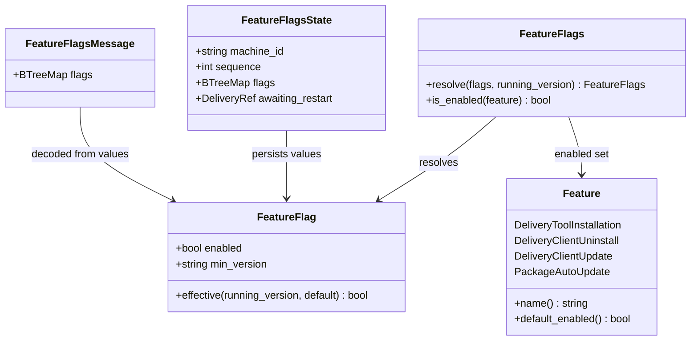
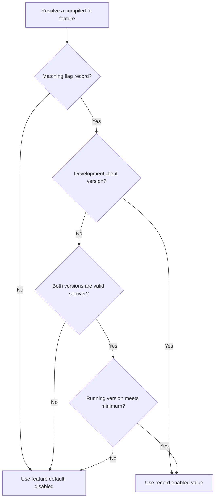
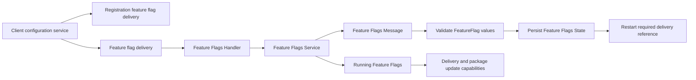
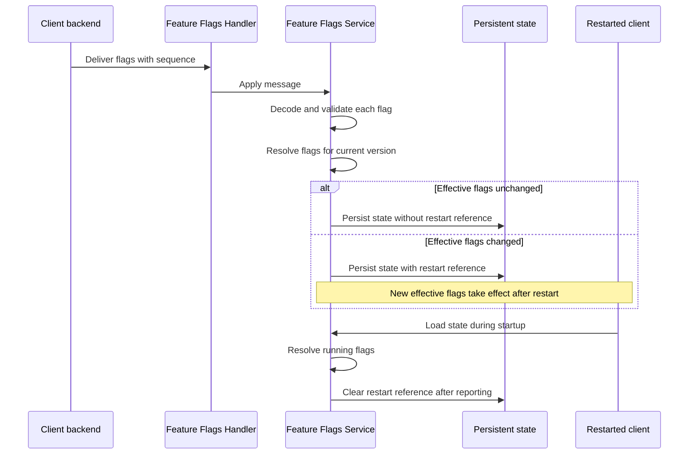

# Model Feature Flags

Model Feature Flags defines the on-device contract used by the OpenFrame Client to selectively enable delivery and package-management capabilities. It is implemented by the `openframe_agent_lib` artifact from the OpenFrame OSS Library and is run by this repository's client deployment. The model turns a server-supplied map of flag records into a small, typed set of effective capabilities for the running client version.

The implementation lives in the OpenFrame OSS Library: [feature_flags.rs](https://github.com/flamingo-stack/openframe-oss-lib/blob/7a766f00e4f58b5d89db007b878ac8d6e0c344f4/clients/openframe-client/src/models/feature_flags.rs).

## Responsibilities

- Define the supported feature vocabulary and its safe defaults.
- Accept a transport message whose values are generic JSON, then validate each usable flag record.
- Resolve configured flags against the installed client version.
- Keep the effective runtime flags separate from newly persisted flags until the client restarts.
- Persist the last accepted machine identifier, delivery sequence, flag map, and any delivery awaiting restart acknowledgement.

All four defined features default to disabled. Consequently, an omitted feature, an invalid flag, an invalid version, or an insufficient client version leaves that capability disabled.

## Supported Features

`Feature` is the closed set of client capabilities. Each feature has a stable wire name used as the key in the flag map.

| Rust variant | Wire name | Default |
|---|---|---:|
| `DeliveryToolInstallation` | `delivery-tool-installation` | Disabled |
| `DeliveryClientUninstall` | `delivery-client-uninstall` | Disabled |
| `DeliveryClientUpdate` | `delivery-client-update` | Disabled |
| `PackageAutoUpdate` | `package-auto-update` | Disabled |

The typed enum is deliberately distinct from the incoming string keys. A server may send additional keys and valid records for them can be retained in persisted state, but only keys corresponding to `Feature::ALL` can affect the effective `FeatureFlags` set.

## Data Model



### Transport and persisted records

`FeatureFlagsMessage` is the incoming payload. Its `flags` property is a sorted map from strings to JSON values, allowing the delivery boundary to receive evolving server payloads without accepting their contents blindly.

Each accepted value is decoded as a `FeatureFlag` with the following camel-case wire properties:

```json
{
  "enabled": true,
  "minVersion": "1.2.3"
}
```

`minVersion` must parse as a semantic version before the record is accepted. The persisted `FeatureFlagsState` stores:

- `machine_id`: the registration that received the configuration;
- `sequence`: the delivery ordering marker associated with that configuration;
- `flags`: the validated map of feature records; and
- `awaiting_restart`: an optional delivery reference retained when the new effective set differs from the currently running set.

The identifier and restart reference have serialization defaults so older state files can be read. The restart reference is omitted when absent.

## Resolution Rules

A feature is enabled only when all applicable safeguards allow it:

1. The feature must be one of the four compiled-in `Feature` variants.
2. A matching record must exist, otherwise the feature default is used.
3. For a normal build, both the running version and `minVersion` must parse as semantic versions.
4. The running version must have semantic-version precedence greater than or equal to `minVersion`.
5. When these checks pass, the record's `enabled` value determines the result. Any failed check falls back to the feature default, which is disabled.

The development client version is an explicit exception: it uses `enabled` directly and bypasses the minimum-version gate. This makes locally built development clients usable for feature testing without weakening the version gate for released clients.



Version parsing tolerates a leading `v` or `V`. Precedence compares major, minor, patch, and pre-release components, so the comparison is semantic rather than a string comparison.

## Runtime Architecture

The model is used with the client-side Feature Flags Service and command handler. The service owns a persisted state guarded by a mutex and computes an immutable `running` `FeatureFlags` value when it loads. The handler is constructed with a shared service instance, providing the command-processing integration point for feature-flag deliveries.



On the server side, the OpenFrame Client Core registration service obtains the configured client flags and dispatches a per-machine seed only when client-feature-flag delivery is enabled. Registration is not failed if that dispatch throws: an error is logged and a later delivery can reach the machine. The Management service initializer loads configured client flags during startup before they are delivered.

## Applying a Delivery

The apply operation accepts the machine identifier, delivery reference, sequence, and `FeatureFlagsMessage`.



For every incoming entry, the service tries to deserialize a `FeatureFlag` and validates `minVersion`. Entries that do not contain a boolean `enabled` value and valid semantic minimum version are ignored and logged. It then resolves the validated map using the current client version:

- If the newly resolved set equals the existing `running` set, the service records `Unchanged` and no restart delivery reference is retained.
- If the sets differ, it records `RestartRequired` and persists a clone of the delivery reference in `awaiting_restart`.

The service does not replace its `running` flags during `apply`. Instead, it writes the new state and a subsequent client start reloads and resolves that state. This prevents a partially reconfigured process from treating restart-sensitive capability changes as already active.

## Delivery Ordering and Restart Reporting

`applied_sequence(machine_id)` returns the persisted sequence only when the supplied identifier matches the machine recorded in state. When the identifier differs, it returns `0`, intentionally allowing a newly registered machine to accept deliveries without inheriting the prior registration's sequence.

`awaiting_restart()` exposes the delivery reference, if any, for restart coordination. After restart status has been reported, `restart_reported()` persists a state copy with that reference removed. This makes restart acknowledgement durable rather than relying solely on in-memory state.

## Startup and Failure Behavior

During `load`, the Feature Flags Service reads and deserializes the state file, then resolves `running` flags for the supplied client version. Missing state starts with an empty default state. If the file cannot be read or parsed, the service logs a warning and also starts with the default state. Since every feature default is disabled, this failure path is fail-closed.

The persisted state mutex recovers the inner value if a prior holder poisoned the mutex, allowing the service to continue operating while preserving the stored configuration semantics.

## Integration Guidance

Capability consumers should query `FeatureFlags::is_enabled` with a typed `Feature`, not inspect string keys or raw delivery payloads. This keeps activation decisions aligned with the compiled feature vocabulary, version gate, and safe defaults.

When adding a capability, maintain these compatibility points together:

1. Add the new `Feature` variant to `Feature::ALL`.
2. Assign a stable `name()` wire key and explicit `default_enabled()` value.
3. Ensure the server configuration and delivery seed use the same wire key.
4. Define a valid semantic `minVersion` for the server-supplied record.
5. Treat restart-required changes as inactive until the next client startup has loaded the persisted state.

The model is part of the `openframe_agent_lib` dependency supplied by OpenFrame OSS Library version `v0.0.5` in this repository's deployment. Its server-side configuration and delivery behavior are provided by the OpenFrame Client Core and Management service libraries.
