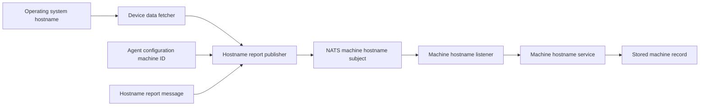
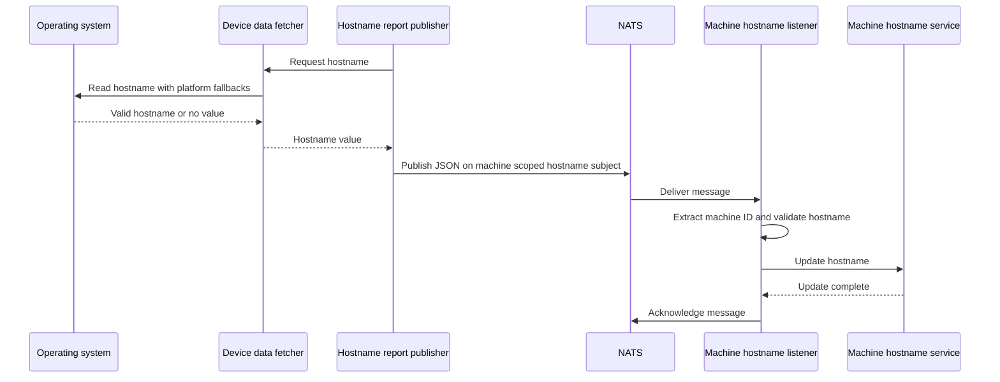
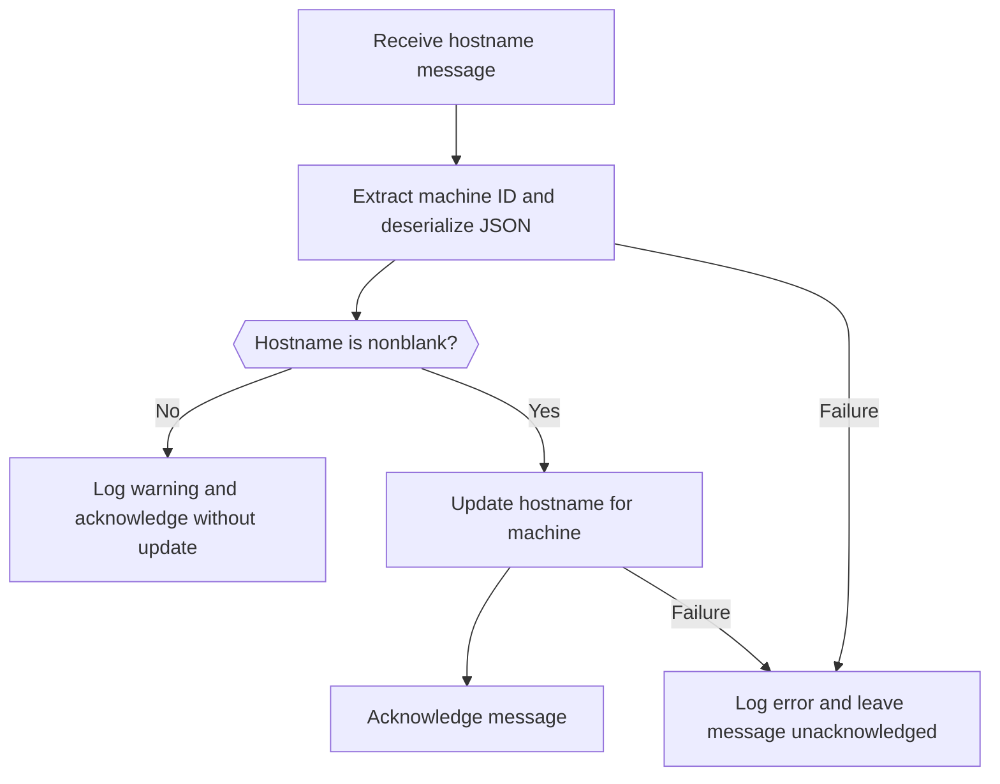

# Model Hostname Report

Model Hostname Report defines the wire payload used by the OpenFrame endpoint client to report a device hostname. It is intentionally small: `HostnameReportMessage` contains only a serialized `hostname` string. Device identity is carried by the NATS subject rather than duplicated in the message body.

The model is implemented by the `openframe_agent_lib` Cargo artifact supplied by [OpenFrame OSS Library](https://github.com/flamingo-stack/openframe-oss-lib/blob/7a766f00e4f58b5d89db007b878ac8d6e0c344f4/clients/openframe-client/src/models/hostname_report_message.rs). This repository runs that library as part of its endpoint-client deployment and supplies the server-side consumer through the OpenFrame Client service.

## Purpose and Contract

`HostnameReportMessage` is a Rust structure derived with `Serialize`:

```rust
pub struct HostnameReportMessage {
    pub hostname: String,
}
```

Its JSON representation has one required property:

```json
{
  "hostname": "workstation-01"
}
```

The model does not validate, normalize, persist, or identify a device. Those responsibilities remain with the publisher, the transport subject, and the receiving service. This separation keeps the message contract stable and lets a hostname change be processed independently of other device facts.

## Architecture



The endpoint-client side is provided by OpenFrame OSS Library. Its `HostnameReportPublisher` composes a device-data fetcher, agent configuration service, and NATS publisher. The OpenFrame Client service consumes hostname messages through `MachineHostnameListener`.

## Component Responsibilities

| Component | Responsibility |
|---|---|
| `HostnameReportMessage` | Serializes the hostname payload as JSON. |
| `DeviceDataFetcher` | Reads the operating-system hostname. It first attempts the kernel hostname and, on macOS, falls back to `LocalHostName` and then `ComputerName`. Invalid, empty, or unavailable values are not returned. |
| `HostnameReportPublisher` | Coordinates hostname collection, machine configuration, model construction, and best-effort publication. Publish errors are logged rather than propagated from its public `publish` operation. |
| `AgentConfigurationService` | Provides the configured machine identifier used for device-scoped routing. |
| `NatsMessagePublisher` | Serializes a payload, obtains a connected NATS client, publishes it, and flushes the client before reporting success. |
| `MachineHostnameListener` | Receives `machine.*.hostname` messages, extracts the machine identifier from the subject, deserializes the JSON body, validates that the hostname is nonblank, and delegates the update. |
| `MachineHostnameService` | Applies the hostname update to the machine record. |

## Data Flow



The receiver relies on two pieces of transport data: the machine ID from the subject and the hostname from the JSON payload. This prevents a payload from selecting the machine record it modifies.

## Processing Outcomes



A blank hostname is treated as a successfully consumed no-op, so it is acknowledged to avoid redelivery. Deserialization, subject extraction, and update failures leave the message unacknowledged, allowing the messaging layer to redeliver it.

## Operational Considerations

- Hostname discovery can fail without terminating the endpoint client. The device-data fetcher logs the reason and returns no value when it cannot produce a valid hostname.
- The publisher is best-effort at its public boundary: failures in model serialization, NATS connection access, publication, or flushing are logged as hostname-report failures.
- Delivery acknowledgement occurs only after a nonblank hostname update succeeds. Monitor listener errors and NATS redeliveries when hostname changes do not appear in device records.
- Compatibility depends on preserving the JSON property name `hostname` and the subject convention accepted by the server listener. Adding device identity to this model would create conflicting sources of identity and should be avoided unless the consumer contract changes in tandem.

## Maintenance Guidance

When changing this contract, update the endpoint publisher and server listener together. Preserve serialization compatibility for already deployed clients, keep hostname validation at the receiving boundary, and verify that failures remain unacknowledged only when redelivery is appropriate. The model itself should remain a transport-only type; collection policies belong in the device-data fetcher and persistence behavior belongs in the server-side hostname service.
