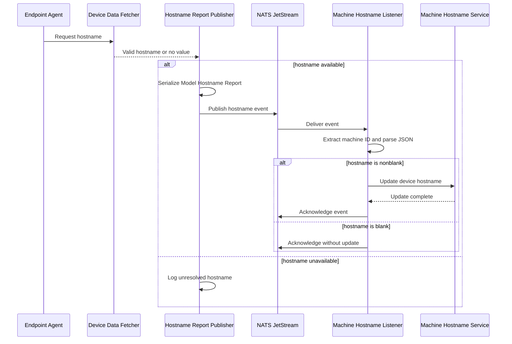
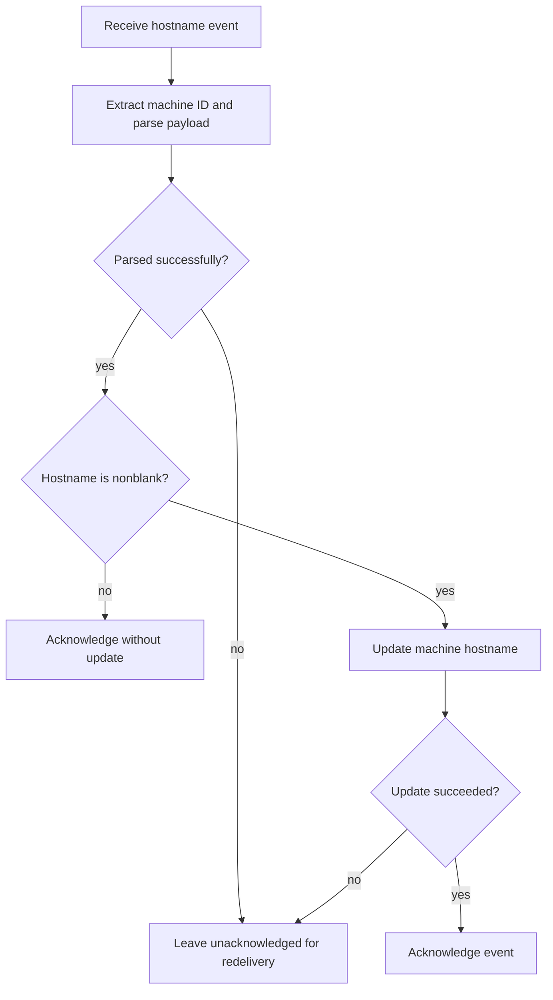

# Model Hostname Report

Model Hostname Report is the endpoint-client message contract for reporting a managed device's hostname to OpenFrame. It contains one serializable value, `hostname`, and intentionally leaves collection, routing, delivery, and persistence to neighboring components.

The contract is supplied at runtime by the `openframe_agent_lib` dependency from [OpenFrame OSS Library](https://github.com/flamingo-stack/openframe-oss-lib/blob/16e7c1cbd9664e7d10ec5ebca7d53c9bd314decf/clients/openframe-client/src/models/hostname_report_message.rs). This repository assembles and runs that library as part of the endpoint client.

## Contract

`HostnameReportMessage` derives Rust `Debug` and Serde `Serialize` and exposes one public required field:

| Field | Type | Meaning |
| --- | --- | --- |
| `hostname` | `String` | The hostname reported by the endpoint. |

```rust
#[derive(Debug, Serialize)]
pub struct HostnameReportMessage {
    pub hostname: String,
}
```

Its serialized payload has no machine identifier, timestamp, status, or optional fields.

```json
{
  "hostname": "workstation-42"
}
```

The minimal shape is intentional: the server derives the target machine identity from the NATS subject rather than the body.

## Architecture

```mermaid
flowchart LR
    Device["Managed Device"]
    Fetcher["Device Data Fetcher"]
    Publisher["Hostname Report Publisher"]
    Model["Model Hostname Report"]
    Nats["NATS JetStream"]
    Listener["Machine Hostname Listener"]
    Service["Machine Hostname Service"]
    Record["Device Record"]

    Device -->|"local hostname"| Fetcher
    Fetcher -->|"validated hostname"| Publisher
    Publisher -->|"creates"| Model
    Model -->|"serialized payload"| Nats
    Nats -->|"hostname event"| Listener
    Listener -->|"machine ID and hostname"| Service
    Service -->|"updates"| Record
```



### Responsibilities

| Component | Responsibility |
| --- | --- |
| Model Hostname Report | Defines the serializable payload shape. |
| Device Data Fetcher | Obtains and validates a local hostname. |
| Hostname Report Publisher | Creates and sends the report using NATS and client configuration. |
| Machine Hostname Listener | Receives the event, extracts the machine identifier, deserializes the payload, and controls acknowledgement. |
| Machine Hostname Service | Persists the hostname update for the identified machine. |

## Endpoint Collection and Publication

Device Data Fetcher first queries the kernel hostname, trims it, and accepts it only if it passes its hostname validity check. On macOS, it can fall back to `LocalHostName`, with a `.local` suffix, and then `ComputerName`. If no valid hostname can be resolved, it logs a warning.

Hostname Report Publisher owns a NATS message publisher, agent configuration service, and device data fetcher. Its public `publish` method logs a warning when its internal publishing work fails instead of returning the error to its caller. Invoking the method therefore does not itself establish that the platform has persisted an update.

## Transport and Server Processing

The Java Machine Hostname Listener consumes the `MACHINE_HOSTNAME` JetStream stream. It uses the subject pattern `machine.*.hostname`, durable consumer `machine-hostname-processor-v1`, delivery group `machine-hostname`, and delivery subject `machine.hostname.delivery`.

The wildcard segment is extracted as the machine identifier. Consequently, routing and identity remain separate from the Model Hostname Report payload.



## Delivery Semantics

The listener treats received messages as follows:

1. It extracts the machine identifier from the NATS subject and deserializes the JSON payload.
2. If the hostname is blank, it logs the condition, acknowledges the event, and makes no update.
3. For a nonblank hostname, it calls Machine Hostname Service and acknowledges only after that operation succeeds.
4. If subject extraction, deserialization, or the update throws an exception, it leaves the event unacknowledged for potential JetStream redelivery.



## Integration and Compatibility

- Preserve the `hostname` JSON property and its string representation. A rename or type change breaks the existing consumer contract.
- Do not add machine identity to this model without coordinating a transport-contract revision: the current consumer derives identity from the subject.
- The model does not reject blank strings. Endpoint collection attempts to avoid invalid values, while the listener explicitly treats blank received values as a no-op.
- Retried processing can apply the same hostname again, so persistence should remain safe for repeated updates.
- Keep concerns separated: the model represents data; the fetcher collects it; the publisher transports it; and the server listener and service process it.

## Maintenance Checklist

1. Retain Serde `Serialize` support required by the endpoint publisher.
2. Verify payload compatibility with the Java consumer whenever the structure changes.
3. Test valid hostname publication, unavailable hostname resolution, blank payload handling, malformed JSON, persistence failure, acknowledgement, and redelivery.
4. Review the publisher, NATS subject convention, and listener together when changing routing or machine identity behavior.

## System Context

Model Hostname Report is a focused endpoint-to-platform telemetry contract in OpenFrame Client Core. It is related to heartbeat and timezone reporting but only maintains the human-readable device hostname. The wider client runtime supplies configuration, authentication, NATS connectivity, and service lifecycle behavior. The Java listener runs in the OpenFrame Client service and provides the durable server-side path from the hostname stream to the device record.

## Source

- [Hostname Report Message source in OpenFrame OSS Library](https://github.com/flamingo-stack/openframe-oss-lib/blob/16e7c1cbd9664e7d10ec5ebca7d53c9bd314decf/clients/openframe-client/src/models/hostname_report_message.rs)

For support or discussion, use the [OpenMSP Slack community](https://www.openmsp.ai/).