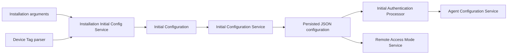
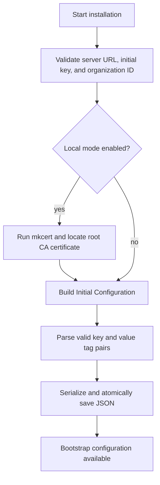
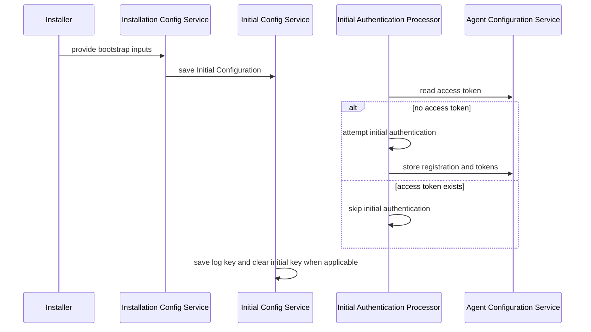
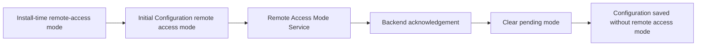

# Model Initial Config

Model Initial Config defines the persisted bootstrap state for an OpenFrame endpoint client. Its sole type, `InitialConfiguration`, carries the information supplied during installation that lets the agent locate its server, authenticate for the first time, associate itself with an organization, and apply initial device settings.

The type is implemented by the Rust `openframe_agent_lib` dependency from [OpenFrame OSS Library](https://github.com/flamingo-stack/openframe-oss-lib/blob/16e7c1cbd9664e7d10ec5ebca7d53c9bd314decf/clients/openframe-client/src/models/initial_configuration.rs). This tenant repository consumes that library at version `v0.0.5`; it does not define a second local model.

## Responsibilities

- Provide one serializable record for installation-time client bootstrap inputs.
- Preserve mandatory endpoint and enrollment values: `server_host`, `initial_key`, and the organization identifier.
- Hold optional metadata and deferred settings without breaking older persisted configurations.
- Support a controlled handoff from one-time enrollment material to the log-stream key.
- Persist a pending remote-access mode until the backend has acknowledged it.

The model is a data contract, not an orchestration layer. Validation, persistence, authentication, and acknowledgement behavior are handled by the surrounding client services.

## Structure

`InitialConfiguration` derives `Clone`, `Debug`, `Serialize`, `Deserialize`, and `Default`. `serde` therefore provides JSON serialization and compatibility defaults for selected fields when they are absent from an existing configuration file.

| Field | Type | Persistence behavior | Purpose |
|---|---|---|---|
| `server_host` | `String` | Required by installation setup | Server URL or host used by the agent during bootstrap. |
| `initial_key` | `String` | Required by installation setup | One-time enrollment credential used for initial authentication. |
| `log_key` | `String` | Defaults to an empty string when deserializing | Log-stream key supplied during installation or obtained later. |
| `local_mode` | `bool` | Default Rust value is `false` | Indicates local-mode installation behavior. |
| `org_id` | `String` | Defaults to an empty string when deserializing | Organization association established at installation. |
| `user_id` | `String` | Defaults to an empty string when deserializing | Optional user association. |
| `local_ca_cert_path` | `String` | Defaults to an empty string when deserializing | Path to the local certificate authority certificate for local mode. |
| `tags` | `Vec<DeviceTag>` | Defaults to an empty collection when deserializing | Initial device tags, grouped as tag keys with one or more values. |
| `remote_access_mode` | `Option<String>` | Defaults to `None` and is omitted from serialized output when absent | Install-time remote-access mode awaiting backend acknowledgement. |

## Architecture and Dependencies

The model sits at the boundary between installation arguments, durable local state, and startup services. It depends directly only on `serde` and the adjacent `DeviceTag` model. The OpenFrame client library supplies the services that construct, persist, read, and progressively consume this record.

### Related client components

| Component | Relationship to Model Initial Config |
|---|---|
| Installation Initial Config Service | Validates install parameters, builds the record, parses tags, resolves a local CA path when local mode is enabled, and saves the result. |
| Initial Configuration Service | Reads the persisted record, exposes field-specific accessors, and serializes updates using a write lock. |
| Initial Authentication Processor | Starts initial authentication only when no existing access token is present. |
| Agent Configuration Service | Stores registration and token data after authentication, allowing later startup to bypass initial authentication. |
| Remote Access Mode Service | Is the downstream service expected to consume the pending remote-access mode and clear it after acknowledgement. |

## Installation and Persistence Flow

During installation, the builder requires nonblank server URL, initial key, and organization ID. It copies optional log key and user ID values when present, converts raw tag arguments to `DeviceTag` values, and maps a requested remote-access mode to its wire name.

When local mode is enabled, installation runs `mkcert -CAROOT`, requires a `rootCA.pem` file in the reported directory, and stores the resulting certificate path in `local_ca_cert_path`. Local-mode certificate discovery is deliberately skipped when local mode is disabled.

The persistence service writes pretty JSON through the library's atomic-write utility. Updates that modify the initial key, log key, or remote-access mode use a shared mutex around their read-modify-write sequence so concurrent updates do not overwrite unrelated fields.

## Authentication Credential Lifecycle

The initial key exists to bootstrap the client; it should not remain the long-term credential. Once a log key is held, the initial key can be cleared. Separately, successful initial authentication stores access-token material through the agent configuration path. On subsequent starts, the initial-authentication processor detects an existing access token and skips its authentication loop.

If initial authentication fails, the processor retries after 60 seconds. This retry behavior is owned by the processor, rather than by Model Initial Config.

## Remote-Access Acknowledgement Flow

`remote_access_mode` is intentionally distinct from permanent client configuration. It represents an installation request that remains durable only until the backend acknowledges it. Its `Option` type makes the distinction explicit: no field is serialized when there is no pending request, and the configuration service clears the value by setting it to `None` after acknowledgement.

## Compatibility and Maintenance Notes

- The fields marked with `serde(default)` are tolerant of older persisted files that do not contain them. New fields should follow this pattern when safe defaults exist.
- `remote_access_mode` has both a deserialization default and `skip_serializing_if`; preserve both semantics so absent values remain absent on disk.
- Do not log or display `initial_key` or `log_key`. They are bootstrap and log-stream credentials.
- Preserve the distinction between an empty string and an absent optional remote-access mode: the latter is represented by `None` and omitted from output.
- Changes to persisted field names, types, or defaults are compatibility-sensitive because installed clients may retain prior JSON files across upgrades.
- Keep validation outside the model. The model accepts its fields as data; installation services establish which values are required for a new install.

## Source of Truth

The authoritative definition is [Initial Configuration in OpenFrame OSS Library](https://github.com/flamingo-stack/openframe-oss-lib/blob/16e7c1cbd9664e7d10ec5ebca7d53c9bd314decf/clients/openframe-client/src/models/initial_configuration.rs). Consult the client library source when changing serialization, persistence, installation, authentication, or remote-access acknowledgement behavior.
