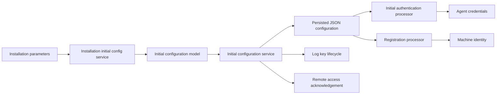
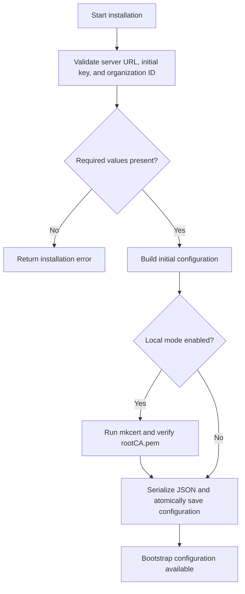
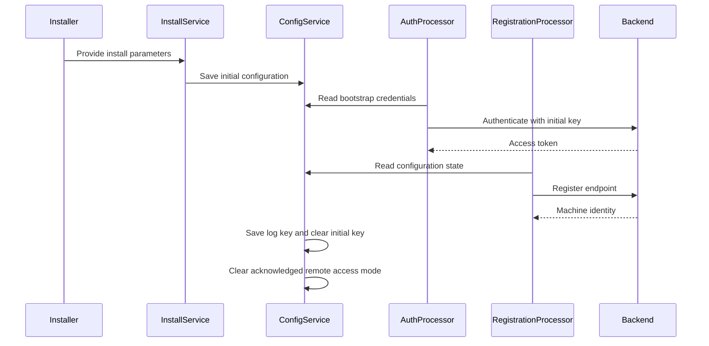

# Model Initial Config

Model Initial Config defines the persisted bootstrap record used by the OpenFrame endpoint client before the endpoint has completed its normal authentication and registration lifecycle. The module consists of the Rust `InitialConfiguration` data model from the OpenFrame OSS Library's `openframe_agent_lib` artifact, consumed by this repository's OpenFrame client runtime.

Its purpose is deliberately narrow: retain installation-time connection, identity, logging, and enrollment inputs long enough for the endpoint agent to establish durable credentials and synchronize pending configuration with the backend. The initial enrollment key is not intended to be permanent state; it is cleared after the agent has a usable replacement credential.

**Source:** [initial_configuration.rs](https://github.com/flamingo-stack/openframe-oss-lib/blob/7a766f00e4f58b5d89db007b878ac8d6e0c344f4/clients/openframe-client/src/models/initial_configuration.rs)

## Responsibilities

- Carry the endpoint's initial server target and enrollment key.
- Preserve optional organization, user, tag, local certificate, and remote-access bootstrap settings.
- Serialize and deserialize installation state as JSON using Serde.
- Provide safe defaults for fields introduced after earlier configuration files may already exist.
- Support a transition from one-time installation credentials to ongoing authentication, registration, and log-streaming state.

The model does not perform I/O, validate arguments, authenticate, or call backend APIs itself. Those responsibilities belong to services in the same client library that create, persist, read, and evolve this record.

## Data Contract

`InitialConfiguration` derives `Clone`, `Debug`, `Serialize`, `Deserialize`, and `Default`. A default instance contains Rust defaults: empty strings, `false` for `local_mode`, an empty tag list, and no pending remote-access mode.

| Field | Type | Required at installation | Meaning and lifecycle |
|---|---|---:|---|
| `server_host` | `String` | Yes | Server URL supplied at installation. Despite the field name, the installation service accepts a server URL and stores it here. |
| `initial_key` | `String` | Yes | One-time enrollment credential used during initial authentication. It is cleared once a log key is held. |
| `log_key` | `String` | No | Log-streaming key supplied at installation or obtained later. Missing JSON values deserialize as an empty string. |
| `local_mode` | `bool` | No | Enables local-mode behavior and local certificate discovery during installation. |
| `org_id` | `String` | Yes | Organization identifier used to associate the endpoint with its organization. Missing JSON values deserialize as an empty string. |
| `user_id` | `String` | No | Optional user identifier saved with the bootstrap configuration. Missing JSON values deserialize as an empty string. |
| `local_ca_cert_path` | `String` | No | Path to the local CA certificate discovered through `mkcert` when local mode is enabled. Missing JSON values deserialize as an empty string. |
| `tags` | `Vec<DeviceTag>` | No | Installation tags, each represented by a key and one or more values. Missing JSON values deserialize as an empty list. |
| `remote_access_mode` | `Option<String>` | No | Install-time remote-access mode awaiting backend acknowledgement. It is omitted from JSON when absent and cleared after acknowledgement. |

A `DeviceTag` contains a `key` and a list of `values`. The installation service parses CLI tag values into this structured form before it creates the model.

## Architecture and Ownership

The library separates the passive model from the stateful services around it. Installation constructs the record, the configuration service writes and updates it, and the startup processors consume it while establishing durable endpoint identity.

### Participating Components

| Component | Role in the Model Initial Config lifecycle |
|---|---|
| `InstallationInitialConfigService` | Validates required installation arguments, constructs `InitialConfiguration`, parses tags, optionally discovers the local CA certificate, and saves the result. |
| `InitialConfigurationService` | Owns the configuration-file path, reads and persists the model, and serializes read-modify-write mutations with a mutex. Writes use the library's atomic file-write helper. |
| `InitialAuthenticationProcessor` | Skips work if an access token already exists; otherwise retries initial authentication until it succeeds. |
| `RegistrationProcessor` | Skips work if a machine ID already exists; otherwise retries registration until it succeeds. |
| `DeviceTag` | Models a tag key with its associated values for bootstrap tag assignment. |

## Installation and Persistence Flow

The installation service requires nonblank server URL, initial key, and organization ID. It accepts optional log key, user ID, tags, local mode, and remote-access mode. A parameterless invocation is recognized only when all optional string inputs are blank or missing, local mode is disabled, no tags exist, and no remote-access mode is supplied.

When `local_mode` is enabled, installation runs `mkcert -CAROOT`, requires a successful command result and a nonempty root directory, and verifies that `rootCA.pem` exists below that directory. The resulting path is stored in `local_ca_cert_path`. When local mode is disabled, this discovery is skipped.

The persisted JSON is produced with pretty serialization. Because newly optional fields use Serde defaults, configuration files written before fields such as `log_key`, organization and user IDs, local certificate path, tags, or remote-access mode were added can still deserialize without those keys. Conversely, an absent `remote_access_mode` is not emitted during serialization, keeping ordinary configuration files free of a null-valued pending setting.

## Credential and Enrollment Lifecycle

The bootstrap record supports a staged handoff rather than treating installation inputs as the endpoint's final identity.

1. At installation, the initial key and server details are persisted with the other supplied context.
2. At startup, initial authentication checks whether an access token already exists. If not, it retries authentication every 60 seconds until successful.
3. Registration checks whether a machine ID already exists. If not, it retries registration every 60 seconds until successful.
4. A log key can be supplied from the beginning or written later through `save_log_key`.
5. After a log key is held, `clear_initial_key` replaces the stored enrollment key with an empty string.
6. A pending remote-access mode remains in the model until backend acknowledgement, then `clear_remote_access_mode` removes it.

## Concurrency and State Integrity

Whole-record persistence is handled by `InitialConfigurationService::save`, which serializes the model then invokes an atomic file write. Mutations that read, alter, and save selected fields acquire the service's process-local mutex first. This prevents concurrent updates in the client process from overwriting one another's field changes.

The guarded mutations visible in the service are:

- `clear_initial_key`, which is idempotent when the key is already empty.
- `save_log_key`, which replaces the current log key.
- `clear_remote_access_mode`, which removes the pending mode by setting it to absent.

The model's `Clone` implementation allows a configuration snapshot to be passed without transferring ownership, but callers should use the configuration service for persisted changes rather than modifying a detached copy.

## Operational Considerations

### Sensitive values

`initial_key` and `log_key` are credential material. The model derives `Debug`, so callers and log statements should avoid formatting entire configuration instances. Persisted configuration storage should be protected according to the client platform's secured-directory and permission controls.

### Retry behavior

Initial authentication and registration retry indefinitely at 60-second intervals after a failure. This makes bootstrap resilient to temporary service or network availability problems, but an incorrect initial key, server URL, or organization ID will continue failing until configuration is corrected or the installation is replaced.

### Compatibility rules

When adding a new nonessential field, use an appropriate Serde default so existing endpoint configuration files remain readable. When adding a one-time or acknowledgement-driven field, model absence explicitly with `Option` and use conditional serialization when omitting the field is meaningful.

## Boundaries

Model Initial Config belongs to the endpoint-agent client library, supplied by the OpenFrame OSS Library. It is assembled at runtime by this repository's OpenFrame client service; it is not a server API payload and does not directly create backend records. Server-side registration, token issuance, and client management are separate concerns handled by the OpenFrame client backend and authorization services.
