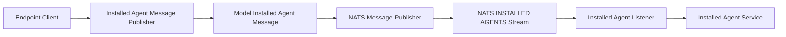
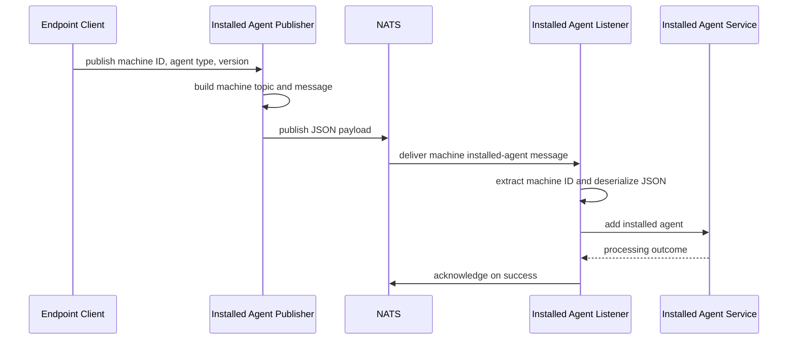
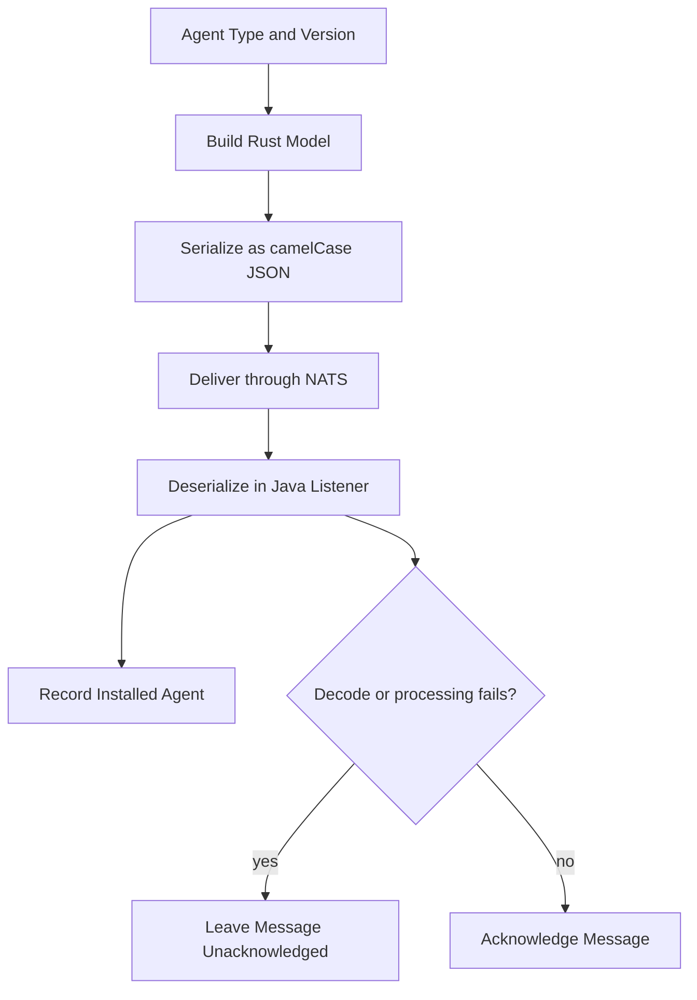

# Model Installed Agent Message

Model Installed Agent Message is the small Rust wire model used by the OpenFrame endpoint client to report an installed agent and its version. It belongs to the `openframe_agent_lib` crate supplied by the OpenFrame OSS Library at version `v0.0.5`; this repository runs that library as part of its endpoint client distribution.

The model deliberately contains only the identity of the installed agent type and the version observed on the endpoint. It is serialized as JSON for NATS delivery and is consumed by the client service that records installed agents for a machine.

## Source and Contract

The canonical implementation is the [`InstalledAgentMessage` source](https://github.com/flamingo-stack/openframe-oss-lib/blob/16e7c1cbd9664e7d10ec5ebca7d53c9bd314decf/clients/openframe-client/src/models/installed_agent_message.rs) in the OpenFrame OSS Library. It derives `Debug`, `Clone`, `Serialize`, and `Deserialize`, allowing the same value to be logged, copied, encoded, and decoded without custom conversion code.

Serde applies `camelCase` naming to the entire structure. Consequently, the Rust fields `agent_type` and `version` are represented on the wire as `agentType` and `version`.

| Wire property | Rust field | Type | Meaning |
| --- | --- | --- | --- |
| `agentType` | `agent_type` | string | Identifies the installed agent implementation or category. |
| `version` | `version` | string | Reports the version installed on the endpoint. |

A representative payload is:

```json
{
  "agentType": "openframe-client",
  "version": "1.2.3"
}
```

Both fields are required strings when deserializing this structure. The model itself does not validate allowed agent types, version format, endpoint identity, or authorization. Those concerns belong to the publisher, transport, and receiving service.

## Architecture

The Model Installed Agent Message is a transport contract rather than a service. It links an endpoint-side publisher to the server-side installed-agent processor.



### Participating Components

| Component | Responsibility | Relationship to the model |
| --- | --- | --- |
| `InstalledAgentMessage` | Defines the two-field JSON contract. | Provides the payload type. |
| `InstalledAgentMessagePublisher` | Accepts a machine identifier, agent type, and version; builds the machine-scoped topic and model; delegates publication. | Produces the payload. |
| `NatsMessagePublisher` | Serializes values with JSON, publishes to NATS, and flushes the client connection. | Carries the serialized payload. |
| `InstalledAgentListener` | Subscribes to installed-agent deliveries, extracts the machine identifier from the subject, decodes the JSON payload, and acknowledges only after processing succeeds. | Consumes the payload. |
| Installed agent service | Adds the reported agent type and version for the machine, with awareness of final delivery attempts. | Persists or applies the reported installation state. |

The endpoint-side implementation is Rust from the OpenFrame OSS Library. The receiving `InstalledAgentListener` is Java code supplied by the `openframe-client-core` service library, which this repository packages into its OpenFrame Client service.

## Message Flow

The publisher receives separate `machine_id`, `agent_type`, and `version` arguments. It derives a topic from the machine identifier and constructs an `InstalledAgentMessage`. The generic NATS publisher serializes the model via Serde JSON, publishes it, and flushes the NATS connection before reporting success.



The server-side listener is configured for the `INSTALLED_AGENTS` stream and the `machine.*.installed-agent` subject pattern. It uses the `installed-agent-processor-v1` consumer in the `installed-agent` delivery group, with deliveries routed through `machine.installed-agent.delivery`.

If JSON decoding, subject extraction, or installed-agent processing fails, the listener leaves the NATS message unacknowledged. NATS can then redeliver it. On successful processing, the listener acknowledges the message. The listener also passes whether the received delivery is the final attempt to the installed-agent service, allowing downstream logic to distinguish ordinary and final retry attempts.

## Serialization and Compatibility



Treat the JSON property names and string types as a compatibility boundary:

- Preserve `agentType` and `version` when changing either producer or consumer.
- Add fields only with receiver compatibility in mind. The known consumer reads the two documented values.
- Keep sensitive credentials and endpoint configuration out of this message. It is an installation report, not an authentication or registration payload.
- Keep the machine identifier in the NATS subject and not in this two-field body; the listener obtains it from the subject through a machine-ID extractor.

## Operational Behavior

Publication can fail if serialization, NATS client retrieval, publishing, or flushing fails. The publisher returns the error with context that identifies the target topic. Callers must decide whether to retry or surface that failure; the model has no local outbox or retry policy.

On the receiving side, processing is at-least-once from the listener's perspective because a message is acknowledged only after the installed-agent service completes. Consumers should therefore ensure that recording the same agent type and version again is safe or otherwise deduplicated by the installed-agent service.

The code-graph snapshot reports no direct callers or tests for the Rust structure itself. That does not alter the runtime contract: it is instantiated inside the publisher's message-building path and decoded by the installed-agent listener. Changes should be validated with an end-to-end publish-and-consume test that checks camel-case JSON, the machine-scoped subject, acknowledgement after success, and non-acknowledgement on failure.

## Scope Boundaries

Model Installed Agent Message is distinct from other endpoint reports:

- It is not the machine heartbeat model, which communicates ongoing endpoint liveness and metrics.
- It is not an agent-registration request or token response, which handle enrollment and credentials.
- It is not an installed-tool record, which represents managed tool assets and their local installation state.
- It is not the user-scoped installed-agent flow. The Java service also listens on `user.*.installed-agent`, but that listener decodes a separate user-installed-agent message type and updates user-scoped state.

This narrow boundary keeps installation reporting stable while authentication, registration, tool lifecycle, and telemetry evolve independently.
