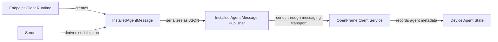
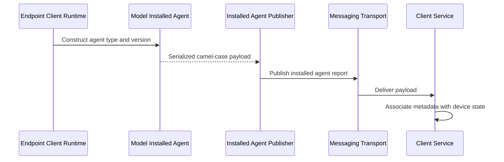
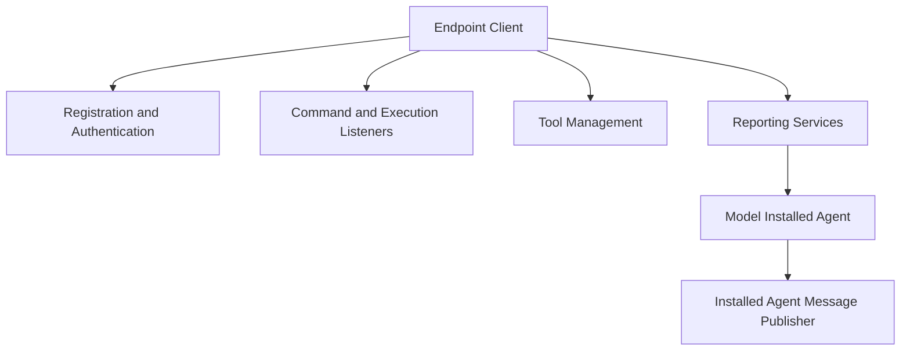

# Model Installed Agent

Model Installed Agent defines the compact wire payload used to report an installed agent and its version. It is implemented in the OpenFrame OSS Library's Rust `openframe-client` code and is consumed at runtime by the endpoint client assembled by this repository. The model is intentionally transport-focused: it carries no installation logic, persistence behavior, routing, or validation of its own.

**Implementation source:** [installed_agent_message.rs](https://github.com/flamingo-stack/openframe-oss-lib/blob/7a766f00e4f58b5d89db007b878ac8d6e0c344f4/clients/openframe-client/src/models/installed_agent_message.rs)

## Responsibility and Boundary

`InstalledAgentMessage` is a serializable Rust structure with two required string values:

| Wire property | Rust field | Meaning |
|---|---|---|
| `agentType` | `agent_type` | Identifies the installed agent category or integration. |
| `version` | `version` | Reports the installed agent version. |

The `serde` `rename_all = "camelCase"` setting defines the external JSON naming convention for the whole structure. Rust callers use snake-case field names, while serialized messages use camel-case property names. Both properties are public `String` values, so construction and deserialization do not enforce an enumerated agent type, semantic-version format, or non-empty content. Those rules, if required, belong to the publisher or receiving service.

## Component Architecture

The model is one layer in an installed-agent reporting path. Its sole implementation dependency is Serde's serialization and deserialization support; it is independent of the transport, broker subject, and server-side persistence implementation.



The surrounding runtime is provided by the OpenFrame OSS Library. This repository consumes the `openframe_agent_lib` Cargo artifact at version `v0.0.5`; the source link above identifies the library revision used to document this model.

## Data Contract

### Rust definition

```rust
#[derive(Debug, Clone, Serialize, Deserialize)]
#[serde(rename_all = "camelCase")]
pub struct InstalledAgentMessage {
    pub agent_type: String,
    pub version: String,
}
```

### JSON representation

```json
{
  "agentType": "remote-access-agent",
  "version": "1.2.3"
}
```

The sample values illustrate the shape only. The model does not prescribe supported agent-type identifiers or version syntax.

### Compatibility Considerations

- **Preserve property names.** Renaming `agentType` or `version` changes the serialized contract and can break receivers that deserialize the existing JSON shape.
- **Add fields cautiously.** Serde derives the format from the public structure. Additional fields alter outbound payloads and should be coordinated with all receivers.
- **Keep values descriptive but non-secret.** This payload is suitable for agent identity and version metadata. Credentials, keys, and other sensitive configuration must not be placed in either field.
- **Validate at boundaries.** Since both values are unconstrained strings, publishers should ensure they are known and meaningful before emission. Receivers should treat them as external input.

## Reporting Flow

The data flow separates collection from representation. A producer determines the installed agent type and version, creates the model, then delegates transmission to a publisher. The downstream service interprets the resulting message in the context of a device or agent connection.



## Relationship to the Endpoint Client

Model Installed Agent belongs to the model layer of the endpoint client. The client library contains separate components for agent registration, authentication, connectivity, tool management, remote access, execution, logging, and periodic machine reports. This model does not coordinate those components. It gives reporting code a stable, cloneable value that can be serialized for the installed-agent event path.



## Maintenance Guidance

When changing Model Installed Agent, review the complete producer-to-receiver contract rather than treating it as an isolated Rust structure:

1. Identify the publisher that constructs the message and confirm how it derives agent type and version.
2. Verify receiver behavior for the current camel-case JSON fields and any new or changed value semantics.
3. Preserve `Serialize` and `Deserialize` support when the message must cross process or network boundaries.
4. Add serialization tests for the expected JSON keys and deserialization tests for valid incoming messages.
5. Use representative non-sensitive values in logs and tests, because this contract is part of a device-reporting channel.

The organization-wide code graph currently records no direct symbol consumers for `InstalledAgentMessage`. This does not change its role as a transport contract in the library; it means maintainers should verify runtime call sites and message receivers when evolving the type.
