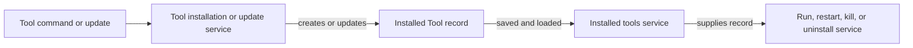
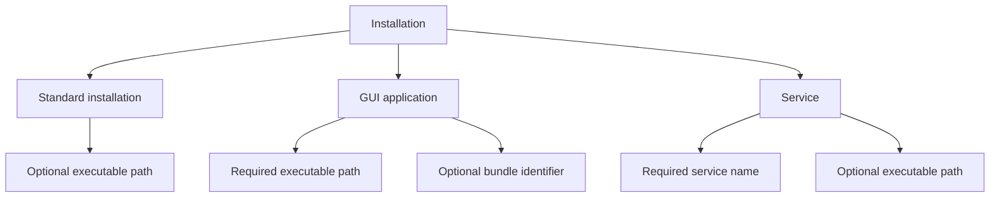
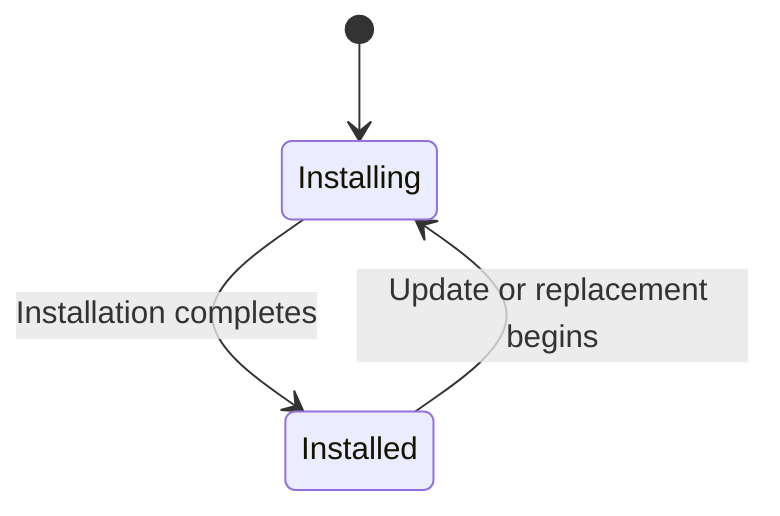
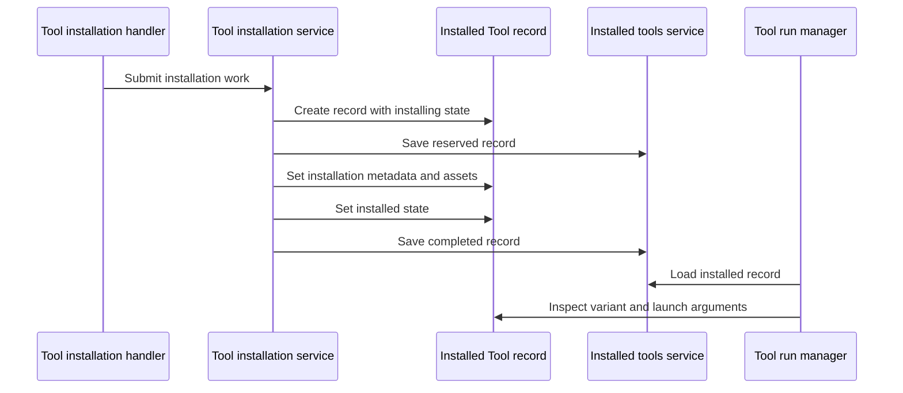

# Model Installed Tool

Model Installed Tool is the OpenFrame client agent's local data contract for an integrated tool that is being installed or is already present on a managed device. It records the tool identity, version, launch and uninstall arguments, installation strategy, installed assets, and installation state.

The implementation is provided by the `openframe_agent_lib` Cargo dependency from [OpenFrame OSS Library](https://github.com/flamingo-stack/openframe-oss-lib/blob/16e7c1cbd9664e7d10ec5ebca7d53c9bd314decf/clients/openframe-client/src/models/installed_tool.rs). This repository consumes that dependency at `v0.0.5` to run the OpenFrame client agent.

## Purpose and Scope

The module is deliberately a model rather than a lifecycle engine. It does not download artifacts, persist records, control operating-system processes, or manage services. Instead, it provides one serializable representation that the client agent's installation, update, run, restart, kill, uninstall, and persistence services can share.

Its responsibilities are to:

- identify the managed tool and its installed version;
- describe whether it is an ordinary executable, GUI application, or operating-system service;
- retain required installation metadata and installed asset versions;
- preserve argument vectors for launch, tool-agent identification, and optional uninstall actions; and
- distinguish an in-progress installation from an installed record.

## Position in the Client Agent

Tool command handling and update processing create or revise an Installed Tool record. Persistence services retain it locally. Runtime services later reload the record and select the appropriate platform behavior from its installation variant.

This module is part of the boundary between control-plane work received by the agent and device-local lifecycle operations. It represents local truth; it does not itself establish whether a process is currently running.

## Core Record

`InstalledTool` is the aggregate record. Serde serialization and deserialization make it suitable for local persistence and subsequent recovery.

| Field | Meaning |
|---|---|
| `tool_agent_id` | Identifier of the managed tool-agent instance. The module also defines `openframe-chat` as the chat tool-agent identifier. |
| `tool_id` | Identifier for the integrated tool. |
| `tool_type` | Tool category provided to the agent. |
| `version` | Installed tool version. |
| `run_command_args` | Ordered arguments used to launch the tool. |
| `tool_agent_id_command_args` | Ordered arguments used to pass the tool-agent identity to the tool. |
| `uninstallation_command_args` | Optional ordered arguments used during removal. It is omitted from serialized output when absent. |
| `installation` | Installation strategy and its strategy-specific metadata. Defaults to a standard installation. |
| `assets` | Installed artifacts associated with the tool. Defaults to an empty list. |
| `state` | Installation lifecycle state. Defaults to `installed`. |

Each `InstalledAsset` contains an asset `id`, `version`, and an `executable` indicator. The indicator defaults to `false`, so an omitted value does not incorrectly classify an asset as runnable.

## Installation Strategy

`Installation` is internally tagged with the serialized field `type`; variant names use snake case. The variants express which operating-system metadata is meaningful and which lifecycle path surrounding services should use.

- **Standard** is the default. Its executable path is optional.
- **GUI application** requires an executable path and optionally carries a bundle identifier.
- **Service** requires a service name and may carry an executable path.

A GUI application always has a reported executable path. Standard and service records can be valid without one, so callers must not infer the installation type merely from path presence.

## Classification Helpers

The `Installation` methods keep common variant checks in one place:

| Method | Behavior |
|---|---|
| `executable_path()` | Returns the configured executable path when the selected variant has one. |
| `is_standard()` | Identifies a standard installation. |
| `is_gui_app()` | Identifies a GUI application installation. |
| `is_service()` | Identifies a service installation. |

For a single installation value, exactly one classification method is true. Runtime code should use this classification to select platform behavior instead of duplicating variant matching throughout the client.

## Lifecycle State

`ToolRecordState` intentionally models only the persisted installation phase. It has `installing` and `installed` values, with `installed` as the default.

Failures, rollbacks, deletion, and process health are not model states. The services coordinating those outcomes own their error handling and choose whether to retain, remove, or revise the corresponding record.

## Typical Installation Flow

The record makes an installation durable before later runtime operations need it. The following flow describes the responsibilities of the surrounding client-agent services without assigning I/O behavior to the model itself.

The installed-tools service is the persistence boundary for these records. The tool updater uses the installation form to choose an updater or migration path, while run, restart, kill, and uninstall services use the same metadata to control the local tool.

## Serialization and Compatibility

The module defines defaults and omission behavior that support incomplete persisted records:

- An omitted `installation` becomes a standard installation with no executable path.
- An omitted `assets` collection becomes empty.
- An omitted `state` becomes `installed`.
- An omitted asset `executable` flag becomes `false`.
- Optional executable paths, GUI bundle identifiers, and uninstall arguments are omitted rather than serialized as null values.

Because `Installation` is an internally tagged enum, the `type` value and variant-specific fields must remain consistent. In particular, service records require a service name and GUI application records require an executable path.

## Maintenance Guidance

- Treat `tool_agent_id`, `tool_id`, and `version` as control-plane identifiers; preserve them through updates unless the coordinating workflow explicitly changes them.
- Preserve the order of all argument vectors. They are structured arguments, not a shell command string.
- Do not interpret `installed` as proof that a path exists or that the tool is currently running.
- Add an installation variant only with corresponding support in installation, updater, run, restart, kill, and uninstall behavior.
- Changes to serialized field names, enum variants, or defaults are compatibility-sensitive because local persisted records and multiple agent services share this contract.

## Source

- [Installed Tool implementation](https://github.com/flamingo-stack/openframe-oss-lib/blob/16e7c1cbd9664e7d10ec5ebca7d53c9bd314decf/clients/openframe-client/src/models/installed_tool.rs)
