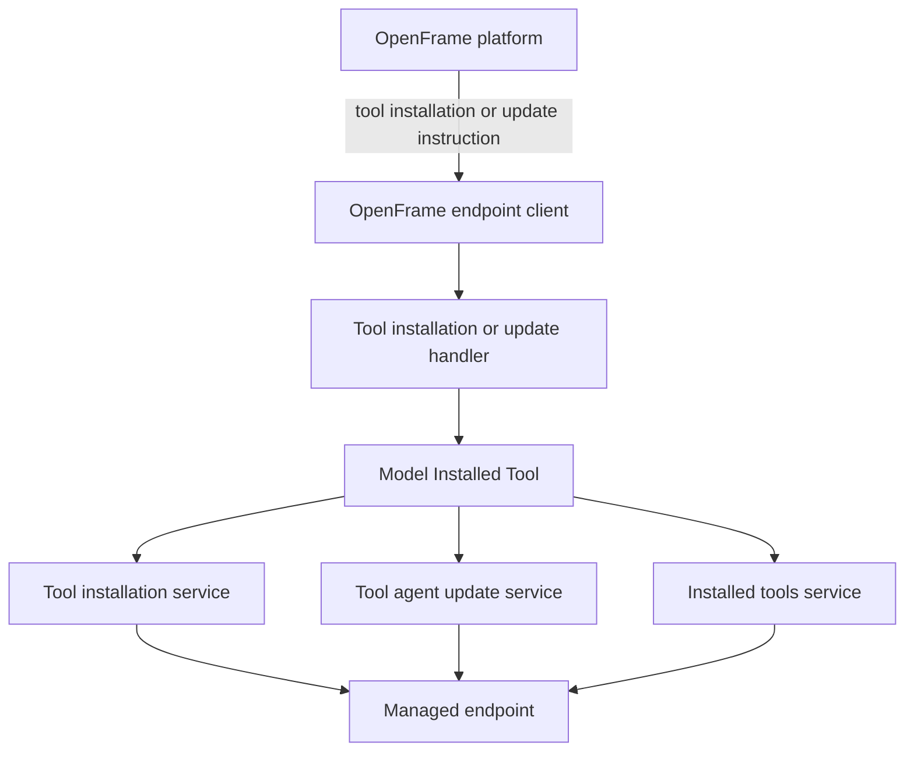
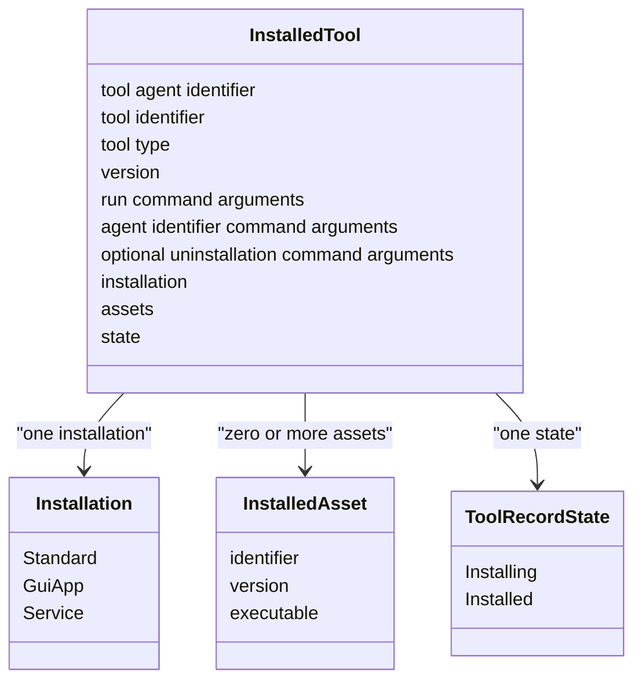
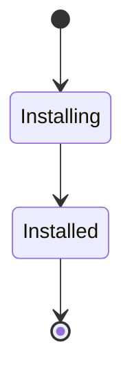
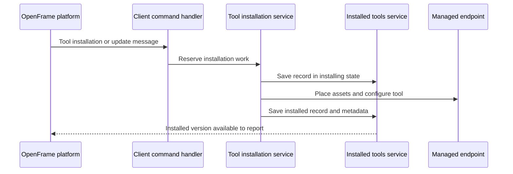

# Model Installed Tool

Model Installed Tool defines the persisted and serializable description of an integrated tool managed by the OpenFrame endpoint client. It is implemented in the `openframe_agent_lib` Cargo dependency from the OpenFrame OSS Library and is assembled at runtime by this repository’s OpenFrame client. The model distinguishes how a tool is installed, records the assets that make up that installation, and exposes a small lifecycle state for installation progress.

The implementation is supplied by the [OpenFrame OSS Library source](https://github.com/flamingo-stack/openframe-oss-lib/blob/7a766f00e4f58b5d89db007b878ac8d6e0c344f4/clients/openframe-client/src/models/installed_tool.rs). This repository consumes `openframe_agent_lib` version `v0.0.5`; the displayed source revision is the implementation analyzed here.

## Responsibilities

The module provides four complementary model types:

- **Installation** is a tagged union that captures the operating model of a tool: a standard executable, a graphical application, or an operating system service.
- **Installed Asset** identifies an individual delivered asset, its version, and whether it is executable.
- **Tool Record State** distinguishes a tool still being installed from one that is installed.
- **Installed Tool** aggregates identity, version, launch arguments, optional removal arguments, installation metadata, assets, and lifecycle state.

It is deliberately a model layer: it does not download artifacts, invoke processes, update files, or persist records itself. Higher-level client services use its data to coordinate those operations.

## Position in the Client Architecture

The model is the contract shared by tool orchestration code:

1. A received installation or update instruction is interpreted by the command handlers and tool services.
2. The tool services construct or update an Installed Tool record, including its installation variant and assets.
3. The Installed Tools Service stores the record and changes its state as work progresses.
4. The run, restart, kill, uninstall, and platform updater services use the installation classification and executable location to select appropriate host behavior.

The neighboring modules listed in the module tree provide the behavioral layers around this data contract. In particular, tool installation handles initial placement, tool agent updates handle updates, and the installed-tools service owns record storage and state transitions.

## Core Data Model

### Installed Tool Record

An Installed Tool is the top-level record. Its mandatory identity and execution metadata are:

| Area | Stored information | Purpose |
|---|---|---|
| Identity | Tool agent identifier, tool identifier, and tool type | Associates the local installation with the platform’s integrated-tool and agent definitions. |
| Versioning | Tool version and per-asset versions | Supports update decisions and installed-version reporting. |
| Execution | Run command arguments and tool-agent identifier command arguments | Supplies process-launch inputs without embedding execution behavior in the model. |
| Removal | Optional uninstallation command arguments | Preserves tool-specific cleanup instructions when supplied. |
| Placement | Installation variant and asset list | Identifies the host integration model and delivered files. |
| Lifecycle | Tool record state | Indicates whether the record represents an in-progress or completed installation. |

The record uses Rust defaults for omitted collections and state. When deserializing data without an asset list, state, or installation value, it receives an empty asset list, `Installed`, and a standard installation without an executable location, respectively. This supports compatibility with records that predate those fields.

### Installation Variants

Installation is serialized as a tagged enum. Its discriminator is named `type`, and variant names use snake case on the wire. The supported variants are:

| Variant | Required data | Optional data | Intended host behavior |
|---|---|---|---|
| Standard | None | Executable location | A conventional executable installation. The location may be unavailable. |
| Graphical application | Executable location | Bundle identifier | A graphical application, with an explicit executable location and an optional platform bundle identity. |
| Service | Service name | Executable location | A background operating system service, with an optional executable location. |

The default is the standard variant with no executable location. This makes an omitted installation object equivalent to a conventional tool whose exact executable path is not yet known.

### Installation Helpers

Installation exposes three predicates and one accessor so consumers do not need to match every variant for common decisions:

- **Executable path** returns the configured path for standard and service installations when present, and always returns the graphical application executable location.
- **Standard check** identifies the standard executable variant.
- **Graphical application check** identifies the graphical application variant.
- **Service check** identifies the service variant.

These helpers are important for downstream platform adapters. A graphical application can require user-session-aware launching, a service can require service-manager operations, and a standard executable can be launched directly according to its tool configuration.

### Installed Assets

Each Installed Asset has an identifier, version, and executable flag. The executable flag defaults to `false` when omitted during deserialization. Assets allow a single tool record to retain the inventory of files or artifacts associated with an installation rather than reducing a tool to one binary.

### Lifecycle State

Tool Record State is serialized in snake case and has two values:

`Installed` is the default. `Installing` gives the surrounding services a durable indicator that an installation operation has been reserved or is still in progress. The model itself does not enforce transitions; the Installed Tools Service and installation orchestration determine when state changes occur.

## Installation and Update Data Flow

The exact command message and installation implementation are outside this module. Model Installed Tool supplies the stable record shape exchanged between those stages:

- The **installation type** drives selection of a standard, graphical-application, or service updater.
- The **asset collection** provides artifact-level inventory and executable classification.
- The **executable location** gives platform-specific launch, update, or stop code a direct target when one is available.
- The **record state** enables callers to represent work that has begun but is not complete.

## Serialization Contract

All four public data types derive serialization and deserialization support, allowing them to be written to local records or transmitted by client workflows. Important wire-format rules are:

- The installation discriminator is `type`; its values are `standard`, `gui_app`, and `service`.
- The tool record state values are `installing` and `installed`.
- Optional executable locations, graphical application bundle identifiers, and uninstallation arguments are omitted when absent rather than emitted as null values.
- Missing installation, asset list, asset executable flag, and state values receive their documented defaults.

Consumers should preserve these defaults and omission rules when adding fields or adapters. They form the compatibility boundary between persisted local state and newer versions of the client.

## Operational Considerations

- Treat the tool agent identifier as the linkage key used by tool record and connection-oriented services. It should remain stable across state changes.
- Do not infer that every installation has an executable location: standard and service variants allow it to be absent.
- Use the installation classification rather than platform-specific heuristics when choosing service control, graphical application launch, or standard executable update behavior.
- Preserve the full asset list during updates so that executable classification and per-asset versions remain available to later operations.
- Mark a record as installing before operations that can leave partial host state, then only mark it installed after orchestration has completed successfully.

## Extension Guidance

When evolving Model Installed Tool:

1. Prefer additive fields with deserialization defaults to keep existing local records readable.
2. Add a new installation variant only when its lifecycle and platform behavior cannot be represented by standard, graphical application, or service semantics.
3. Update every consumer that selects updater, launcher, restart, kill, or uninstall behavior for installation variants.
4. Keep optional values omitted in serialized output where the existing model uses omission; changing this can alter persisted and message compatibility.
5. Add tests for defaults, tagged-enum serialization, omitted optional values, and helper behavior for every installation variant.

The module contains a dedicated test submodule alongside the implementation, making serialization compatibility and variant-specific behavior the primary regression surface.
