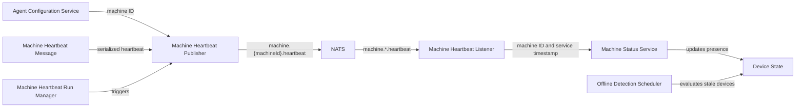
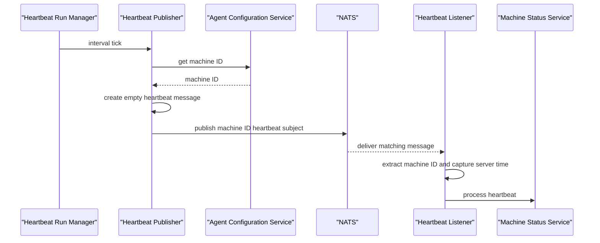
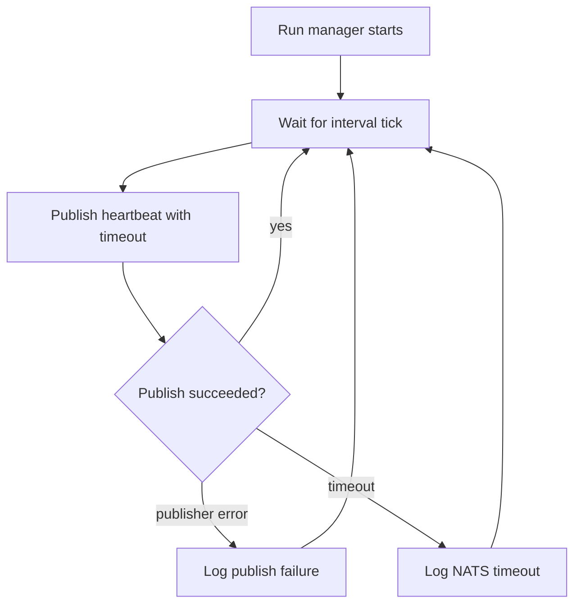

# Model Machine Heartbeat

Model Machine Heartbeat defines the intentionally minimal wire payload used by the OpenFrame endpoint agent to signal that a machine is alive. The payload contains no fields: the machine identity is carried by the NATS subject and the receiving service assigns the event timestamp when it consumes the message. This keeps the message contract small and prevents the client clock from becoming the source of presence time.

The Rust model belongs to the `openframe_agent_lib` library from OpenFrame OSS Library. OpenFrame OSS Tenant runs that library through its client agent and provides the Java client service that consumes the corresponding NATS events.

## Scope and Contract

The module exposes one serializable and deserializable type:

| Component | Responsibility |
| --- | --- |
| `MachineHeartbeatMessage` | Represents the heartbeat payload. Serde uses camel-case naming should fields be added later, although the current object has no fields. |
| `MachineHeartbeatMessage::new()` | Constructs the empty message. The `Default` implementation delegates to this constructor. |

The model serializes to an empty JSON object:

```json
{}
```

The current publisher first serializes the model to that JSON text and then passes the text to the generic NATS publisher, which serializes its input again. As a result, the bytes published by the current implementation are a JSON string whose content is `{}`:

```json
"{}"
```

The receiving heartbeat listener relies on the subject for identity and does not deserialize the body, so this transport encoding does not affect current processing. It is nevertheless a compatibility detail to preserve or deliberately migrate in a coordinated producer and consumer change.

The identity and timestamp are deliberately out of band:

| Concern | Authoritative source |
| --- | --- |
| Machine identity | The NATS subject segment in `machine.{machineId}.heartbeat`. |
| Presence event time | The receiving client service, at message handling time. |
| Payload schema | `MachineHeartbeatMessage`, currently an empty object. |

The model source is maintained in the OpenFrame OSS Library: [machine heartbeat message source](https://github.com/flamingo-stack/openframe-oss-lib/blob/16e7c1cbd9664e7d10ec5ebca7d53c9bd314decf/clients/openframe-client/src/models/machine_heartbeat_message.rs).

## Architecture

The heartbeat model is a boundary contract between the endpoint agent and the client-side platform service. It does not schedule work, acquire a NATS connection, or decide whether a device is offline. Those responsibilities stay in adjacent services.



### Runtime Responsibilities

- **Endpoint agent:** `MachineHeartbeatRunManager` starts an asynchronous loop. On every interval tick it invokes `MachineHeartbeatPublisher::publish_heartbeat` under a timeout. Errors and timeouts are logged and do not terminate the loop.
- **Publisher:** The publisher obtains the machine ID from `AgentConfigurationService`, constructs `MachineHeartbeatMessage`, serializes it, and publishes it to `machine.{machineId}.heartbeat` through `NatsMessagePublisher`.
- **NATS transport:** `NatsMessagePublisher::publish` serializes its supplied value, publishes the bytes through the active client, and flushes the connection. In the heartbeat path the supplied value is already a JSON string, so the publisher serializes that string for transport.
- **Client service:** `MachineHeartbeatListener` subscribes to `machine.*.heartbeat` after application readiness. It extracts the machine ID from the subject, captures `Instant.now()`, and calls `MachineStatusService.processHeartbeat`.
- **Offline handling:** `DeviceHeartbeatOfflineDetectionScheduler` is enabled only when `openframe.device.heartbeat.offline-detection.enabled` is `true`. It runs a stale-device sweep using `openframe.device.heartbeat.offline-detection.interval`, whose configured default is 60,000 milliseconds.

## Publish and Consume Flow



## Lifecycle and Failure Behavior



The run manager continues after a failed or timed-out publish. This provides eventual recovery when NATS connectivity returns, but it does not introduce a local heartbeat queue or retry each individual message. A missing heartbeat is therefore interpreted by downstream status and offline-detection logic rather than being represented as a special client payload.

On the consuming side, the listener catches failures per NATS message and logs the machine ID when available. During shutdown it drains its NATS dispatcher with a five-second timeout so that in-flight callbacks can complete cleanly.

## Design Constraints

### Keep the Payload Empty

`MachineHeartbeatMessage` is intentionally a marker type. Do not add `machineId` or a client-generated timestamp unless the server-side subject and time authority model is changed as a coordinated protocol revision. Duplicating the identifier in the body creates two possible sources of truth; trusting the endpoint clock for a presence event allows clock skew to affect device status.

### Treat the Subject as a Contract

The producer emits `machine.{machineId}.heartbeat`, while the consumer subscribes to `machine.*.heartbeat`. Any change to segment order, separators, or wildcard-compatible structure must update both components and the machine ID extraction logic together.

### Preserve Serialization Compatibility

The type derives `Serialize` and `Deserialize` and specifies `camelCase` field naming. This has no observable field-name effect today, but it establishes the convention for a future additive payload evolution. Consumers must remain able to accept the current empty object.

### Separate Presence from Offline Policy

A heartbeat declares successful agent-to-broker publication only. It does not directly set an offline state, establish a service-level delivery acknowledgement, or encode an offline threshold. The status service records the observed event, and the optional management scheduler applies the stale-device policy later.

## Maintenance Guidance

When changing this contract, validate the complete path:

1. Confirm Rust serialization still produces the payload intended for NATS.
2. Confirm the emitted subject is compatible with `machine.*.heartbeat` and machine ID extraction.
3. Confirm the Java listener can deserialize or safely ignore the evolved body if it begins to use payload fields.
4. Test reconnection behavior, publish failures, and heartbeat timeout logging without stopping the scheduling loop.
5. Verify that online updates and the offline-detection sweep produce the expected device-state transitions.

The interval and timeout constants used by the agent run manager are defined outside this model. Operational tuning should target the run manager configuration or implementation rather than expanding the model solely to carry scheduling metadata.

## System Placement

Model Machine Heartbeat is part of the endpoint-agent messaging path assembled from the `openframe_agent_lib` Cargo artifact, version `v0.0.5`, sourced from OpenFrame OSS Library. OpenFrame OSS Tenant also runs the Java `openframe-client` service that includes the NATS heartbeat listener and the `openframe-management` service that includes the optional offline-detection scheduler. The tenant configuration provides NATS at `nats.datasources.svc.cluster.local` for the client service.

This module is therefore a small but central compatibility boundary: the agent supplies liveness evidence, NATS transports it, the platform records service-observed presence, and management policy later identifies stale devices.
