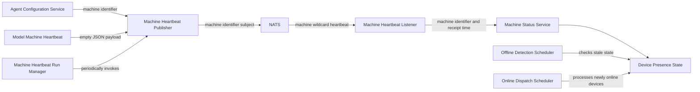
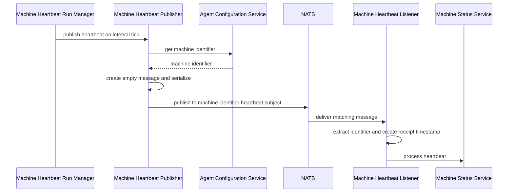
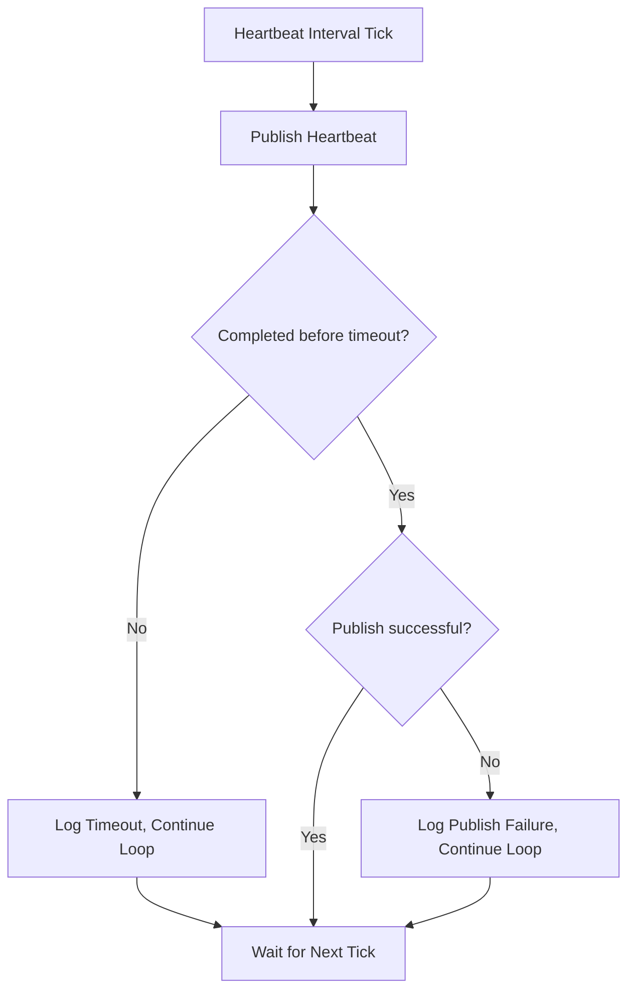

# Model Machine Heartbeat

Model Machine Heartbeat is the minimal wire contract used by an OpenFrame client to announce that a registered machine is still reachable. The message deliberately contains no fields: the machine identity is encoded in the NATS subject and the receiving service assigns the event time when it handles the message. This keeps the heartbeat payload small and prevents the client clock from becoming the source of truth for presence.

The model is implemented by the OpenFrame OSS Library's Rust client code and is assembled at runtime by this repository's OpenFrame Client deployment. The authoritative implementation is [`machine_heartbeat_message.rs`](https://github.com/flamingo-stack/openframe-oss-lib/blob/7a766f00e4f58b5d89db007b878ac8d6e0c344f4/clients/openframe-client/src/models/machine_heartbeat_message.rs).

## Responsibilities and Boundaries

The module owns only the serializable `MachineHeartbeatMessage` type and its `new()` constructor. It does **not** determine the machine identifier, schedule publications, establish a NATS connection, persist device state, or decide when a device is offline. Those responsibilities belong to the client and server-side services surrounding the contract.

| Concern | Responsible component | Behavior |
|---|---|---|
| Wire payload | `MachineHeartbeatMessage` | Produces an empty JSON object. The type derives serialization and deserialization support and applies camel-case naming should fields be added later. |
| Identity | `MachineHeartbeatPublisher` | Reads the persisted machine ID from agent configuration and places it in the subject. |
| Periodic execution | `MachineHeartbeatRunManager` | Runs publication asynchronously at the configured heartbeat interval, with a timeout per attempt. |
| Transport | `NatsMessagePublisher` | Publishes the serialized payload to NATS. |
| Presence ingestion | `MachineHeartbeatListener` | Subscribes to matching NATS subjects, derives the machine ID, timestamps receipt, and invokes machine-status processing. |
| Offline evaluation | `DeviceHeartbeatOfflineDetectionScheduler` | Optionally sweeps for stale devices in the management service. |

## Contract

`MachineHeartbeatMessage` is a unit-like data carrier represented as an empty struct. Both `new()` and the `Default` implementation create the same value.

```json
{}
```

The publisher sends that payload on the following subject form:

```text
machine.<machine-id>.heartbeat
```

The receiving client-core service subscribes to `machine.*.heartbeat`. The wildcard occupies exactly the machine identifier position. The model therefore has an important protocol constraint: producers and consumers must preserve this three-token subject layout. A payload alone cannot identify the machine.

### Why Receipt Time Is Authoritative

The client listener extracts the machine identifier from the received subject and creates an `Instant` when processing the message. It then calls the machine-status service with that identifier and server-side timestamp. This avoids treating a potentially skewed or stale client-provided timestamp as the observed liveness time.

Because the payload is empty, adding machine metadata directly to the heartbeat would be a wire-contract change. Prefer the existing identity and server-side processing path unless a new value is explicitly required by both publisher and listener implementations.

## Architecture



The model sits at the boundary between the Rust agent and Java client-core services. It is intentionally transport-neutral at the type level: serialization produces the body, while the publisher supplies the NATS subject that makes the message meaningful.

## Publication Flow

The OpenFrame client starts `MachineHeartbeatRunManager`, which creates a background Tokio task. On every interval tick, the task calls `MachineHeartbeatPublisher.publish_heartbeat()` under the configured heartbeat timeout.



### Attempt Outcomes

The background loop remains active after individual publication failures.



A successful return means the publisher read the machine ID, serialized the empty message, and completed the NATS publish call. This module does not define application-level acknowledgment, retries, local queuing, or delivery persistence for heartbeats.

## Server-Side Processing and Presence Effects

At application readiness, `MachineHeartbeatListener` creates a NATS dispatcher and registers its wildcard subscription. For every received message it:

1. Reads the NATS subject.
2. Extracts the machine identifier with `NatsTopicMachineIdExtractor`.
3. Captures the service-side event timestamp.
4. Calls `MachineStatusService.processHeartbeat(machineId, eventTimestamp)`.
5. Logs unexpected processing exceptions without terminating the listener callback.

During shutdown, the listener attempts to drain its dispatcher with a five-second limit. This gives in-flight work an opportunity to finish before the connection is released.

Presence changes can trigger later workflows, but they are separated from the heartbeat contract:

- `DeviceOnlineDispatchScheduler` runs a device-online processing sweep at a configurable fixed delay. Its default delay is 60 seconds and it uses a scheduler lock to coordinate execution.
- `DeviceHeartbeatOfflineDetectionScheduler` runs only when `openframe.device.heartbeat.offline-detection.enabled` is `true`. Its default fixed delay is 60 seconds and it delegates stale-device evaluation to the offline-detection service.

The exact online threshold, stale threshold, storage behavior, and any resulting dispatch actions are outside Model Machine Heartbeat and must be treated as server-side policy.

## Operational Considerations

- **Registration prerequisite:** the publisher obtains the identifier from agent configuration. If no machine ID is available, publication cannot construct a valid subject.
- **NATS availability:** timeout is reported as a possible disconnected NATS condition. Publish errors and timeouts are logged; the run manager continues to later ticks.
- **Clock semantics:** use server receipt time for liveness investigations. The model carries no client timestamp.
- **Subject compatibility:** changing `machine.<machine-id>.heartbeat` affects identifier extraction and the `machine.*.heartbeat` subscription.
- **Schema evolution:** the empty message is a stable baseline. Any field addition must consider Rust serialization, Java deserialization expectations, and mixed-version clients.
- **Observability:** publisher logging includes the machine identifier after a successful publication, and the listener emits debug logs around processing. Avoid relying on payload content for diagnosis because it is intentionally empty.

## Maintenance Checklist

When changing this contract or the heartbeat path:

1. Keep `MachineHeartbeatMessage::new()` and `Default` behavior equivalent.
2. Verify the JSON body remains compatible with all consumers.
3. Verify publisher subject construction and server wildcard subscription together.
4. Verify that the subject extractor still obtains the intended machine identifier.
5. Exercise success, publish failure, and timeout paths without stopping the periodic loop.
6. Validate presence effects separately from transport delivery, including online dispatch and optional offline detection.

## Scope Summary

Model Machine Heartbeat is a deliberately small protocol model, not a complete presence subsystem. Its empty JSON representation works only in combination with the subject-based identifier, periodic Rust publisher, NATS listener, machine-status processor, and separate online or offline policy jobs. Keeping those layers distinct makes the message contract stable while allowing presence policy to evolve independently.
