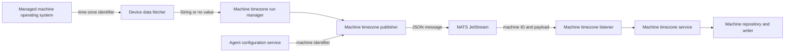
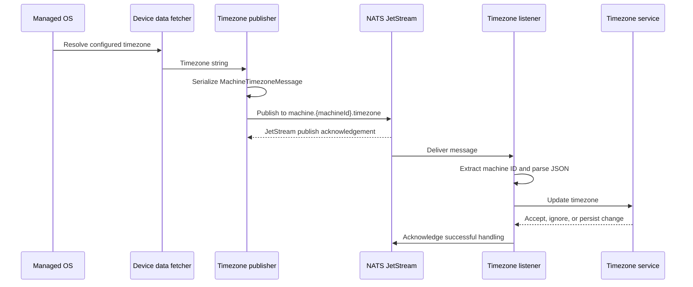
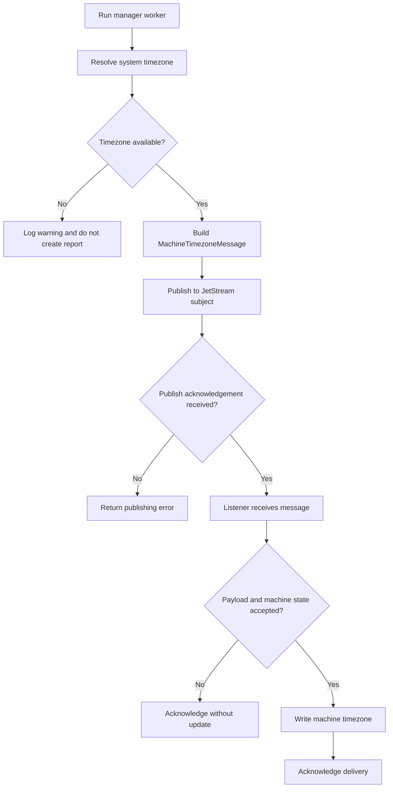

# Model Machine Timezone

Model Machine Timezone defines the small, agent-side wire model used to report a managed machine's configured time zone. Its sole type, `MachineTimezoneMessage`, is serialized as JSON and published by the OpenFrame client to the platform's JetStream-based NATS workflow. The receiving client service validates the zone identifier and persists a valid change on the matching machine record.

The model is implemented by the `openframe_agent_lib` artifact supplied by [OpenFrame OSS Library](https://github.com/flamingo-stack/openframe-oss-lib/blob/7a766f00e4f58b5d89db007b878ac8d6e0c344f4/clients/openframe-client/src/models/machine_timezone_message.rs), version `v0.0.5` in this repository's dependency graph. It runs as part of the OpenFrame client assembled by this repository.

## Purpose and Contract

`MachineTimezoneMessage` is a Rust structure with one public field:

| JSON field | Rust type | Meaning |
| --- | --- | --- |
| `timezone` | `String` | The machine time-zone identifier reported by the agent. |

Because the type derives `Serialize`, a value such as the following is the agent-side JSON payload shape:

```json
{
  "timezone": "America/New_York"
}
```

The model is deliberately a transport contract, not a policy layer. It does not include the machine identifier, validate the time-zone value, collect platform information, retain a report locally, or define a schedule. The publisher derives the machine identifier from agent configuration and places it in the NATS subject. The receiving service owns semantic validation and persistence.

## Architecture



The components on the agent side are Rust components from OpenFrame OSS Library:

- `DeviceDataFetcher::get_timezone` obtains the current IANA-style identifier through `iana_time_zone`. It returns no value and logs a warning when the operating system value cannot be resolved.
- `MachineTimezoneRunManager` is the lifecycle wrapper. Its constructor receives the data fetcher, publisher, and NATS connection manager; `start` logs startup and spawns its asynchronous worker.
- `MachineTimezonePublisher::publish_timezone` builds this model, serializes it with `serde_json`, and uses the configured machine ID to form the destination subject.
- `NatsMessagePublisher::publish_acked` publishes through JetStream and waits for the JetStream publish acknowledgement before reporting success to the caller.

The server-side listener and persistence service are Java components from the same OpenFrame OSS Library. They are included here to describe the end-to-end contract rather than as code owned by this model.

## Message Routing and Ownership

The publisher constructs the subject as `machine.{machineId}.timezone`. This separates identity from the payload and permits the server to extract the machine ID from the subject rather than accepting it as a mutable field in the JSON body.



On the server, `MachineTimezoneListener` consumes the `MACHINE_TIMEZONE` stream with subject `machine.*.timezone`. It uses consumer name `machine-timezone-processor-v1`, delivery group `machine-timezone`, and delivery subject `machine.timezone.delivery`.

## Processing Rules

The receiving listener first decodes the JSON into its server-side message representation and extracts the machine ID from the NATS subject. Its outcome is determined by the following rules:

1. A blank `timezone` payload is logged and acknowledged without updating a machine.
2. A nonblank value is passed to `MachineTimezoneService`.
3. The service accepts only identifiers in Java's `ZoneId.getAvailableZoneIds()` set.
4. An update is ignored if the target machine does not exist, is deleting or deleted, or already holds the submitted value.
5. Otherwise, the service updates the machine's `TIMEZONE` field through the machine writer.
6. The listener acknowledges normally handled messages, including ignored values. An unexpected decoding or processing exception leaves the message unacknowledged so JetStream can redeliver it.

This division of responsibility is important: the Rust model permits serialization of any string, while the platform is the authoritative gate for acceptable zone identifiers and valid machine state.

## Data Flow and Failure Boundaries



There are two distinct acknowledgements:

- **Publish acknowledgement:** the agent's `publish_acked` call waits until JetStream acknowledges receipt of the published bytes.
- **Consumer acknowledgement:** after delivery, the server listener acknowledges a message only after its normal handling path completes. Unexpected exceptions intentionally avoid the acknowledgement and rely on redelivery.

A successful publish therefore proves broker receipt, not that the machine record has already been updated. Conversely, invalid, blank, unknown-machine, unchanged, and deleting-machine reports are terminally acknowledged on the server because retrying them would not change the result under the current state.

## Integration Details

### Agent-side collection

The model is used with `DeviceDataFetcher::get_timezone`, which calls the operating-system time-zone discovery library. The optional return type makes a discovery failure explicit: no empty placeholder message needs to be produced by the fetcher.

### Agent-side publication

`MachineTimezonePublisher` obtains the machine ID through `AgentConfigurationService::get_machine_id`. It creates this model only after an ID is available, serializes it into bytes, and publishes those bytes to JetStream. NATS connection access is supplied by `NatsConnectionManager`; attempting to publish before the manager has an initialized client produces an error.

### Platform-side consumption

The Java client-core service consumes the stream, parses the payload, validates the proposed zone against the Java runtime's available zone IDs, resolves the machine through the repository, and writes only a real change. This protects persisted machine data from malformed payloads and avoids needless writes for repeat reports.

## Maintenance Guidance

- Treat `timezone` as a compatibility-sensitive JSON field. Renaming it, changing its type, or adding required fields requires coordinated changes to the Rust publisher and Java listener.
- Keep machine identity in the subject unless the server-side routing and extraction strategy changes together. Adding a machine ID into this message would create two sources of identity.
- Preserve IANA-compatible zone identifiers. The receiving service validates against Java `ZoneId` values, so a platform-specific display name can be published successfully only if Java recognizes it.
- Do not infer persistence success from agent logs that state a report was published. Inspect consumer processing and machine state when diagnosing end-to-end issues.
- When changing acknowledgement handling, preserve the distinction between permanent validation outcomes, which are acknowledged, and unexpected failures, which are left available for JetStream redelivery.

## Source Components

| Component | Role |
| --- | --- |
| `MachineTimezoneMessage` | Serializable payload containing the reported time zone. |
| `MachineTimezonePublisher` | Builds the payload, derives the per-machine subject, and uses acknowledged JetStream publication. |
| `MachineTimezoneRunManager` | Starts the asynchronous agent-side reporting worker. |
| `DeviceDataFetcher` | Resolves the machine's configured time zone from the operating system. |
| `MachineTimezoneListener` | Consumes and parses platform messages from the machine timezone stream. |
| `MachineTimezoneService` | Validates and conditionally persists the time-zone update. |
