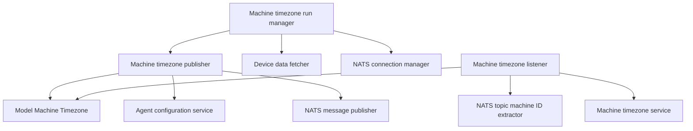
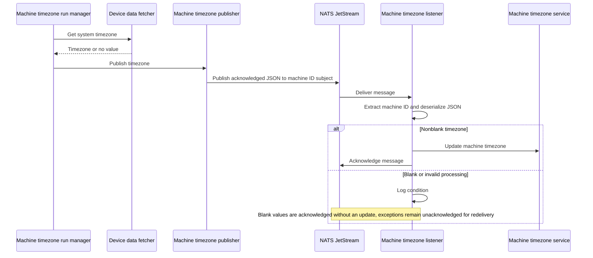
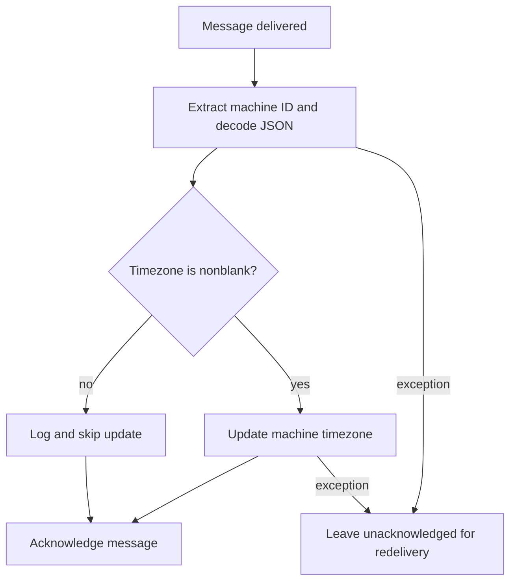

# Model Machine Timezone

Model Machine Timezone is the wire model used by the OpenFrame endpoint client to report a machine's current IANA time-zone identifier. It is deliberately small: the message contains only `timezone`, leaving machine identity to the NATS subject rather than duplicating it in the JSON payload.

The Rust definition belongs to the `openframe_agent_lib` artifact from [OpenFrame OSS Library](https://github.com/flamingo-stack/openframe-oss-lib/blob/16e7c1cbd9664e7d10ec5ebca7d53c9bd314decf/clients/openframe-client/src/models/machine_timezone_message.rs). OpenFrame OSS Tenant runs the client that assembles this library code and consumes the resulting messages through its client service.

## Contract

`MachineTimezoneMessage` derives Rust `Serialize` and has one public field:

| Field | Type | Meaning |
| --- | --- | --- |
| `timezone` | String | The time-zone identifier resolved from the endpoint operating system. |

The endpoint serializes the model as JSON before publishing. The receiving Java listener deserializes the body into its corresponding message type.

```json
{
  "timezone": "America/New_York"
}
```

Machine identity is represented by the subject shape `machine.<machine ID>.timezone`; it is not a JSON field. Consumers must therefore treat the subject and payload as one logical update.

## Architecture

```mermaid
flowchart LR
    EndpointOs["Endpoint operating system"] -->|"time-zone lookup"| Fetcher["Device data fetcher"]
    Fetcher -->|"time-zone string"| RunManager["Machine timezone run manager"]
    RunManager -->|"publish request"| Publisher["Machine timezone publisher"]
    Publisher -->|"serialized message"| Nats["NATS JetStream"]
    Nats -->|"machine ID subject"| Listener["Machine timezone listener"]
    Listener -->|"timezone update"| Service["Machine timezone service"]
```



### Endpoint-side responsibilities

- **Device data fetcher** resolves the system timezone through `iana_time_zone::get_timezone`. It logs a warning and returns no value if lookup fails.
- **Machine timezone run manager** owns the timezone publisher, device-data fetcher, and NATS connection manager. Its `start` method starts its background work on Tokio.
- **Machine timezone publisher** obtains the persisted machine ID from agent configuration, creates Model Machine Timezone, JSON-serializes it, and publishes with acknowledgement through `NatsMessagePublisher`.

### Server-side responsibilities

The client service listens to `machine.*.timezone` in the `MACHINE_TIMEZONE` stream. It extracts the machine ID from the subject, deserializes the message, validates that the timezone is not blank, and passes valid updates to `MachineTimezoneService`.



## Publication and Processing Flow



## Delivery Semantics

The endpoint publisher uses acknowledged publication, so it waits for the broker acknowledgement before considering its send successful. On the server, a valid update is acknowledged only after the timezone service call returns. A blank timezone is logged and acknowledged without changing machine data. Exceptions during extraction, deserialization, or update are logged and left unacknowledged, allowing JetStream to redeliver the message.



## Maintenance Notes

- Preserve the single-field JSON shape when evolving Model Machine Timezone. The server-side listener expects a `timezone` property, while identity continues to come from the NATS subject.
- Publish only a resolved timezone. The device-data fetcher represents lookup failure as no value rather than manufacturing a fallback timezone.
- Changes to the subject convention require coordinated endpoint and server changes because the listener subscription and machine-ID extraction depend on `machine.*.timezone`.
- Timezone validation is intentionally limited in the observed listener to a nonblank check. If stronger IANA validation is added, apply it consistently before persisting data and document how invalid values are handled.

## Source Components

| Component | Role |
| --- | --- |
| `MachineTimezoneMessage` | Serializable payload model containing the timezone string. |
| `MachineTimezonePublisher` | Builds the payload and publishes it to the machine-specific subject. |
| `MachineTimezoneRunManager` | Starts the background timezone reporting workflow. |
| `DeviceDataFetcher` | Queries the endpoint operating system for its timezone. |
| `MachineTimezoneListener` | Receives updates, validates the value, persists it through the timezone service, and controls acknowledgement. |
