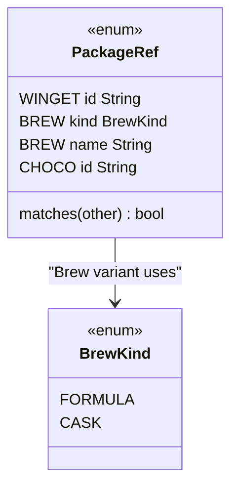
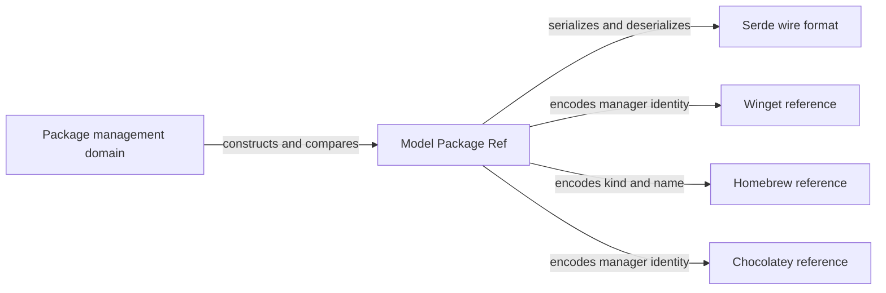
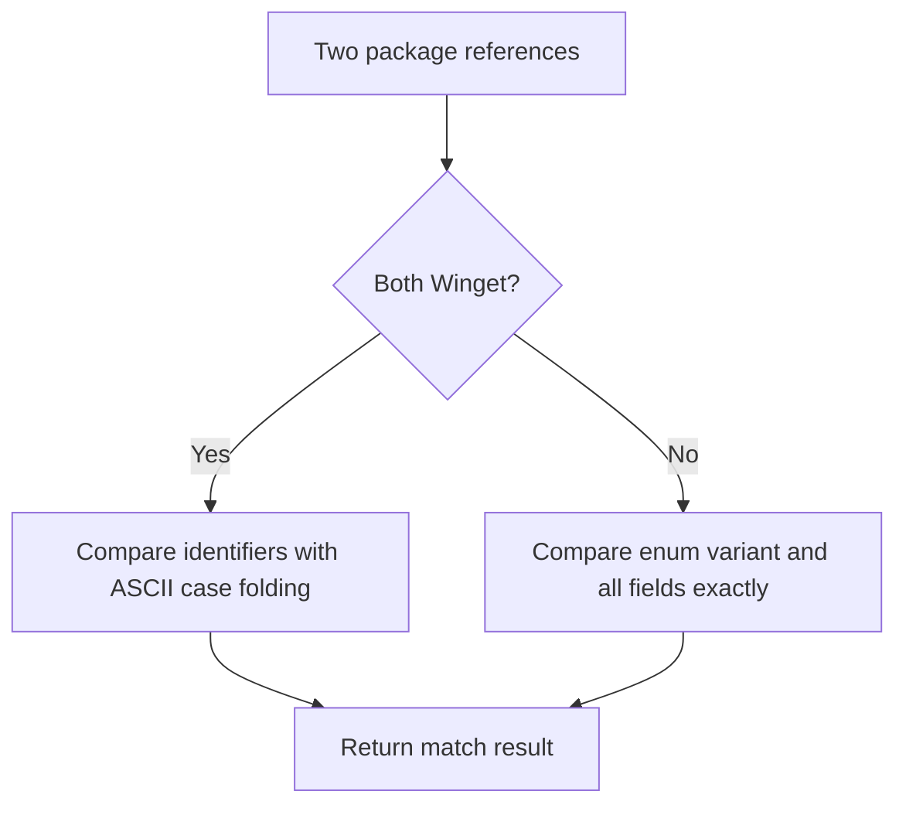
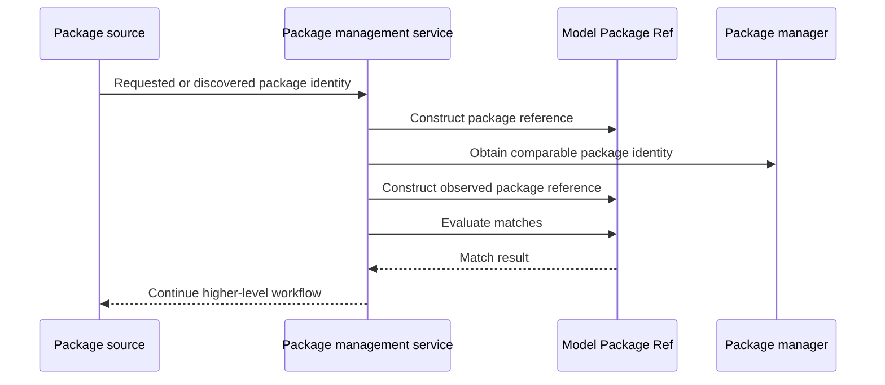

# Model Package Ref

Model Package Ref defines the small, serializable identity used to name a package managed by the OpenFrame Client. It distinguishes Winget, Homebrew, and Chocolatey packages, preserves the identifier required by each ecosystem, and supplies one deliberately asymmetric comparison rule: Winget identifiers are matched without regard to ASCII letter case, while Homebrew and Chocolatey references retain normal structural equality.

The implementation belongs to the `openframe_agent_lib` Rust artifact supplied by [OpenFrame OSS Library](https://github.com/flamingo-stack/openframe-oss-lib/blob/7a766f00e4f58b5d89db007b878ac8d6e0c344f4/clients/openframe-client/src/models/package_ref.rs). This repository consumes that artifact at version `v0.0.5`; the model runs as part of the OpenFrame Client rather than being implemented locally in this repository.

## Purpose and Scope

A package manager needs more than a package label to locate software reliably. Model Package Ref makes the manager part of the identity and captures the manager-specific key:

| Package manager | Variant | Identity fields | Comparison behavior |
|---|---|---|---|
| Winget | `PackageRef::Winget` | `id` | ASCII case-insensitive identifier comparison |
| Homebrew | `PackageRef::Brew` | `kind`, `name` | Exact structural equality |
| Chocolatey | `PackageRef::Choco` | `id` | Exact structural equality |

`BrewKind` further separates a Homebrew `Formula` from a `Cask`. This prevents a Homebrew reference from treating those package categories as interchangeable when they use the same name.

The model is intentionally limited to package identity. It does not discover installed packages, invoke a package manager, choose update policy, or report update status. Those responsibilities are implemented by the OpenFrame Client's package-management services and the adjacent package-update models.

## Type Model and Wire Contract

`PackageRef` is a Rust enum with Serde serialization and deserialization. Its `manager` field is an internal tag with uppercase manager values. `BrewKind` is also encoded as an uppercase string. The model derives `Debug`, `Clone`, `PartialEq`, `Eq`, and `Hash`, allowing it to be copied into application data, compared, and used as a key where the default equality semantics are appropriate.



Representative serialized values follow the type's tagged-enum contract:

```json
{
  "manager": "WINGET",
  "id": "Contoso.Editor"
}
```

```json
{
  "manager": "BREW",
  "kind": "CASK",
  "name": "contoso-editor"
}
```

```json
{
  "manager": "CHOCO",
  "id": "contoso.editor"
}
```

The model has no custom deserialization fallback or normalization step. Producers and consumers must supply the expected discriminator and fields, and must not assume that `id` and `name` are interchangeable.

## Architecture and Placement

Model Package Ref is a pure domain model within the Rust OpenFrame Client library. It has a direct dependency only on Serde for wire conversion. The package-management domain can construct references from commands or inventory, then use `matches` when correlating two known references. The model itself does not perform input/output, persistence, network calls, or operating-system detection.



At the repository level, the OpenFrame Client is one of the services assembled from OpenFrame OSS Library components. This model supports the package-management portion of that client. The code-graph snapshot reports no direct callers for either `PackageRef` or `PackageRef::matches`; that reflects the indexed source relationship, not a guarantee that no runtime payload, deserialized value, or future component uses the model.

## Matching Semantics

The `matches` method is the semantic comparison API for package correlation. It applies the following decision process:



### Winget

When both values are `Winget`, `matches` delegates to Rust's `eq_ignore_ascii_case`. Thus `Contoso.Editor` and `contoso.editor` match. The rule is ASCII-only, which is appropriate for the expected package identifiers but does not provide Unicode case folding.

### Homebrew and Chocolatey

All other pairs use the derived equality implementation:

- Two `Brew` values match only if both have the same `BrewKind` and exactly the same `name`.
- Two `Choco` values match only if their `id` values are identical as written.
- References from different managers never match.
- A `Brew` formula and a `Brew` cask never match solely because their names are equal.

This distinction matters when a package operation correlates a requested package to a discovered or persisted reference. Callers needing manager-aware matching should use `matches`; callers using raw `==` will not receive Winget's case-insensitive behavior.

## Comparison Examples

```rust
use openframe_agent_lib::models::package_ref::{BrewKind, PackageRef};

let requested = PackageRef::Winget {
    id: "Contoso.Editor".to_owned(),
};
let observed = PackageRef::Winget {
    id: "contoso.editor".to_owned(),
};
assert!(requested.matches(&observed));

let formula = PackageRef::Brew {
    kind: BrewKind::Formula,
    name: "contoso-editor".to_owned(),
};
let cask = PackageRef::Brew {
    kind: BrewKind::Cask,
    name: "contoso-editor".to_owned(),
};
assert!(!formula.matches(&cask));
```

## Data Flow in Package Correlation

The model's contribution to a package workflow is bounded to representing and comparing identity. A higher-level service owns acquisition of data, update execution, and result publication.



## Maintenance Guidance

- Treat `manager` values and Homebrew `kind` values as part of a wire contract. Renaming variants or changing Serde casing affects serialized payload compatibility.
- Add manager-specific comparison rules only in `matches`; keep ordinary derived equality intact unless the model's hashing and equality contract is redesigned together.
- If adding another package manager, define its serialized fields, default equality behavior, and any normalization rule explicitly. Update tests for same-manager, cross-manager, and case-variant comparisons.
- Do not use a Winget-normalized reference as an interchangeable hash key with the original value: `Hash` follows derived field values, whereas `matches` deliberately applies case-insensitive comparison for Winget.
- Keep package acquisition, operating-system selection, installation, update gating, and status reporting outside this model to preserve its side-effect-free role.

## Source

The authoritative implementation is [package ref source in OpenFrame OSS Library](https://github.com/flamingo-stack/openframe-oss-lib/blob/7a766f00e4f58b5d89db007b878ac8d6e0c344f4/clients/openframe-client/src/models/package_ref.rs).