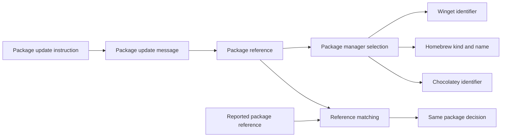
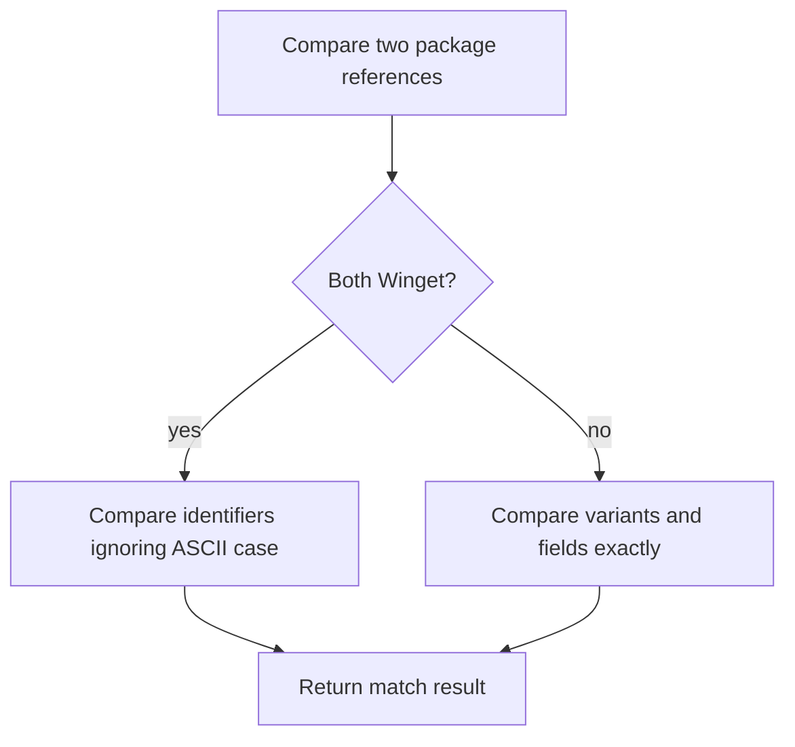
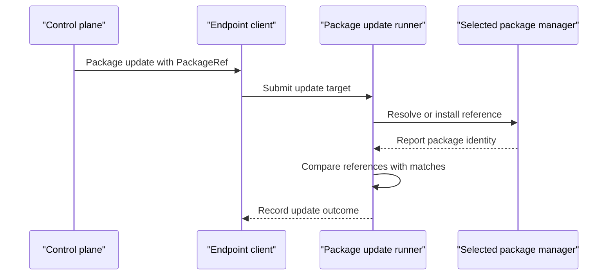

# Model Package Ref

Model Package Ref defines the compact, serializable identity of a software package managed by the OpenFrame endpoint client. It is implemented in the OpenFrame OSS Library's Rust `openframe_agent_lib` artifact, which this repository runs as part of the OpenFrame client. The model preserves the package-manager namespace and carries the manager-specific identifier needed to recognize the same package across inventory, policy, and update work.

The implementation is sourced from [the OpenFrame OSS Library package reference model](https://github.com/flamingo-stack/openframe-oss-lib/blob/16e7c1cbd9664e7d10ec5ebca7d53c9bd314decf/clients/openframe-client/src/models/package_ref.rs).

## Purpose and Scope

A package name is not globally meaningful on its own: package managers have independent catalogs and identifier rules. Model Package Ref makes that manager context explicit by representing exactly three supported references:

| Manager | Variant | Identity fields | Matching rule |
| --- | --- | --- | --- |
| Windows Package Manager | `Winget` | `id` | ASCII case-insensitive |
| Homebrew | `Brew` | `kind`, `name` | Exact equality |
| Chocolatey | `Choco` | `id` | Exact equality |

This module is intentionally a model layer. It neither runs package-manager commands nor performs installation, download, update scheduling, or persistence. Those responsibilities remain in the package-management services that consume package-update messages.

## Architecture

`PackageRef` is the transport and comparison boundary between a desired package reference and the reference discovered or reported from a device. `BrewKind` disambiguates Homebrew formulae from casks, preventing two distinct Homebrew package categories from being treated as interchangeable.



### Core Types

#### `PackageRef`

`PackageRef` is an enum with derived debug, cloning, equality, hashing, serialization, and deserialization support. Each variant keeps only the fields required to identify a package for its package-manager namespace:

- `Winget { id }` identifies a Windows Package Manager package.
- `Brew { kind, name }` identifies a Homebrew package and whether it is a formula or cask.
- `Choco { id }` identifies a Chocolatey package.

The enum is tagged with the `manager` field and uses uppercase discriminators. Its wire representation is therefore manager-explicit. The following JSON illustrates the serialized shape:

```json
{
  "manager": "WINGET",
  "id": "Example.Package"
}
```

```json
{
  "manager": "BREW",
  "kind": "CASK",
  "name": "example-app"
}
```

```json
{
  "manager": "CHOCO",
  "id": "example-package"
}
```

Consumers should retain these uppercase discriminator values. Changing the tag name, a variant name, or a field name is a wire-contract change for serialized messages and stored payloads.

#### `BrewKind`

`BrewKind` distinguishes the two Homebrew reference categories:

- `Formula` for Homebrew formulae.
- `Cask` for Homebrew casks.

It also serializes as uppercase values, `FORMULA` and `CASK`. Because `BrewKind` participates in normal enum equality, a formula and a cask with the same `name` do not match.

## Matching Semantics

The `matches` method implements domain-specific comparison rather than relying solely on derived equality:

1. When both references are `Winget`, their identifiers are compared with ASCII case ignored.
2. Every other pair uses exact enum equality. Variants must agree, and every identity field must be equal.

This makes Windows Package Manager identity tolerant of identifier casing while keeping Homebrew and Chocolatey behavior conservative and predictable.



### Consequences

- `Winget { id: "Vendor.Tool" }` matches `Winget { id: "vendor.tool" }`.
- A Winget reference never matches a Chocolatey or Homebrew reference, even when identifier text is identical.
- `Brew { kind: Formula, name: "tool" }` does not match `Brew { kind: Cask, name: "tool" }`.
- Homebrew names and Chocolatey identifiers retain their written casing for comparison; callers must normalize them before constructing a reference if their domain requires looser comparison.

## Package Update Data Flow

The model is used to express the target of a package-management operation. The reference travels with a package-update instruction, is resolved by the selected package-manager integration, and is compared with package metadata or operation state using `matches`.



The model itself does not choose a manager or execute the update. It supplies the typed identity required for those operations and avoids accidental cross-manager matches.

## Serialization and Compatibility Guidance

Treat Model Package Ref as a protocol type:

- Preserve the `manager` tag and its uppercase values: `WINGET`, `BREW`, and `CHOCO`.
- Preserve Homebrew's `kind` field and uppercase values: `FORMULA` and `CASK`.
- Do not collapse the variants into an unqualified string identifier; that would lose the package-manager boundary.
- Use `matches` for package identity decisions instead of assuming derived equality reflects the Winget case rule.
- Add a new manager only as a coordinated protocol change. It requires a new enum variant, serialization compatibility review, manager selection support, and behavior in any consumers that process package references.

## Maintenance Notes

The derived `Hash`, `PartialEq`, and `Eq` implementations remain exact, including the casing of Winget identifiers. In contrast, `matches` intentionally relaxes only Winget comparison. Maintainers should not substitute one for the other:

- Use `matches` for the business question, “do these references identify the same package?”
- Use equality and hashing only where exact structural identity is required, such as a collection key whose casing behavior is intentionally strict.

At the time this documentation was generated, organization-wide code-graph coverage found no indexed direct consumers for `PackageRef` or `BrewKind`. That absence does not alter the model's wire-contract role in the endpoint client's package-update flow; it means maintainers should validate downstream behavior when changing this shared library type.
