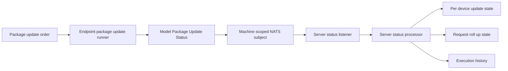
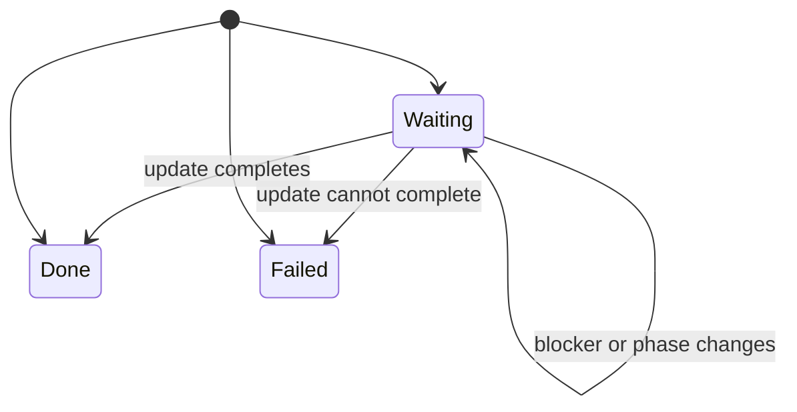
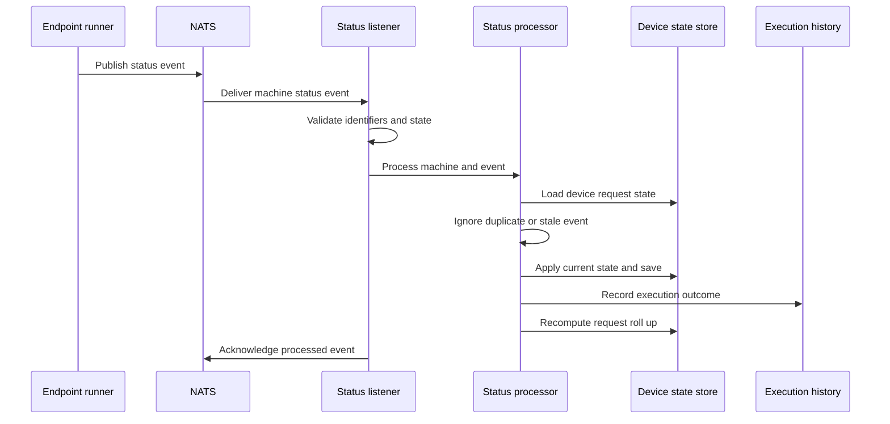

# Model Package Update Status

Model Package Update Status is the wire contract used by the OpenFrame endpoint client to report the lifecycle of one package-update request for one machine. It is implemented by the `openframe_agent_lib` dependency from the OpenFrame OSS Library and is run in this repository by the OpenFrame client. The model is published on NATS, consumed by the server-side client core, and converted into per-device and request-level software-update state.

The implementation is in the [OpenFrame OSS Library source](https://github.com/flamingo-stack/openframe-oss-lib/blob/16e7c1cbd9664e7d10ec5ebca7d53c9bd314decf/clients/openframe-client/src/models/package_update_status.rs). This repository consumes `openframe_agent_lib` version `v0.0.5`.

## Responsibilities

The module defines:

- A stable, machine-scoped NATS subject for package-update status events.
- `PackageUpdateStatusMessage`, the event envelope that correlates an update request, machine, package, source, versions, event time, and lifecycle state.
- A three-state lifecycle: `WAITING`, `DONE`, and `FAILED`.
- State-specific payloads that describe blockers, successful completion, and failures without mixing unrelated fields.
- Enumerations for wait causes and phases, completion results, and failure categories.

It does not execute an update, select a package manager, persist device state, or decide retry policy. Those responsibilities belong to the package-update runner and server-side status-processing components.

## Position in the Update Architecture



The endpoint-side model carries `PackageRef` and `UpdateSource` values from the package-update request model. The server listener resolves the machine identity from the subject, deserializes the payload, validates required identifiers and state, then applies the event to the matching tenant, request, and device state.

## NATS Routing Contract

`PACKAGE_UPDATE_STATUS_KIND` is `package-update.status`. The `package_update_status_subject` function constructs the target subject as follows:

```text
machine.<machine ID>.package-update.status
```

The machine identifier is embedded in the subject as well as in the message body. The server listener extracts the identifier from the subject and uses it to locate the machine. It also requires non-empty `eventId`, `requestId`, and `machineId` fields plus a non-null state before processing. Malformed or incomplete messages are acknowledged and rejected rather than retried; unexpected processing failures are left unacknowledged for the messaging system to redeliver.

## Message Envelope

`PackageUpdateStatusMessage` is serialized using camel-case property names. It contains both correlation data and one lifecycle-specific detail object.

| Field | Required | Purpose |
|---|---:|---|
| `eventId` | Yes | Unique event identifier used for duplicate detection. |
| `requestId` | Yes | Correlates every lifecycle event with one package-update request. |
| `machineId` | Yes | Identifies the endpoint that emitted the event. |
| `at` | Yes | Event timestamp, used by the server to discard stale events. |
| `source` | Yes | Identifies where the requested update originated. |
| `package` | Yes | Identifies the target package through the shared package reference model. |
| `installedVersion` | No | Version observed as installed by the endpoint. |
| `availableVersion` | No | Version the package manager reported as available. |
| `state` | Yes | One of `WAITING`, `DONE`, or `FAILED`. |
| `waiting` | No | Detail for a `WAITING` event. |
| `done` | No | Detail for a `DONE` event. |
| `failed` | No | Detail for a `FAILED` event. |

Optional fields are omitted from serialized output when absent. Consumers should interpret the `state` field first and then read only its matching detail object. The model itself does not enforce that the matching object is present, so producers must emit internally consistent messages and consumers must tolerate absent optional detail.

### Package and Source Context

The status model reuses the request’s `PackageRef` and `UpdateSource` values. A package reference can identify a Windows Package Manager package, a Homebrew package with its brew kind and name, or a Chocolatey package. Repeating the package and source on every event makes each lifecycle update independently interpretable without requiring the original update order.

## Lifecycle Model



A request can first report a terminal result when no wait is needed. `WAITING` is therefore an observable interim state, not a mandatory phase. `DONE` and `FAILED` are terminal outcomes for the endpoint’s update attempt.

### Waiting

A `Waiting` payload communicates why the update cannot proceed yet:

| Property | Meaning |
|---|---|
| `reason` | `APP_RUNNING`, `MANAGER_BUSY`, or `NO_USER_SESSION`. |
| `phase` | `PROMPT` while the user is being asked to close an application, or `COUNTDOWN` while waiting toward closure or enforcement. |
| `holders` | Zero or more application and optional user pairs that identify running blockers. |
| `closesAt` | Optional time at which the wait window is expected to end. |

`HolderInfo` describes a blocking application through its `app` name and, when known, the associated `user`. An empty holder list is valid because a wait reason may not be attributable to a specific process.

### Done

A `Done` payload describes a completed endpoint attempt:

| Property | Meaning |
|---|---|
| `result` | `UPGRADED` when an update was applied, or `ALREADY_LATEST` when no newer version was needed. |
| `rebootRequired` | Whether the resulting installation needs a machine reboot. |
| `relaunched` | Whether the updated application was relaunched. |

Both completion results are successful terminal outcomes. They differ operationally: `ALREADY_LATEST` records that the order was processed but did not change the installed package.

### Failed

A `Failed` payload conveys the failure category and optional diagnostic data:

| Reason | Interpretation |
|---|---|
| `MANAGER_ERROR` | The selected package manager returned an error. |
| `MANAGER_MISSING` | The required package manager is unavailable. |
| `CLOSE_FAILED` | A required application close operation failed. |
| `TIMEOUT` | The update operation exceeded its allowed time. |
| `NOT_SUPPORTED` | This package-update operation is unsupported on the endpoint. |
| `SUPERSEDED` | A newer request replaced this request for the same package. |
| `NOT_INSTALLED` | The target package is not installed. |
| `NOT_UPGRADABLE` | The package manager reports that the package cannot be upgraded. |

`exitCode` and `message` are optional. The endpoint status reporter uses `SUPERSEDED` with a message indicating that a newer request replaced the prior order. It uses other failure reasons when rejecting an update order before it can execute.

## Event Processing and State Reduction



The server processor makes status delivery resilient to at-least-once messaging:

1. It looks up the machine using the subject-derived identifier. Events for unknown machines are ignored.
2. It loads or creates state keyed by tenant, request, and machine.
3. An event whose `eventId` matches the stored last event is treated as a duplicate. The processor does not reapply it, but rechecks the request roll-up.
4. An event whose `at` value is earlier than the stored last event time is treated as stale and skipped.
5. For a new event, the reducer replaces prior state-specific detail, records the versions and event identity, maps the lifecycle state to device status, and saves the result.
6. The processor updates execution history and recomputes the request-level result from all target devices.

The request is `COMPLETED` only when every device is terminal and none failed. It is `FAILED` when every device is terminal and at least one failed. Otherwise, it is `WAITING` when any device is waiting, `IN_PROGRESS` when any device is in progress, or `SCHEDULED` when neither condition applies.

## Deadline Interaction

The server recognizes a timed waiting workflow for requests configured in wait mode with a deadline. When it receives the first `WAITING` event whose reason is `APP_RUNNING`, it derives a device deadline from the event time plus the configured deadline duration and schedules a forced delivery. If the update finishes before that deadline, the pending force is cancelled. If completion is reported after the deadline, the ordinary wait delivery is withdrawn because the force delivery owns the final result.

This behavior makes the waiting payload operational: `reason`, `phase`, and `closesAt` communicate progress to clients, while the first application-running wait can start server-side enforcement.

## JSON Example

The following is a representative waiting event. Values are illustrative and the package and source shapes follow their shared model definitions.

```json
{
  "eventId": "event-7d4d",
  "requestId": "request-238a",
  "machineId": "machine-19",
  "at": "2026-11-14T21:25:22Z",
  "source": {
    "kind": "MANUAL"
  },
  "package": {
    "winget": {
      "id": "Contoso.App"
    }
  },
  "installedVersion": "4.1.0",
  "availableVersion": "4.2.0",
  "state": "WAITING",
  "waiting": {
    "reason": "APP_RUNNING",
    "phase": "COUNTDOWN",
    "holders": [
      {
        "app": "Contoso App",
        "user": "alex"
      }
    ],
    "closesAt": "2026-11-14T21:30:22Z"
  }
}
```

The exact serialized representation of `source` and `package` is governed by their shared Rust enums. Integrators should use the endpoint client’s serializers rather than hand-constructing those polymorphic values.

## Implementation Guidance

- Generate a new `eventId` for each emitted lifecycle event, even when the request and package are unchanged.
- Preserve the same `requestId`, machine identity, source, and package across every event for one update attempt.
- Use an event timestamp that progresses monotonically for a given request and machine; earlier events can be discarded as stale.
- Emit only the detail object that corresponds to `state`, and omit irrelevant optional fields.
- Include installed and available versions whenever the package manager can determine them, because the server persists these values for the device state.
- Treat `DONE` as terminal whether the result is `UPGRADED` or `ALREADY_LATEST`.
- Include an actionable `message` and package-manager `exitCode` for failures when available.
- Do not infer a retry from this contract. Retry scheduling and package-removal checks are server-side policy decisions.

## Maintenance Notes

Changing enum spellings, JSON field names, subject construction, or the meaning of terminal states is a protocol change. The endpoint Rust client and the Java listener must remain compatible because the listener deserializes events from the machine-scoped NATS subject and maps the state-specific payloads into persisted software-action state and execution history.

When adding a lifecycle state or detail field, update the endpoint producer, server listener validation, state reducer, execution recorder, persistence schema, and user-facing software-action projections together. Ensure duplicate and stale-event behavior remains deterministic for the new state.
