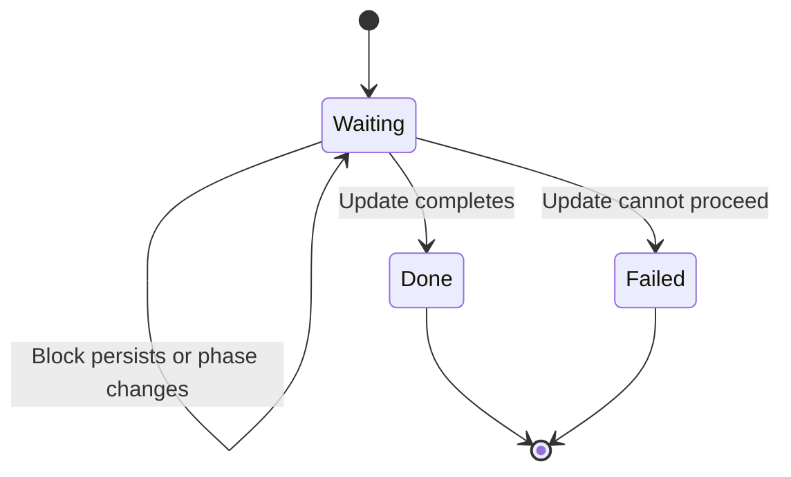
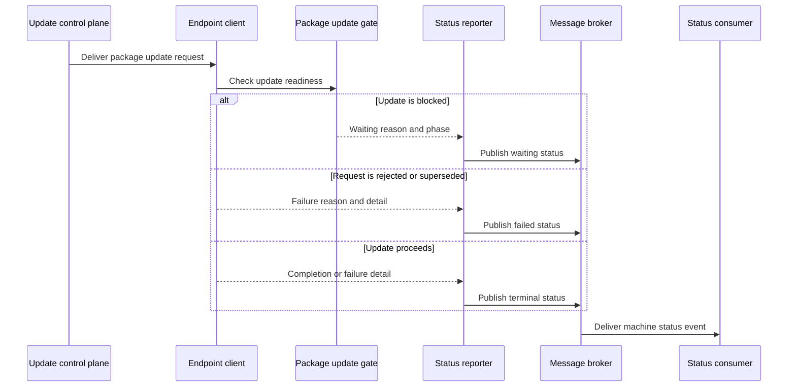

# Model Package Update Status

Model Package Update Status defines the Rust wire model for reporting the lifecycle of one software package update performed by the OpenFrame endpoint client. It correlates a status event with a request, a device, the requested package, and the request source, then describes exactly one outcome: waiting, completed, or failed.

The implementation is supplied by the **OpenFrame OSS Library** as part of the `openframe_agent_lib` Cargo artifact (version `v0.0.5` consumed by this repository). The tenant repository runs the client that assembles this library code; the model source itself is maintained in the library repository at [package update status source](https://github.com/flamingo-stack/openframe-oss-lib/blob/7a766f00e4f58b5d89db007b878ac8d6e0c344f4/clients/openframe-client/src/models/package_update_status.rs).

## Responsibilities

The module provides a stable, serializable event contract that lets a server-side consumer distinguish between these update outcomes:

- **Waiting** — the request cannot proceed yet because an application is running, the package manager is busy, or an interactive user session is unavailable.
- **Done** — the package was upgraded or was already at the latest version, together with reboot and relaunch facts.
- **Failed** — the request could not complete, including manager, close, timeout, support, installation, upgradeability, and supersession failures.

It does not run a package manager, decide whether an update may start, or persist delivery state. Those responsibilities belong to the client package-update services and the platform's status-processing components.

## System Position

A package-update command contains a package reference and an update source. The endpoint client accepts or rejects that work, may postpone it while a gate is blocked, and emits a status message keyed to the target machine. The server side consumes those status events to update device and execution state.

```mermaid
flowchart LR
    UpdateRequest["Package update request"] --> CommandHandler["Package update command handler"]
    CommandHandler --> OrderStore["Update order store"]
    CommandHandler --> StatusReporter["Status reporter"]
    OrderStore --> UpdateWorker["Package update worker"]
    UpdateWorker --> UpdateGate["Update gate"]
    UpdateGate --> StatusReporter
    StatusReporter --> StatusModel["Model Package Update Status"]
    StatusModel --> StatusSubject["Machine status subject"]
    StatusSubject --> ServerListener["Server status listener"]
    ServerListener --> StatusProcessor["Server status processor"]
```



The model depends on two adjacent endpoint-client models:

- `PackageRef` identifies a package through a Winget identifier, a Chocolatey identifier, or a Homebrew package name and kind.
- `UpdateSource` records whether the request is automatic or manual and can record an administrative or end-user origin.

These are included in every status event so consumers can correlate status without reconstructing request context.

## Message Contract

`PackageUpdateStatusMessage` is the top-level event. Rust Serde uses camel-case field names for this structure, omits optional fields when they are absent, and serializes its status enums in screaming-snake-case values.

| Field | Purpose | Presence |
|---|---|---|
| `eventId` | Identifies this lifecycle event. | Required |
| `requestId` | Correlates all events for one update request. | Required |
| `machineId` | Identifies the endpoint that produced the event. | Required |
| `at` | Carries the event timestamp as a string. | Required |
| `source` | Preserves the update source and optional origin. | Required |
| `package` | Identifies the requested package. | Required |
| `installedVersion` | Version found before or during processing. | Optional |
| `availableVersion` | Version offered by the package manager. | Optional |
| `state` | Selects `WAITING`, `DONE`, or `FAILED`. | Required |
| `waiting` | Supplies waiting-specific detail. | Optional, used for waiting events |
| `done` | Supplies completion-specific detail. | Optional, used for completed events |
| `failed` | Supplies failure-specific detail. | Optional, used for failed events |

The `state` value is the discriminator. Producers should populate the detail object that corresponds to that state and omit unrelated detail objects. Consumers should interpret missing optional version and detail fields as unavailable rather than inventing values.

### Routing Subject

`package_update_status_subject(machine_id)` builds the per-machine routing subject:

```text
machine.{machine identifier}.package-update.status
```

The fixed kind is `package-update.status`; substituting the machine identifier scopes the event stream to one endpoint. A publisher and subscriber must derive the same subject from the same machine identifier.

## Status Details

### Waiting

A `WAITING` event includes `Waiting` detail:

| Field | Meaning |
|---|---|
| `reason` | The condition blocking progress: `APP_RUNNING`, `MANAGER_BUSY`, or `NO_USER_SESSION`. |
| `phase` | The wait interaction phase: `PROMPT` or `COUNTDOWN`. |
| `holders` | Zero or more applications currently holding the relevant resource. |
| `closesAt` | Optional timestamp by which the wait or close window is expected to end. |

Each `HolderInfo` records an application name and, when known, the associated user. An empty holder list is valid because a blocking condition can be detected without a named process or user.

### Completion

A `DONE` event carries `Done` detail:

| Field | Meaning |
|---|---|
| `result` | `UPGRADED` when the client changed the installed package, or `ALREADY_LATEST` when no package change was needed. |
| `rebootRequired` | Whether the completed operation requires a system restart. |
| `relaunched` | Whether the updated application was relaunched. |

Completion is therefore not synonymous with a binary replacement: `ALREADY_LATEST` is a successful terminal result.

### Failure

A `FAILED` event carries `Failed` detail. Although `Failed` is not separately listed in the module-tree summary, it is the structure declared by the source and used by the top-level `failed` field.

| Failure reason | Meaning |
|---|---|
| `MANAGER_ERROR` | The package manager returned an error. |
| `MANAGER_MISSING` | The required package manager is unavailable. |
| `CLOSE_FAILED` | An application could not be closed for the update. |
| `TIMEOUT` | The operation exceeded its allowed wait or execution time. |
| `NOT_SUPPORTED` | The requested update is unsupported on this device or manager. |
| `SUPERSEDED` | A newer request replaced this request for the same package. |
| `NOT_INSTALLED` | The requested package is not installed. |
| `NOT_UPGRADABLE` | The package is installed but cannot be upgraded. |

`exitCode` and `message` are optional diagnostics. A failure does not require either value, allowing failures detected before a package-manager process starts to use the same contract.

## Lifecycle and Data Flow

The status model represents one event in a lifecycle rather than a mutable in-place record. A request can produce one or more waiting events before it reaches a terminal completion or failure event.



The package-update status reporter has explicit paths for rejected and superseded work. For a rejected request it produces a failure containing the supplied reason and detail text. For superseded work it produces `SUPERSEDED` with the diagnostic message that a newer request for the same package replaced it. This ensures requests that never execute still produce an observable terminal status.



## Component Relationships

| Component | Relationship to this module |
|---|---|
| `PackageUpdateHandler` | Accepts package-update commands and holds an update-order store and a status reporter. |
| `PackageUpdateRunManager` | Starts the asynchronous package-update worker lifecycle. |
| `StatusReporter` | Builds and publishes status events, including explicit rejection and supersession failures. |
| Update gate | Determines whether an update can proceed or must wait, providing the conditions represented by waiting detail. |
| Server status listener and processor | Consume the client event and apply it to server-side package-update and device state. |

## Maintenance Guidance

- Treat `requestId`, `machineId`, `source`, and `package` as correlation data on every event. Removing or changing them breaks consumers that join status with a dispatched request.
- Keep enum values backward compatible. They are serialized protocol values rather than local-only Rust implementation details.
- Add a new state detail object only alongside a clear discriminator and consumer support. Do not overload waiting or failure fields with unrelated data.
- Preserve optional-field behavior for versions, user names, deadlines, exit codes, and messages. The contract intentionally represents unavailable information by omission.
- When adding a failure reason, update endpoint reporting and server-side processing together so the outcome stays terminal and observable.
