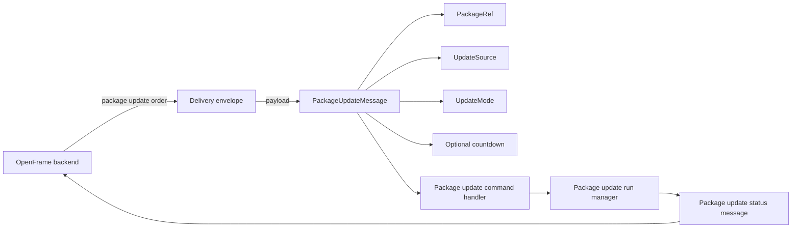
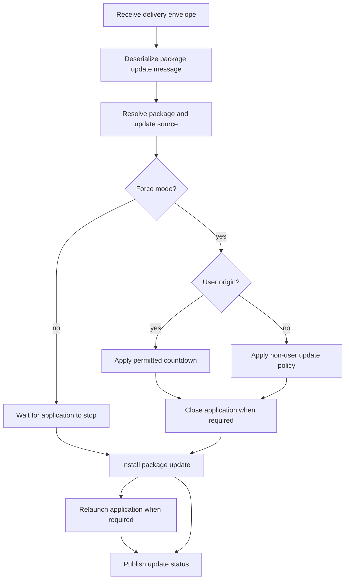
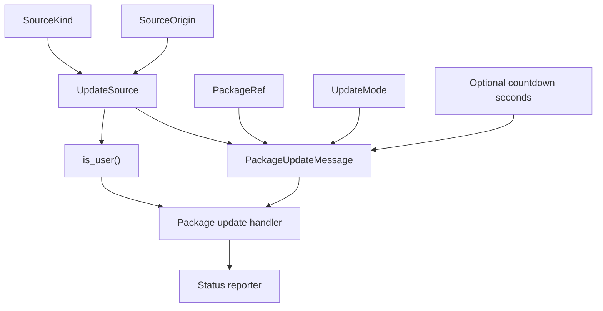

# Model Package Update

Model Package Update defines the wire contract for a single package-update order delivered to the OpenFrame endpoint client. The model is implemented by the `openframe_agent_lib` artifact from [OpenFrame OSS Library](https://github.com/flamingo-stack/openframe-oss-lib/blob/16e7c1cbd9664e7d10ec5ebca7d53c9bd314decf/clients/openframe-client/src/models/package_update.rs), which this repository consumes at version `v0.0.5`.

The contract identifies the order, the target package, why it was initiated, and the permitted installation behavior. It deliberately does not perform package-manager work, stop processes, or publish results. Those responsibilities belong to the client command, package-manager, and status-reporting layers that consume this model.

## Responsibilities

Model Package Update provides:

- A stable message kind, `package-update`, for identifying this command category.
- `PackageUpdateMessage`, the complete update request payload.
- `UpdateMode`, which distinguishes a non-disruptive update from one that may close and relaunch an application.
- `UpdateSource`, `SourceKind`, and `SourceOrigin`, which preserve initiation context.
- `UpdateSource::is_user`, the policy predicate used to recognize an end-user initiated update.

The model depends on `PackageRef`, defined by the neighboring package-reference model, to identify the package in a package-manager-neutral way.

## Architecture and Boundaries



The delivery envelope carries the delivery reference separately from the model payload. Model Package Update therefore contains the business fields needed to execute an update, while acknowledgement and delivery tracking remain outside this type.

Within the endpoint client, the command-listener package-update handler accepts this payload, and package-update services coordinate ordering, gates, execution, and status reporting. The model remains intentionally transport-focused so that those layers share one serialized request shape.

## Contract Structure

### Package Update Message

`PackageUpdateMessage` is serialized and deserialized with camel-case field names.

| Field | Type | Serialized name | Purpose |
|---|---|---|---|
| `request_id` | `String` | `requestId` | Correlates the update order and later status handling. |
| `source` | `UpdateSource` | `source` | Describes whether the update was automatic or manual, and optionally who initiated it. |
| `package` | `PackageRef` | `package` | Identifies the target package. |
| `mode` | `UpdateMode` | `mode` | Selects wait or force behavior. |
| `countdown_seconds` | `Option<u64>` | `countdownSeconds` | Optional delay before a forced application close. Omitted from JSON when absent. |

The request identifier should be treated as an opaque correlation value. Consumers should preserve it when creating status messages and execution records rather than inferring any meaning from its format.

### Update Mode

`UpdateMode` serializes as `SCREAMING_SNAKE_CASE`.

| Variant | Wire value | Expected behavior |
|---|---|---|
| `Wait` | `WAIT` | Install only after the target application is no longer running. The client must not close the application. |
| `Force` | `FORCE` | After the configured countdown, close the target application, install the update, and relaunch it. |

A countdown is part of the request data, not an independent instruction to terminate a process. The execution layer interprets it together with `Force` mode and platform-specific application lifecycle capabilities.

### Update Source

`UpdateSource` serializes in camel case and contains a required `kind` plus an optional `origin`.

| Field | Type | Wire behavior |
|---|---|---|
| `kind` | `SourceKind` | Required. Serializes as `AUTO` or `MANUAL`. |
| `origin` | `Option<SourceOrigin>` | Optional. Omitted when absent. Serializes as `ADMIN` or `USER` when present. |

`SourceKind` records the broad workflow category:

- `Auto` maps to `AUTO` for an automatically initiated update.
- `Manual` maps to `MANUAL` for a manually initiated update.

`SourceOrigin` refines the manual context when it is known:

- `Admin` maps to `ADMIN`.
- `User` maps to `USER` and represents the endpoint user's Update now action from a prompt.

The helper `UpdateSource::is_user()` returns `true` only when `origin` is exactly `Some(User)`. It does not infer user intent from `kind`. In particular, a manual update with no origin, or one whose origin is `Admin`, is not a user-originated update.

## Serialization Example

The following illustrative payload is a forced update initiated directly by the endpoint user. The exact structure of `package` is supplied by `PackageRef` and depends on the selected package manager.

```json
{
  "requestId": "update-request-123",
  "source": {
    "kind": "MANUAL",
    "origin": "USER"
  },
  "package": {
    "manager": "WINGET",
    "id": "example.package"
  },
  "mode": "FORCE",
  "countdownSeconds": 60
}
```

The example shows the model's naming conventions: outer fields use camel case, while enum values use screaming snake case. When `countdown_seconds` or `source.origin` is absent, Serde omits its corresponding JSON property rather than serializing `null`.

## Update Processing Flow



The model encodes intent and context; it does not itself validate package availability, inspect running processes, wait, close an application, install software, or emit status. Those operations occur after deserialization in the endpoint client's package-update processing pipeline.

## Source and Countdown Policy

The source comment establishes a specific policy boundary: the endpoint user's own Update now action is the only origin allowed a zero countdown. The model records the evidence needed for that rule through `origin: USER`; enforcement belongs to the consumer that evaluates `is_user()` together with the requested mode and countdown.

This separation has two maintenance implications:

1. Adding another source origin must not accidentally inherit user-only behavior. Consumers should explicitly evaluate the new variant rather than broadening the `is_user()` predicate.
2. Changing countdown behavior requires coordinated changes to both the sender and the endpoint execution layer. The model alone accepts an optional unsigned countdown and does not enforce mode-specific timing rules.

## Component Interaction



The enums are intentionally small and closed. This gives the endpoint a predictable, strongly typed representation of update choices while allowing the higher-level services to decide whether an order is eligible, deferred, superseded, rejected, or completed.

## Maintenance Guidance

- Preserve the Serde rename policies. Changing field casing or enum values changes the backend-to-endpoint protocol.
- Keep `countdown_seconds` optional and omitted when unset to maintain compatibility with senders that do not provide it.
- Treat `PackageRef` evolution as a coordinated protocol change because Model Package Update embeds it directly.
- Add tests for deserialization and serialization whenever adding enum variants or message fields, including absent optional fields.
- Keep `is_user()` narrowly tied to `SourceOrigin::User`; it is a policy-sensitive distinction rather than a synonym for manual updates.
- When introducing execution behavior, implement it in the command and package-manager layers rather than adding side effects to this model.

## Relationship to the Wider System

The tenant repository packages the endpoint client alongside backend services, while the runtime client implementation and this model originate in OpenFrame OSS Library. Backend-side client services can issue update deliveries and consume reported outcomes; the endpoint uses Model Package Update as the shared payload at that boundary. Package manager support, order persistence, update gating, and status types are separate modules so the wire contract stays compact and platform-neutral.
