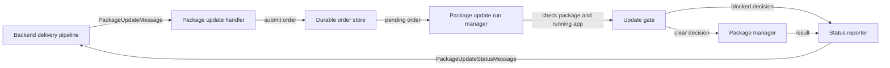
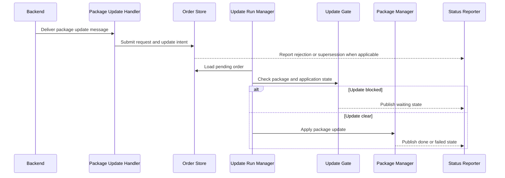
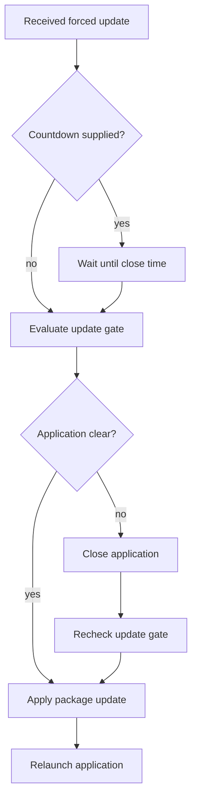

# Model Package Update

Model Package Update defines the wire contract for a single managed software-update order sent to an OpenFrame endpoint. It belongs to the Rust `openframe_client` agent library supplied by OpenFrame OSS Library and is assembled into this repository's OpenFrame Client service. The model is deliberately small: it identifies the request and package, records why the update was initiated, and states whether the agent must wait for an application to exit or may close and relaunch it.

The implementation is in [package_update.rs](https://github.com/flamingo-stack/openframe-oss-lib/blob/7a766f00e4f58b5d89db007b878ac8d6e0c344f4/clients/openframe-client/src/models/package_update.rs). That source is provided by the `openframe_agent_lib` Cargo dependency, pinned as version `v0.0.5` by OpenFrame OSS Tenant.

## Purpose and Scope

The model carries the intent of a package update. It does not select a package-manager executable, inspect running processes, persist a queue, download software, or apply the package change. Those responsibilities belong to the surrounding agent package-management, command-listener, update-gate, and status-reporting components.

Its boundary is useful for maintaining a stable backend-to-agent protocol:

- `PackageUpdateMessage` represents one delivered update order.
- `PackageRef` identifies the target in the supported package ecosystems: Winget, Homebrew, or Chocolatey.
- `UpdateSource` preserves whether the order was automatic or manual and, where supplied, its origin.
- `UpdateMode` communicates the user-impact policy for a running application.
- `countdownSeconds` optionally supplies the delay for a forced update.

## Contract Structure

`PackageUpdateMessage` uses Serde with camel-case field names. The delivery envelope carries the corresponding delivery reference separately, so the message itself stores the backend request identifier rather than transport metadata.

| Field | Rust type | Required | Serialized name | Meaning |
|---|---|---:|---|---|
| `request_id` | `String` | Yes | `requestId` | Identifies this update request across order processing and status reports. |
| `source` | `UpdateSource` | Yes | `source` | Describes the dispatch category and optional origin. |
| `package` | `PackageRef` | Yes | `package` | Identifies a Winget, Homebrew, or Chocolatey package. |
| `mode` | `UpdateMode` | Yes | `mode` | Determines whether a running app is only waited on or can be closed for the update. |
| `countdown_seconds` | `Option<u64>` | No | `countdownSeconds` | Optional delay before forced application closure. Omitted from JSON when absent. |

The package reference is a tagged Rust enum with the following forms:

| Package manager | Reference data |
|---|---|
| Winget | Package identifier |
| Homebrew | Brew kind and package name |
| Chocolatey | Package identifier |

## Source and Mode Semantics

### Update Source

`UpdateSource` is serialized in camel case and has two fields:

| Field | Values | Meaning |
|---|---|---|
| `kind` | `AUTO`, `MANUAL` | Broad scheduling or dispatch category. |
| `origin` | `ADMIN`, `USER`, or omitted | Optional actor context for the request. |

The `is_user()` helper returns `true` only when `origin` is exactly `USER`; it does not infer user intent from `kind`. In particular, the source comment designates an end user's own Update now action as the only origin permitted to use a zero-second countdown. Producers and consumers must therefore retain the origin rather than treating automatic or manual classification as an equivalent authorization signal.

### Update Mode

`UpdateMode` uses screaming-snake-case values:

| Value | Agent behavior |
|---|---|
| `WAIT` | Install only after the application is no longer running. The agent must not close it. |
| `FORCE` | After the countdown, close the application, install the update, and relaunch it. |

A countdown is optional in the model, and mode alone does not establish a default delay. Runtime components are responsible for resolving any operational defaults and enforcing the zero-countdown restriction for user-originated requests.

## Architecture and Relationships

The model is a protocol boundary between the backend delivery pipeline and the locally running OpenFrame Client. The client command listener accepts the update message, while the package-update runtime converts it to a durable order. The order adds local execution metadata such as a delivery sequence, receipt time, normalized countdown value, and a revision used to re-report waiting work.



The key neighboring agent components are:

| Component | Relationship to Model Package Update |
|---|---|
| Package update command handler | Receives the message and uses its request, source, package, mode, and countdown fields to submit an order. |
| Order store | Persists an `Order` containing the message data plus local sequence, receipt, revision, and non-optional countdown values. |
| Package update run manager | Starts the worker that processes pending orders. |
| Update gate | Resolves whether the target is clear or blocked, including information about application holders. |
| Package-manager abstraction | Resolves manager presence and executes the applicable update operation. |
| Status reporter | Publishes progress and final outcomes using the request, source, and package identity from the order. |

## Message Lifecycle

The following flow distinguishes protocol data from locally derived execution state.



A forced order follows a user-impact path before execution:



`WAIT` orders take the same gate path but do not request closure. If the gate remains blocked, the execution layer reports a waiting state instead of forcing the application to stop.

## Status Correlation

The related status contract is `PackageUpdateStatusMessage`. It echoes `request_id`, `source`, and `package`, adds a machine identifier and timestamp, and represents one of three high-level states: `Waiting`, `Done`, or `Failed`.

- A waiting status can include a reason, phase, active holder details, and an optional close time.
- A completed status includes the result, whether a reboot is required, and whether the application was relaunched.
- A failure can distinguish manager errors or absence, inability to close the app, timeout, unsupported packages, superseded orders, packages that are not installed, and packages that are not upgradable.

This correlation means `requestId` must be stable throughout delivery, queuing, execution, and reporting. Status publishers should preserve the original source and package reference so the backend can associate an outcome with the initiating policy or user action.

## Serialization Example

The following illustrative payload shows the naming and enum conventions. It is a contract example, not a statement of backend defaults.

```json
{
  "requestId": "request-8f2c",
  "source": {
    "kind": "MANUAL",
    "origin": "ADMIN"
  },
  "package": {
    "Winget": {
      "id": "Vendor.Product"
    }
  },
  "mode": "FORCE",
  "countdownSeconds": 300
}
```

Because the exact JSON representation of `PackageRef` is defined by its own model, integrations should serialize and deserialize through the agent library rather than hand-building package-reference JSON.

## Maintenance Guidelines

- Treat enum casing as protocol compatibility. `UpdateMode`, `SourceKind`, and `SourceOrigin` serialize with screaming-snake-case values, while containing structures use camel-case field names.
- Keep `origin` optional for compatibility with requests that only provide a source kind; do not replace an omitted origin with a guessed actor.
- Preserve `requestId` exactly when adapting an inbound message to a durable order or outbound status event.
- Do not collapse `WAIT` and `FORCE` into a generic update flag. Their application-closure guarantees are materially different.
- When adding a source kind, origin, update mode, or package-manager variant, update the agent parser, backend producer, queue behavior, status handling, and compatibility tests together.
- Validate user-originated zero-countdown behavior at the policy boundary. The model exposes `is_user()` specifically for checking the explicit `USER` origin.

## System Placement

OpenFrame OSS Tenant publishes the OpenFrame Client service alongside the API, gateway, management, stream, configuration, authorization, and external API services. The package-update model runs on managed endpoints inside the OpenFrame Client rather than in those server processes. The server-side client-core components coordinate dispatch and consume package-update statuses, while the endpoint agent makes the local package-manager and application-lifecycle decisions.
