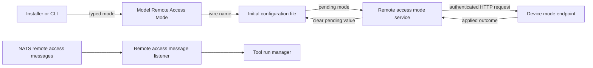
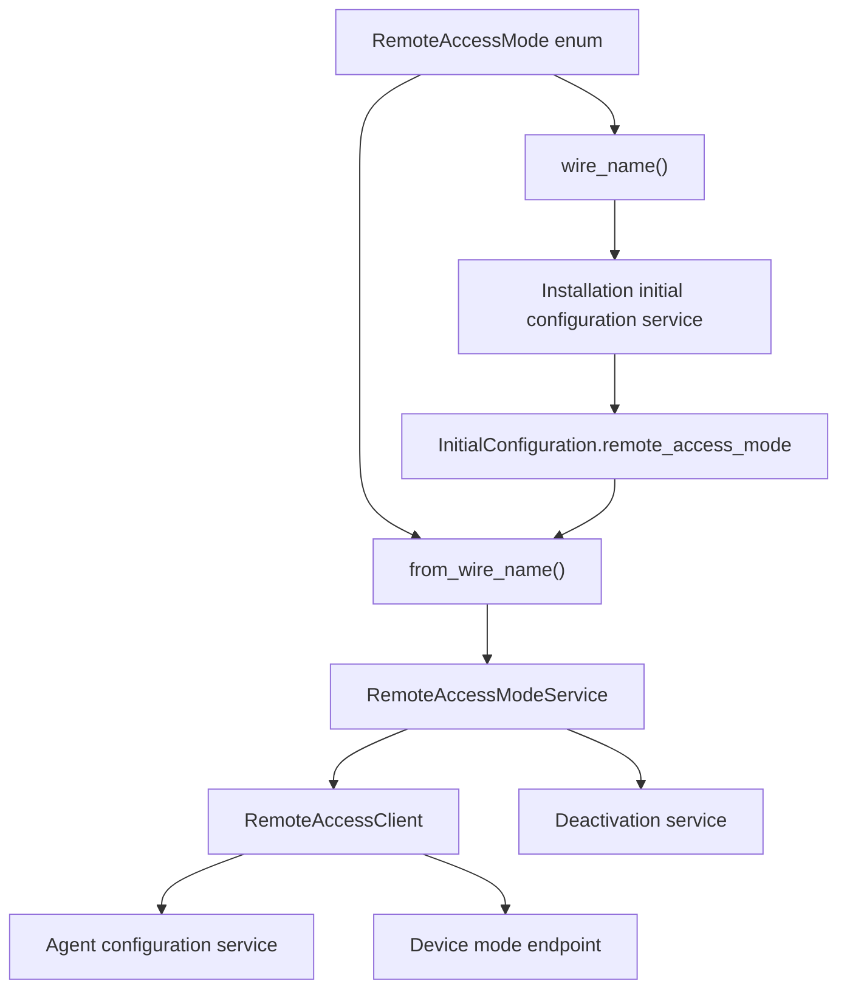
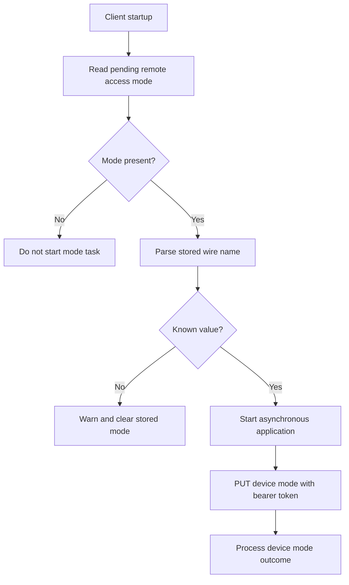
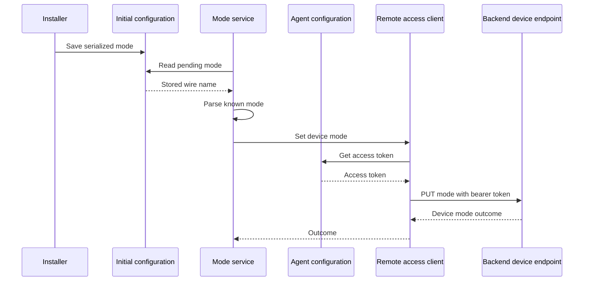

# Model Remote Access Mode

Model Remote Access Mode defines the small, versioned wire contract used by the OpenFrame endpoint client to preset a device's remote-access behavior at installation time. It is implemented by the `openframe_agent_lib` Rust artifact from the OpenFrame OSS Library, consumed by this repository's OpenFrame Client runtime.

The model deliberately contains no policy enforcement or remote-session implementation. Its job is to provide a closed set of modes and a stable conversion between Rust values and the persisted/backend representation. The client uses that representation while applying a pending installation preference to the backend.

**Source:** [remote access mode model in OpenFrame OSS Library](https://github.com/flamingo-stack/openframe-oss-lib/blob/7a766f00e4f58b5d89db007b878ac8d6e0c344f4/clients/openframe-client/src/models/remote_access_mode.rs)

## Responsibilities and Boundaries

| Responsibility | How Model Remote Access Mode fulfills it |
|---|---|
| Define supported choices | `RemoteAccessMode` is an enum with four variants. |
| Provide CLI-compatible values | The enum derives Clap `ValueEnum`, allowing installation arguments to be parsed into a typed mode. |
| Serialize the backend contract | Serde uses screaming-snake-case names, such as `APPROVAL_REQUIRED`. |
| Persist an install-time request | `wire_name()` produces the same string used in initial configuration. |
| Safely read deferred configuration | `from_wire_name()` returns `None` for an unknown persisted value rather than inventing a fallback. |

The model does **not** decide whether a user may begin a remote session, start a remote-access tool, or process a live remote-access message. Those responsibilities remain in the backend and in the client services and listeners that consume the model.

## Supported Modes

| Rust variant | Serialized wire name | Intended device override |
|---|---|---|
| `ApprovalRequired` | `APPROVAL_REQUIRED` | Remote access requires approval. |
| `NotifyOnly` | `NOTIFY_ONLY` | Remote access notifies the device user. |
| `SilentAccess` | `SILENT_ACCESS` | Remote access proceeds without the approval or notification behavior represented by the other modes. |
| `DenyAccess` | `DENY_ACCESS` | Remote access is denied. |

The names in the second column are protocol and persistence values. They are generated through Serde serialization, rather than maintained as a second hand-written mapping, so the outbound and inbound formats share a single enum definition.

## Architecture and Ownership

Model Remote Access Mode is part of the endpoint-side OpenFrame Client. The repository packages and deploys the surrounding tenant services, while the client code is supplied by the OpenFrame OSS Library dependency.

The two remote-access paths are adjacent but separate:

- **Install-time override path:** uses `RemoteAccessMode`, the initial configuration store, `RemoteAccessModeService`, and `RemoteAccessClient` to set a device mode through HTTP.
- **Runtime message path:** uses `RemoteAccessMessageListener`, which subscribes to a machine-specific NATS subject and coordinates with `ToolRunManager`. The provided components do not show it consuming `RemoteAccessMode`; it should not be documented as the enforcement mechanism for the model.

## Component Relationships

### Model Contract

`RemoteAccessMode` derives `Debug`, `Clone`, `Copy`, `PartialEq`, `Eq`, `ValueEnum`, `Serialize`, and `Deserialize`. As a unit enum, it is cheap to copy and is suitable for command parsing, configuration construction, JSON payloads, and equality-based control flow.

`wire_name()` serializes the enum to JSON and extracts its string value. The implementation expects a unit enum variant to serialize to a string, making a serialization-shape change immediately visible rather than silently persisting an invalid value.

`from_wire_name(name)` deserializes an individual string value and returns an optional mode. This supports forward compatibility: a newer backend or installer may leave a name that an older client does not recognize. The caller can discard or otherwise handle the unknown request instead of applying an incorrect mode.

## Installation and Deferred Application Flow

The install configuration service accepts an optional typed `remote_access_mode` in `InstallConfigParams`. During `build_and_save()`, it maps that value with `RemoteAccessMode::wire_name()` and writes it to `InitialConfiguration.remote_access_mode`. Initial configuration writes use an atomic file write.

At startup, `RemoteAccessModeService` reads the stored value:

The HTTP client obtains the access token from `AgentConfigurationService`, sends it as a bearer token, and submits a JSON object whose `mode` value is serialized from `RemoteAccessMode`. Its public result type distinguishes:

- `Applied` — the endpoint accepted the requested mode.
- `NotSupported` — the connected backend does not support this operation.
- `OverrideExists` — an existing device override prevents the new preset from taking effect.

The service also receives `DeactivationService` and retry timing configuration. This indicates that application is lifecycle-aware and retry-oriented; the exact retry and clearing behavior beyond the visible startup, parsing, and client call boundaries should be verified in the service implementation before modifying it.

## HTTP and Messaging Integration

The live listener separately constructs its NATS subscription subject as `machine.{machine_id}.remote-access.>`. It reconnects after listener failures and delegates runtime handling to its own dependencies. Keeping this subject-driven mechanism separate from the HTTP preset flow avoids conflating an installation preference with a remote-session command.

## Persistence and Compatibility Rules

1. Persist only the canonical screaming-snake-case wire name returned by `wire_name()`.
2. Treat the persisted field as optional. An absent value means that no install-time override is waiting to be applied.
3. Parse persisted values only through `from_wire_name()`. Do not match raw strings in multiple call sites.
4. When a value is unknown, do not coerce it to another mode. The current startup service warns, clears the pending value, and does not start an application task.
5. Add any future mode as an enum variant with the required compatibility review. Adding it changes both the accepted CLI value set and the backend JSON contract.

## Maintenance Guidance

When changing Model Remote Access Mode:

- Preserve existing serialized names unless the backend, persisted configurations, installer, and compatible client versions are migrated together.
- Test serialization and deserialization for every variant, including rejection of invalid wire names.
- Test the installation handoff: typed install parameter, persisted `remote_access_mode`, startup parsing, and the resulting HTTP request body.
- Test client handling for all `DeviceModeOutcome` values and communication failures.
- Keep policy semantics out of this model. If a change controls session authorization or tool behavior, implement it in the appropriate backend or runtime service rather than adding side effects to the enum.

For operational questions about backend policy and remote-session behavior, refer to the platform documentation and the backend remote-access implementation.