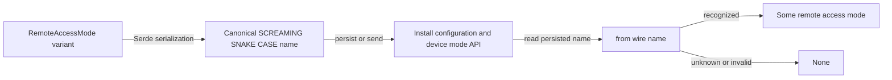
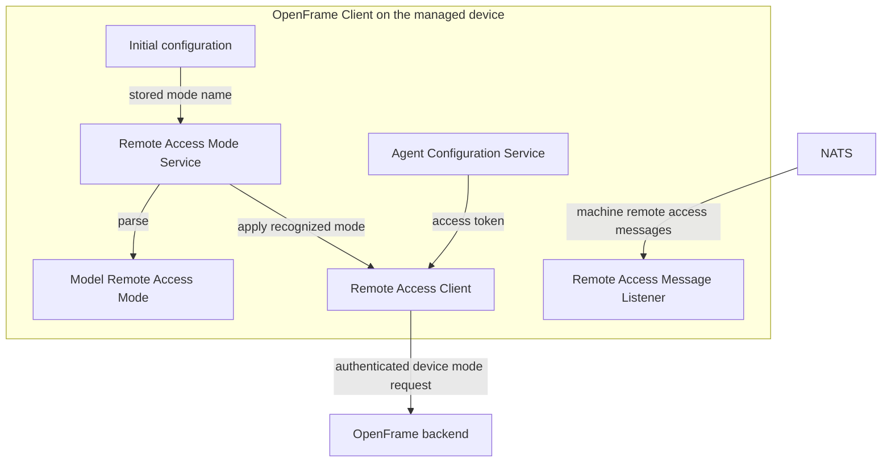
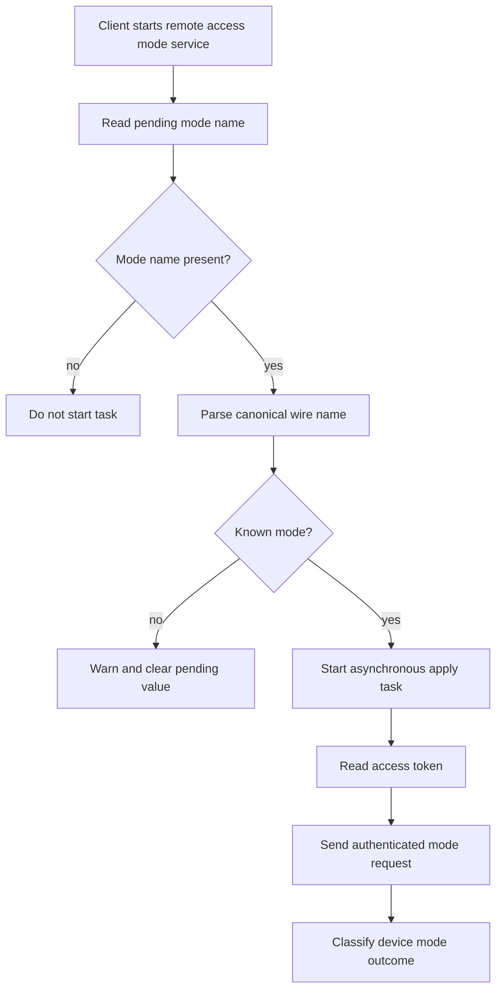
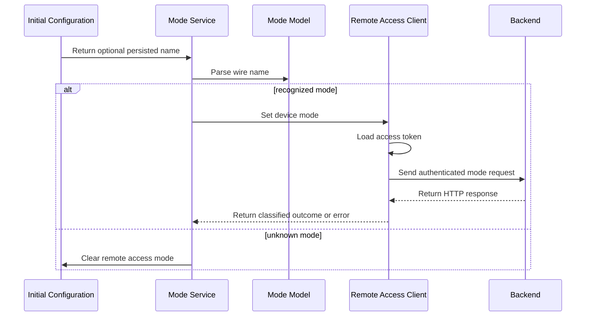

# Model Remote Access Mode

Model Remote Access Mode is the Rust domain contract that represents an install-time remote-access override for an OpenFrame device. It supplies a closed set of policy choices, a stable backend and persisted representation, and tolerant parsing for values read from existing configuration.

The implementation is provided by the `openframe_agent_lib` crate from [OpenFrame OSS Library](https://github.com/flamingo-stack/openframe-oss-lib/blob/16e7c1cbd9664e7d10ec5ebca7d53c9bd314decf/clients/openframe-client/src/models/remote_access_mode.rs). This repository assembles and runs that client library as part of the OpenFrame Client service.

## Purpose and Scope

The model separates a device's requested remote-access behavior from the transport and lifecycle code that applies it. Its responsibilities are deliberately narrow:

- enumerate the four supported override modes;
- serialize modes to the backend's canonical wire names;
- parse persisted wire names without treating an unfamiliar value as an error; and
- support command-line value selection through Clap `ValueEnum`.

It does not authorize a remote session, operate a remote-control tool, or persist configuration itself. Those concerns remain in the client services that consume the model.

## Supported Modes

`RemoteAccessMode` is a copyable enum with four variants:

| Rust variant | Canonical wire name | Intended policy selection |
|---|---|---|
| `ApprovalRequired` | `APPROVAL_REQUIRED` | Access requires approval. |
| `NotifyOnly` | `NOTIFY_ONLY` | Access notifies the device user. |
| `SilentAccess` | `SILENT_ACCESS` | Access proceeds without a notification requirement represented by this model. |
| `DenyAccess` | `DENY_ACCESS` | Access is denied. |

The intent descriptions identify the policy choice represented by each enum value. The model itself does not enforce those behaviors; the platform's remote-access implementation interprets the selected mode.

## Contract and Serialization

The enum derives `Serialize` and `Deserialize` with Serde's `SCREAMING_SNAKE_CASE` rename rule. Therefore, the JSON representation is the uppercase name shown in the table, rather than the Rust variant spelling.

`wire_name()` serializes the unit enum variant to JSON and returns its string value. This makes the name used by install configuration and the backend derive from the same Serde contract rather than from a separately maintained mapping.

`from_wire_name(name)` performs the inverse operation by deserializing the supplied string. It returns `Option<RemoteAccessMode>`:

- a recognized canonical name returns `Some(mode)`;
- an unknown, malformed, or differently cased name returns `None`.

This is forward-compatible parsing. A client can safely encounter a server-side mode introduced after that client version without guessing its meaning.



## Runtime Architecture

Although this module only defines the value contract, it is part of an install-time application path in the OpenFrame Client library. The adjacent library components divide responsibility as follows:

| Component | Responsibility | Relationship to Model Remote Access Mode |
|---|---|---|
| `InitialConfigurationService` | Reads and updates initial client configuration under a write lock. | Retrieves and clears the persisted remote-access-mode string. |
| `RemoteAccessModeService` | Starts asynchronous application of a pending install-time mode. | Parses the string, applies a recognized mode, and removes unsupported input. |
| `RemoteAccessClient` | Authenticated HTTP adapter for the device-mode endpoint. | Sends the mode as JSON in a bearer-authorized `PUT` request. |
| `AgentConfigurationService` | Provides the current access token. | Supplies the bearer token used by the HTTP adapter. |
| `DeactivationService` | Coordinates device deactivation state. | Is a dependency of the mode service's retrying lifecycle. |
| `RemoteAccessMessageListener` | Maintains a reconnecting NATS subscription for remote-access messages. | Uses the per-machine subject pattern, separate from the install-time HTTP application path. |



## Install-Time Application Flow

At startup, `RemoteAccessModeService::start()` first reads the optional value from `InitialConfigurationService`.

1. If no value is stored, the service does not create a background task.
2. If configuration cannot be read, it logs the failure and does not create a task.
3. If a value is present, it calls `RemoteAccessMode::from_wire_name`.
4. For an unknown value, it emits a warning, removes the pending value, and does not apply a policy.
5. For a known value, it starts an asynchronous task that applies the mode with the service's retry timing and deactivation coordination.
6. The HTTP client obtains the current access token and sends a JSON body containing the mode to the device-mode API.



The explicit unknown-value branch is important: it avoids applying a potentially unsafe fallback when the platform adds a new mode. Clearing that stale preset also prevents repeated processing of a value the installed client cannot understand.

## API Boundary

`RemoteAccessClient::set_device_mode` accepts a `RemoteAccessMode`, obtains an access token from `AgentConfigurationService`, and performs an HTTP `PUT` to its configured device-mode endpoint. Its request body has the following shape, with the model serialized by Serde:

```json
{
  "mode": "APPROVAL_REQUIRED"
}
```

The client maps recognized HTTP statuses into `DeviceModeOutcome`. For statuses it does not classify, it reads the response body when possible and returns an error containing the HTTP status and body. The model is therefore the typed input to the API adapter; HTTP outcome and retry behavior remain outside the enum.

## Remote-Access Messaging Context

The mode model should not be confused with the message listener used for remote-access events. `RemoteAccessMessageListener` derives a machine-specific NATS subject with this pattern:

```text
machine.<machine-id>.remote-access.>
```

Its `start()` method runs a reconnect loop: listener failures are logged, then the listener waits for its configured reconnection delay before attempting to listen again. This messaging path and the authenticated HTTP mode-setting path are complementary, but the provided implementation does not make the enum responsible for interpreting NATS message contents.



## Configuration and Compatibility Considerations

- Persist only canonical uppercase wire names. They are the representation accepted by `from_wire_name` and produced by `wire_name`.
- Treat `None` from `from_wire_name` as unsupported input, not as a default policy. The startup service's behavior is to warn and clear the value.
- Keep additions backward-compatible by adding a new enum variant and retaining the Serde naming convention. Older clients will safely decline the unknown name.
- Avoid duplicating string literals for modes in client code. Use `RemoteAccessMode` and `wire_name()` when a persisted backend name is required.
- Changes to a mode's serialized spelling are protocol changes. They affect persisted configuration and requests sent to the device-mode API.

## Source and Maintenance Notes

The authoritative implementation is the library source file [remote_access_mode.rs](https://github.com/flamingo-stack/openframe-oss-lib/blob/16e7c1cbd9664e7d10ec5ebca7d53c9bd314decf/clients/openframe-client/src/models/remote_access_mode.rs). It is consumed at runtime by this repository through the pinned `openframe_agent_lib` dependency version `v0.0.5`.

When extending the model, validate all three boundaries together: CLI value parsing, Serde wire serialization, and the installation flow that reads and clears pending configuration. The module has a dedicated test module declared as `remote_access_mode_tests.rs`, which is the appropriate place to protect canonical-name and unknown-value behavior.
