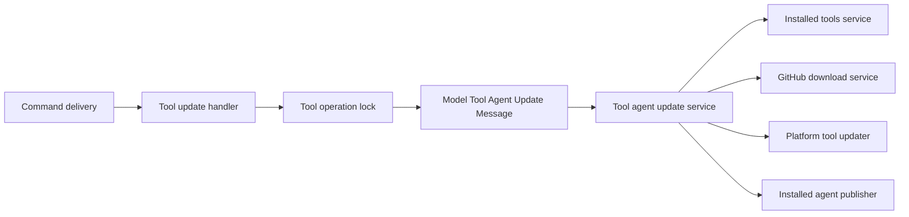
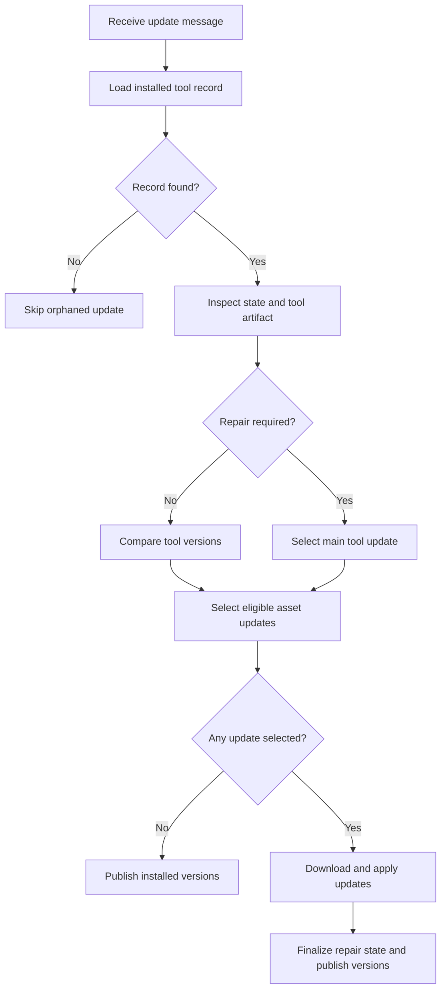
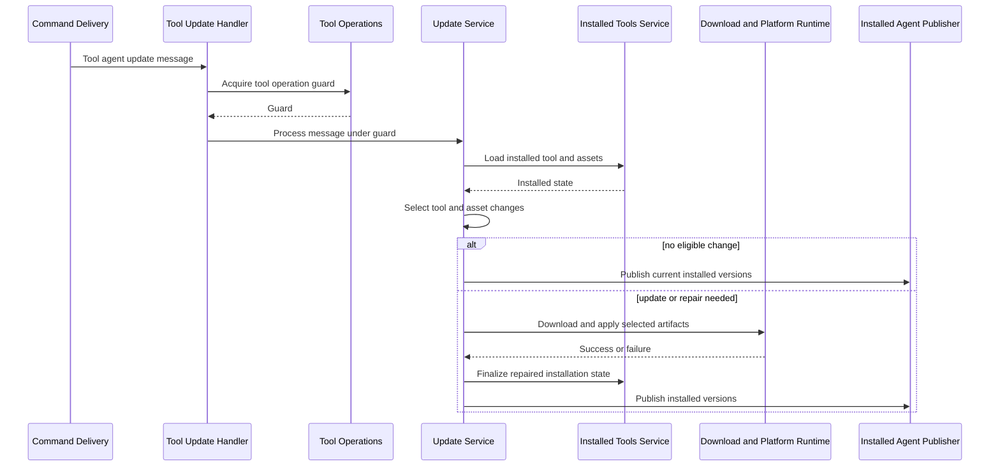

# Model Tool Agent Update Message

Model Tool Agent Update Message defines the Rust wire contract used to request an update of an integrated tool agent and, optionally, selected assets belonging to that tool. It is implemented by the `openframe_client` crate from **OpenFrame OSS Library** (`openframe_agent_lib` version `v0.0.5` consumed by this repository). The model is deserialized from a command message and passed to the client-side update service; it does not itself download, install, or restart software.

The source implementation is [`tool_agent_update_message.rs`](https://github.com/flamingo-stack/openframe-oss-lib/blob/7a766f00e4f58b5d89db007b878ac8d6e0c344f4/clients/openframe-client/src/models/tool_agent_update_message.rs).

## Purpose and Scope

An update command identifies a previously installed tool agent, specifies its target version, and provides operating-system-specific download choices for the primary tool. It may also carry asset-level updates. This makes a single message capable of requesting:

- an update or repair of the main tool agent;
- independent updates for assets associated with that tool agent; and
- platform-specific installation metadata for each downloadable artifact.

The update message is intentionally lean. It assumes the client already has an installed-tool registry record that supplies installation details. If no such record exists, the update service treats the tool as orphaned and skips the update rather than attempting an installation.

## Contract Types

| Type | Role | Required fields |
|---|---|---|
| `ToolAgentUpdateMessage` | Top-level command payload for one tool agent. | `tool_agent_id`, `version`, `download_configurations` |
| `AssetUpdate` | Optional target state for one associated asset. | `asset_id` |
| `DownloadConfiguration` | A platform-specific file download and installation description. | `os`, `file_name`, `target_file_name`, `link` |

All fields are serialized with `camelCase` names. For example, Rust field `tool_agent_id` is represented as `toolAgentId` on the wire.

### Tool Agent Update Message

`ToolAgentUpdateMessage` has the following shape:

- `tool_agent_id`: stable identifier for the installed tool record to update.
- `version`: desired version of the main tool agent.
- `download_configurations`: ordered collection of primary-tool download candidates. Each candidate describes its OS, source link, source file name, target file name, installation type, and optional bundle or service identity.
- `assets`: optional collection of `AssetUpdate` entries. When absent, asset processing is not requested.

### Asset Update

Each `AssetUpdate` targets one asset using `asset_id` and may provide:

- `version`: target asset version. An asset without a version is ignored by the update-selection logic.
- `executable`: whether the downloaded asset is executable. It defaults to `false` when omitted during deserialization.
- `download_configurations`: optional platform-specific candidates. Missing or empty configurations prevent that asset from being selected for update.

The top-level tool version and asset versions are evaluated separately. Therefore, an unchanged main tool can still produce an asset-only update, and a tool update can occur even when no asset update is eligible.

## Serialized Representation

The following is an illustrative payload shape. Actual values, URLs, and the available operating-system configurations are supplied by the server-side delivery system.

```json
{
  "toolAgentId": "tool-agent-identifier",
  "version": "target-tool-version",
  "downloadConfigurations": [
    {
      "os": "target-os",
      "fileName": "downloaded-file-name",
      "targetFileName": "installed-file-name",
      "link": "artifact-download-link",
      "installationType": "installation-type"
    }
  ],
  "assets": [
    {
      "assetId": "asset-identifier",
      "version": "target-asset-version",
      "executable": true,
      "downloadConfigurations": [
        {
          "os": "target-os",
          "fileName": "asset-download-name",
          "targetFileName": "asset-target-name",
          "link": "asset-download-link",
          "installationType": "installation-type"
        }
      ]
    }
  ]
}
```

`DownloadConfiguration` accepts legacy aliases `agentFileName` and `assetFileName` for its `target_file_name` field when deserializing. This allows senders using those earlier field names to interoperate while the canonical serialized field remains `targetFileName`.

## Architecture and Relationships

The model sits between command delivery and the device-local update workflow. The command handler owns concurrency coordination, while the update service evaluates installed state, resolves eligible changes, and delegates downloads and platform-specific replacement work.



### Primary Dependencies

| Dependency | Relationship to the model |
|---|---|
| `DownloadConfiguration` | Defines each primary-tool or asset download candidate. OS matching and installation characteristics are modeled here. |
| `ToolUpdateHandler` | Receives update commands and invokes the update service under a per-tool operation guard. |
| `ToolAgentUpdateService` | Consumes `ToolAgentUpdateMessage`, compares requested and installed versions, performs repair or update work, and publishes the resulting installed versions. |
| Installed-tool model and service | Provide the existing tool record, version, assets, state, and installation details required for safe update decisions. |
| Download and platform updater services | Obtain artifacts and apply replacement or migration behavior after the service chooses an eligible update. |

## Update Decision Flow

Before applying changes, `ToolAgentUpdateService` loads the installed record identified by `tool_agent_id`. It detects incomplete installation state or a missing executable as a repair condition. A repair forces main-tool processing even if the reported version matches the requested version.



### Version and Asset Selection Rules

The service compares the requested main-tool version with the installed version using its version comparator.

1. A message considered to be a downgrade is refused when downgrade support is disabled, except when a repair is needed.
2. Equal versions do not update the main tool unless repair is required.
3. Non-semantic version strings are compared as strings for change detection; if they differ, the service may proceed without the semantic downgrade check.
4. An asset is considered only when it includes both a target version and a non-empty `download_configurations` collection.
5. New asset identifiers are eligible when their required metadata is present.
6. Existing assets are eligible when their version differs, subject to the same downgrade protection where versions can be compared.
7. If neither the tool nor any asset needs work, the service publishes currently installed versions and returns without downloading artifacts.

## Component Interaction

The handler, service, and local state components divide responsibility so that the message remains a pure transport object.



## Operational Considerations

- **Installed state is authoritative.** The message identifies desired state, but processing requires a local registry record. Use the full tool-installation flow when a tool was never registered locally.
- **Repair is deliberate.** A record marked as installing, or a missing main executable, overrides a version-match no-op and causes repair processing.
- **Partial asset metadata is safe but inactive.** Asset entries missing a version or usable download configuration do not trigger an update.
- **Platform behavior belongs below the contract.** The model expresses artifact metadata only. Tool type, installation layout, migrations, process shutdown, and GUI relaunch decisions are handled by the tool update service and platform updater.
- **Status reporting follows both action and no-op paths.** Version publication occurs after a no-change decision as well as after successful update processing, keeping remote inventory synchronized with the client record.

## Maintenance Guidance

When evolving this contract:

1. Preserve `camelCase` serialization so existing senders and receivers keep the same field names.
2. Treat `tool_agent_id` and `asset_id` as identity keys, not display labels.
3. Add fields as optional or with defaults where backward compatibility with older command producers is required.
4. Update the selection logic alongside any new field that changes eligibility, versioning, download behavior, or executable handling.
5. Test absent assets, empty asset download configurations, equal versions, attempted downgrades, interrupted installation state, and missing binaries.

The module is part of the OpenFrame client library supplied by OpenFrame OSS Library; the tenant repository assembles and deploys services that use this library rather than defining this Rust model locally.
