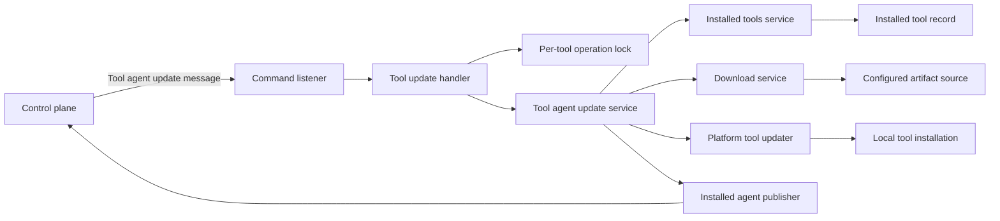
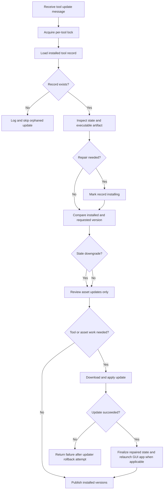
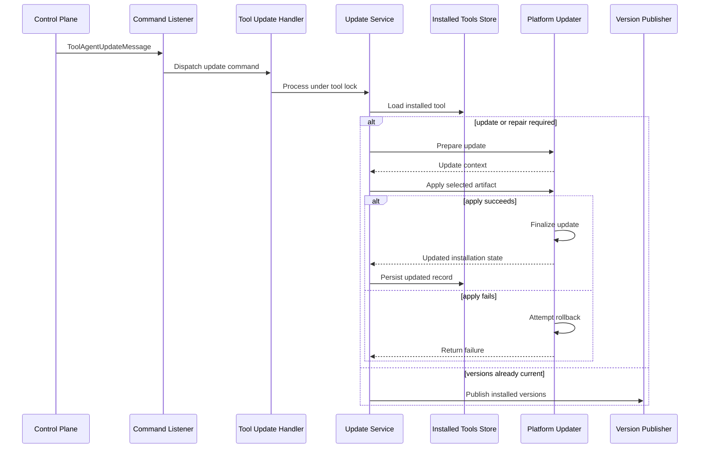

# Model Tool Agent Update

Model Tool Agent Update defines the wire payload that asks an installed OpenFrame client tool agent to move to a requested version and, optionally, update individual tool assets. It is a compact Rust model from the `openframe_agent_lib` library, consumed at runtime by this repository's OpenFrame client. The model deliberately carries deployment intent rather than installation state: the client resolves the request against its locally persisted tool record, operating system, and update safety rules.

The source model is maintained in the OpenFrame OSS Library: [tool_agent_update_message.rs](https://github.com/flamingo-stack/openframe-oss-lib/blob/16e7c1cbd9664e7d10ec5ebca7d53c9bd314decf/clients/openframe-client/src/models/tool_agent_update_message.rs).

## Purpose and Scope

A `ToolAgentUpdateMessage` identifies one tool agent, its desired version, and the operating-system-specific download choices available to reach it. `AssetUpdate` extends the same request with independently versioned assets, allowing a tool update to include selective updates for associated executables or resources.

The model does not download, install, restart, or persist anything itself. Those responsibilities belong to the client runtime's update handler and tool-update services. Keeping the message declarative permits the receiving agent to reject stale versions, avoid unsupported platform artifacts, repair interrupted installations, and serialize concurrent operations for the same tool.

## Message Contract

Both structures derive `Serialize` and `Deserialize` with camel-case field names. Rust callers use snake-case field names; serialized JSON uses camel case.

| Type | Field | Required | Meaning |
|---|---|---:|---|
| `ToolAgentUpdateMessage` | `tool_agent_id` | Yes | Stable identity used to locate the installed tool record and acquire its operation lock. |
| `ToolAgentUpdateMessage` | `version` | Yes | Requested version for the primary tool agent. |
| `ToolAgentUpdateMessage` | `download_configurations` | Yes | Candidate download definitions, from which the client selects a configuration matching its operating system. |
| `ToolAgentUpdateMessage` | `assets` | No | Optional list of independently managed asset updates. Absence means the request carries no asset instructions. |
| `AssetUpdate` | `asset_id` | Yes | Identity of the installed asset to compare or create. |
| `AssetUpdate` | `version` | No | Desired asset version. An asset without a version is not selected for update. |
| `AssetUpdate` | `executable` | No | Whether the asset is executable. It defaults to `false` when omitted. |
| `AssetUpdate` | `download_configurations` | No | Optional OS-specific download definitions for the asset. An absent or empty list is not actionable for an asset update. |

An encoded message has the following shape. Values are illustrative, not a prescribed endpoint or release format.

```json
{
  "toolAgentId": "remote-tool-agent",
  "version": "2.4.0",
  "downloadConfigurations": [
    {
      "os": "windows",
      "fileName": "remote-tool-agent.zip",
      "targetFileName": "remote-tool-agent.exe",
      "link": "https://downloads.example.invalid/remote-tool-agent-2.4.0.zip"
    }
  ],
  "assets": [
    {
      "assetId": "helper-binary",
      "version": "1.3.0",
      "executable": true,
      "downloadConfigurations": [
        {
          "os": "windows",
          "fileName": "helper-binary.zip",
          "targetFileName": "helper.exe",
          "link": "https://downloads.example.invalid/helper-binary-1.3.0.zip"
        }
      ]
    }
  ]
}
```

## Download Configuration Semantics

Each primary-tool or asset candidate uses `DownloadConfiguration`. It provides the target `os`, archive `file_name`, extracted `target_file_name`, and source `link`; it can also describe installation type, bundle identity, and service identity. The client accepts only a candidate whose `os` equals its compiled platform, case-insensitively: `windows`, `macos`, or `linux`.

The download service expects ZIP, TAR.GZ, or TGZ archives when extracting a single executable. It retries downloads, rejects undersized archives and extracted binaries, and extracts the configured target file. Folder-extraction configurations instead extract all contents into the tool directory, apply executable permissions to the configured target, and return that target name. These behaviors make the `fileName` and `targetFileName` fields operational rather than descriptive metadata.

## Architecture and Relationships

The model is at the boundary between centrally issued command delivery and the local tool lifecycle. A command listener delegates a received update to `ToolUpdateHandler`; the handler coordinates `ToolOps` locking and `ToolAgentUpdateService`. The service loads the installed record, applies version and repair decisions, uses the selected download configuration, and publishes installed-version state after processing.



`InstalledTool` supplies the local record that the update service needs but the message does not contain, including the tool type, command arguments, installation form, installed assets, and lifecycle state. This separation makes an update message intentionally lean; it cannot establish a missing tool from scratch.

## Primary Tool Update Flow

The update flow is guarded by a per-tool lock, preventing concurrent operations on the same `tool_agent_id`. The service then follows this decision process.



### Record and Repair Rules

- If no installed record matches `tool_agent_id`, the update is skipped. The service logs that a lean update cannot self-heal an orphaned tool and waits for a full tool-installation command.
- A record in `Installing` state, or a record whose expected executable or application artifact is missing, forces repair even if the versions match.
- For a missing artifact, the service attempts to persist `Installing` before repair. On a successful repair, it attempts to change the record to `Installed`.
- Once no tool or asset work is required, the service still publishes the observed installed versions. This allows the control plane to reconcile state without rewriting an already current tool.

### Version Safety

The service compares versions for both the main tool and each eligible asset. When versions compare as semantic versions, a requested lower version is rejected by default. When either version cannot be parsed as semantic version, unequal values are treated as a change and the request can proceed, with a warning.

A primary-tool downgrade is suppressed unless repair is required. Assets are considered separately: an asset must supply a version and a non-empty download-configuration list, then is selected when it is new or differs from the stored asset version. Downgrades for assets are also rejected by default when semantic comparison proves the installed asset is newer.

## Applying and Recovering Updates

The platform updater separates each update into preparation, application, and finalization phases. The client chooses an updater according to the local installation representation, such as a standard executable, service, or GUI application. A required installation-type transition uses a migration path instead of a normal update.

If application fails, the updater attempts rollback and returns an error even if rollback also fails. Successful updates can return a replacement installation descriptor, which is used for finalization. For an already GUI-based tool, the client may relaunch the GUI application after success; the implementation specifically does this for Windows GUI applications that are not supervised by the normal run manager.



## Operational Considerations

- **Platform coverage:** provide a valid download configuration for every supported operating system. A message may include multiple configurations, but a device uses only the one matching its platform.
- **Versioning:** use consistently comparable version strings when downgrade protection is important. Non-semantic versions lose ordered comparison and are evaluated as string inequality.
- **Asset completeness:** include a version and at least one download configuration for every asset intended to change. Omitting either keeps that asset out of the update selection.
- **Orphaned records:** use the installation workflow, not this model, to create a tool that has no local installed-tools record.
- **Failure handling:** design artifact availability and packaging so retries and rollback can operate safely. A failed platform update returns an error after rollback is attempted; it is not silently treated as complete.
- **State reconciliation:** version publication includes only tools whose local record is `Installed`; callers should not interpret the absence of a version report as evidence that an interrupted installation completed.

## Implementation Notes

`ToolAgentUpdateMessage` and `AssetUpdate` are plain transport structures. They are suitable for serialization tests and compatibility checks because they contain no I/O, validation side effects, or local-state mutation. Behavior such as archive extraction, executable permissions, installation migration, locking, record persistence, and installed-version publication belongs to the client runtime services that consume the model.
