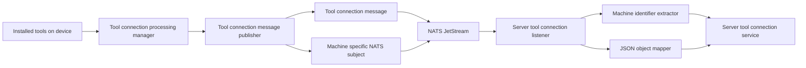
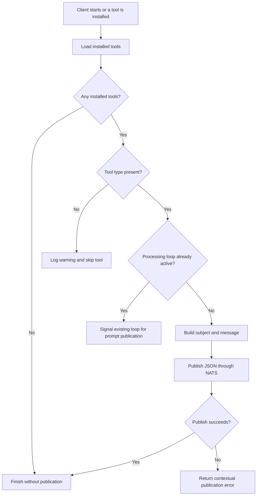
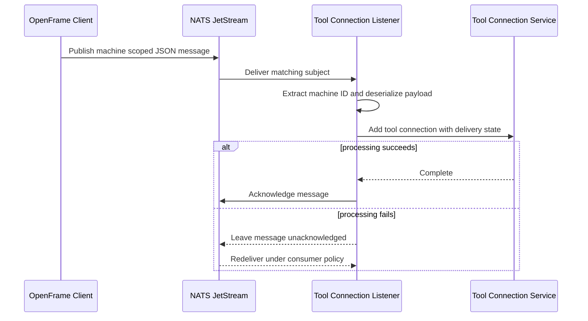

# Model Tool Connection Message

Model Tool Connection Message is the small wire-contract module that reports an OpenFrame client tool's identity to the server. It belongs to the Rust `openframe_agent_lib` library, supplied by OpenFrame OSS Library version `v0.0.5` and run by this repository's OpenFrame client deployment. The contract is intentionally limited to the identifiers needed to associate a device-local tool with its server-side tool-agent record.

The source definition is maintained in [OpenFrame OSS Library](https://github.com/flamingo-stack/openframe-oss-lib/blob/7a766f00e4f58b5d89db007b878ac8d6e0c344f4/clients/openframe-client/src/models/tool_connection_message.rs).

## Purpose and Contract

`ToolConnectionMessage` is a Rust struct with Serde serialization and deserialization enabled. Its `camelCase` serialization policy produces this JSON contract:

```json
{
  "toolType": "string",
  "agentToolId": "string"
}
```

| Rust field | Wire field | Meaning |
|---|---|---|
| `tool_type` | `toolType` | The tool's type. The client-side connection processing manager skips publication when this value is empty because the backend rejects empty tool types. |
| `agent_tool_id` | `agentToolId` | The identifier assigned to the tool agent, used by the server to associate the tool connection with the originating machine. |

The machine identifier is deliberately not embedded in the payload. It is carried by the NATS subject, which keeps the message body scoped to tool information while allowing the receiving service to derive the machine from routing metadata.

## Architecture

The message sits between the device-resident OpenFrame client and the server-side client-core listener. The publisher creates a machine-specific subject, serializes the message through the generic NATS publisher, and sends it to JetStream. The server listener extracts the machine identifier from the subject, deserializes the same contract, and delegates persistence or reconciliation to its tool-connection service.



## Publishing Side

The OpenFrame client library's `ToolConnectionProcessingManager` owns the discovery and repeat-publication behavior:

1. At startup, it loads installed tools through `InstalledToolsService`.
2. It ignores tools whose tool type is empty.
3. It ensures only one connection-processing loop per local tool is active.
4. For each eligible tool, it resolves the connection and invokes `ToolConnectionMessagePublisher` with the machine ID, agent tool ID, and tool type.
5. It re-resolves and republishes on each client start. This handles server-side tool-agent ID changes, such as re-keying or loss of server state.
6. When a newly installed tool is already being processed, it signals the existing loop for immediate publication rather than starting a duplicate loop.

The publisher builds the subject from the machine ID and constructs the payload from the agent tool ID and tool type. It forwards the payload through `NatsMessagePublisher`. A publication error is returned with context that names the target topic. The current publisher code notes that acknowledgement waiting and retry after a failed acknowledgement are not yet implemented at this layer.



## Receiving Side and Delivery Semantics

The Java `ToolConnectionListener`, supplied by the OpenFrame OSS Library `openframe-client-core` Maven artifact, consumes the `TOOL_CONNECTIONS` JetStream stream. It subscribes to the `machine.*.tool-connection` subject pattern using the `tool-connection-processor-v2` durable consumer and the `tool-connection` delivery group. Messages are delivered locally through `machine.tool-connection.delivery`.

For every delivery, the listener:

1. Reads the UTF-8 message body and its NATS subject.
2. Extracts the machine ID from the subject.
3. Uses Jackson to deserialize the body as `ToolConnectionMessage`.
4. Reads `toolType` and `agentToolId` from the parsed contract.
5. Determines whether the current delivery is the last permitted attempt.
6. Calls `ToolConnectionService.addToolConnection` with the machine ID, tool type, agent tool ID, and last-attempt indicator.
7. Acknowledges only after the service call completes successfully.

An exception during extraction, decoding, or processing leaves the message unacknowledged. JetStream can therefore redeliver it according to the consumer's configuration. The server implementation is maintained in the OpenFrame OSS Library; it is the consumer counterpart of this module's message model.



## Relationship to Adjacent Models and Services

The message is a transport DTO, not the client-side persistence record. The nearby `ToolConnection` model contains `tool_agent_id`, `agent_tool_id`, and a `published` flag; it represents local tracking state. `ToolConnectionMessage` exposes only the two values that cross the broker boundary. The machine ID is retained as subject metadata rather than duplicated in either model's payload.

The message model also has no behavior beyond Serde-derived JSON conversion. Validation and lifecycle decisions occur in the processing manager and server-side service. This separation keeps the cross-language contract stable while allowing both the device client and backend to evolve their persistence and retry logic independently.

## Integration Considerations

- **Field names are compatibility-critical.** The `camelCase` Serde annotation must remain aligned with the Java listener's `getToolType()` and `getAgentToolId()` accessors.
- **Both identifiers are strings.** Consumers should not impose a numeric interpretation or normalize values unless the authoritative tool-agent service requires it.
- **Subject and payload form one logical record.** A consumer cannot reconstruct a complete connection from the JSON alone because it also needs the machine ID extracted from the NATS subject.
- **Do not publish a blank tool type.** The client processing manager treats this as invalid for backend processing and skips the message.
- **Consumers should preserve acknowledgement ordering.** A message is acknowledged only after server-side handling succeeds, providing at-least-once delivery behavior at the listener boundary. Server-side processing should therefore tolerate redelivery.

## Source and Runtime Ownership

This repository publishes and deploys the OpenFrame client as part of the tenant platform, while the implementation documented here is supplied by OpenFrame OSS Library. The Rust message type is in the `openframe_agent_lib` crate, and the Java consumer is in `com.openframe.oss:openframe-client-core`. The client configuration for this repository connects its service to NATS at the tenant datasource endpoint, enabling the broker leg shown in the diagrams.
